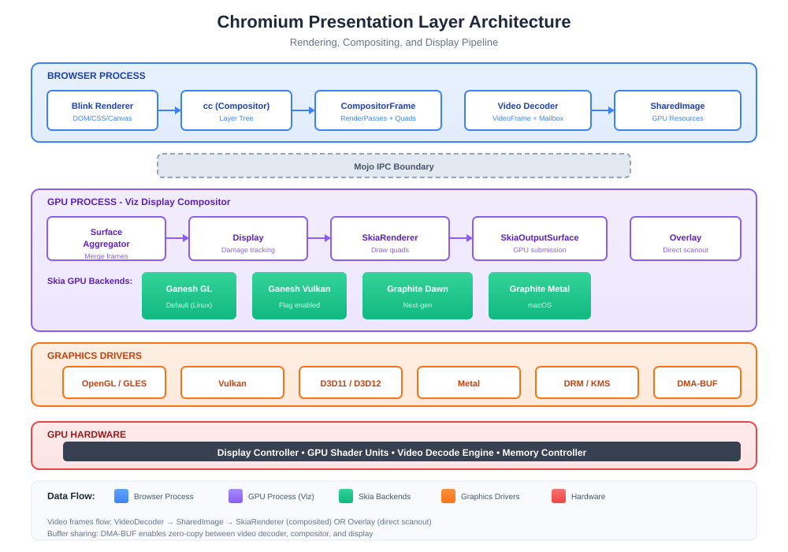

<!--
SPDX-FileCopyrightText: Copyright (c) 2026 NVIDIA CORPORATION & AFFILIATES. All rights reserved.
SPDX-FileCopyrightText: 2026 The Khronos Group, Inc.
SPDX-License-Identifier: Apache-2.0

Licensed under the Apache License, Version 2.0 (the "License");
you may not use this file except in compliance with the License.
You may obtain a copy of the License at

http://www.apache.org/licenses/LICENSE-2.0

Unless required by applicable law or agreed to in writing, software
distributed under the License is distributed on an "AS IS" BASIS,
WITHOUT WARRANTIES OR CONDITIONS OF ANY KIND, either express or implied.
See the License for the specific language governing permissions and
limitations under the License.
-->
# Chromium Presentation Layer Architecture

<!-- DOC-STATUS -->
> **Status: CURRENT.** How Chromium presents frames; background for the input tiers.
> Index: [`README.md`](README.md).


## Rendering, Compositing, and Display

This document provides an in-depth analysis of Chromium's presentation layer, focusing on how content is rendered, composited, and displayed on screen. Understanding this architecture is critical for Vulkan Video integration to ensure efficient zero-copy frame presentation.

---

## Table of Contents

1. [Overview](#1-overview)
2. [Graphics Backend Options](#2-graphics-backend-options)
3. [Skia: The Core Rendering Engine](#3-skia-the-core-rendering-engine)
4. [Display Compositor (Viz)](#4-display-compositor-viz)
5. [Rendering Pipeline](#5-rendering-pipeline)
6. [Platform-Specific Backends](#6-platform-specific-backends)
7. [Video Frame Integration](#7-video-frame-integration)
8. [Overlay System](#8-overlay-system)
9. [Synchronization](#9-synchronization)
10. [Vulkan Video Integration Considerations](#10-vulkan-video-integration-considerations)
11. [References](#11-references)

---

## 1. Overview



Chromium's presentation layer is responsible for:
- **Rendering**: Converting web content (DOM, CSS, Canvas, WebGL) into pixels
- **Compositing**: Combining multiple rendered layers into a final frame
- **Display**: Presenting the composited frame to the screen

The architecture is designed to be:
- Cross-platform (Windows, macOS, Linux, Android, ChromeOS)
- GPU-accelerated when possible
- Efficient with video content (zero-copy paths)
- Secure (works with protected content/DRM)

### High-Level Architecture

```
┌─────────────────────────────────────────────────────────────────────────┐
│                           Browser Process                                │
│  ┌────────────────┐  ┌────────────────┐  ┌────────────────────────────┐ │
│  │  Blink/WebKit  │  │   cc (Compositor│  │      Frame Submission      │ │
│  │   Renderer     │→ │     Client)     │→ │    (CompositorFrame)       │ │
│  └────────────────┘  └────────────────┘  └────────────────────────────┘ │
└─────────────────────────────────────────────────────────────────────────┘
                                    │ Mojo IPC
                                    ▼
┌─────────────────────────────────────────────────────────────────────────┐
│                             GPU Process                                  │
│  ┌────────────────────────────────────────────────────────────────────┐ │
│  │                    Viz (Display Compositor)                         │ │
│  │  ┌──────────────┐  ┌──────────────┐  ┌──────────────────────────┐  │ │
│  │  │   Surface    │  │   Display    │  │     SkiaRenderer         │  │ │
│  │  │  Aggregator  │→ │   (Damage)   │→ │  (SkiaOutputSurface)     │  │ │
│  │  └──────────────┘  └──────────────┘  └──────────────────────────┘  │ │
│  └────────────────────────────────────────────────────────────────────┘ │
│                                    │                                     │
│                    ┌───────────────┼───────────────┐                    │
│                    ▼               ▼               ▼                    │
│            ┌────────────┐  ┌────────────┐  ┌────────────┐              │
│            │   Ganesh   │  │   Ganesh   │  │  Graphite  │              │
│            │    (GL)    │  │  (Vulkan)  │  │   (Dawn)   │              │
│            └────────────┘  └────────────┘  └────────────┘              │
└─────────────────────────────────────────────────────────────────────────┘
                                    │
                                    ▼
┌─────────────────────────────────────────────────────────────────────────┐
│                          Graphics Drivers                                │
│     OpenGL/GLES          Vulkan            D3D11/D3D12         Metal    │
└─────────────────────────────────────────────────────────────────────────┘
```

---

## 2. Graphics Backend Options

Chromium supports multiple graphics backends, configurable at runtime:

### GrContextType Enumeration

```cpp
// From gpu/config/gpu_preferences.h
enum class GrContextType : uint32_t {
  kNone,           // No GPU acceleration
  kGL,             // Ganesh with OpenGL/GLES
  kVulkan,         // Ganesh with Vulkan
  kGraphiteDawn,   // Graphite with Dawn (WebGPU backend)
  kGraphiteMetal,  // Graphite with Metal (macOS/iOS)
};
```

### GPU Mode

```cpp
// From gpu/config/gpu_mode.h
enum class GpuMode {
  UNKNOWN,
  HARDWARE_GL,       // Hardware acceleration using only GL
  HARDWARE_VULKAN,   // Hardware acceleration using Vulkan and GL
  HARDWARE_GRAPHITE, // Hardware acceleration using Graphite-Dawn
  SOFTWARE_GL,       // Software WebGL (SwiftShader)
  DISPLAY_COMPOSITOR,// GPU process for display compositor only
};
```

### Skia Backend Types (for UMA)

```cpp
// Recorded for telemetry
enum class SkiaBackendType {
  kNone,
  kUnknown,
  kGaneshGL,           // Skia Ganesh with OpenGL
  kGaneshVulkan,       // Skia Ganesh with Vulkan
  kGraphiteDawnVulkan, // Skia Graphite with Dawn+Vulkan
  kGraphiteDawnD3D11,  // Skia Graphite with Dawn+D3D11
  kGraphiteDawnD3D12,  // Skia Graphite with Dawn+D3D12
  kGraphiteDawnMetal,  // Skia Graphite with Dawn+Metal
};
```

---

## 3. Skia: The Core Rendering Engine

[Skia](https://skia.org/) is Google's 2D graphics library used by Chrome, Android, Flutter, and many other projects.

### Skia GPU Backends

#### Ganesh (Current)
- Mature, production-ready GPU backend
- Supports OpenGL, OpenGL ES, Vulkan, Metal, D3D
- Used in current Chrome releases

#### Graphite (Next-generation)
- New GPU backend designed for modern APIs
- Better support for compute shaders
- Uses Dawn as abstraction layer for Vulkan/D3D12/Metal
- Currently being rolled out

### Skia in Chrome Architecture

```
┌─────────────────────────────────────────────────────────────┐
│                        SkiaRenderer                          │
│  ┌─────────────────────────────────────────────────────────┐│
│  │                    SkCanvas API                          ││
│  │   drawRect(), drawImage(), drawTextBlob(), clipPath()   ││
│  └─────────────────────────────────────────────────────────┘│
│                            │                                 │
│              ┌─────────────┴─────────────┐                  │
│              ▼                           ▼                  │
│  ┌─────────────────────┐     ┌─────────────────────┐       │
│  │   GrDirectContext   │     │  skgpu::graphite::  │       │
│  │      (Ganesh)       │     │      Recorder       │       │
│  │                     │     │     (Graphite)      │       │
│  └─────────────────────┘     └─────────────────────┘       │
│              │                           │                  │
│              ▼                           ▼                  │
│  ┌─────────────────────┐     ┌─────────────────────┐       │
│  │  GrGLGpu / GrVkGpu  │     │   Dawn WebGPU API   │       │
│  │  GrMtlGpu / GrD3DGpu│     │                     │       │
│  └─────────────────────┘     └─────────────────────┘       │
└─────────────────────────────────────────────────────────────┘
```

---

## 4. Display Compositor (Viz)

The **Viz** (Visual) service is Chrome's display compositor, running in the GPU process.

### Key Components

| Component | File Location | Purpose |
|-----------|---------------|---------|
| `Display` | `components/viz/service/display/display.cc` | Manages the display pipeline |
| `SkiaRenderer` | `components/viz/service/display/skia_renderer.cc` | Renders using Skia |
| `SkiaOutputSurface` | `components/viz/service/display_embedder/skia_output_surface_impl.cc` | GPU output surface |
| `SurfaceAggregator` | `components/viz/service/display/surface_aggregator.cc` | Aggregates compositor frames |
| `OverlayProcessor` | `components/viz/service/display/overlay_processor_*.cc` | Hardware overlay support |

### Display Initialization

```cpp
// From components/viz/service/display/display.cc
void Display::InitializeRenderer() {
  if (skia_output_surface_) {
    // GPU-accelerated path using Skia
    auto resource_provider = std::make_unique<DisplayResourceProviderSkia>();
    renderer_ = std::make_unique<SkiaRenderer>(
        &settings_, debug_settings_, output_surface_.get(),
        resource_provider.get(), overlay_processor_.get(),
        skia_output_surface_);
    resource_provider_ = std::move(resource_provider);
  } else if (output_surface_->capabilities().skips_draw) {
    // Null renderer for headless/testing
    renderer_ = std::make_unique<NullRenderer>(...);
  } else {
    // Software fallback
    renderer_ = std::make_unique<SoftwareRenderer>(...);
  }
}
```

### Compositor Frame Flow

```
┌──────────────┐     ┌──────────────┐     ┌──────────────┐
│   Renderer   │     │    Browser   │     │     Viz      │
│   Process    │     │   Process    │     │ (GPU Process)│
└──────┬───────┘     └──────┬───────┘     └──────┬───────┘
       │                    │                    │
       │ CompositorFrame    │                    │
       │───────────────────>│                    │
       │                    │ SubmitCompositor   │
       │                    │ Frame              │
       │                    │───────────────────>│
       │                    │                    │ Aggregate
       │                    │                    │ Surfaces
       │                    │                    │    │
       │                    │                    │    ▼
       │                    │                    │ Draw Frame
       │                    │                    │    │
       │                    │                    │    ▼
       │                    │                    │ Swap Buffers
       │                    │                    │    │
       │                    │  Presentation      │    │
       │                    │  Feedback          │<───┘
       │                    │<───────────────────│
```

---

## 5. Rendering Pipeline

### Frame Rendering Stages

1. **Aggregation**: Combine surfaces from multiple sources (main content, iframes, video)
2. **Occlusion Culling**: Remove hidden/occluded quads
3. **Draw**: Render visible quads using SkiaRenderer
4. **Overlay Processing**: Identify candidates for hardware overlays
5. **Swap**: Present the frame to the display

### SkiaRenderer Draw Frame

```cpp
// From components/viz/service/display/skia_renderer.cc
void SkiaRenderer::DrawFrame(
    const RenderPassList* render_passes_in_draw_order,
    float device_scale_factor,
    const gfx::Size& device_viewport_size,
    const gfx::DisplayColorSpaces& display_color_spaces,
    SurfaceDamageRectList surface_damage_rect_list) {
  
  // For each render pass
  for (const auto& pass : *render_passes_in_draw_order) {
    // Begin Skia recording
    auto canvas = BeginPaintRenderPass(pass);
    
    // Draw each quad in the pass
    for (const auto* quad : pass->quad_list) {
      DrawQuad(quad, canvas);
    }
    
    // End recording and submit to GPU
    EndPaintRenderPass(pass);
  }
  
  // Submit all recorded work to GPU
  FlushOutputSurface();
}
```

---

## 6. Platform-Specific Backends

### Linux Desktop

| Component | Default | Vulkan Alternative |
|-----------|---------|-------------------|
| GL Implementation | EGL/GLES (Mesa) | N/A |
| Skia Backend | Ganesh GL | Ganesh Vulkan (flag) |
| Display Server | X11 or Wayland | Same |
| Buffer Sharing | DMA-BUF | DMA-BUF |

**To enable Vulkan on Linux:**
```bash
chrome --enable-features=Vulkan --use-vulkan=native
```

### ChromeOS

| Component | Default | Notes |
|-----------|---------|-------|
| GL Implementation | EGL/GLES | Direct rendering |
| Skia Backend | Ganesh GL | Vulkan testing in progress |
| Display | DRM/KMS | Direct scanout support |
| Buffer Sharing | GBM + DMA-BUF | Zero-copy overlays |

### Windows

| Component | Default | Notes |
|-----------|---------|-------|
| GL Implementation | ANGLE (D3D11) | D3D to GL translation |
| Skia Backend | Ganesh GL | Via ANGLE |
| Alternative | Graphite Dawn D3D12 | Next-gen path |

### macOS

| Component | Default | Notes |
|-----------|---------|-------|
| Skia Backend | Graphite Metal | Modern path |
| Alternative | Ganesh GL | Via ANGLE |

### Android

| Component | Default | Notes |
|-----------|---------|-------|
| GL Implementation | EGL/GLES | Native Android |
| Skia Backend | Ganesh GL | Default |
| WebView Vulkan | Optional | `--webview-draw-functor-uses-vulkan` |

---

## 7. Video Frame Integration

### Video Frame to Display Path

```
┌─────────────────────────────────────────────────────────────────┐
│                    Video Decoder                                 │
│  ┌─────────────────────────────────────────────────────────────┐│
│  │  Decoded Frame (GPU Memory)                                  ││
│  │  - VA-API: VASurface → DMA-BUF                              ││
│  │  - Vulkan Video: VkImage → DMA-BUF (via external memory)    ││
│  │  - V4L2: DMA-BUF directly                                   ││
│  └─────────────────────────────────────────────────────────────┘│
└─────────────────────────────────────────────────────────────────┘
                              │
                              ▼
┌─────────────────────────────────────────────────────────────────┐
│                    SharedImage System                            │
│  ┌─────────────────────────────────────────────────────────────┐│
│  │  SharedImageBacking (DMA-BUF backed)                        ││
│  │  - Can be accessed as GL texture (EGLImage)                 ││
│  │  - Can be accessed as Vulkan VkImage                        ││
│  │  - Can be scanned out directly as overlay                   ││
│  └─────────────────────────────────────────────────────────────┘│
└─────────────────────────────────────────────────────────────────┘
                              │
              ┌───────────────┴───────────────┐
              ▼                               ▼
┌──────────────────────────┐    ┌──────────────────────────┐
│     Composited Path      │    │     Overlay Path         │
│  ┌────────────────────┐  │    │  ┌────────────────────┐  │
│  │ Import as GL/Vk    │  │    │  │ Direct Scanout     │  │
│  │ texture, draw to   │  │    │  │ via DRM plane      │  │
│  │ compositor surface │  │    │  │ (zero GPU copy)    │  │
│  └────────────────────┘  │    │  └────────────────────┘  │
└──────────────────────────┘    └──────────────────────────┘
```

### SharedImage for Video Frames

```cpp
// DMA-BUF backed SharedImage creation
// From gpu/command_buffer/service/shared_image/

class SharedImageBackingOzone : public SharedImageBacking {
  // Backed by gfx::NativePixmapDmaBuf
  // Can create:
  // - GLTextureImageRepresentation (for GL compositing)
  // - VulkanImageRepresentation (for Vulkan compositing)  
  // - OverlayImageRepresentation (for direct scanout)
};
```

---

## 8. Overlay System

Hardware overlays allow video frames to be displayed without GPU composition, saving power and reducing latency.

### Overlay Processor

```cpp
// From components/viz/service/display/overlay_processor_ozone.cc
class OverlayProcessorOzone : public OverlayProcessorUsingStrategy {
  // Determines if quads can be promoted to overlays
  // Checks:
  // - Buffer format compatibility
  // - Transform support
  // - Blend mode support
  // - Display controller capabilities
};
```

### Overlay Candidate Requirements

For a video frame to qualify as an overlay:

1. **Format**: Must be supported by display hardware (NV12, P010, etc.)
2. **Transform**: Rotation/scaling must be hardware-supported
3. **Blend**: Usually opaque or simple alpha
4. **Position**: Within display bounds
5. **Buffer**: Must be scanout-capable (DMA-BUF with proper modifiers)

### DRM/KMS Integration (Linux/ChromeOS)

```
┌─────────────────────────────────────────────────────────────────┐
│                     DRM Display Controller                       │
│  ┌─────────────────────────────────────────────────────────────┐│
│  │  Primary Plane (CRTC)                                       ││
│  │  - Browser UI + composited content                          ││
│  └─────────────────────────────────────────────────────────────┘│
│  ┌─────────────────────────────────────────────────────────────┐│
│  │  Overlay Plane 1                                            ││
│  │  - Video frame (direct scanout, zero-copy)                  ││
│  └─────────────────────────────────────────────────────────────┘│
│  ┌─────────────────────────────────────────────────────────────┐│
│  │  Overlay Plane 2                                            ││
│  │  - Additional content (picture-in-picture, etc.)            ││
│  └─────────────────────────────────────────────────────────────┘│
│  ┌─────────────────────────────────────────────────────────────┐│
│  │  Cursor Plane                                               ││
│  │  - Hardware cursor                                          ││
│  └─────────────────────────────────────────────────────────────┘│
└─────────────────────────────────────────────────────────────────┘
```

---

## 9. Synchronization

### Buffer Synchronization Mechanisms

#### Implicit Sync (DMA-BUF default on Linux)

```cpp
// Kernel handles sync automatically via dma_fence
// - Producer signals fence when write complete
// - Consumer waits on fence before read
// Works across VA-API, OpenGL, Vulkan, display
```

#### Explicit Sync (Modern path)

```cpp
// VkSemaphore for Vulkan-to-Vulkan
// sync_file (Linux) for cross-API
// DMA-BUF sync_file import/export

// Vulkan external semaphore
VkImportSemaphoreFdInfoKHR import_info = {
  .sType = VK_STRUCTURE_TYPE_IMPORT_SEMAPHORE_FD_INFO_KHR,
  .semaphore = semaphore,
  .handleType = VK_EXTERNAL_SEMAPHORE_HANDLE_TYPE_SYNC_FD_BIT,
  .fd = sync_fd,
};
```

### Frame Timing

```
Timeline:
────────────────────────────────────────────────────────────────────►
     │              │              │              │
     ▼              ▼              ▼              ▼
  VSync 0       VSync 1       VSync 2       VSync 3
     │              │              │              │
     ├── Draw ─────►├── Present ──►│              │
     │   Frame N    │   Frame N    │              │
     │              │              │              │
     │              ├── Draw ─────►├── Present ──►│
     │              │   Frame N+1  │   Frame N+1  │
```

---

## 10. Vulkan Video Integration Considerations

### Current State: OpenGL Compositor

When the compositor uses OpenGL (current default on Linux):

```
Vulkan Video Decoder          OpenGL Compositor
       │                             │
       ▼                             │
  VkImage (decoded)                  │
       │                             │
       ▼                             │
  Export as DMA-BUF                  │
       │                             │
       └─────── DMA-BUF ────────────►│
                                     ▼
                              EGLImage import
                                     │
                                     ▼
                              GL texture
                                     │
                                     ▼
                              Draw to screen
```

### Future State: Vulkan Compositor

When the compositor uses Vulkan (via `--enable-features=Vulkan`):

```
Vulkan Video Decoder          Vulkan Compositor
       │                             │
       ▼                             │
  VkImage (decoded)                  │
       │                             │
       ▼                             │
  Export as DMA-BUF                  │
       │                             │
       └─────── DMA-BUF ────────────►│
                                     ▼
                              VkImage import
                              (VK_EXT_external_memory_dma_buf)
                                     │
                                     ▼
                              Skia draws with VkImage
                                     │
                                     ▼
                              Present to screen
```

### Optimal Path: Direct Overlay

For best performance (lowest power, lowest latency):

```
Vulkan Video Decoder          DRM Display Controller
       │                             │
       ▼                             │
  VkImage (decoded)                  │
       │                             │
       ▼                             │
  Export as DMA-BUF                  │
       │                             │
       └─────── DMA-BUF ────────────►│
                                     ▼
                              Direct scanout
                              (overlay plane)
                                     │
                                     ▼
                              Display hardware
```

### Recommendations for Vulkan Video Integration

1. **Use DMA-BUF Export**
   - All decoded frames should be exportable as DMA-BUF
   - Use `VK_EXT_external_memory_dma_buf` extension
   - Ensure correct DRM format modifiers

2. **Support Overlay Promotion**
   - Allocate buffers with scanout capability
   - Use hardware-friendly formats (NV12, P010)
   - Respect display controller limitations

3. **Handle Compositor Backend Dynamically**
   - Detect if compositor uses GL or Vulkan
   - Optimize sync primitives accordingly
   - Use `sync_file` for cross-API synchronization

4. **Protected Content Path**
   - Use `VK_EXT_protected_content` for DRM
   - Ensure HDCP-capable display output
   - Keep decrypted content in protected memory

---

## 11. References

### Chromium Source Locations

| Component | Path |
|-----------|------|
| GPU Config | `gpu/config/` |
| GPU Init | `gpu/ipc/service/gpu_init.cc` |
| Viz Display | `components/viz/service/display/` |
| Skia Renderer | `components/viz/service/display/skia_renderer.cc` |
| Skia Output Surface | `components/viz/service/display_embedder/skia_output_surface_impl.cc` |
| Overlay Processing | `components/viz/service/display/overlay_processor_*.cc` |
| SharedImage | `gpu/command_buffer/service/shared_image/` |
| Vulkan Init | `gpu/vulkan/` |

### External Documentation

- [Skia GPU Architecture](https://skia.org/docs/dev/design/gpu/)
- [Chromium Graphics Overview](https://chromium.googlesource.com/chromium/src/+/main/docs/gpu/gpu_architecture.md)
- [Viz Service Overview](https://chromium.googlesource.com/chromium/src/+/main/components/viz/README.md)
- [DMA-BUF Documentation](https://www.kernel.org/doc/html/latest/driver-api/dma-buf.html)
- [DRM/KMS Overview](https://www.kernel.org/doc/html/latest/gpu/drm-kms.html)
- [Vulkan External Memory](https://registry.khronos.org/vulkan/specs/1.3-extensions/man/html/VK_KHR_external_memory.html)

### Chrome Flags for Testing

```bash
# Enable Vulkan backend
--enable-features=Vulkan
--use-vulkan=native

# Enable Graphite (next-gen Skia)
--enable-features=SkiaGraphite

# Debug overlays
--enable-features=UseOzonePlatform
--show-overdraw-feedback

# Video overlay debugging
--enable-hardware-overlays=single-fullscreen,single-on-top,underlay
```

---

*Document Version: 1.0*
*Last Updated: December 2024*
*Based on Chromium source analysis*

