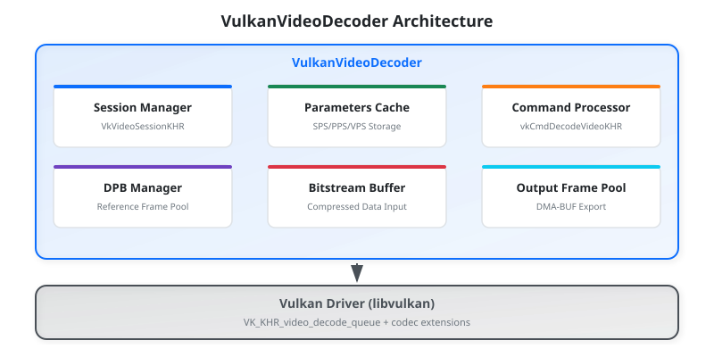
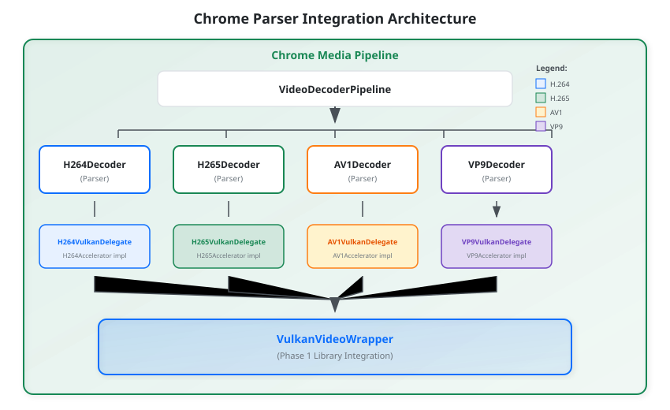
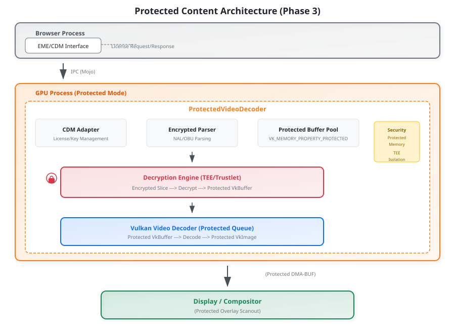
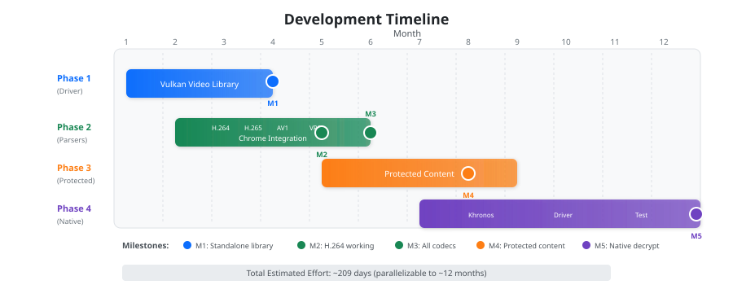

# Vulkan Video Decode Integration Development Plan

## Executive Summary

This document outlines the development plan for integrating Vulkan Video decode capabilities into Chromium. The plan is structured into four parallel/sequential work streams that can be developed with some degree of parallelism.

**Target Codecs:** H.264/AVC, H.265/HEVC, VP9, AV1

**Key Dependencies:**
- Vulkan 1.3+ with Video Extensions
- VK_KHR_video_queue
- VK_KHR_video_decode_queue
- VK_KHR_video_decode_h264/h265
- VK_KHR_video_decode_av1
- VK_KHR_video_maintenance1
- VK_EXT_video_decode_vp9 (provisional)

---

## Phase 1: Vulkan Video Driver Layer (NVPRO-based)

### 1.1 Objectives

Develop a standalone Vulkan Video decode library based on NVIDIA's NVPRO sample, providing:
- Video session management
- Parameter buffer handling
- Decode command buffer construction
- DMA-BUF FD export for zero-copy output

### 1.2 Architecture Overview



### 1.3 Component Details

#### 1.3.1 Session Manager

**File:** `vulkan_video_session.h/cc`

```cpp
// Core session management class
class VulkanVideoSession {
public:
    struct SessionConfig {
        VkVideoCodecOperationFlagBitsKHR codec_operation;
        VkFormat picture_format;           // VK_FORMAT_G8_B8R8_2PLANE_420_UNORM
        VkFormat dpb_format;               // Usually same as picture_format
        VkExtent2D max_coded_extent;       // Max resolution (4096x2160)
        uint32_t max_dpb_slots;            // 16-17 for H.264, 8 for others
        uint32_t max_active_reference_pictures;
        VkVideoChromaSubsamplingFlagsKHR chroma_subsampling;
        VkVideoComponentBitDepthFlagsKHR luma_bit_depth;
        VkVideoComponentBitDepthFlagsKHR chroma_bit_depth;
        const void* codec_profile;         // Codec-specific profile info
    };

    // Initialization
    static std::unique_ptr<VulkanVideoSession> Create(
        VkDevice device,
        VkPhysicalDevice physical_device,
        const SessionConfig& config);
    
    // Session lifecycle
    VkResult Initialize();
    void Destroy();
    
    // Accessors
    VkVideoSessionKHR GetHandle() const { return session_; }
    VkVideoSessionParametersKHR GetParameters() const { return session_params_; }
    
    // Memory requirements
    VkResult BindMemory(const std::vector<VkDeviceMemory>& memory);
    std::vector<VkMemoryRequirements2> GetMemoryRequirements() const;

private:
    VkDevice device_;
    VkVideoSessionKHR session_ = VK_NULL_HANDLE;
    VkVideoSessionParametersKHR session_params_ = VK_NULL_HANDLE;
    std::vector<VkDeviceMemory> session_memory_;
    SessionConfig config_;
};
```

**Implementation Tasks:**

| Task | Description | Effort |
|------|-------------|--------|
| 1.3.1.1 | Query video capabilities (vkGetPhysicalDeviceVideoCapabilitiesKHR) | 2d |
| 1.3.1.2 | Query format properties (vkGetPhysicalDeviceVideoFormatPropertiesKHR) | 2d |
| 1.3.1.3 | Create video session (vkCreateVideoSessionKHR) | 3d |
| 1.3.1.4 | Allocate and bind session memory | 2d |
| 1.3.1.5 | Create session parameters (codec-specific) | 4d |
| 1.3.1.6 | Session reset and parameter update | 2d |

#### 1.3.2 Parameters Cache

**File:** `vulkan_video_params.h/cc`

Manages codec-specific parameter sets (SPS, PPS, VPS) with efficient update tracking.

```cpp
// H.264 Parameters
struct H264ParameterSets {
    std::map<uint32_t, StdVideoH264SequenceParameterSet> sps_map;
    std::map<uint32_t, StdVideoH264PictureParameterSet> pps_map;
    
    // Vulkan structures (point to std structures above)
    std::vector<VkVideoDecodeH264SessionParametersAddInfoKHR> add_info;
};

// H.265 Parameters  
struct H265ParameterSets {
    std::map<uint32_t, StdVideoH265VideoParameterSet> vps_map;
    std::map<uint32_t, StdVideoH265SequenceParameterSet> sps_map;
    std::map<uint32_t, StdVideoH265PictureParameterSet> pps_map;
};

// AV1 Parameters
struct AV1ParameterSets {
    StdVideoAV1SequenceHeader sequence_header;
    // AV1 doesn't have traditional parameter sets like H.264/H.265
};

// VP9 Parameters (provisional extension)
struct VP9ParameterSets {
    // VP9 is frame-based, parameters per-frame
};

class VulkanVideoParametersCache {
public:
    // Update session parameters when new SPS/PPS arrive
    VkResult UpdateH264Parameters(
        VkDevice device,
        VkVideoSessionKHR session,
        const StdVideoH264SequenceParameterSet* sps,
        const StdVideoH264PictureParameterSet* pps);
    
    VkResult UpdateH265Parameters(
        VkDevice device,
        VkVideoSessionKHR session,
        const StdVideoH265VideoParameterSet* vps,
        const StdVideoH265SequenceParameterSet* sps,
        const StdVideoH265PictureParameterSet* pps);
    
    VkResult UpdateAV1Parameters(
        VkDevice device,
        VkVideoSessionKHR session,
        const StdVideoAV1SequenceHeader* seq_header);
    
    // Get current parameters handle
    VkVideoSessionParametersKHR GetCurrentParameters() const;
    
private:
    VkVideoSessionParametersKHR current_params_ = VK_NULL_HANDLE;
    std::variant<H264ParameterSets, H265ParameterSets, AV1ParameterSets, VP9ParameterSets> params_;
};
```

#### 1.3.3 DPB (Decoded Picture Buffer) Manager

**File:** `vulkan_dpb_manager.h/cc`

```cpp
struct DPBSlot {
    int32_t slot_index;                    // -1 if unused
    VkImage image;
    VkImageView image_view;
    VkDeviceMemory memory;
    int fd;                                // DMA-BUF FD for export
    
    // Reference frame state
    bool is_reference;
    int32_t picture_order_count;           // POC for H.264/H.265
    int32_t frame_num;                     // Frame number
    uint64_t timestamp;
    
    // Vulkan video structures
    VkVideoPictureResourceInfoKHR picture_resource;
    VkVideoReferenceSlotInfoKHR reference_slot;
};

class VulkanDPBManager {
public:
    static constexpr uint32_t kMaxDPBSlots = 17;  // H.264 Level 5.2 max
    
    struct Config {
        VkDevice device;
        VkPhysicalDevice physical_device;
        VkFormat format;
        VkExtent2D extent;
        uint32_t num_slots;
        bool enable_export;                // Enable DMA-BUF export
    };
    
    VkResult Initialize(const Config& config);
    void Destroy();
    
    // Slot management
    DPBSlot* AcquireSlot();
    void ReleaseSlot(int32_t slot_index);
    DPBSlot* GetSlot(int32_t slot_index);
    
    // Reference frame management
    void MarkAsReference(int32_t slot_index, int32_t poc);
    void MarkAsNonReference(int32_t slot_index);
    std::vector<VkVideoReferenceSlotInfoKHR> GetActiveReferences() const;
    
    // DMA-BUF export
    int ExportDmaBufFd(int32_t slot_index);
    
private:
    VkResult CreateDPBImages();
    VkResult AllocateExportableMemory(VkImage image, VkDeviceMemory* memory);
    
    Config config_;
    std::array<DPBSlot, kMaxDPBSlots> slots_;
    std::queue<int32_t> free_slots_;
};
```

#### 1.3.4 Bitstream Buffer Manager

**File:** `vulkan_bitstream_buffer.h/cc`

```cpp
class VulkanBitstreamBuffer {
public:
    struct Config {
        VkDevice device;
        VkPhysicalDevice physical_device;
        size_t size;                       // Typically 4MB for 4K
        bool enable_import;                // For protected content
    };
    
    VkResult Initialize(const Config& config);
    void Destroy();
    
    // Copy compressed data
    VkResult CopyBitstream(const uint8_t* data, size_t size, size_t offset = 0);
    
    // For protected content - import from external buffer
    VkResult ImportFromDmaBuf(int fd, size_t size);
    
    VkBuffer GetBuffer() const { return buffer_; }
    VkDeviceSize GetOffset() const { return current_offset_; }
    VkDeviceSize GetSize() const { return current_size_; }
    
private:
    VkDevice device_;
    VkBuffer buffer_ = VK_NULL_HANDLE;
    VkDeviceMemory memory_ = VK_NULL_HANDLE;
    void* mapped_ptr_ = nullptr;
    size_t buffer_size_ = 0;
    VkDeviceSize current_offset_ = 0;
    VkDeviceSize current_size_ = 0;
};
```

#### 1.3.5 Decode Command Processor

**File:** `vulkan_decode_command.h/cc`

```cpp
struct DecodeTask {
    // Input
    VkBuffer bitstream_buffer;
    VkDeviceSize bitstream_offset;
    VkDeviceSize bitstream_size;
    
    // Output
    DPBSlot* output_slot;
    
    // References
    std::vector<DPBSlot*> reference_slots;
    
    // Codec-specific decode info
    std::variant<
        VkVideoDecodeH264PictureInfoKHR,
        VkVideoDecodeH265PictureInfoKHR,
        VkVideoDecodeAV1PictureInfoKHR
    > picture_info;
};

class VulkanDecodeCommandProcessor {
public:
    struct Config {
        VkDevice device;
        uint32_t queue_family_index;       // Video decode queue family
        uint32_t command_buffer_count;     // Double/triple buffering
    };
    
    VkResult Initialize(const Config& config);
    void Destroy();
    
    // Submit decode operation
    VkResult BeginVideoCoding(VkVideoSessionKHR session);
    VkResult SubmitDecode(const DecodeTask& task);
    VkResult EndVideoCoding();
    
    // Synchronization
    VkResult WaitForDecode(uint64_t timeout_ns = UINT64_MAX);
    VkSemaphore GetCompletionSemaphore() const;
    VkFence GetCompletionFence() const;
    
private:
    VkResult CreateCommandPool();
    VkResult AllocateCommandBuffers();
    VkResult CreateSyncObjects();
    
    void RecordDecodeCommands(VkCommandBuffer cmd, const DecodeTask& task);
    
    VkDevice device_;
    uint32_t queue_family_index_;
    VkQueue video_queue_ = VK_NULL_HANDLE;
    VkCommandPool command_pool_ = VK_NULL_HANDLE;
    std::vector<VkCommandBuffer> command_buffers_;
    std::vector<VkFence> fences_;
    std::vector<VkSemaphore> semaphores_;
    uint32_t current_buffer_ = 0;
};
```

### 1.4 DMA-BUF Export Implementation

**Critical for Chromium integration - enables zero-copy frame sharing.**

```cpp
// vulkan_dmabuf_export.h

class VulkanDmaBufExporter {
public:
    struct ExportableImage {
        VkImage image;
        VkDeviceMemory memory;
        VkFormat format;
        VkExtent2D extent;
        
        // Exported handles
        int dmabuf_fd;
        uint32_t stride;
        uint32_t offset;
        uint64_t modifier;                 // DRM format modifier
    };
    
    // Create exportable image with external memory
    static VkResult CreateExportableImage(
        VkDevice device,
        VkPhysicalDevice physical_device,
        VkFormat format,
        VkExtent2D extent,
        VkImageUsageFlags usage,
        ExportableImage* out_image);
    
    // Export DMA-BUF file descriptor
    static VkResult ExportDmaBufFd(
        VkDevice device,
        VkDeviceMemory memory,
        int* out_fd);
    
    // Query DRM format modifier
    static VkResult GetDrmModifier(
        VkDevice device,
        VkImage image,
        uint64_t* out_modifier);
    
private:
    // Required extensions check
    static bool CheckExportExtensions(VkPhysicalDevice physical_device);
};

// Implementation details
VkResult VulkanDmaBufExporter::CreateExportableImage(
    VkDevice device,
    VkPhysicalDevice physical_device,
    VkFormat format,
    VkExtent2D extent,
    VkImageUsageFlags usage,
    ExportableImage* out_image)
{
    // 1. Create image with external memory
    VkExternalMemoryImageCreateInfo external_info = {
        .sType = VK_STRUCTURE_TYPE_EXTERNAL_MEMORY_IMAGE_CREATE_INFO,
        .handleTypes = VK_EXTERNAL_MEMORY_HANDLE_TYPE_DMA_BUF_BIT_EXT
    };
    
    VkImageCreateInfo image_info = {
        .sType = VK_STRUCTURE_TYPE_IMAGE_CREATE_INFO,
        .pNext = &external_info,
        .imageType = VK_IMAGE_TYPE_2D,
        .format = format,
        .extent = { extent.width, extent.height, 1 },
        .mipLevels = 1,
        .arrayLayers = 1,
        .samples = VK_SAMPLE_COUNT_1_BIT,
        .tiling = VK_IMAGE_TILING_DRM_FORMAT_MODIFIER_EXT,
        .usage = usage | VK_IMAGE_USAGE_VIDEO_DECODE_DST_BIT_KHR,
        .sharingMode = VK_SHARING_MODE_EXCLUSIVE,
    };
    
    VK_CHECK(vkCreateImage(device, &image_info, nullptr, &out_image->image));
    
    // 2. Allocate exportable memory
    VkMemoryRequirements mem_reqs;
    vkGetImageMemoryRequirements(device, out_image->image, &mem_reqs);
    
    VkExportMemoryAllocateInfo export_info = {
        .sType = VK_STRUCTURE_TYPE_EXPORT_MEMORY_ALLOCATE_INFO,
        .handleTypes = VK_EXTERNAL_MEMORY_HANDLE_TYPE_DMA_BUF_BIT_EXT
    };
    
    VkMemoryAllocateInfo alloc_info = {
        .sType = VK_STRUCTURE_TYPE_MEMORY_ALLOCATE_INFO,
        .pNext = &export_info,
        .allocationSize = mem_reqs.size,
        .memoryTypeIndex = FindMemoryType(physical_device, mem_reqs, 
            VK_MEMORY_PROPERTY_DEVICE_LOCAL_BIT)
    };
    
    VK_CHECK(vkAllocateMemory(device, &alloc_info, nullptr, &out_image->memory));
    VK_CHECK(vkBindImageMemory(device, out_image->image, out_image->memory, 0));
    
    // 3. Export FD
    VkMemoryGetFdInfoKHR fd_info = {
        .sType = VK_STRUCTURE_TYPE_MEMORY_GET_FD_INFO_KHR,
        .memory = out_image->memory,
        .handleType = VK_EXTERNAL_MEMORY_HANDLE_TYPE_DMA_BUF_BIT_EXT
    };
    
    VK_CHECK(vkGetMemoryFdKHR(device, &fd_info, &out_image->dmabuf_fd));
    
    return VK_SUCCESS;
}
```

### 1.5 Phase 1 Tasks and Timeline

| ID | Task | Dependencies | Effort | Owner |
|----|------|--------------|--------|-------|
| 1.1 | Project setup, build system, NVPRO integration | - | 3d | - |
| 1.2 | Vulkan instance/device creation with video extensions | 1.1 | 3d | - |
| 1.3 | Video capabilities query and validation | 1.2 | 2d | - |
| 1.4 | Session manager implementation | 1.3 | 5d | - |
| 1.5 | H.264 session parameters | 1.4 | 3d | - |
| 1.6 | H.265 session parameters | 1.4 | 3d | - |
| 1.7 | AV1 session parameters | 1.4 | 3d | - |
| 1.8 | VP9 session parameters (provisional) | 1.4 | 2d | - |
| 1.9 | DPB manager implementation | 1.4 | 5d | - |
| 1.10 | Bitstream buffer manager | 1.4 | 3d | - |
| 1.11 | Decode command processor | 1.9, 1.10 | 5d | - |
| 1.12 | DMA-BUF export implementation | 1.9 | 4d | - |
| 1.13 | Synchronization (fences, semaphores) | 1.11 | 3d | - |
| 1.14 | Unit tests for each component | All | 5d | - |
| 1.15 | Integration test with test vectors | 1.14 | 3d | - |

**Total Phase 1 Effort: ~50 days (can be parallelized)**

---

## Phase 2: Chrome Parser Integration

### 2.1 Objectives

Integrate Chromium's existing codec parsers with the Vulkan Video backend, implementing the `*Accelerator` interfaces for each codec.

### 2.2 Architecture



### 2.3 Accelerator Interface Implementations

#### 2.3.1 H.264 Accelerator

**File:** `media/gpu/vulkan/h264_vulkan_video_decoder_delegate.h/cc`

```cpp
// Following Chromium's naming: H264VaapiVideoDecoderDelegate -> H264VulkanVideoDecoderDelegate
class H264VulkanVideoDecoderDelegate : public H264Decoder::H264Accelerator,
                                        public VulkanVideoDecoderDelegate {
public:
    H264VulkanVideoDecoderDelegate(
        VulkanDecodeSurfaceHandler* vulkan_dec,
        scoped_refptr<VulkanVideoWrapper> vulkan_wrapper);
    ~H264VulkanVideoDecoderDelegate() override;

    // H264Accelerator interface
    scoped_refptr<H264Picture> CreateH264Picture() override;
    
    Status SubmitFrameMetadata(
        const H264SPS* sps,
        const H264PPS* pps,
        const H264DPB& dpb,
        const H264Picture::Vector& ref_pic_listp0,
        const H264Picture::Vector& ref_pic_listb0,
        const H264Picture::Vector& ref_pic_listb1,
        scoped_refptr<H264Picture> pic) override;
    
    Status SubmitSlice(
        const H264PPS* pps,
        const H264SliceHeader* slice_hdr,
        const H264Picture::Vector& ref_pic_list0,
        const H264Picture::Vector& ref_pic_list1,
        scoped_refptr<H264Picture> pic,
        const uint8_t* data,
        size_t size,
        const std::vector<SubsampleEntry>& subsamples) override;
    
    Status SubmitDecode(scoped_refptr<H264Picture> pic) override;
    
    bool OutputPicture(scoped_refptr<H264Picture> pic) override;
    
    void Reset() override;

private:
    // Convert Chrome SPS to Vulkan StdVideoH264SequenceParameterSet
    void ConvertSPS(const H264SPS* sps, StdVideoH264SequenceParameterSet* vk_sps);
    
    // Convert Chrome PPS to Vulkan StdVideoH264PictureParameterSet  
    void ConvertPPS(const H264PPS* pps, StdVideoH264PictureParameterSet* vk_pps);
    
    // Build reference picture list for Vulkan
    void BuildReferencePictureList(
        const H264Picture::Vector& ref_pics,
        std::vector<VkVideoReferenceSlotInfoKHR>* vk_refs);
    
    // Convert slice header to Vulkan decode info
    void FillDecodeInfo(
        const H264SliceHeader* slice_hdr,
        const H264PPS* pps,
        VkVideoDecodeH264PictureInfoKHR* decode_info,
        StdVideoDecodeH264PictureInfo* std_info);

    VulkanVideoWrapper* vk_wrapper_;
    
    // Current frame state
    struct PendingFrame {
        scoped_refptr<H264Picture> picture;
        std::vector<uint8_t> bitstream_data;
        std::vector<uint32_t> slice_offsets;
        VkVideoDecodeH264PictureInfoKHR decode_info;
        StdVideoDecodeH264PictureInfo std_picture_info;
        std::vector<StdVideoDecodeH264ReferenceInfo> ref_info;
    };
    std::unique_ptr<PendingFrame> pending_frame_;
};
```

**Conversion Example - SPS:**

```cpp
void H264VulkanVideoDecoderDelegate::ConvertSPS(
    const H264SPS* sps,
    StdVideoH264SequenceParameterSet* vk_sps) 
{
    *vk_sps = {};
    
    // Profile/Level
    vk_sps->profile_idc = static_cast<StdVideoH264ProfileIdc>(sps->profile_idc);
    vk_sps->level_idc = static_cast<StdVideoH264LevelIdc>(sps->level_idc);
    vk_sps->seq_parameter_set_id = sps->seq_parameter_set_id;
    
    // Chroma format
    vk_sps->chroma_format_idc = 
        static_cast<StdVideoH264ChromaFormatIdc>(sps->chroma_format_idc);
    vk_sps->bit_depth_luma_minus8 = sps->bit_depth_luma_minus8;
    vk_sps->bit_depth_chroma_minus8 = sps->bit_depth_chroma_minus8;
    
    // Picture dimensions
    vk_sps->pic_width_in_mbs_minus1 = sps->pic_width_in_mbs_minus1;
    vk_sps->pic_height_in_map_units_minus1 = sps->pic_height_in_map_units_minus1;
    
    // DPB parameters
    vk_sps->max_num_ref_frames = sps->max_num_ref_frames;
    vk_sps->log2_max_frame_num_minus4 = sps->log2_max_frame_num_minus4;
    vk_sps->pic_order_cnt_type = sps->pic_order_cnt_type;
    vk_sps->log2_max_pic_order_cnt_lsb_minus4 = sps->log2_max_pic_order_cnt_lsb_minus4;
    
    // Flags
    vk_sps->flags.constraint_set0_flag = sps->constraint_set0_flag;
    vk_sps->flags.constraint_set1_flag = sps->constraint_set1_flag;
    vk_sps->flags.constraint_set2_flag = sps->constraint_set2_flag;
    vk_sps->flags.constraint_set3_flag = sps->constraint_set3_flag;
    vk_sps->flags.constraint_set4_flag = sps->constraint_set4_flag;
    vk_sps->flags.constraint_set5_flag = sps->constraint_set5_flag;
    vk_sps->flags.direct_8x8_inference_flag = sps->direct_8x8_inference_flag;
    vk_sps->flags.mb_adaptive_frame_field_flag = sps->mb_adaptive_frame_field_flag;
    vk_sps->flags.frame_mbs_only_flag = sps->frame_mbs_only_flag;
    vk_sps->flags.delta_pic_order_always_zero_flag = sps->delta_pic_order_always_zero_flag;
    vk_sps->flags.separate_colour_plane_flag = sps->separate_colour_plane_flag;
    vk_sps->flags.gaps_in_frame_num_value_allowed_flag = 
        sps->gaps_in_frame_num_value_allowed_flag;
    vk_sps->flags.qpprime_y_zero_transform_bypass_flag = 
        sps->qpprime_y_zero_transform_bypass_flag;
    vk_sps->flags.frame_cropping_flag = sps->frame_cropping_flag;
    vk_sps->flags.seq_scaling_matrix_present_flag = sps->seq_scaling_matrix_present_flag;
    vk_sps->flags.vui_parameters_present_flag = sps->vui_parameters_present_flag;
    
    // Scaling lists (if present)
    if (sps->seq_scaling_matrix_present_flag) {
        // Copy 4x4 and 8x8 scaling lists
        memcpy(vk_sps->pScalingLists->ScalingList4x4, 
               sps->scaling_list4x4, sizeof(sps->scaling_list4x4));
        memcpy(vk_sps->pScalingLists->ScalingList8x8,
               sps->scaling_list8x8, sizeof(sps->scaling_list8x8));
    }
}
```

#### 2.3.2 H.265 Accelerator

**File:** `media/gpu/vulkan/h265_vulkan_video_decoder_delegate.h/cc`

```cpp
class H265VulkanVideoDecoderDelegate : public H265Decoder::H265Accelerator,
                                        public VulkanVideoDecoderDelegate {
public:
    H265VulkanVideoDecoderDelegate(
        VulkanDecodeSurfaceHandler* vulkan_dec,
        scoped_refptr<VulkanVideoWrapper> vulkan_wrapper);
    ~H265VulkanVideoDecoderDelegate() override;

    // H265Accelerator interface
    scoped_refptr<H265Picture> CreateH265Picture() override;
    
    Status SubmitFrameMetadata(
        const H265SPS* sps,
        const H265PPS* pps,
        const H265SliceHeader* slice_hdr,
        const H265Picture::Vector& ref_pic_list,
        scoped_refptr<H265Picture> pic) override;
    
    Status SubmitSlice(
        const H265SPS* sps,
        const H265PPS* pps,
        const H265SliceHeader* slice_hdr,
        const H265Picture::Vector& ref_pic_list0,
        const H265Picture::Vector& ref_pic_list1,
        const H265Picture::Vector& ref_pic_set_lt_curr,
        const H265Picture::Vector& ref_pic_set_st_curr_after,
        const H265Picture::Vector& ref_pic_set_st_curr_before,
        scoped_refptr<H265Picture> pic,
        const uint8_t* data,
        size_t size,
        const std::vector<SubsampleEntry>& subsamples) override;
    
    Status SubmitDecode(scoped_refptr<H265Picture> pic) override;
    
    bool OutputPicture(scoped_refptr<H265Picture> pic) override;
    
    void Reset() override;

private:
    void ConvertVPS(const H265VPS* vps, StdVideoH265VideoParameterSet* vk_vps);
    void ConvertSPS(const H265SPS* sps, StdVideoH265SequenceParameterSet* vk_sps);
    void ConvertPPS(const H265PPS* pps, StdVideoH265PictureParameterSet* vk_pps);
    
    VulkanVideoWrapper* vk_wrapper_;
};
```

#### 2.3.3 AV1 Accelerator

**File:** `media/gpu/vulkan/av1_vulkan_video_decoder_delegate.h/cc`

```cpp
class AV1VulkanVideoDecoderDelegate : public AV1Decoder::AV1Accelerator,
                                       public VulkanVideoDecoderDelegate {
public:
    AV1VulkanVideoDecoderDelegate(
        VulkanDecodeSurfaceHandler* vulkan_dec,
        scoped_refptr<VulkanVideoWrapper> vulkan_wrapper);
    ~AV1VulkanVideoDecoderDelegate() override;

    // AV1Accelerator interface
    scoped_refptr<AV1Picture> CreateAV1Picture(bool apply_grain) override;
    
    Status SubmitDecode(
        const AV1Picture& pic,
        const libgav1::ObuSequenceHeader& sequence_header,
        const AV1ReferenceFrameVector& ref_frames,
        const libgav1::Vector<libgav1::TileBuffer>& tile_buffers,
        base::span<const uint8_t> data) override;
    
    bool OutputPicture(const AV1Picture& pic) override;

private:
    void ConvertSequenceHeader(
        const libgav1::ObuSequenceHeader& seq_header,
        StdVideoAV1SequenceHeader* vk_seq_header);
    
    void ConvertFrameHeader(
        const libgav1::ObuFrameHeader& frame_header,
        const AV1ReferenceFrameVector& ref_frames,
        StdVideoDecodeAV1PictureInfo* vk_picture_info);
    
    void SetupTileInfo(
        const libgav1::Vector<libgav1::TileBuffer>& tile_buffers,
        StdVideoAV1TileInfo* tile_info);

    VulkanVideoWrapper* vk_wrapper_;
};
```

#### 2.3.4 VP9 Accelerator

**File:** `media/gpu/vulkan/vp9_vulkan_video_decoder_delegate.h/cc`

```cpp
class VP9VulkanVideoDecoderDelegate : public VP9Decoder::VP9Accelerator,
                                       public VulkanVideoDecoderDelegate {
public:
    VP9VulkanVideoDecoderDelegate(
        VulkanDecodeSurfaceHandler* vulkan_dec,
        scoped_refptr<VulkanVideoWrapper> vulkan_wrapper);
    ~VP9VulkanVideoDecoderDelegate() override;

    // VP9Accelerator interface  
    scoped_refptr<VP9Picture> CreateVP9Picture() override;
    
    Status SubmitDecode(
        scoped_refptr<VP9Picture> pic,
        const Vp9SegmentationParams& seg,
        const Vp9LoopFilterParams& lf,
        const Vp9ReferenceFrameVector& reference_frames,
        base::OnceClosure done_cb) override;
    
    bool OutputPicture(scoped_refptr<VP9Picture> pic) override;
    
    bool GetFrameContext(scoped_refptr<VP9Picture> pic,
                         Vp9FrameContext* frame_ctx) override;
    
    bool IsFrameContextRequired() const override;

private:
    // VP9 uses provisional extension - may need custom handling
    void ConvertFrameHeader(
        const Vp9FrameHeader& header,
        const Vp9SegmentationParams& seg,
        const Vp9LoopFilterParams& lf,
        /* provisional VP9 structures */);

    VulkanVideoWrapper* vk_wrapper_;
};
```

### 2.4 VulkanVideoWrapper Integration Layer

**File:** `media/gpu/vulkan/vulkan_video_wrapper.h/cc`

```cpp
class VulkanVideoWrapper {
public:
    enum class Codec {
        kH264,
        kH265,
        kVP9,
        kAV1
    };
    
    static std::unique_ptr<VulkanVideoWrapper> Create();
    
    // Initialization
    bool Initialize(Codec codec, const gfx::Size& max_resolution);
    void Destroy();
    
    // Capabilities query
    bool IsCodecSupported(Codec codec) const;
    gfx::Size GetMaxResolution(Codec codec) const;
    std::vector<VideoPixelFormat> GetSupportedOutputFormats() const;
    
    // Session management
    bool CreateSession(Codec codec, const gfx::Size& resolution);
    void DestroySession();
    
    // Parameter updates (called when SPS/PPS change)
    bool UpdateH264Parameters(const StdVideoH264SequenceParameterSet* sps,
                              const StdVideoH264PictureParameterSet* pps);
    bool UpdateH265Parameters(const StdVideoH265VideoParameterSet* vps,
                              const StdVideoH265SequenceParameterSet* sps,
                              const StdVideoH265PictureParameterSet* pps);
    bool UpdateAV1Parameters(const StdVideoAV1SequenceHeader* seq_header);
    
    // Frame decode
    struct DecodeResult {
        bool success;
        scoped_refptr<VideoFrame> frame;
        int dpb_slot_index;
    };
    
    DecodeResult Decode(const uint8_t* bitstream_data,
                        size_t bitstream_size,
                        const void* codec_picture_info,
                        const std::vector<int>& reference_slot_indices);
    
    // Frame output (creates VideoFrame with DMA-BUF backing)
    scoped_refptr<VideoFrame> CreateOutputVideoFrame(int dpb_slot_index);
    
    // DPB management
    void ReleaseFrame(int dpb_slot_index);
    void MarkAsReference(int dpb_slot_index, int64_t timestamp);
    void ClearReferences();
    
private:
    // Phase 1 components
    std::unique_ptr<VulkanVideoSession> session_;
    std::unique_ptr<VulkanVideoParametersCache> params_cache_;
    std::unique_ptr<VulkanDPBManager> dpb_manager_;
    std::unique_ptr<VulkanBitstreamBuffer> bitstream_buffer_;
    std::unique_ptr<VulkanDecodeCommandProcessor> command_processor_;
    std::unique_ptr<VulkanDmaBufExporter> dmabuf_exporter_;
    
    Codec current_codec_;
    gfx::Size current_resolution_;
};
```

### 2.5 VideoFrame Creation with DMA-BUF

```cpp
scoped_refptr<VideoFrame> VulkanVideoWrapper::CreateOutputVideoFrame(
    int dpb_slot_index) 
{
    DPBSlot* slot = dpb_manager_->GetSlot(dpb_slot_index);
    if (!slot || slot->fd < 0)
        return nullptr;
    
    // Create NativePixmapDmaBuf
    gfx::NativePixmapHandle handle;
    handle.planes.push_back(gfx::NativePixmapPlane(
        slot->stride,
        slot->offset,
        slot->size,
        base::ScopedFD(dup(slot->fd))
    ));
    handle.modifier = slot->modifier;
    
    scoped_refptr<gfx::NativePixmapDmaBuf> pixmap =
        base::MakeRefCounted<gfx::NativePixmapDmaBuf>(
            current_resolution_,
            gfx::BufferFormat::YUV_420_BIPLANAR,
            std::move(handle));
    
    // Create VideoFrame backed by the pixmap
    scoped_refptr<VideoFrame> frame = VideoFrame::WrapExternalGpuMemoryBuffer(
        gfx::GpuMemoryBufferHandle::FromNativePixmap(pixmap),
        current_resolution_,
        gfx::Rect(current_resolution_),
        current_resolution_,
        base::TimeDelta(),  // timestamp set by caller
        base::BindOnce(&VulkanVideoWrapper::OnFrameReleased,
                       weak_ptr_factory_.GetWeakPtr(),
                       dpb_slot_index));
    
    return frame;
}
```

### 2.6 Phase 2 Tasks and Timeline

| ID | Task | Dependencies | Effort | Owner |
|----|------|--------------|--------|-------|
| 2.1 | VulkanVideoWrapper design and scaffolding | Phase 1 | 3d | - |
| 2.2 | H.264 Accelerator - SPS/PPS conversion | 2.1 | 4d | - |
| 2.3 | H.264 Accelerator - slice submission | 2.2 | 4d | - |
| 2.4 | H.264 Accelerator - DPB management | 2.3 | 3d | - |
| 2.5 | H.264 Accelerator - complete integration | 2.4 | 3d | - |
| 2.6 | H.265 Accelerator - VPS/SPS/PPS conversion | 2.1 | 4d | - |
| 2.7 | H.265 Accelerator - slice submission | 2.6 | 4d | - |
| 2.8 | H.265 Accelerator - complete integration | 2.7 | 3d | - |
| 2.9 | AV1 Accelerator - sequence header | 2.1 | 3d | - |
| 2.10 | AV1 Accelerator - tile-based decode | 2.9 | 5d | - |
| 2.11 | AV1 Accelerator - film grain (if applicable) | 2.10 | 2d | - |
| 2.12 | VP9 Accelerator - frame header conversion | 2.1 | 3d | - |
| 2.13 | VP9 Accelerator - complete integration | 2.12 | 3d | - |
| 2.14 | VideoFrame/DMA-BUF integration | 2.1 | 4d | - |
| 2.15 | DecoderSelector integration | 2.5, 2.8, 2.11, 2.13 | 2d | - |
| 2.16 | Unit tests for all accelerators | All | 5d | - |
| 2.17 | Conformance testing with test vectors | 2.16 | 5d | - |

**Total Phase 2 Effort: ~57 days (H.264/H.265/AV1/VP9 can be parallelized)**

---

## Phase 3: Protected Content (Protected Daemon)

### 3.1 Objectives

Implement protected content playback using a protected daemon process that:
- Handles Content Decryption Module (CDM) operations
- Decrypts content to protected Vulkan buffers
- Submits protected buffers to Vulkan Video decoder

### 3.2 Architecture



### 3.3 Protected Buffer Pool

```cpp
// protected_vulkan_buffer_pool.h

class ProtectedVulkanBufferPool {
public:
    struct ProtectedBuffer {
        VkBuffer buffer;
        VkDeviceMemory memory;  // VK_MEMORY_PROPERTY_PROTECTED_BIT
        size_t size;
        bool in_use;
    };
    
    struct ProtectedImage {
        VkImage image;
        VkImageView image_view;
        VkDeviceMemory memory;  // VK_MEMORY_PROPERTY_PROTECTED_BIT
        gfx::Size size;
        bool in_use;
    };
    
    VkResult Initialize(VkDevice device, 
                        VkPhysicalDevice physical_device,
                        uint32_t protected_queue_family);
    void Destroy();
    
    // Allocate protected bitstream buffer
    ProtectedBuffer* AllocateBitstreamBuffer(size_t size);
    void ReleaseBitstreamBuffer(ProtectedBuffer* buffer);
    
    // Allocate protected output image
    ProtectedImage* AllocateOutputImage(const gfx::Size& size, VkFormat format);
    void ReleaseOutputImage(ProtectedImage* image);
    
private:
    VkResult CreateProtectedBuffer(size_t size, ProtectedBuffer* out_buffer);
    VkResult CreateProtectedImage(const gfx::Size& size, VkFormat format,
                                  ProtectedImage* out_image);
    
    VkDevice device_;
    VkPhysicalDevice physical_device_;
    uint32_t protected_queue_family_;
    
    std::vector<ProtectedBuffer> bitstream_buffers_;
    std::vector<ProtectedImage> output_images_;
};
```

### 3.4 Protected Video Decoder

```cpp
// protected_vulkan_video_decoder.h

class ProtectedVulkanVideoDecoder {
public:
    struct Config {
        VulkanVideoWrapper::Codec codec;
        gfx::Size max_resolution;
        cdm::ContentDecryptionModule* cdm;  // CDM interface
    };
    
    static std::unique_ptr<ProtectedVulkanVideoDecoder> Create(const Config& config);
    
    bool Initialize();
    void Destroy();
    
    // Decode encrypted content
    struct DecodeRequest {
        scoped_refptr<DecoderBuffer> encrypted_buffer;
        DecryptConfig decrypt_config;  // IV, key ID, subsamples
    };
    
    using DecodeCallback = base::OnceCallback<void(
        scoped_refptr<VideoFrame> frame)>;
    
    void Decode(const DecodeRequest& request, DecodeCallback callback);
    
    void Reset();
    
private:
    // Internal decode pipeline
    struct DecodeContext {
        DecodeRequest request;
        DecodeCallback callback;
        
        // Protected resources
        ProtectedVulkanBufferPool::ProtectedBuffer* bitstream_buffer;
        ProtectedVulkanBufferPool::ProtectedImage* output_image;
    };
    
    // Step 1: Parse encrypted stream (in protected process)
    bool ParseEncryptedStream(DecodeContext* ctx);
    
    // Step 2: Decrypt to protected buffer
    bool DecryptToProtectedBuffer(DecodeContext* ctx);
    
    // Step 3: Submit to protected Vulkan decoder
    bool SubmitProtectedDecode(DecodeContext* ctx);
    
    // Step 4: Output protected frame
    scoped_refptr<VideoFrame> CreateProtectedOutputFrame(DecodeContext* ctx);
    
    Config config_;
    std::unique_ptr<VulkanVideoWrapper> vk_wrapper_;  // Protected mode
    std::unique_ptr<ProtectedVulkanBufferPool> buffer_pool_;
    
    // Protected queue and command buffer
    VkQueue protected_queue_;
    VkCommandPool protected_command_pool_;
};
```

### 3.5 Decryption to Protected Buffer

```cpp
bool ProtectedVulkanVideoDecoder::DecryptToProtectedBuffer(DecodeContext* ctx) {
    const DecryptConfig& config = ctx->request.decrypt_config;
    
    // Allocate protected buffer for decrypted content
    ctx->bitstream_buffer = buffer_pool_->AllocateBitstreamBuffer(
        ctx->request.encrypted_buffer->data_size());
    
    if (!ctx->bitstream_buffer)
        return false;
    
    // CDM decrypts directly into protected Vulkan buffer
    // The actual decryption happens in hardware TEE
    cdm::InputBuffer input;
    input.data = ctx->request.encrypted_buffer->data();
    input.data_size = ctx->request.encrypted_buffer->data_size();
    input.key_id = config.key_id().data();
    input.key_id_size = config.key_id().size();
    input.iv = config.iv().data();
    input.iv_size = config.iv().size();
    
    // Subsamples for pattern encryption
    std::vector<cdm::SubsampleEntry> subsamples;
    for (const auto& ss : config.subsamples()) {
        subsamples.push_back({ss.clear_bytes, ss.cypher_bytes});
    }
    input.subsamples = subsamples.data();
    input.num_subsamples = subsamples.size();
    
    // Output directly to protected Vulkan buffer memory
    // This requires CDM support for Vulkan protected memory
    cdm::OutputBuffer output;
    output.data = nullptr;  // Protected - no CPU access
    output.data_size = ctx->request.encrypted_buffer->data_size();
    output.vulkan_buffer = ctx->bitstream_buffer->buffer;
    output.vulkan_memory = ctx->bitstream_buffer->memory;
    
    cdm::Status status = config_.cdm->Decrypt(input, &output);
    
    return status == cdm::kSuccess;
}
```

### 3.6 Protected Vulkan Session Creation

```cpp
bool ProtectedVulkanVideoDecoder::CreateProtectedSession() {
    // Create protected queue
    VkDeviceQueueInfo2 queue_info = {
        .sType = VK_STRUCTURE_TYPE_DEVICE_QUEUE_INFO_2,
        .flags = VK_DEVICE_QUEUE_CREATE_PROTECTED_BIT,
        .queueFamilyIndex = protected_queue_family_,
        .queueIndex = 0
    };
    vkGetDeviceQueue2(device_, &queue_info, &protected_queue_);
    
    // Create protected command pool
    VkCommandPoolCreateInfo pool_info = {
        .sType = VK_STRUCTURE_TYPE_COMMAND_POOL_CREATE_INFO,
        .flags = VK_COMMAND_POOL_CREATE_PROTECTED_BIT |
                 VK_COMMAND_POOL_CREATE_RESET_COMMAND_BUFFER_BIT,
        .queueFamilyIndex = protected_queue_family_
    };
    vkCreateCommandPool(device_, &pool_info, nullptr, &protected_command_pool_);
    
    // Create protected video session
    VkVideoSessionCreateInfoKHR session_info = {
        .sType = VK_STRUCTURE_TYPE_VIDEO_SESSION_CREATE_INFO_KHR,
        .flags = VK_VIDEO_SESSION_CREATE_PROTECTED_CONTENT_BIT_KHR,
        // ... other session parameters
    };
    
    return vkCreateVideoSessionKHR(device_, &session_info, nullptr, &session_)
           == VK_SUCCESS;
}
```

### 3.7 Phase 3 Tasks and Timeline

| ID | Task | Dependencies | Effort | Owner |
|----|------|--------------|--------|-------|
| 3.1 | Protected process architecture design | Phase 2 | 3d | - |
| 3.2 | ProtectedVulkanBufferPool implementation | 3.1 | 5d | - |
| 3.3 | Protected queue/command buffer setup | 3.2 | 3d | - |
| 3.4 | CDM adapter for Vulkan protected memory | 3.3 | 5d | - |
| 3.5 | Decrypt-to-protected-buffer pipeline | 3.4 | 5d | - |
| 3.6 | Protected video session creation | 3.3 | 3d | - |
| 3.7 | Protected decode submission | 3.5, 3.6 | 4d | - |
| 3.8 | Protected output frame handling | 3.7 | 3d | - |
| 3.9 | Protected overlay scanout integration | 3.8 | 4d | - |
| 3.10 | EME/CDM interface integration | 3.9 | 3d | - |
| 3.11 | Widevine L1 integration testing | 3.10 | 5d | - |
| 3.12 | PlayReady integration testing | 3.10 | 3d | - |
| 3.13 | Security audit and hardening | All | 5d | - |

**Total Phase 3 Effort: ~51 days**

---

## Phase 4: Native Decrypt-During-Decode (Future Vulkan Extension)

### 4.1 Objectives

Implement optimized protected content playback where decryption and decoding happen atomically in hardware, similar to VA-API's `VAEncryptionParameters`.

### 4.2 Proposed Extension: VK_KHR_video_decode_encryption

```cpp
// Proposed Vulkan extension structures

// Extension name and version
#define VK_KHR_VIDEO_DECODE_ENCRYPTION_EXTENSION_NAME "VK_KHR_video_decode_encryption"
#define VK_KHR_VIDEO_DECODE_ENCRYPTION_SPEC_VERSION 1

// Encryption scheme types
typedef enum VkVideoDecodeEncryptionSchemeKHR {
    VK_VIDEO_DECODE_ENCRYPTION_SCHEME_CENC_AES_CTR_KHR = 0,
    VK_VIDEO_DECODE_ENCRYPTION_SCHEME_CENC_AES_CBC_KHR = 1,
    VK_VIDEO_DECODE_ENCRYPTION_SCHEME_CBCS_KHR = 2,
} VkVideoDecodeEncryptionSchemeKHR;

// Key slot handle (opaque, managed by TEE)
VK_DEFINE_NON_DISPATCHABLE_HANDLE(VkCryptoKeySlotKHR)

// Encryption parameters for decode operation
typedef struct VkVideoDecodeEncryptionInfoKHR {
    VkStructureType                      sType;
    const void*                          pNext;
    VkVideoDecodeEncryptionSchemeKHR     encryptionScheme;
    VkCryptoKeySlotKHR                   keySlot;
    uint32_t                             ivSize;
    const uint8_t*                       pIv;
    uint32_t                             subsampleCount;
    const VkVideoDecodeSubsampleKHR*     pSubsamples;
} VkVideoDecodeEncryptionInfoKHR;

// Subsample definition
typedef struct VkVideoDecodeSubsampleKHR {
    uint32_t    clearByteCount;
    uint32_t    encryptedByteCount;
} VkVideoDecodeSubsampleKHR;

// Key slot creation
typedef struct VkCryptoKeySlotCreateInfoKHR {
    VkStructureType    sType;
    const void*        pNext;
    uint32_t           keySize;
    const uint8_t*     pKey;      // Wrapped/encrypted key blob
} VkCryptoKeySlotCreateInfoKHR;

// Functions
typedef VkResult (VKAPI_PTR *PFN_vkCreateCryptoKeySlotKHR)(
    VkDevice device,
    const VkCryptoKeySlotCreateInfoKHR* pCreateInfo,
    const VkAllocationCallbacks* pAllocator,
    VkCryptoKeySlotKHR* pKeySlot);

typedef void (VKAPI_PTR *PFN_vkDestroyCryptoKeySlotKHR)(
    VkDevice device,
    VkCryptoKeySlotKHR keySlot,
    const VkAllocationCallbacks* pAllocator);
```

### 4.3 Usage in Chromium

```cpp
// Future: Decrypt-during-decode implementation

class VulkanEncryptedVideoDecoder {
public:
    // Initialize with encryption support
    bool Initialize(VulkanVideoWrapper::Codec codec,
                    const gfx::Size& max_resolution);
    
    // Decode encrypted content in single pass
    struct EncryptedDecodeRequest {
        // Encrypted bitstream (not decrypted!)
        scoped_refptr<DecoderBuffer> encrypted_buffer;
        
        // Encryption parameters
        DecryptConfig decrypt_config;
        
        // Key slot (obtained from CDM)
        VkCryptoKeySlotKHR key_slot;
    };
    
    using DecodeCallback = base::OnceCallback<void(
        scoped_refptr<VideoFrame> frame)>;
    
    void Decode(const EncryptedDecodeRequest& request, 
                DecodeCallback callback);

private:
    bool SubmitEncryptedDecode(const EncryptedDecodeRequest& request,
                               int output_slot_index) {
        // Build subsample array
        std::vector<VkVideoDecodeSubsampleKHR> subsamples;
        for (const auto& ss : request.decrypt_config.subsamples()) {
            subsamples.push_back({
                .clearByteCount = ss.clear_bytes,
                .encryptedByteCount = ss.cypher_bytes
            });
        }
        
        // Encryption info - chains to decode info
        VkVideoDecodeEncryptionInfoKHR encryption_info = {
            .sType = VK_STRUCTURE_TYPE_VIDEO_DECODE_ENCRYPTION_INFO_KHR,
            .pNext = nullptr,
            .encryptionScheme = VK_VIDEO_DECODE_ENCRYPTION_SCHEME_CENC_AES_CTR_KHR,
            .keySlot = request.key_slot,
            .ivSize = request.decrypt_config.iv().size(),
            .pIv = request.decrypt_config.iv().data(),
            .subsampleCount = subsamples.size(),
            .pSubsamples = subsamples.data()
        };
        
        // Standard decode info with encryption chained
        VkVideoDecodeInfoKHR decode_info = {
            .sType = VK_STRUCTURE_TYPE_VIDEO_DECODE_INFO_KHR,
            .pNext = &encryption_info,  // Chain encryption
            // ... standard decode parameters
        };
        
        // Submit - hardware does decrypt + decode atomically
        vkCmdDecodeVideoKHR(command_buffer, &decode_info);
        
        return true;
    }
};
```

### 4.4 CDM Integration for Key Slots

```cpp
// Key slot management with CDM

class VulkanCryptoKeyManager {
public:
    // Create key slot from CDM-provided wrapped key
    VkResult CreateKeySlot(const cdm::KeyInfo& key_info,
                           VkCryptoKeySlotKHR* out_key_slot) {
        VkCryptoKeySlotCreateInfoKHR create_info = {
            .sType = VK_STRUCTURE_TYPE_CRYPTO_KEY_SLOT_CREATE_INFO_KHR,
            .pNext = nullptr,
            .keySize = key_info.wrapped_key_size,
            .pKey = key_info.wrapped_key  // Encrypted key blob
        };
        
        // Key unwrapping happens in hardware TEE
        // Driver/TEE unwraps key, stores in secure slot
        return vkCreateCryptoKeySlotKHR(device_, &create_info, 
                                        nullptr, out_key_slot);
    }
    
    void DestroyKeySlot(VkCryptoKeySlotKHR key_slot) {
        vkDestroyCryptoKeySlotKHR(device_, key_slot, nullptr);
    }
    
    // Key rotation - create new slot, swap, destroy old
    VkResult RotateKey(VkCryptoKeySlotKHR old_slot,
                       const cdm::KeyInfo& new_key_info,
                       VkCryptoKeySlotKHR* new_slot) {
        VkResult result = CreateKeySlot(new_key_info, new_slot);
        if (result == VK_SUCCESS) {
            // Synchronize - ensure old key not in use
            vkDeviceWaitIdle(device_);
            DestroyKeySlot(old_slot);
        }
        return result;
    }

private:
    VkDevice device_;
    std::map<std::string, VkCryptoKeySlotKHR> key_id_to_slot_;
};
```

### 4.5 Benefits of Native Decrypt-During-Decode

| Aspect | Phase 3 (Separate Decrypt) | Phase 4 (Native) |
|--------|---------------------------|------------------|
| Memory Bandwidth | 2x (decrypt + decode) | 1x (single pass) |
| Latency | Higher (2 operations) | Lower (atomic) |
| Key Exposure | Key in protected buffer | Key never leaves TEE |
| Buffer Management | Protected bitstream buffers | Only protected output |
| Hardware Requirements | Protected memory | Decrypt+decode engine |
| Security Level | High | Higher |
| Power Efficiency | Lower | Higher |

### 4.6 Phase 4 Tasks and Timeline

| ID | Task | Dependencies | Effort | Owner |
|----|------|--------------|--------|-------|
| 4.1 | Extension proposal and Khronos discussion | Phase 3 | 10d | - |
| 4.2 | Driver vendor engagement | 4.1 | 5d | - |
| 4.3 | Extension implementation (Chromium side) | 4.2 | 5d | - |
| 4.4 | VulkanCryptoKeyManager implementation | 4.3 | 4d | - |
| 4.5 | CDM key slot integration | 4.4 | 5d | - |
| 4.6 | Encrypted decode submission | 4.5 | 4d | - |
| 4.7 | Driver testing (NVIDIA, AMD, Intel) | 4.6 | 10d | - |
| 4.8 | Conformance testing | 4.7 | 5d | - |
| 4.9 | Performance benchmarking | 4.8 | 3d | - |

**Total Phase 4 Effort: ~51 days (dependent on Khronos/vendor timelines)**

---

## Overall Timeline and Dependencies



**Key Milestones:**

| Milestone | Target | Description |
|-----------|--------|-------------|
| M1 | Month 3 | Phase 1 complete - standalone Vulkan Video library |
| M2 | Month 5 | H.264 decode working in Chromium |
| M3 | Month 6 | All codecs (H.264/H.265/AV1/VP9) working |
| M4 | Month 8 | Protected content (Phase 3) working |
| M5 | Month 12 | Native decrypt-decode (Phase 4) available |

---

## Risk Assessment

| Risk | Probability | Impact | Mitigation |
|------|-------------|--------|------------|
| Driver bugs in Vulkan Video | Medium | Medium | Close collaboration with IHVs, extensive testing |
| CDM integration complexity | Medium | High | Early engagement with Widevine team |
| Protected memory not available | Low | High | Feature detection, fallback to VA-API |
| Performance worse than VA-API | Low | Medium | Profiling, optimization passes |
| Khronos rejects encryption extension | Medium | High | Continue with Phase 3 approach |

---

## Test Plan Summary

### Phase 1 Tests
- Unit tests for each component
- Integration tests with conformance test vectors
- Memory leak and error handling tests

### Phase 2 Tests
- Chromium video_decode_accelerator_tests
- Conformance test vectors for each codec
- Stress tests (resolution changes, seek, etc.)

### Phase 3 Tests
- Widevine L1 certification tests
- PlayReady certification tests
- Fuzz testing of encrypted content handling

### Phase 4 Tests
- Same as Phase 3 with new extension
- Performance comparison with Phase 3
- Security audit

---

## References

- [Vulkan Video Decode Tutorial](https://github.com/nvpro-samples/vk_video_samples)
- [Khronos Vulkan Video](https://www.khronos.org/vulkan/)
- [Chromium Media Documentation](https://chromium.googlesource.com/chromium/src/+/main/media/)
- [VA-API Specification](https://intel.github.io/libva/)
- [Widevine DRM](https://www.widevine.com/)


