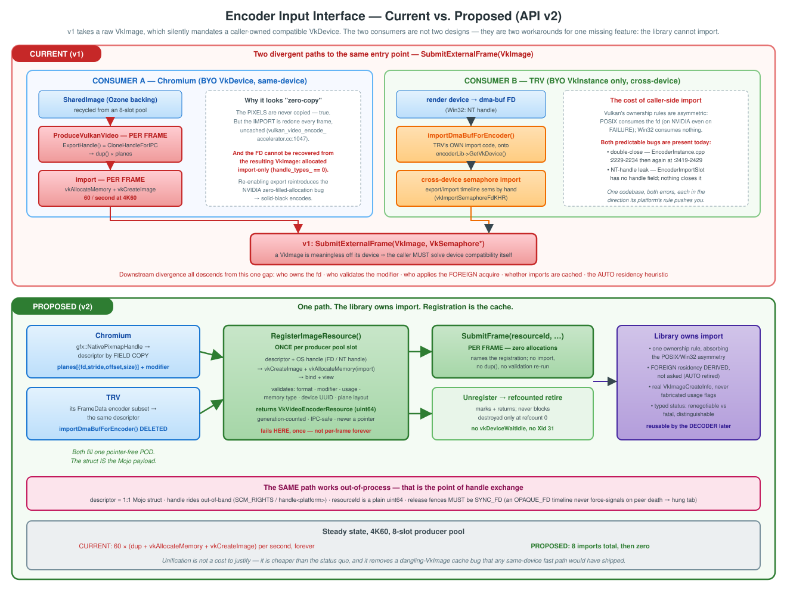
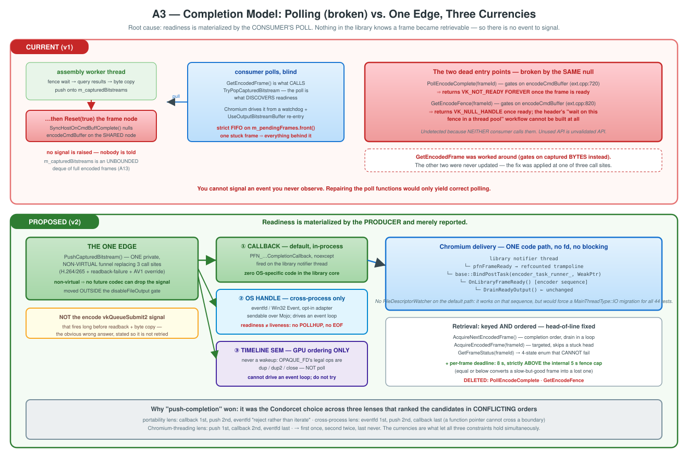

<!--
SPDX-FileCopyrightText: Copyright (c) 2026 NVIDIA CORPORATION & AFFILIATES. All rights reserved.
SPDX-License-Identifier: Apache-2.0

Internal engineering design document. NOT published to the docs portal.
-->

# Encoder Ext API v2 — Unified Handle Exchange, Event-Driven Completion, and Config/ABI Repair

**Date:** 2026-07-25 · **Status:** design for review · **Supersedes:** the open findings in `VULKAN_VIDEO_ENCODER_ARCH_REVIEW.md`

## 0. What this document decides

Five findings from the RC-1 architecture review, designed as one coherent API v2 rather than five patches:

| ID | Problem | Decision |
|---|---|---|
| **HX** | Chromium and TRV use structurally different device models through one interface | **Unify on handle exchange.** Library owns import. Register/Submit/Unregister. |
| **A3** | Completion is polling; two of its four entry points are dead | **One producer-raised readiness edge, three delivery currencies.** Delete the dead methods. |
| **A0/A1** | "Structured config" is argv marshalling; 10 fields silently dropped | **Direct binder** + a mechanism that makes silent drops structurally impossible. |
| **A8** | No ABI versioning; `std::vector` across `extern "C"` | **Self-stamping versioned structs**, count+array replacement. |
| **A2** | RGBA compute filter unreachable | **Deferred deliberately** — but this design supplies the missing predicate and turns today's crash into a typed error. |

**Method.** Two adversarial design workflows (23 agents, ~4.2M tokens): five code explorers → competing independent designs → three hostile review lenses (Vulkan-spec correctness / cross-process + sandbox reality / migration + upstreamability) → adjudicated synthesis. Every claim below carries a file:line and was verified against the RC-1 trees.

---

## 1. Two bugs to fix immediately, independent of any redesign

These are shipping defects found during the design work. Neither needs v2.

### 1.1 🔴 Every Ext-API session is rate-controlled at 29.97 fps

Verified chain:

1. Chromium sets the real value — `lib_config.frameRateNum = vea_config.framerate; frameRateDen = 1` (`vulkan_video_encoder_config_builder.cc:132-133`)
2. `BuildEncoderConfig` **never forwards it**. The only read of `config.frameRateNum` in the whole ext impl is inside `Reconfigure()` (`vulkan_video_encoder_ext.cpp:883`)
3. There is **no `--frameRate` CLI flag** to carry it — the sole `frameRate` hit in `VkEncoderConfig.cpp` is the Y4M header parse (`:313`), a file-input path the ext API never takes
4. The codec configs preseed `FRAME_RATE_NUM_DEFAULT = 30000` / `FRAME_RATE_DEN_DEFAULT = 1001` in their constructors (`VkEncoderConfigH264.h:111`, `H265.h:123`, `AV1.h:88`)

**Effect:** the rate controller (`pRcLayerInfo->frameRateNumerator`), the H.264/H.265 VUI timing, and the AV1 IVF header all run at **29.97 fps regardless of the caller**. A 60 fps screen share is budgeted for ~half its true frame count → bitrate overshoot; emitted timing metadata is wrong. It self-corrects only if `RequestEncodingParametersChange` later triggers `Reconfigure`.

### 1.2 🔴 `SubmitExternalFrame` blocks on a condition variable — on a sequence that forbids it

`SubmitExternalFrame` is **not asynchronous**. It runs inline: `SetExternalInputFrame → EncodeFrameCommon → EnqueueFrame → PushOrderedFrames → ProcessOrderedFrames`, which executes `StartOfVideoCodingEncodeOrder`/`ProcessDpb`/`RecordVideoCodingCmd`/`SubmitVideoCodingCmds` on the caller's thread (`VkVideoEncoder.cpp:3472-3475`).

Worse, it **can block**: `QueueFramesForAssembly → VkThreadSafeQueue::Push` waits on `m_condProducer` at capacity `numBitstreamBuffersToPreallocate` (default 8, `VkThreadSafeQueue.h:38-52`, capacity set at `VkVideoEncoder.cpp:2575-2576`) with **no timeout and no `VK_NOT_READY` escape**.

Chromium's VEA encoder sequence has `MayBlock()` but **not** `WithBaseSyncPrimitives()` (`task_tracker.cc:447` installs a `ScopedDisallowBaseSyncPrimitives`). A condvar wait there is a policy violation and a latency hazard. The header meanwhile documents `VK_NOT_READY` as the backpressure contract — which this path bypasses.

**Fix (v2, §3.6):** backpressure must be a non-blocking return at submit, never a blocking push.

---

## 2. Part I — Unified handle exchange



*The whole of Part I in one picture: two divergent workarounds converging on a
`VkImage`-shaped entry point (top) become one registration path the library owns (bottom) —
and the per-frame import cost disappears with it.*

### 2.1 The decisive fact

The review framed this as "unifying costs Chromium its same-device fast path." **That framing was wrong**, in both directions:

**(a) Chromium already imports a dma-buf on every single frame.** `OzoneImageBacking::ProduceVulkanVideo` calls `pixmap_->ExportHandle()` — which is `CloneHandleForIPC`, i.e. a `dup()` per plane — then `CreateImageFromGpuMemoryHandleWithUsage()` → `vkAllocateMemory` (import) + `vkCreateImage`. `StartAsyncResolve` invokes that **per frame** (`vulkan_video_encode_accelerator.cc:1047`), with no cache.

| Per encoded frame, today | Count |
|---|---|
| `dup()` (one per plane) | 1–3 |
| `vkAllocateMemory` (dma-buf import) | 1 |
| `vkCreateImage` + view | 1 |
| representation + scoped access create/destroy | GPU-thread-affine |

At 4K60 that is **60 imports/second/stream**.

**(b) There is no "export from the encoder's VkImage" leg to reuse anyway.** That memory is allocated **import-only** (`handle_types_ == 0`), so `vkGetMemoryFdKHR` fails (`gpu/vulkan/vulkan_memory.cc:138-156`). Re-adding `VkExportMemoryAllocateInfo` to make export work reintroduces a **confirmed NVIDIA driver bug** — the in-tree comment at `gpu/vulkan/vulkan_image_linux.cc:97-108` states it verbatim: the driver returns *"a fresh, zero-filled exportable allocation instead of importing the dma_buf … observable as solid-black zero-copy encode streams."*

**Conclusion:** handle exchange is not a cost to justify — it is **cheaper than the status quo**, because registration amortizes an import Chromium currently pays every frame. And it removes a latent bug: a `VkImage`-keyed cache would dangle, since `ProduceVulkanVideo` mints a fresh `VulkanImage` per frame and destroys it at retirement.

**So: dma-buf handle exchange is the default for both consumers. No same-device carve-out.** This is the unification you asked for, and it is a performance win.

### 2.1a Why the two-consumer split existed at all

Worth stating precisely, because the fix follows from the diagnosis. The v1 interface takes a
raw `VkImage` + `VkSemaphore` arrays. That is not a neutral choice — **it silently mandates
that the caller already own a `VkDevice` compatible with the encoder's**, because a `VkImage`
handle is meaningless off its device. Two consumers each solved that mandate differently:

- **Chromium** made the devices *the same one* — BYO `externalDevice`, so its
  SharedImage-resolved `VkImage` is trivially valid.
- **TRV** kept devices *separate* and did the import **itself**, calling
  `encoderLib->GetVkDevice()` and then building the image with its own
  `importDmaBufForEncoder()`.

Both are correct. Neither is the interface's design — they are two different **workarounds for
the same missing feature**: the library does not know how to import. Every downstream
divergence (who owns the fd, who validates the modifier, who applies the FOREIGN acquire,
whether imports are cached) is a consequence of that one gap. Moving import into the library
does not add a feature so much as *delete a category of caller obligation*.

### 2.1b What registration buys, quantified

| | Per-frame import (today) | Registered (v2) |
|---|---|---|
| `dup()` syscalls | 1–3 per frame | 1–3 **per pool slot, once** |
| `vkAllocateMemory` | 1 per frame | once per slot |
| `vkCreateImage` + view | 1 per frame | once per slot |
| Steady state at 4K60, 8-slot pool | 60 imports/s | **8 imports total**, then zero |
| Modifier/format validation | per frame (or skipped) | once, at registration, with a typed error |
| Failure surfaces | mid-stream, per frame | **at registration**, before the producer commits |

The last row is the one that matters most for a browser. Today an unsupported modifier or
format fails on *every frame forever*, mid-stream, with a driver-level error. Under
registration it fails **once, at a negotiation point**, with a code the caller can act on —
which is the difference between "renegotiate the allocation" and "kill the stream".

### 2.2 Shape: Register / Submit / Unregister

Precedent: `nvEncRegisterResource`, VA-API surfaces, D3D11 keyed mutex. Registration **is** the cache.

```
RegisterImageResource(desc, handle) -> VkVideoEncoderResource (uint64, generation-counted, IPC-safe)
    performs vkCreateImage + vkAllocateMemory(import) + vkBindImageMemory + view creation
    ONCE per buffer (producer pool slot / Mailbox / DXGIHandleToken)

SubmitFrame(resourceId, syncDesc, frameParams)
    per-frame; zero allocations; names the registration

UnregisterImageResource(resourceId)
    deferred-retired: refcount, not timeline — never frees while the GPU may still read
```

Key decisions carried from adversarial review:

- **Library-minted `uint64` ids with generation counters**, not pointers — the only form that survives an IPC boundary and detects use-after-unregister.
- **The caller owns the key→id map.** The library does not do "register-if-absent": that puts `vkCreateImage` + `vkAllocateMemory` back on the submit path, which is the thing being fixed.
- **Deferred retirement is refcount-driven** (`AcquireInFlight`/`ReleaseInFlight`), not timeline-driven. Timeline-driven eviction either stalls (a `vkDeviceWaitIdle`, which this design exists to avoid) or frees an image the GPU is still reading — Xid 31 CE2 VIRT_READ, the exact failure Chromium's hold-to-completion fix addressed.
- **`uniqueImageIndex` is deleted.** The registration id subsumes it.

### 2.2a The header — the descriptor that replaces `VkVideoEncodeInputFrame`

Pointer-free POD, so the struct **is** the IPC payload (a 1:1 Mojo struct); the OS handle
rides out-of-band as `SCM_RIGHTS` / `handle<platform>`. It is a superset of TRV's
`presenter::FrameData` encoder subset and of `gfx::NativePixmapHandle` + `gfx::Size` +
`VkFormat` — i.e. **both consumers can fill it by field copy**.

```c
typedef struct VkVideoEncoderPlaneLayout {
    uint64_t offset;
    uint64_t size;        // MUST be 0 on the DRM-modifier explicit path (VUID-...-size-02267)
    uint64_t rowPitch;
    uint64_t arrayPitch;  // 0 for arrayLayers == 1
    uint64_t depthPitch;  // 0 for 2D
} VkVideoEncoderPlaneLayout;

typedef struct VkVideoEncoderExternalImageDescriptor {
    VkVideoEncoderStructureType sType;   // ..._EXTERNAL_IMAGE_DESCRIPTOR
    const void*                 pNext;   // MUST be NULL when serialized for IPC

    VkVideoEncoderExternalHandleType handleType;

    // ---- The exporter's ACTUAL VkImageCreateInfo. Never guessed. ----
    VkFormat              format;
    uint32_t              width, height;
    VkImageType           imageType;    // 0 => VK_IMAGE_TYPE_2D
    uint32_t              mipLevels;    // 0 => 1
    uint32_t              arrayLayers;  // 0 => 1
    VkSampleCountFlagBits samples;      // 0 => VK_SAMPLE_COUNT_1_BIT
    VkImageTiling         tiling;       // TRI-STATE: OPTIMAL | LINEAR | DRM_FORMAT_MODIFIER_EXT
    VkImageUsageFlags     imageUsage;   // 0 is INVALID -> USAGE_INSUFFICIENT
    VkImageCreateFlags    imageFlags;   // MUTABLE_FORMAT => library emits
                                        //   VkImageFormatListCreateInfo (VUID-...-tiling-02353)
    VkSharingMode         sharingMode;

    // ---- DRM format modifier ----
    VkBool32 hasDrmFormatModifier;      // distinguishes "no modifier" from "modifier 0"
    uint64_t drmFormatModifier;

    uint32_t                  planeCount;   // 1..VK_VIDEO_ENCODER_MAX_PLANES
    VkVideoEncoderPlaneLayout planeLayouts[VK_VIDEO_ENCODER_MAX_PLANES];

    // ---- Memory ----
    uint64_t allocationSize;            // from the EXPORTER; 0 = unknown (logged)
    uint32_t memoryTypeBits;            // exporter's; 0 = unknown
    uint32_t memoryTypeIndex;           // exporter's; UINT32_MAX = unknown
    VkBool32 requiresDedicatedAllocation;

    // ---- Provenance: multi-GPU safety ----
    uint8_t  deviceUUID[VK_UUID_SIZE];
    uint8_t  driverUUID[VK_UUID_SIZE];
    uint8_t  deviceLUID[VK_LUID_SIZE];
    VkBool32 deviceLUIDValid;

    VkVideoEncoderInputResidency residency;  // IGNORED+derived for OS handles; honored for VK_IMAGE
    VkImageLayout                defaultLayout;
} VkVideoEncoderExternalImageDescriptor;
```

**Field-level justification — each of these was a defect in v1:**

| Field | Why it exists |
|---|---|
| `imageUsage`, `imageFlags`, `sharingMode`, `mipLevels`, `arrayLayers`, `samples` | v1's `WrapExternalImage` **fabricates** `STORAGE\|SAMPLED\|…` on an image it cannot verify. Latent only because nothing currently touches the image as a storage image — and it is exactly what would make the A2 filter fix unsafe. `imageUsage == 0` is therefore an **error**, not a default: the library must never invent a usage the exporter did not grant. |
| `tiling` as a **tri-state** | v1 treats tiling as LINEAR/not-LINEAR. `DRM_FORMAT_MODIFIER_EXT` is a third, distinct case with entirely different import requirements (`VkImageDrmFormatModifierExplicitCreateInfoEXT` with a full plane layout). Collapsing it is how you get a plausible-looking import that samples garbage. |
| `hasDrmFormatModifier` separate from `drmFormatModifier` | **modifier 0 is real** — it is `DRM_FORMAT_MOD_LINEAR`, and NVIDIA refuses `VIDEO_ENCODE_SRC` for it on multiplanar YCbCr. A single `uint64` cannot distinguish "no modifier, import as OPTIMAL" (Chromium spells this `kNoModifier == 0x00ffffffffffffff`) from "the modifier is literally zero". |
| `allocationSize` **from the exporter** | Deriving it from `vkGetImageMemoryRequirements` is **wrong for dma-buf on NVIDIA**. Accepting 0 with a log is a deliberate concession, not an endorsement. |
| `memoryTypeIndex` + policy | Import memory-type selection is spec-constrained by `vkGetMemoryFdPropertiesKHR` — which has **zero call sites in the entire tree** (A14). One non-negotiable policy: honor the exporter's index iff representable in the importing device's `memReqs.memoryTypeBits`, else first `DEVICE_LOCAL`. On `OPAQUE_WIN32`/`D3D11_TEXTURE`, WDDM validates allocation properties, so an unrepresentable index is a **hard error**, not a fallback. |
| `deviceUUID`/`driverUUID`/`deviceLUID` | Multi-GPU. TRV propagates **nothing** today (`deviceId = -1`, `gpuUUID` zeroed), so on a dual-GPU box display and encode can land on different physical devices and every import fails with an unhelpful driver error. Supplied-and-mismatched now fails `DEVICE_MISMATCH` at registration. |
| `residency` **derived, not asked** | v1's `AUTO` heuristic (FOREIGN iff layout != PREINITIALIZED) is a documented footgun that misclassifies a *reused* staging image. For every OS-handle kind the library did the import, so **it knows** — the field is ignored and derived as FOREIGN. It is honored only for `VK_IMAGE`, where the caller alone knows whether the image is a reused local staging image. |

### 2.2b Typed status, not bare `VkResult`

```c
typedef enum VkVideoEncoderStatusCode {
    VK_VIDEO_ENCODER_STATUS_SUCCESS = 0,
    VK_VIDEO_ENCODER_STATUS_ERROR_STRUCTURE_TYPE_UNKNOWN,
    VK_VIDEO_ENCODER_STATUS_ERROR_API_VERSION_UNSUPPORTED,
    VK_VIDEO_ENCODER_STATUS_ERROR_DEVICE_MISMATCH,        // wrong GPU
    VK_VIDEO_ENCODER_STATUS_ERROR_HANDLE_TYPE_UNSUPPORTED,
    VK_VIDEO_ENCODER_STATUS_ERROR_EXTENSION_MISSING,      // BYO device lacks dma_buf/modifier/foreign
    VK_VIDEO_ENCODER_STATUS_ERROR_FORMAT_UNSUPPORTED,
    VK_VIDEO_ENCODER_STATUS_ERROR_MODIFIER_UNSUPPORTED,   // RENEGOTIABLE: see pDirectModifiers
    VK_VIDEO_ENCODER_STATUS_ERROR_USAGE_INSUFFICIENT,     // exporter did not grant requiredUsage
    VK_VIDEO_ENCODER_STATUS_ERROR_PLANE_LAYOUT_INVALID,
    VK_VIDEO_ENCODER_STATUS_ERROR_ALLOCATION_SIZE_INVALID,
    VK_VIDEO_ENCODER_STATUS_ERROR_MEMORY_TYPE_UNSUPPORTED,
    VK_VIDEO_ENCODER_STATUS_ERROR_CONVERSION_REQUIRED,    // RGBA in, no compute filter (A2)
    VK_VIDEO_ENCODER_STATUS_ERROR_IMPORT_FAILED,          // driver rejected it
    VK_VIDEO_ENCODER_STATUS_ERROR_RESOURCE_LIMIT,
} VkVideoEncoderStatusCode;
```

**Why not `VkResult`.** A bare `VkResult` cannot distinguish *"this DRM modifier is not
encodable"* from *"this format is not supported"* from *"you sent me a handle from the wrong
GPU"*. In-process that is merely annoying. **Across a process boundary it is disqualifying**:
the client must be able to tell "renegotiate the allocation and retry" from "fail the stream",
and `VK_ERROR_INITIALIZATION_FAILED` tells it neither. `MODIFIER_UNSUPPORTED` is explicitly
paired with the list of modifiers that *would* work, so renegotiation is a single round trip.

### 2.3 Handle ownership — the asymmetry, stated in the header

This is the single most bug-prone part of any handle API and the current code documents it nowhere.

| Platform | Handle type | On successful import | On failed import | Rule in header |
|---|---|---|---|---|
| Linux/Android | `DMA_BUF`, `OPAQUE_FD` | **Vulkan takes ownership**; closed by `vkFreeMemory` | **Library closes it** | Caller must not touch the fd after a call that returns `VK_SUCCESS` *or* an error |
| Linux | `SYNC_FD` (binary sem) | **Ownership transferred**, single-use | Library closes | One fd per wait; never reused |
| Windows | `OPAQUE_WIN32`, `D3D11_TEXTURE`, `D3D12_RESOURCE` | **Caller retains**; caller must `CloseHandle` | Caller retains | Library never closes an NT handle |
| Windows | `OPAQUE_WIN32_KMT` | Caller retains; not refcounted | Caller retains | Discouraged |

**One unconditional rule, chosen over per-call flags:** *the library consumes POSIX fds it is given, always, on every exit path; the library never closes a Win32 handle, ever.* Uniformity beats a flag no one reads correctly.

#### Why the API absorbs the asymmetry instead of exposing it

This is not a stylistic preference. **Exposing Vulkan's native asymmetry has already produced
two live bugs in the reference implementation**, and they are the two failure modes you would
predict:

1. **A double-close.** `VkImportMemoryFdInfoKHR` consumes the fd on success — and on NVIDIA it
   consumes it **on failure too** (`gpu/vulkan/vulkan_memory.cc:115-124`, and the
   `kFailedBefore/AfterAllocate` enum at `vulkan_image.cc:294-306` exists precisely to track
   which). TRV closes the fd on `vkCreateImage` failure at
   `EncoderInstance.cpp:2229-2234`, and its caller closes it *again* at `:2419-2429`.
2. **An unbounded NT-handle leak.** `VkImportMemoryWin32HandleInfoKHR` consumes **nothing** —
   the app must `CloseHandle`. TRV's `EncoderImportSlot` has no handle field at all, so
   nothing ever does.

One codebase, both errors, in the direction each platform's rule pushes you. A per-call
`ownership` flag would not have prevented either — the flag would have been set from the same
misunderstanding. So the API takes the asymmetry away:

- On POSIX the library closes anything it did not hand to the driver, on **every** exit path
  including argument-validation failures that never reach Vulkan.
- On Win32 the library `CloseHandle`s a *successfully imported* handle immediately after
  `vkAllocateMemory` — legal, because the `VkDeviceMemory` holds its own reference — and never
  leaks it.
- `VkVideoEncoderStatus::handlesConsumed` is `VK_TRUE` on every such return, so the caller can
  assert rather than guess.

A `BORROW` mode exists for callers that genuinely must retain their handle (TRV's presenter
reuses the fd for a display blit). It is implemented as an immediate private `dup(2)` /
`DuplicateHandle(GetCurrentProcess(), …, GetCurrentProcess(), …)` — note **no
`PROCESS_DUP_HANDLE` on any peer is required**, which matters in a sandbox. The default is
`TRANSFER`, because the safe thing should be the thing you get by writing `{}`.

### 2.3a Resource lifecycle — and why retirement is refcounted, not timeline-driven

```
        RegisterImageResource(desc, handle)
                  │  import once: vkCreateImage + vkAllocateMemory + bind + view
                  ▼
            ┌──────────┐   SubmitFrame(id)          ┌──────────┐
            │ REGISTERED├──────────────────────────►│ IN-FLIGHT │  AcquireInFlight()
            │          │◄──────────────────────────┤ (refcount)│  ReleaseInFlight()
            └────┬─────┘   frame completes/retires  └──────────┘
                 │ UnregisterImageResource(id)
                 ▼
            ┌──────────┐  refcount > 0 ?  ──yes──►  RETIRING (deferred)
            │ RETIRING │  refcount == 0   ──────►  destroyed: vkDestroyImageView,
            └──────────┘                            vkDestroyImage, vkFreeMemory
```

Three properties are load-bearing:

**(a) Retirement is refcount-driven, never timeline-driven.** A timeline-driven eviction has
only two implementations and both are wrong: wait for the timeline (that is a
`vkDeviceWaitIdle` in disguise — precisely the stall this design exists to avoid), or free
optimistically (that frees an image the GPU is still reading → **Xid 31 CE2 VIRT_READ**, the
exact device-lost that Chromium's hold-to-completion fix was written to stop). `AcquireInFlight`
/ `ReleaseInFlight` are pure bookkeeping, which means the whole table can be factored into a
`VulkanExternalResourceTable` and **unit-tested with no Vulkan device at all**.

**(b) `Unregister` during in-flight work is legal and non-blocking.** It marks and returns.
This matters because the realistic teardown order in a browser is "tab closes → SharedImage
pool drops → encoder still draining", and an API that requires the caller to quiesce first
just relocates the deadlock into the caller.

**(c) `callerKey` is diagnostics-only.** It is echoed back in properties and in every log line
and the library **never interprets it and never uses it for cache lookup**. Chromium sets it
to a `gpu::Mailbox` hash (Linux) or `gfx::DXGIHandleToken` (Windows); TRV sets it to the
producer `poolIndex`. Making it a lookup key would be re-introducing "register-if-absent",
which puts `vkCreateImage` back on the submit path — the exact thing being fixed. **The caller
owns the key→id map**, and that is also what makes the out-of-process proxy able to
force-retire everything on peer death (§2.4).

### 2.4 What crosses a process boundary

| | In-process (today) | Out-of-process (Model C) |
|---|---|---|
| Image | `NativePixmapHandle` fields → registration | same, over Mojo (`mojo::PlatformHandle`) |
| Image id | `uint64` | same `uint64` — IPC-safe by construction |
| Acquire sync | imported semaphore | `SYNC_FD` (see below) |
| Release sync | imported semaphore | **must be `SYNC_FD`** |
| Bitstream | in-memory pointer + `ReleaseEncodedFrame` | shared memory region |

**Cross-process release fences must be `SYNC_FD`, mandated in the header.** If the encoder process is SIGKILLed (OOM killer, sandbox violation, tab-close race) holding an unsignalled obligation on an imported `OPAQUE_FD` **timeline**, nothing ever advances the payload — unlike a `dma_fence`, which the kernel force-signals on process death. The compositor then blocks forever on `OzoneImageBacking::read_fences_[kVulkanVideoEncode]`: **a hung tab, not a crash** — the worst possible failure to diagnose.

Three-part mitigation, all normative:
1. Cross-process release fences are `SYNC_FD`.
2. The EndAccess obligation **stays with the process that owns the backing**; the library's signal is an input to it, never a replacement.
3. The GPU-process proxy arms a Mojo **disconnect handler** that force-retires every outstanding access for that encoder instance.

**Corollary the reviewers flagged and all three drafts missed: the readiness signal must never be the liveness signal.** An `eventfd` has no `POLLHUP` and no EOF (`man 2 eventfd` documents only `POLLIN` when counter > 0, `POLLOUT`, and `POLLERR` on overflow); a Win32 Event never becomes signalled because its peer died. Peer death is detected by the Mojo pipe, full stop.

**And: no Vulkan object may be the cross-process wakeup.** `OPAQUE_FD`'s spec-enumerated legal operations are `dup`/`dup2`/`close` — *not* `poll`. A timeline semaphore exported as `OPAQUE_FD` is not pollable by `epoll`/`select`, so it cannot drive an event loop. It remains valuable for **GPU-side ordering**; it is not a wakeup.

### 2.5 Extension prerequisites — a real, currently-latent bug

Three extensions the library already *uses* are requested **nowhere**: `VK_EXT_external_memory_dma_buf`, `VK_EXT_image_drm_format_modifier`, `VK_EXT_queue_family_foreign` are absent from the required list at `vulkan_video_encoder_ext.cpp:400-418`, yet `CreateExportable` uses DMA_BUF handle types and `StageInputFrame` uses `VK_QUEUE_FAMILY_FOREIGN_EXT`. And under BYO the list is inert anyway — `VulkanDeviceContext::CreateVulkanDevice` skips `vkCreateDevice` entirely when `externalDevice != VK_NULL_HANDLE` (`:1162-1172`). **Spec-invalid; works on NVIDIA by luck.**

v2 adds `VALIDATE_EXTENSIONS_BIT`, which hard-fails at context creation naming the missing extension. Chromium's `gpu/vulkan` device-extension list must be audited **before** this lands — expect configurations that "worked" to start failing loudly. That is the intent.

---

## 3. Part II — A3: event-driven completion



*Top: why the poll model has no event to signal, and how the same nulled `encodeCmdBuffer`
kills both dead entry points. Bottom: the single producer-raised edge, the three currencies,
and the Chromium delivery chain that needs no file descriptor and no blocking wait.*

### 3.1 Why polling cannot simply be repaired

**Readiness is currently materialized by the consumer's poll.** `GetEncodedFrame` (`vulkan_video_encoder_ext.cpp:733`) is what calls `TryPopCapturedBitstream` and only then discovers a frame is ready. **Nothing in the library knows a frame became retrievable.** You cannot signal an event you never observe. That is the root of A3.

The fix inverts it: readiness is **materialized by the producer** and reported to the consumer.

There is exactly one true readiness edge, and it is **host-side, not GPU-side**: the moment a `CapturedBitstream` is pushed onto `m_capturedBitstreams` — after `ReadbackBitstreamData`'s fence wait, after `vkGetQueryPoolResults(VK_QUERY_RESULT_WAIT_BIT)`, after the byte copy. *Chaining a semaphore onto the encode `vkQueueSubmit2` signal list would fire far too early* — a trap worth stating explicitly, because it is the obvious wrong answer.

Today there are three push sites, all gated inside `if (disableFileOutput)`:
- `VkVideoEncoder.cpp:1474-1476` — normal H.264/H.265 capture in `WriteBitstreamToFile`
- `VkVideoEncoder.cpp:1546-1555` — readback-failure capture in `AssemblyWorkerThread`
- `VkVideoEncoderAV1.cpp:1050-1052` — AV1's **virtual** override (a 4th codec = a 4th site)

All three collapse into **one private non-virtual `PushCapturedBitstream()`**, so no future codec override can silently drop the signal, and it moves **outside** the `disableFileOutput` gate.

### 3.2 The adjudication: one edge, three currencies

The three review lenses ranked the candidates in *conflicting* orders — which is exactly the tension to resolve, not average away:

| Lens | 1st | 2nd | 3rd |
|---|---|---|---|
| Library portability / upstreamability | callback (FRN) | **push-completion** | eventfd (ECS) — *"reject rather than iterate"* |
| Cross-process / IPC reality | eventfd (ECS) | **push-completion** | callback (FRN) — *a `void(*)()` cannot cross a boundary* |
| Chromium threading correctness | **push-completion** | callback (FRN) | eventfd (ECS) |

**Push-completion is the Condorcet winner** — first once, second twice, last never. The resolution that satisfies all three lenses simultaneously:

> **One producer-raised edge. Three delivery currencies, chosen by the consumer. The callback is the default in-process; the OS handle exists only for the cross-process boundary; the timeline semaphore is for GPU ordering only — never a wakeup.**

Binding constraints, each from a different lens and all honored:

- *Portability:* **zero** OS-specific code in `VkVideoEncoder.{h,cpp}` and zero in the **default** path of the ext layer. No `<sys/eventfd.h>`, no `<windows.h>`, no `poll`/`epoll`. The OS-handle currency lives in an optional, separately-compiled adapter.
- *Chromium:* **no file descriptor and no `base::FileDescriptorWatcher` on the default path.** `WatchReadable` *does* work on the VEA's production sequence — but it would force a `MainThreadType::IO` fixture migration for all 44 existing tests. Delivery is a C callback → `base::BindPostTask` → the encoder sequence. One code path.
- *Cross-process:* the transportable currency must be **default-on and CI-exercised** in the OOP configuration, or it rots as dead code.
- *Zero-migration default:* a consumer that registers no callback and calls only `GetEncodedFrame`/`ReleaseEncodedFrame` **must keep working**.

### 3.2a The completion API

```c
typedef enum VkVideoEncoderFrameState {
    VK_VIDEO_ENCODER_FRAME_STATE_UNKNOWN  = 0,  // never submitted, or already released
    VK_VIDEO_ENCODER_FRAME_STATE_PENDING  = 1,  // submitted, no capture yet
    VK_VIDEO_ENCODER_FRAME_STATE_READY    = 2,  // Acquire* will return it
    VK_VIDEO_ENCODER_FRAME_STATE_ACQUIRED = 3,  // awaiting ReleaseEncodedFrame
} VkVideoEncoderFrameState;

// Invoked on the library's notifier thread the moment a frame becomes retrievable.
// MUST NOT call any session-serial method (see the threading contract). MUST NOT throw.
typedef void (*PFN_vkVideoEncoderCompletionCallback)(
    uint64_t frameId, void* pUserData) VK_VIDEO_ENCODER_CB_NOEXCEPT;

class VulkanVideoEncoderExt2 : public VulkanVideoEncoderExt {
public:
    // --- currency selection -------------------------------------------------
    virtual VkResult ConfigureCompletion(const VkVideoEncoderCompletionConfig*) = 0;
    virtual VkResult SetCompletionCallback(PFN_vkVideoEncoderCompletionCallback,
                                           void* pUserData) = 0;

    // --- currency 1: callback (DEFAULT, in-process) --------------------------
    //     delivered via the notifier thread; Chromium wraps with BindPostTask.

    // --- currency 2: OS handle (opt-in, cross-process only) ------------------
    virtual VkVideoEncoderNativeHandle GetCompletionEventHandle() const = 0;

    // --- currency 3: Vulkan timeline (GPU ordering ONLY, never a wakeup) -----
    virtual VkSemaphore GetCompletionSemaphore() const = 0;
    virtual VkResult    ExportCompletionSemaphoreHandle(/*...*/) = 0;

    // --- retrieval: keyed AND ordered ---------------------------------------
    virtual VkResult AcquireNextEncodedFrame(VkVideoEncodeResult* pResult) = 0;
    virtual VkResult AcquireEncodedFrame(uint64_t frameId,
                                          VkVideoEncodeResult* pResult) = 0;
    virtual void     ReleaseEncodedFrame(uint64_t frameId) = 0;

    // --- observability & control --------------------------------------------
    virtual VkVideoEncoderFrameState GetFrameStatus(uint64_t frameId) const = 0;
    virtual uint64_t GetCompletionCounter() const = 0;   // monotonic; coalescing-safe
    virtual VkResult GetCompletionInfo(VkVideoEncoderCompletionInfo*) const = 0;
    virtual VkResult SetFrameDeadline(uint32_t deadlineMs) = 0;
    virtual VkResult CancelFrame(uint64_t frameId) = 0;
    virtual VkResult CancelAllPendingFrames(uint32_t* pCancelledCount) = 0;
};
```

**Why a monotonic `GetCompletionCounter()` alongside the callback.** Notifications *coalesce* —
one edge may cover three ready frames. A consumer that assumes "one callback, one retrieval"
silently drops frames under load, and the symptom (`frames_submitted_ != frames_emitted_`
forever) looks **exactly like a library stall**, which is the worst possible false signal. The
counter makes coalescing detectable rather than a trap, and the header mandates drain-in-a-loop.
A CI test (`CompletionCoalescing`: one notification covering 3 frames must emit all 3) enforces
it rather than trusting prose.

**Why `GetFrameStatus` returns an enum that cannot fail.** The old `PollEncodeComplete`
conflated three genuinely different conditions into one boolean-ish `VkResult`: *still
encoding*, *never submitted*, and *already released*. Those demand different caller responses
(wait / bug / bug), so they get different values.

### 3.3 The two dead methods: delete, do not repair

`PollEncodeComplete` and `GetEncodeFence` both gate on `pending.encodeFrameInfo->encodeCmdBuffer` (`:720`, `:820`). `ReleaseAssemblyItem` (`VkVideoEncoder.cpp:1592`) → `item.frameInfo->Reset(true)` (`VkVideoEncoder.h:421`) → `SyncHostOnCmdBuffComplete()` (`:467`) nulls `encodeCmdBuffer` (`:485`) on the **same shared node** the `PendingFrame` holds — at exactly the moment the frame becomes ready.

They could be re-gated on `hasCapture` like `GetEncodedFrame` was. **That would merely yield a correct polling function, and polling is what is being deleted.** Zero TRV call sites, zero Chromium call sites. They go, in the same version bump as the A8 ABI change, so consumers migrate once.

Replacement: `GetFrameStatus(frameId) → VkVideoEncoderFrameState`, a 4-valued enum that **cannot fail** and therefore distinguishes *still-encoding* from *never-submitted* from *already-released* — three cases the old boolean-ish poll conflated.

### 3.4 Head-of-line blocking: keyed retrieval **and** a deadline

`GetEncodedFrame` inspects `m_pendingFrames.front()` and returns `VK_NOT_READY` unless `front.hasCapture` (`:779-782`), over a deque in **submit** order (`push_back` at `:708`). Any frame that never yields a capture parks at the head and everything behind it is unreachable **forever**. The only thing between that and an infinite hang is Chromium's 5 s watchdog — which converts one stuck frame into a terminal error that kills the entire session.

Both halves are required; each alone leaves a hole:

1. **Keyed map + ready-ordered queue** replaces the submit-ordered deque. `AcquireEncodedFrame(frameId)` for targeted retrieval, `AcquireNextEncodedFrame()` for completion-order draining.
2. **Per-frame deadline** (`frameCompletionTimeoutNs`, default **8 s**). A timed-out frame is delivered as a 0-byte drop frame with `VK_TIMEOUT` — every downstream consumer already handles drop frames.

> **Derived constraint, documented in the header:** the deadline must stay **strictly above** the internal 5 s `WaitAndResetFence` cap. Equal or below, and a slow-but-successful frame is declared timed-out, delivered as failed, and its real capture later discarded as a late arrival — converting a slow frame into a lost one. `framesTimedOut` and `lateCaptures` counters make the collision observable if it ever occurs.

Because a timeout now silently drops instead of killing the session, it must be **measured**, or a degrading GPU looks like a lossy network to WebRTC: `Media.VulkanVEA.FrameTimeout` UMA, `kMaxConsecutiveFrameTimeouts = 3` terminal escalation, per-timeout `LOG(ERROR)` with the frameId and the submitted/emitted delta.

### 3.5 Unbounded queue — a third latent bug

`m_capturedBitstreams` (`VkVideoEncoder.h:1122-1123`) is an **unbounded `std::deque` of full encoded frames with no eviction**. A consumer that stops draining grows it without limit. v2 bounds it and applies backpressure **at submit**, as a non-blocking `VK_NOT_READY` — never a blocking push (§1.2).

### 3.6 Chromium integration

```
library assembly thread
  └─ PushCapturedBitstream()  ← the one edge
       └─ pfnFrameReady(frameId, user)      [C callback, noexcept]
            └─ refcounted trampoline
                 └─ base::BindPostTask(encoder_task_runner_, WeakPtr)
                      └─ OnLibraryFrameReady()  [encoder sequence]
                           └─ DrainReadyOutput()   ← unchanged
```

Non-negotiables from the Chromium lens, all verified in-tree:

- The task runner is a `scoped_refptr<base::SequencedTaskRunner>` captured on the encoder sequence during `CompleteLibraryInitialize()` and owned by `BindPostTask`.
- **`terminal_` latch**, set as the *first* statement of `NotifyTerminalError`. Verified: `NotifyTerminalError` (`:2782-2807`) does **not** null `lib_state_` or `lib_state_->encoder`, so any guard written as `if (!lib_state_)` is dead code and the engine would keep running on a dead encoder.
- **Two watchdogs, never one:** `kStallWatchdog = 15 s` (library owes us) and `kClientStarvationWatchdog = 30 s` (client owes us), terminating with *distinct* messages. Collapsing them turns a client bug into a silent hang. `frames_ready_unclaimed_` must be decremented on **every** consuming path including the per-frame-error early return, or the counter leaks and pins the branch permanently.
- **`RetryHeldInput()` reachable only from a freshly posted completion task**, never from `TryReturnBitstreamBuffer`, which sync clients re-enter from inside `BitstreamBufferReady`.
- **Trampoline lifetime:** refcounted, released exactly once by `ReleaseThunk` *after the last possible `ReadyThunk` returns*. The `WeakPtr` guards the posted task, **not** the trampoline object — a raw `void*` here is a UAF with no protection.
- One notifier thread **per process**, not per encoder (24 VEAs ≠ 24 threads), named `VkEncNotifier`.

**Tests stay GPU-free:** the fake encoder invokes the callback synchronously from `CompleteFrame()`, so all 44 tests keep running on the default `TaskEnvironment`. One new test (`CompletionFromForeignThread`, real `std::thread`, TSan) carries the cross-thread load — and should be weighted accordingly in review, since it is the only coverage of the real hop.

### 3.7 Threading contract — into the header, verbatim

The header today says **nothing** about threading. Three method classes:

- **(a) Session-serial** — one thread, never concurrent: `InitializeExt`, `ConfigureCompletion`, `Deinitialize`, `Flush`, `DrainPendingFrames`, `Reconfigure`.
- **(b) Submit-thread-affine** — one thread, same thread all session: `SubmitFrame`. **With a loud warning that it is not asynchronous and can block** (§1.2).
- **(c) Fully thread-safe** — any thread including the callback: `AcquireEncodedFrame`, `ReleaseEncodedFrame`, `GetFrameStatus`, `GetCompletionCounter`, `CancelFrame`.

**Enforced, not documented:** calling any class-(a) method from inside `pfnFrameReady` returns `VK_ERROR_NOT_PERMITTED_KHR` — checked by comparing `std::this_thread::get_id()` against the notifier's. Without it, a consumer reaches `WaitForThreadsToComplete()` (which joins the assembly workers) *from the notifier thread*, reproducing the documented tail-assembly stall. Chromium's trampoline structurally cannot do this; TRV and the CLI samples can, which is why the check is what makes the contract real.

The callback is `VK_VIDEO_ENCODER_CB_NOEXCEPT`. Where exceptions are enabled, an escape is converted to a diagnosed `abort()` naming the frameId — because `VkThreadPool.h:47-50` removed the worker try/catch **unconditionally** while leaving the enqueue throw `#ifdef __cpp_exceptions`-guarded, so an escaping exception is already process-fatal with worse triage.

---

## 4. Part III — A0/A1: the config binder

`BuildEncoderConfig` (~214 lines of string marshalling) → `BindExtConfig(const VkVideoEncoderConfig&, EncoderConfig&)` (~120 lines), modelled on the **working precedent already in the tree**: `EncoderConfigJsonLoader` binds 29 fields in 158 lines against the same object, running before the derived tail.

**This lands early, not late.** Once the encoder is cross-process, `VkVideoEncoderConfig` becomes the *sole* configuration channel and every dropped field becomes an IPC contract lie.

### 4.1 Field disposition (10 fields, not the 8 originally reported)

| Field | Today | Binds to | Note |
|---|---|---|---|
| `frameRateNum/Den` | **dropped** | `frameRateNumerator/Denominator` | **The live bug — §1.1** |
| `vbvBufferSize` | dropped | `EncoderConfig::vbvBufferSize` | feeds level selection + HRD/CPB in all three codecs |
| `idrPeriod` | dropped | `gopStructure.SetIdrPeriod()` | **preserve the 0 sentinel** — `InitDeviceCapabilities` replaces 0 with the driver's `preferredIdrPeriod`; writing the caller's value unconditionally removes that fallback |
| `closedGop` | dropped | `gopStructure.SetClosedGop()` | Chromium requests `VK_TRUE`, gets open GOP |
| `colourPrimaries`, `transferCharacteristics`, `matrixCoefficients`, `videoFullRange` | dropped | same-named members | **plus three presence writes** — `video_signal_type_present_flag=1`, `color_description_present_flag=1`, `video_format=5`, or the SPS writers drop them. Dead on *every* channel today, including JSON |
| `minQp`/`maxQp` | forwarded to **write-only base members** | `EncoderConfigH264/H265::minQp/maxQp` | **name shadowing** — the derived structs hide the base `int32_t`s and are what `GetRateControlParameters` reads. A binder written against the base type silently no-ops. Needs a downcast |
| `profile` | H.264 only | `EncoderConfigH265/AV1::profile` | HEVC Main-10 is accepted for probing then silently downgraded for the session |
| `inputFormat` | derives `--inputBpp` only | `input.bpp`/`numPlanes`/`chromaSubsampling` | `input.vkFormat` is *derived* from subsampling+bpp with `numPlanes` defaulting to 3 — structurally incapable of yielding an RGB format. **Prerequisite for A2** |
| `verbose` | dropped, behind a **factually wrong comment** | `EncoderConfig::verbose` | `--verbose` **is** parsed (`VkEncoderConfig.cpp:826-827`). Only `--validate` genuinely lacks a flag |
| `enablePreprocessFilter` | dropped | `enablePreprocessComputeFilter` + `filterType` | bound under the same `#ifdef`; harmless no-op until A2 |

**Two invariants the binder must not break:**
- `repeatInputFrames = true` is semantically overloaded — `InitEncoder` uses it as the gate that *skips* allocating the host-visible linear staging pool. Dropping it allocates `numInputImages` full-size HOST_VISIBLE images for nothing.
- `FinalizeConfig()` (the extracted `ParseArguments` tail) **must** still run: `encodeMaxWidth/Height` defaulting feeds `m_maxCodedExtent`, which sizes the input and DPB pools. Skip it and you get zero-extent images.

**Also fixed in passing:** `--output` together with `--disableFileOutput` still creates the file today, because `SetFileName` `fopen`s `"wb"` immediately and `disableFileOutput` only suppresses the `fwrite`. Latent only because Chromium passes `outputPath = nullptr`.

**Cost:** ~120 lines binder (net −90 in the ext), ~80 lines for `FinalizeConfig` + a codec-typed factory, ~20 for VUI presence + the codec QP structs. **≈ one day, contained blast radius.** No capability/level/DPB logic is duplicated — that all runs later inside `InitEncoder`, untouched.

### 4.2 Making silent drops structurally impossible

Documentation is not a mechanism. Three layers:

1. **X-macro field list.** The struct is *generated* from a single `VK_VIDEO_ENCODER_CONFIG_FIELDS(X)` list; the binder is generated from the same list. Adding a field without a binder entry **fails to compile**.
2. **`static_assert(sizeof(VkVideoEncoderConfig) == N)`** — forces a deliberate review when the struct grows.
3. **A conformance test** that sets every field to a non-default value and asserts either an observable effect *or* an explicit rejection. "Accepted and ignored" becomes a test failure.

---

## 5. Part IV — A8: ABI versioning

**Chosen: Vulkan-style `sType`/`pNext`**, not `structSize`. The header already includes `<vulkan/vulkan.h>`, the audience is Vulkan programmers, and `pNext` allows *optional extension structs* (QP maps, SVC, intra-refresh) without ever touching the base struct — which a size field cannot.

**Why deliberately NO `size` field, even as a belt-and-braces addition.** This is the
non-obvious call, so it is worth stating plainly. A size field is a **second, competing
versioning mechanism**, and its failure mode is that it *invites the library to read fewer
bytes than the caller wrote* — silently dropping the tail fields. That is not a hypothetical
risk: **it is precisely the failure mode that already loses 10 fields of `VkVideoEncoderConfig`
today** (A1). Re-introducing a mechanism whose natural behaviour is "silently ignore what I
don't recognise", into the very API whose defining defect is silently ignoring fields, would be
a design error with a straight face.

So the rule is absolute and enforced:

> The **only** legal way to extend a struct in this API is a new `pNext`-chained struct with a
> new `sType`. Appending a field to an existing struct is an ABI break and requires a new
> `sType`. The library **rejects any `sType` it does not know** with
> `ERROR_STRUCTURE_TYPE_UNKNOWN` rather than guessing.

`sType` values are numbered from a private base (`'VE' << 16`) and are **never reused or
renumbered**. Unknown-`sType` rejection is what converts a version skew from silent
misbehaviour into a loud, actionable error at the boundary — which is the whole point across
an IPC seam where the two sides may ship independently.

**NSDMI self-stamping** so `T x = {};` is valid and IPC-deserializable without a constructor
call — the caller cannot forget to set `sType`:

```c
#define VK_VIDEO_ENCODER_STRUCT(tag)      \
    VkVideoEncoderStructureType sType = tag; \
    const void*                 pNext = nullptr;
```

Applied to all five public structs, with **NSDMI self-stamping** so `T x = {};` is valid and IPC-deserializable:

```cpp
#define VK_VIDEO_ENCODER_STRUCT(tag)                     \
    VkStructureType sType = tag;                         \
    const void*     pNext = nullptr;
```

**`std::vector` removal** from `VkVideoEncoderCapabilities`: the four vector members (`h264StdFlags`, `h265StdFlags`, `av1StdFlags`, `supportedInputFormats`) become the standard Vulkan two-call `pCount` + `pArray` idiom — the same shape the rest of the design already mirrors.

**Version negotiation:** a single `VK_VIDEO_ENCODER_EXT_API_VERSION`. The ABI break lands **once** — the v2 method changes and the struct changes ride the same CL train, so out-of-tree consumers get one hard compile break against a named constant, not two.

---

## 6. Part V — A2: deliberately deferred, with the predicate handed over

**This design does not fix A2, and that is a scope decision, not an oversight.** The blockers compound:

- The filter reads via `imageLoad` from a `STORAGE_IMAGE` with a hardcoded `rgba8` format qualifier. There is **no sampled path anywhere** — zero `texelFetch`/`sampler2D` in 4,462 lines.
- It is gated on `VK_VIDEO_SAMPLES_COMPUTE_FILTER_SUPPORTED`, a macro defined in **no** build system, so `m_inputComputeFilter` is not even a member in any shipped build.
- It compiles GLSL **at runtime via `shaderc`**, which Chromium does not vendor.
- **TRV is not a precedent:** it converts RGBA→NV12 **producer-side** on its own storage-capable image and ships NV12 over the dma-buf. In-library conversion for cross-process browser use is genuinely new territory.

Bundling that in would make both changes undeliverable. What v2 *does* deliver:

1. **Converts a crash into a typed error.** Today an RGBA external frame is accepted by `SupportsFormat()`, routed to non-direct-encode, and **dereferences a null `VkMpFormatInfo` in `CopyLinearToOptimalImage`**. Under v2, `RegisterImageResource` rejects it at the boundary with `ERROR_CONVERSION_REQUIRED`, and `QueryImageSupport` answers *before* the producer allocates. `SupportsFormat()` stops advertising six formats that crash.
2. **Supplies the predicate A2 needs, which does not exist today.** `filterCapable`, derived from `drmFormatModifierTilingFeatures & VK_FORMAT_FEATURE_2_SAMPLED_IMAGE_BIT` **for the specific modifier**. Every existing gate in the tree checks `optimalTilingFeatures` and is simply **wrong for DRM-tiled images** (`FilterTestApp.cpp:525-560`, TRV `PostProcessFilter.cpp:342-357`). `SelectDrmFormatModifier` requires only `VIDEO_ENCODE_INPUT|TRANSFER_DST` and never `STORAGE` or `SAMPLED`.
3. **Removes the fabricated usage** that would make the eventual fix unsafe — `WrapExternalImage` currently *invents* `STORAGE|SAMPLED` on an imported image it cannot verify. Latent only because nothing touches it as a storage image today.
4. **Pre-wires the fallback** — `VK_VIDEO_EXTERNAL_INPUT_PATH_FILTER` is already an enum value and the resource slot is where a library-owned OPTIMAL RGBA scratch image would live. **No public struct changes when A2 lands.**

**When A2 lands, the sequence is:** (a) sampled-read primary — `SAMPLED_IMAGE` descriptor, drop the `rgba8` qualifier (which simultaneously unblocks BGRA, both sRGB variants, A2B10G10R10 and RGBA16F, none of which are shader-storage formats), `imageLoad` → `texelFetch`; (b) blit fallback via the already-written-but-unused `FilterExecutionDesc`/`preTransferOp` machinery; (c) replace `|| isExternalInput` with `!props.filterCapable`; (d) plumb `inputFormat` (§4.1); (e) add the acquire barriers the filter branch lacks; (f) offline SPIR-V for Chromium; (g) **decide sRGB policy explicitly** — a sampled read of an `*_SRGB` view applies the EOTF in hardware where a storage read does not, and flipping that silently produces "almost right" colours that survive review.

---

## 7. Rollout

Each milestone keeps both consumers compiling and the tree green.

| M | Content | Risk |
|---|---|---|
| **M0** | §1.1 frame-rate fix + §1.2 non-blocking submit. Standalone, no API change. | Low — ship now |
| **M1** | A8 versioning + `std::vector` removal (ABI break #1, the only one) | Low |
| **M2** | A0/A1 config binder + X-macro enforcement + golden-bitstream refresh | Medium — behaviour deltas are intentional (§7.1) |
| **M3** | Path-A FOREIGN acquire as its own bisectable commit; stage-mask fix separate | Medium-high — changes a shipping path |
| **M4** | External-resource context: register/submit/unregister, DMA_BUF arm. Chromium extension audit **must precede** | High |
| **M5** | Chromium migration to registration; TRV migration; `gpuUUID` propagation | Medium |
| **M6** | A3 completion: one funnel, callback currency, keyed retrieval, deadlines, bounded queue | Medium |
| **M7** | OS-handle currency + OOP proxy; CI-exercised in the OOP config | High |
| **M8** | Win32 arms (three independent sub-projects — see risk register) | High schedule |

### 7.1 Behaviour deltas that are *intended*

Honouring the real frame rate changes `levelIdc` and VUI timing; the colour VUI block appears where none existed. **Golden-bitstream refresh is an explicit M2 gate, not a surprise.**

---

## 8. Risk register (survivors after adversarial review)

| # | Risk | Mitigation |
|---|---|---|
| R-1 | **Peer death hangs a tab** (OOP): unsignalled `OPAQUE_FD` timeline never force-signals | `SYNC_FD` mandated cross-process; obligation stays with the backing owner; Mojo disconnect handler force-retires |
| R-2 | **Release-obligation guard under-implemented** — ~12 early-return sites in `SubmitFrame`; one miss deadlocks a producer pool silently | Single scope-exit `ReleaseObligationGuard` armed at function top, disarmed only on successful enqueue; fault-injection test at every site |
| R-3 | **Trampoline UAF on teardown** — `WeakPtr` guards the posted task, not the trampoline object | Refcounted trampoline; `ReleaseThunk` fires exactly once after the last `ReadyThunk` returns; ASAN+TSAN stress |
| R-4 | **`terminal_` latch forgotten in a future edit** — `NotifyTerminalError` doesn't null `lib_state_` | Latch is the first statement; checked at 5 named entry points; `DCHECK(!terminal_)` in `DrainReadyOutput` |
| R-5 | **`vkGetMemoryFdPropertiesKHR` never called in this tree** — making it authoritative could hard-break a working NVIDIA path | `RELAXED_MEMORY_TYPE_BIT` quirk on by default M1–M5, off in tests from day one, removed at M6 once telemetry shows zero fallbacks |
| R-6 | **`VK_TIMEOUT` drop masks a degrading GPU** | UMA + 3-consecutive escalation + per-timeout ERROR log |
| R-7 | **Deadline races the internal 5 s fence cap** | Default 8 s, documented as strictly-above; `framesTimedOut`/`lateCaptures` counters |
| R-8 | **Windows is three projects, not one** — the library's own Win32 memory *export* is stubbed (`VulkanDeviceMemoryImpl.cpp:520-548`, call commented out, returns `VK_SUCCESS` with a null handle) | Win32 arms reserved and rejected with `ERROR_HANDLE_TYPE` through M8; `QueryImageSupport` answers `VK_FALSE` so callers branch cleanly |
| R-9 | **Multi-GPU misconfiguration undiagnosed** — TRV propagates nothing (`deviceId = -1`, `gpuUUID` zeroed) | `STRICT_DEVICE_MATCH_BIT` set by both consumers; zeroed UUID logs an explicit warning; M5 makes TRV propagate |
| R-10 | **Coalescing misuse** — "one callback, one retrieval" silently drops frames, and the symptom looks exactly like a library stall | Header mandates drain-in-a-loop; `CompletionCoalescing` test (one notification → 3 frames) is CI-enforced |
| R-11 | **Notifier thread invisible to Chromium** (not in `ThreadPoolInstance::Shutdown`, tracing, thread counts) | One per process; named `VkEncNotifier`; documented in `media/gpu/vulkan/README.md` for crash triage |

---

## 9. Upstreamability

The fork already carries ~8 patches; every Chromium-specific addition compounds the rebase burden. Disposition:

**Upstream to KhronosGroup/Vulkan-Video-Samples:**
- §1.1 frame-rate fix and §1.2 non-blocking submit (plain bugs)
- The single non-virtual capture funnel + bounded queue
- The config binder and the H.264 DPB clamp already noted in the review
- The external-resource context — it is codec-agnostic and the **decoder can share it**, which is the strongest argument for the standalone-context shape over an encoder-private one

**Chromium-side only:**
- The trampoline, watchdogs, UMA, and the OOP proxy
- The `RELAXED_MEMORY_TYPE_BIT` quirk (named removal condition, deleted at M6)

**Deliberately not upstreamed:** nothing in this design requires OS-specific code in `VkVideoEncoder.{h,cpp}` — the eventfd/Win32-Event currency is an optional adapter, which is what makes the whole thing acceptable upstream.

---

## 10. Appendix — alternatives considered and rejected

Recording these matters as much as recording the choices: each was proposed by an independent
designer and killed by a specific, checkable objection, and each will be re-proposed by
someone who has not seen the objection.

| Rejected | Proposed as | Why it was killed |
|---|---|---|
| **Per-frame descriptor union** (no registration) with register-if-absent caching | minimal API churn, best source compatibility | Puts `vkCreateImage` + `vkAllocateMemory` back on the **submit path** — the exact cost being removed — and makes the cache key implicit, so eviction has no owner. Optimizes source compatibility, which is the axis that matters least. |
| **`structSize` tail-scan versioning** | simpler than `pNext`, one field | Invites reading fewer bytes than were written = silent field loss. Cannot distinguish "older caller" from "corrupt input". Re-creates A1's failure mode inside A8's fix (§5). |
| **`VkImage`-value-keyed compatibility cache** | lets same-device callers skip registration | Dangles by frame 2: `ProduceVulkanVideo` mints a **fresh `VulkanImage` per frame** and destroys it at retirement, so the key is never stable. Would have shipped a use-after-free. |
| **Keeping a same-device `VkImage` fast path as the primary** | avoids "regressing" Chromium | The premise is false — Chromium already imports per frame, and **cannot export an FD from the encoder's `VkImage` at all** (§2.1). Keeping it would preserve the two-consumer split this design exists to end. Retained only as an opt-in arm with a documented precondition. |
| **`BORROW` as the default ownership mode** | "least surprising", caller keeps its handle | The safe thing must be what you get from `{}`. `BORROW` costs a `dup` per registration and leaves the caller holding a handle it must remember to close — the leak half of the two bugs in §2.3. |
| **eventfd / Win32 Event as the *normative* completion mechanism** | best cross-process story | Drags a Linux syscall object into a cross-platform Vulkan sample library with no macOS/MoltenVK answer, and makes the portable consumers pay for a boundary they do not have. Retained as an **opt-in currency**, not the default. |
| **A Vulkan timeline semaphore as the cross-process wakeup** | "Vulkan-native, no OS types" | `OPAQUE_FD`'s spec-enumerated legal operations are `dup`/`dup2`/`close` — **not `poll`**. It cannot drive an event loop. Retained for GPU-side ordering only. |
| **A raw C callback as the *only* mechanism** | smallest API surface, zero new sync objects | A function pointer **cannot cross a process boundary**. Would leave the OOP service with no completion path at all. |
| **`base::FileDescriptorWatcher` on Chromium's default path** | idiomatic Chromium fd integration | Technically works on the VEA's sequence, but forces a `MainThreadType::IO` fixture migration for all **44 existing tests** to buy nothing in-process. Reserved for the OOP configuration. |
| **Repairing `PollEncodeComplete`/`GetEncodeFence` in place** | smaller diff, no ABI break | Re-gating them on `hasCapture` yields *a correct polling function*, and polling is the thing being deleted. Zero call sites in either consumer means deletion costs nothing. |
| **Fixing A2 (the RGBA filter) in this change** | it is a HIGH finding, close it now | Would make both changes undeliverable: no sampled read path exists in 4,462 lines, the gating macro is in no build system, and it needs `shaderc`, which Chromium does not vendor. v2 instead supplies the `filterCapable` predicate A2 needs and converts today's crash into a typed error (§6). |
| **A single blocking `WaitForCompletion(timeout)`** | trivial to implement and to explain | Chromium's encoder sequence has `MayBlock()` but **not** `WithBaseSyncPrimitives()`; a blocking wait there is a policy violation. It also re-creates A12 rather than fixing it. |

### 10.1 Decisions that survived every lens unchanged

Worth calling out, because they were attacked and held:

- **Library-minted `uint64` ids with generation counters** — the only identity form that
  survives IPC *and* detects use-after-unregister from a crashed peer.
- **The caller owns the key→id map** — which is what makes the OOP proxy able to enumerate and
  force-retire outstanding registrations on Mojo disconnect (§2.4, R-1).
- **One unconditional per-platform ownership rule** rather than a per-call flag (§2.3).
- **`filterCapable` derived from per-modifier `drmFormatModifierTilingFeatures`**, not
  `optimalTilingFeatures` — every existing gate in the tree gets this wrong.
