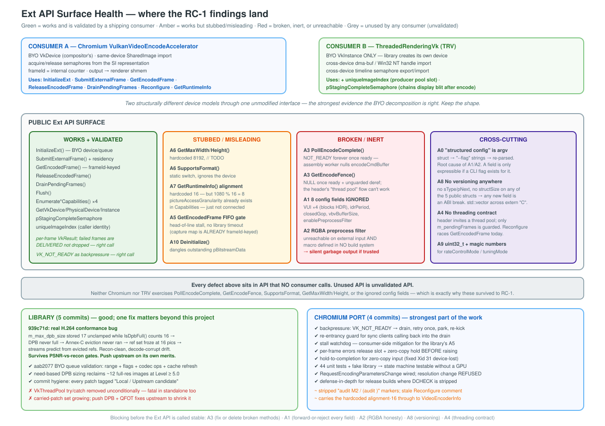

<!--
SPDX-FileCopyrightText: Copyright (c) 2026 NVIDIA CORPORATION & AFFILIATES. All rights reserved.
SPDX-License-Identifier: Apache-2.0

Internal engineering review. NOT published to the docs portal (docs/index.html) —
it contains driver-defect detail and pre-upstream findings.
-->

# Architecture Review — Vulkan Video Encoder Library Interface and Chromium Port

**Date:** 2026-07-25 · **Reviewer:** architecture review pass · **Status:** findings for RC-1
**Rev 2 (2026-07-27):** amended after two adversarial design workflows (23 agents) went deeper
than this pass. Four findings added (**A11–A14**), and **A1/A2 corrected — both were understated**.
The fixes are designed in [`VULKAN_VIDEO_ENCODER_API_V2_DESIGN.md`](VULKAN_VIDEO_ENCODER_API_V2_DESIGN.md);
this document remains the findings register, that one is the resolution.

## 0. Scope and evidence base

| Artifact | Revision reviewed |
|---|---|
| Chromium port | `visgarg/src` branch `RC-1`, last 4 commits `42614c8 → 31391da` (498 files, +174,673) |
| NVPRO samples | `visgarg/vk_video_samples` branch `RC-1`, last 5 commits `ac52930 → 9e491cb` (20 files, +1,882/−94) |
| Second consumer | `ThreadedRenderingVk_Standalone` (TRV) `07e6429`, `src/encoder/EncoderInstance.{h,cpp}` (4,335 lines) |
| Execution plan | `VULKAN_VIDEO_ENCODE_INTEGRATION_DESIGN_DOCUMENT.md` §11 (6 phases, 18–21 eng-weeks) |

All findings below were verified in source; file:line references are to the revisions above.

---

## 1. Executive assessment

**The port is in good shape and the BYO-device design is right. The Chromium-side code is the strongest part of the work. The library's public `Ext` API is the weakest — not because its shape is wrong, but because a meaningful fraction of its advertised surface is inert, stubbed, or broken, and it has no versioning or threading contract.**

| Dimension | Verdict |
|---|---|
| Interface **shape** (BYO device, external frames, async retrieval, caps-before-init) | **Good** — validated by two structurally different consumers |
| Interface **honesty** (does the surface do what it says) | **Poor** — 8 config fields silently ignored, 2 methods broken, 3 stubbed |
| **Expandability** (add features without breaking callers) | **Weak** — no version/pNext in any public struct; argv marshalling taxes every new field |
| **Robustness** (error paths, lifetime, concurrency) | **Mixed** — good per-frame error delivery; no threading contract; head-of-line stall risk |
| Library **implementation** (the 5 commits) | **Good** — includes a genuine conformance bug fix |
| Chromium **port** (the 4 commits) | **Very good** — defensive, well-tested, honest about gaps |
| Alignment with the **execution plan** | **Ahead** on device sharing, **behind** on P5/P6 — consistent with "encode first" |

**Bottom line:** the design is sound enough to build on and the port is close to upstream-ready. But **the `Ext` API should not be treated as stable until §3's A0–A3 are addressed** — once Chromium, TRV, and any third consumer are on it, these get expensive to change.

---

## 2. What the two-consumer split proves (and it is the strongest evidence in this review)

The API is exercised by two consumers that stress *complementary* halves of the contract. That is unusually good validation for an interface this young:

| | **Chromium VEA** | **TRV** |
|---|---|---|
| Device model | **BYO `VkDevice`** (compositor's), same-device | **BYO `VkInstance` only** — library creates its own device (`EncoderInstance.cpp:780`) |
| Input arrival | SharedImage → `ProduceVulkanVideo` → same-device `VkImage` | **dma-buf / Win32 NT handle import, cross-device** (`importDmaBufForEncoder`) |
| Sync | acquire/release semaphores from the SI representation | **cross-device timeline semaphore export/import** (`vkImportSemaphoreFdKHR` onto the encoder device) |
| Output | `GetEncodedFrame` → copy into renderer shmem | `GetEncodedFrame` → file / IPC |
| Frame identity | `frameId` = internal counter | `uniqueImageIndex` = **producer pool slot** (`:2451`) |
| Chaining | none | **`pStagingCompleteSemaphore`** to chain a display blit after encode |

**This is the real justification for the BYO design.** A single-consumer API would have hard-coded one of these models. Both work through the same entry points, which means the `externalInstance` / `externalPhysicalDevice` / `externalDevice` decomposition (rather than one opaque "context" handle) is the correct granularity. Keep it.

Two specific design elements are validated by TRV and should be preserved:
- **`uniqueImageIndex` as caller-supplied pool identity** — TRV's comment (`:2449`) records that the earlier `(frameId>>4)` scheme aliased 16 frames onto one index. Caller-owned identity is right; the library cannot infer it.
- **`pStagingCompleteSemaphore` as an optional out-param** — lets a consumer interpose work between "encoder done reading input" and "input released". Chromium doesn't need it; TRV can't work without it. Good extension point.

**Gap:** neither consumer exercises `Reconfigure()`, `PollEncodeComplete()`, `GetEncodeFence()`, `SupportsFormat()`, or `GetMaxWidth/Height()`. Every one of those is where the defects in §3 are. **Unused API is unvalidated API.**

---

## 3. Interface findings, severity-ranked

### A0 — HIGH · The "structured config" is argv marshalling underneath

`InitializeExt()` → `BuildEncoderConfig()` (`vulkan_video_encoder_ext.cpp:152–370`) converts the struct into `std::vector<std::string>` of `"--encodeWidth", "1920", …` and re-parses it through the CLI `ParseArguments`. The header's promise — *"Encoder Configuration (structured, not argc/argv)"* (`vulkan_video_encoder_ext.h:70`) — is skin-deep.

Consequences, all observed in the code:
- **A field is only expressible if a CLI flag exists for it.** Fields without one are poked into members afterwards — the code says so: *"Frame rate: no CLI arg for this in ParseArguments — set via member directly after config"* (`:203`).
- **Type safety is round-tripped through strings** (`std::to_string` → parse), and malformed input surfaces as *"Unknown positional args"* console noise — which is precisely why `silenceStdio` had to be invented.
- **Every new config field costs three edits** (struct, CLI flag + parser, marshaller) instead of one.

This is the root cause of A1 and A2 below. It is the single biggest obstacle to "flexible and expandable".

**Recommendation:** invert it. Populate `EncoderConfig` members directly from the struct and keep `ParseArguments` for the CLI sample only. This is a mechanical, well-bounded refactor and it is worth doing *before* more callers arrive.

### A1 — HIGH · Ten documented config fields are silently ignored

> **Rev 2 correction — this was understated.** The count is **ten, not eight**. Added:
> `frameRateNum`/`frameRateDen` (see **A11** — this one is a live bug, not a latent gap),
> `verbose` (dropped behind a factually incorrect comment; `--verbose` **is** parsed at
> `VkEncoderConfig.cpp:826-827` — only `--validate` genuinely lacks a flag), and
> `minQp`/`maxQp`, which are forwarded to **write-only base members**: the derived
> `EncoderConfigH264/H265` structs shadow them and are what `GetRateControlParameters`
> actually reads, so a binder written against the base type silently no-ops.
> Also: the four VUI fields need **three extra presence writes**
> (`video_signal_type_present_flag=1`, `color_description_present_flag=1`, `video_format=5`)
> or the SPS writers drop them regardless — they are dead on *every* channel today,
> including the JSON loader.

Verified by direct grep of `vulkan_video_encoder_ext.cpp` — **zero references** to any of:

| Field | Documented as | Actual effect |
|---|---|---|
| `enablePreprocessFilter` | *"RGBA input that needs RGBA→NV12 conversion"* | **none** |
| `colourPrimaries`, `transferCharacteristics`, `matrixCoefficients`, `videoFullRange` | *"Color info (VUI)"* | **none** — encoder always emits its default VUI |
| `idrPeriod`, `closedGop` | GOP structure | **none** |
| `vbvBufferSize` | HRD/CPB sizing | **none** |

The caller sets them, `InitializeExt()` returns `VK_SUCCESS`, and nothing happens. There is no validation and no diagnostic.

The VUI group is not academic: our own `VULKAN_VIDEO_ENCODER_PROCESSING_GRAPHS.md` records that Chromium hardcodes `encoded_color_space = REC709` because "the VUI is hardcoded BT.709-limited". **This is the root cause** — the plumbing exists in the public struct and stops at the marshaller. HDR/BT.2020 encode is blocked by four unforwarded bytes.

**Recommendation:** every public field must either be forwarded or rejected at `InitializeExt()` with a distinct error. "Accepted and ignored" is the worst option for an API that other teams will build on.

### A2 — HIGH · `enablePreprocessFilter` cannot work on the external-input path *by construction*

> **Rev 2 correction — this was understated.** The outcome is **a crash, not silent garbage**:
> an RGBA external frame is accepted by `SupportsFormat()`, routed to non-direct-encode by
> `SetExternalInputFrame`, and **dereferences a null `VkMpFormatInfo` in
> `CopyLinearToOptimalImage`**. Two further blockers were missed: the filter has **no sampled
> read path at all** (it uses `imageLoad` from a `STORAGE_IMAGE` with a hardcoded `rgba8`
> format qualifier — zero `texelFetch`/`sampler2D` in 4,462 lines), and it compiles GLSL **at
> runtime via `shaderc`, which Chromium does not vendor**. Also note **TRV is not a
> precedent**: it converts RGBA→NV12 **producer-side** on its own storage-capable image and
> ships NV12 over the dma-buf. In-library conversion for cross-process use is new territory.
> One more: every existing filter gate in the tree checks `optimalTilingFeatures`, which is
> **wrong for DRM-tiled images** — the correct predicate is per-modifier
> `drmFormatModifierTilingFeatures`.

Two independent blockers, either sufficient:

1. **Compile-gated off everywhere.** `VK_VIDEO_SAMPLES_COMPUTE_FILTER_SUPPORTED` is referenced by three source files but **defined in no CMakeLists, no `.gni`, and no `BUILD.gn`** in either tree (Chromium's `third_party/vulkan_video_samples/BUILD.gn:72,91` defines only the three `VK_USE_VIDEO_*_QUEUE` macros). With it undefined, `VkVideoEncoder.cpp:843` compiles to `if (true)` — the plain LINEAR→OPTIMAL copy — and the entire filter branch (`:904–959`) is removed. The `ac52930` commit message acknowledges this.
2. **Structurally skipped even when defined.** `VkVideoEncoder.cpp:842` reads `if (m_inputComputeFilter == nullptr || encodeFrameInfo->isExternalInput)` — external input **always** takes the no-filter path. The in-code rationale (`:838–840`) is sound: storage reads on an imported DRM-modifier image can't be serviced on compressed block-linear memory.

Meanwhile `SupportsFormat()` (`:886–905`) returns **`VK_TRUE`** for six RGBA formats, and `inputFormat`'s only use in the marshaller is deriving bit depth (`:191–202`) — RGBA is never communicated to the encoder config at all.

**Net effect:** a caller that trusts `SupportsFormat(VK_FORMAT_B8G8R8A8_UNORM)`, sets `enablePreprocessFilter = VK_TRUE`, and submits an RGBA external image gets a raw copy of RGBA bytes into an NV12-expecting encode image — **silently garbled output, no error at any layer.**

> **This corrects our own architecture docs.** `VULKAN_VIDEO_ENCODER_PROCESSING_GRAPHS.md` §3.1 (and the blog's P3-RGBA section) states the library "already ships the GPU converter" and frames RGBA zero-copy as three Chromium-side changes. **That is wrong as of RC-1**: the filter is unreachable from `SubmitExternalFrame` and unbuilt in both trees. P3-RGBA needs library work first — filter into a storage-capable intermediate, then encode. I will correct those documents.

**Recommendation (pick one, now):** (a) make `SupportsFormat` device- and path-aware so RGBA reports `VK_FALSE` for external input, **and** reject RGBA + external at `InitializeExt()`; or (b) implement filter-on-external-input via a storage-capable staging image. (a) is the honest one-day fix; (b) is the feature.

### A3 — HIGH · `PollEncodeComplete()` and `GetEncodeFence()` are broken by design drift

Both gate on `pending.encodeFrameInfo->encodeCmdBuffer` (`:715–731`, `:816–825`). The async assembly worker calls `frameInfo->Reset(true)` on that same shared node when it captures the bitstream — **nulling `encodeCmdBuffer` exactly when the frame becomes ready.**

`GetEncodedFrame`'s own comment (`:740–755`) documents this root cause precisely and works around it by gating on captured *bytes* instead. **The other two entry points were never updated.** Result:
- `PollEncodeComplete(frameId)` returns `VK_NOT_READY` **forever** for a completed frame.
- `GetEncodeFence(frameId)` returns `VK_NULL_HANDLE` once ready — i.e. the "wait on this fence in a thread pool" workflow the header advertises (`:431–435`) cannot be built.
- `GetEncodeFence` also dereferences `pending.encodeFrameInfo->` with no null check.

Undetected because **neither consumer calls them** (§2). A third-party integrator following the header would hit this on day one.

**Recommendation:** reimplement both on the capture-based readiness signal, or **delete them from the interface**. Deleting is defensible — `GetEncodedFrame` covers both use cases — and is far better than shipping known-broken surface into an ABI.

### A4 — MEDIUM · No threading contract

The header never states which methods may be called concurrently. Internally, only `m_pendingFrames` is guarded (`m_pendingMutex`); `m_encoder`, `m_initialized`, and `m_rateControlMode` are read/written **unlocked** by `InitializeExt` / `Reconfigure` / `Deinitialize` while `GetEncodedFrame` runs under the lock. A concurrent `Reconfigure()` + `GetEncodedFrame()` is a data race today.

Chromium is safe by construction (one `encoder_sequence_checker_`). But the header actively *invites* the unsafe pattern: *"The caller can wait on this fence externally (e.g. in a thread pool)"* (`:432`).

**Recommendation:** document the contract explicitly — "all methods externally synchronized except `GetEncodedFrame`/`ReleaseEncodedFrame`, which may be called from one dedicated retrieval thread" — and make the state it names actually safe.

### A5 — MEDIUM · Head-of-line blocking with no library-side timeout

`GetEncodedFrame` is strict FIFO on `m_pendingFrames.front()` gated on `hasCapture` (`:777–782`). Any submitted frame that never produces a capture stalls **the entire pipeline permanently** — no timeout, no diagnostic, no way to skip.

The known benign case is the deferred GOP tail (needs `DrainPendingFrames()`), which Chromium handles with its own stall watchdog. The dangerous case is a partially-failed submission that leaves a pending entry with no capture.

Note the irony: the capture map is **already keyed by `frameId`** and the matching loop is a linear scan over all pending frames — the data structure supports out-of-order retrieval; only the delivery gate is FIFO.

**Recommendation:** add a `GetEncodedFrameById(frameId)` or a submitted-but-unretrieved deadline. The FIFO gate should not be the only door.

### A6 — MEDIUM · Capability methods are stubs that mislead

- `GetMaxWidth()` / `GetMaxHeight()` return **hardcoded 8192** with `// TODO: query from device capabilities` (`:907–917`).
- `SupportsFormat()` is a static switch ignoring the device entirely (`:886`).

The header presents these under *"=== Capability Query ===  Can be called before InitializeExt() to check support"* (`:452–458`). Chromium correctly bypasses them for the free-function enumerators — good instinct — but the trap remains for the next caller.

**Recommendation:** back them with the same `VkVideoEncoderCapabilities` probe that already exists, or remove them. The probe path is right there.

### A7 — MEDIUM · `VideoEncoderInfo` alignment is hardcoded 16 — and 1080 isn't a multiple of 16

`GetRuntimeInfo()` sets `requestedResolutionAlignmentWidth/Height = 16` unconditionally with `applyAlignmentToAllSimulcastLayers = VK_TRUE` (`:967–971`), reasoning that over-alignment is safe.

**Over-alignment is not free at this layer.** Chromium/WebRTC honor `requestedResolutionAlignment` by *adjusting the encode resolution*. 1080 — the most common video height in existence — is not a multiple of 16 (1080/16 = 67.5). The practical outcome is 1920×1080 being coerced to 1920×1072 or padded to 1088, a visible behavior difference from the VA-API path.

The correct datum, `pictureAccessGranularity`, is **already a field in `VkVideoEncoderCapabilities`** (`vulkan_video_encoder_ext.h:522–524`). The plumbing exists; it just isn't connected.

**Recommendation:** connect it before the WebRTC use cases are tuned. Verify against real 1080p WebRTC behavior — this is exactly the kind of thing that shows up as an unexplained resolution change in a demo.

### A8 — MEDIUM · No versioning or extension mechanism in any public struct

None of `VkVideoEncoderConfig`, `VkVideoEncodeInputFrame`, `VkVideoEncodeResult`, `VkVideoEncoderRuntimeInfo`, or `VkVideoEncoderCapabilities` carries an `sType`/`pNext` chain or a `structSize`/`version` field. Adding **any** field is an ABI break for a shared-library consumer, and a silent struct-layout mismatch for a statically vendored one built from a different header revision.

The header reasons carefully about ABI in one place — deliberately avoiding `<vk_video/…>` std types so the public header carries no std dependency (`:41–51`) — and then uses **`std::vector` members in `VkVideoEncoderCapabilities`** (`:538–543`) across an `extern "C"` boundary. That is not C-ABI-safe and binds the caller to the identical STL, compiler, and flags. Fine for the vendored static-link model; **not** fine for the "cross-process encoder services" the header's own overview advertises (`:29`), nor for a `.so`.

The `h264StdFlags` comment claims vectors allow "a future multi-profile probe … without an ABI change" — true for *contents*, but the struct still can't gain a *field*.

**Recommendation:** add `uint32_t structVersion` (or sType/pNext) to each public struct now, while there are two in-tree consumers, and replace the `std::vector`s with `count` + caller-allocated array (the standard Vulkan two-call idiom the rest of the design already mirrors).

### A9 — LOW · Type safety given away for no benefit

`rateControlMode` and `tuningMode` are `uint32_t` with the enum mapping in a **comment** (`:89–94`, `:119–124`), then re-derived by magic-number comparison in the marshaller (`extConfig.rateControlMode == 2 /* CBR */`) and again in `GetRuntimeInfo` (`m_rateControlMode == 2u || m_rateControlMode == 3u`). The header already includes `<vulkan/vulkan.h>` — `VkVideoEncodeRateControlModeFlagBitsKHR` and `VkVideoEncodeTuningModeKHR` are available at zero cost. Use them.

### A10 — LOW · Lifetime and defensive gaps

- **`Deinitialize()` invalidates outstanding bitstream pointers.** It clears `m_pendingFrames` (`:978–982`) without requiring `ReleaseEncodedFrame`, dangling any `pBitstreamData` the caller still holds against the documented contract (`:304`, `:420–423`). Document or drain.
- **`ReleaseEncodedFrame(unknownId)` is a silent no-op** — a double-release or a typo'd id is undiagnosable.
- **`OverrideImportedQueueFamilies`** range-checks against `queues.size()` then indexes `videoQueues[]` and `queryResultStatus[]` (`VulkanDeviceContext.cpp`) — OOB if `vk::get` ever returns unequal sizes. Cheap to assert.

---

## 4. Library implementation review (the 5 samples commits)

**Overall: good, and one commit is materially valuable beyond this project.**

**`939c71d` "encoder: correctness fixes" contains a genuine H.264 conformance bug fix.** `VkEncDpbH264::DpbSequenceStart` stored the Vulkan session slot count (17 at Level ≥ 5.0) unclamped into `m_max_dpb_size`, while `IsDpbFull()` counts occupancy over `i < MAX_DPB_SLOTS` (16). The DPB therefore **never reported full, Annex-C sliding-window eviction never ran, and the short-term reference set froze at the first 16 pictures** — emitting streams that predict from pictures a conforming decoder has already evicted. Recon-clean, decode-corrupt, progressive drift. This is the class of bug that survives PSNR-vs-recon gates and only shows up on a real decoder. The fix mirrors the H.265 path, which always clamped. **This should go upstream on its own merits, independent of Chromium.**

The same commit's need-based DPB sizing (`InitDpbCount`, was `dpbCount = 0 // TODO: What is the need for this?`) reclaims ~12 full-resolution DPB images at Level ≥ 5.0. Real memory win.

**`aab2077` BYO device/queue discipline is correctly implemented.** `OverrideImportedQueueFamilies` validates family index range, `VK_QUEUE_VIDEO_ENCODE_BIT_KHR`, the requested codec ops, and `VK_QUEUE_COMPUTE_BIT`, then refreshes the cached per-family metadata (`m_videoEncodeNumQueues`, `m_videoEncodeQueryResultStatusSupport`) rather than leaving it stale. The `externalDevice`-requires-`externalPhysicalDevice` rejection is the right call — Vulkan genuinely offers no way back from a logical handle. This is the strongest part of the library changes.

**`9e491cb` AV1 TD OBU prepend** is spec-motivated and correctly scoped to capture mode only. Good.

**Concerns:**
- **`ac52930` removes the worker-task `try/catch` from `VkThreadPool.h` unconditionally**, making task exceptions process-fatal *in every build including upstream standalone*. The commit message is admirably explicit that this is not behavior-neutral outside Chromium. Chromium builds `-fno-exceptions` so it's moot there — but this is a behavioral regression pushed onto every other consumer of the shared header. Should be `#if defined(__cpp_exceptions)`.
- **The `VK_VIDEO_SAMPLES_COMPUTE_FILTER_SUPPORTED` define exists in no build system** (A2). Whatever the resolution, the current state — a feature referenced by three files, gated by a macro nothing defines — is a trap.
- **Upstream divergence is tracked but growing.** Every commit message carries an explicit *"Local patch; not in upstream"* / *"Upstream candidate: yes/likely"* annotation. **This is exemplary practice for a vendored fork** and should be kept. But 5 commits with ~8 carried patches is already a rebase burden; the DPB fix and the FOREIGN QFOT barrier should be pushed upstream soon so the fork shrinks rather than grows.

---

## 5. Chromium port review (the 4 commits)

**This is the highest-quality part of the work.** Evidence, all in `media/gpu/vulkan/vulkan_video_encode_accelerator.cc`:

- **Backpressure done properly.** `SubmitExternalFrame` returning `VK_NOT_READY` is treated as flow control, not error: drain, retry once, then park the frame and re-kick on retirement (`:2309–2313`). Staging-pool exhaustion likewise.
- **Re-entrancy guard** on `DrainReadyOutput` for sync clients that call `UseOutputBitstreamBuffer` from inside `BitstreamBufferReady` (`:2860–2867`).
- **Stall watchdog** with `last_progress_ticks_` / `emitted_any` forward-progress tracking — the correct mitigation for A5, implemented on the *consumer* side because the library offers none.
- **Per-frame error surfacing.** `result.status != VK_SUCCESS` releases the frame, retires the staging slot and the zero-copy hold, *then* raises a terminal error (`:2894–2907`) — no silent drops, no leaked slots on the error path.
- **Hold-to-completion for zero-copy inputs**, with the in-code root cause recorded: releasing the SharedImage representation at submit time unmapped the import's VA before the library's async copy read it → *"Xid 31 CE2 VIRT_READ device-lost"*. That is a hard-won bug, correctly fixed and correctly documented.
- **Defense-in-depth null checks** with explicit reasoning about release builds where `DCHECK` is stripped (`:2849–2856`).
- **44 unit tests** plus `fake_vulkan_video_encoder_ext.{h,cc}` — the fake is what makes the state machine testable without a GPU, and it is the right investment.
- **`RequestEncodingParametersChange` is now wired** to the library's rate-control `Reconfigure`, with mid-stream *resolution* change explicitly refused rather than silently ignored (`:2567–2600`). This closes the gap flagged in the earlier `dev`-branch review.

**Concerns:**
- Comments contain **stripped audit references** — "audit M2", "audit L5", "(audit )" with an empty token at `:2578`. Whatever tool populated these left dangling markers; clean before upstreaming, since Chromium reviewers will ask what M2 is.
- `GetRuntimeInfo`'s stale comment claims `Reconfigure()` is a "stub today" — no longer true after `c0976f1`.
- The port carries the A7 alignment value through to `VideoEncoderInfo` unexamined.

---

## 6. Execution-plan alignment (DDD §11)

| Phase | Plan | RC-1 actual |
|---|---|---|
| P1 Foundation | **private** media `VkDevice` | **Compositor BYO device instead** — P4's optional item pulled forward |
| P2 H.264 CQP + shmem | ✔ | ✔ done, PSNR-gated |
| P3 CBR/VBR + params change | ✔ | ✔ done (`RequestEncodingParametersChange` wired) |
| P4 GPU-backed input | SharedImage + `ProduceVulkanVideo` | ✔ done |
| P5 HEVC + AV1 | full delegates | **partial** — AV1 capture + TD OBU; profiles advertised, not conformance-validated |
| P6 Advanced (SVC, QP map, intra-refresh, manual refs) | — | **not started**, consistent with `RuntimeInfo` reporting `VK_FALSE` |

**Deviation worth endorsing:** skipping the private-device phase in favor of the compositor's `VkDevice` from the start. The plan hedged (F11) toward a private device for debuggability; going BYO-first is what makes the zero-copy seam real, and the BYO validation in `aab2077` is what makes it safe. The plan should be updated to record this.

**Deviation worth watching:** P5 is being reported as "advertised" on the strength of capability probes, not conformance runs. Advertising H.265/AV1 profiles that have not passed the Tier-5 gates is how you get bug reports from WebRTC users on day one.

---

### A11 — 🔴 CRITICAL (Rev 2) · Every Ext-API session is rate-controlled at 29.97 fps

A **live shipping defect**, not a design gap. Verified chain:

1. Chromium sets the real value — `lib_config.frameRateNum = vea_config.framerate; frameRateDen = 1` (`vulkan_video_encoder_config_builder.cc:132-133`).
2. `BuildEncoderConfig` **never forwards it**. The only read of `config.frameRateNum` in the entire ext impl is inside `Reconfigure()` (`vulkan_video_encoder_ext.cpp:883`).
3. There is **no `--frameRate` CLI flag** to carry it — the sole `frameRate` hit in `VkEncoderConfig.cpp` is the Y4M header parse (`:313`), a file-input path the ext API never takes.
4. The codec configs preseed `FRAME_RATE_NUM_DEFAULT = 30000` / `FRAME_RATE_DEN_DEFAULT = 1001` in their constructors (`VkEncoderConfigH264.h:111`, `H265.h:123`, `AV1.h:88`).

**Effect:** the rate controller (`pRcLayerInfo->frameRateNumerator`), the H.264/H.265 VUI
timing, and the AV1 IVF header all run at **29.97 fps regardless of the caller**. A 60 fps
screen share is budgeted for roughly half its true frame count → bitrate overshoot, plus
wrong timing metadata in the emitted stream. It self-corrects only if
`RequestEncodingParametersChange` later triggers a `Reconfigure`.

**Fix now — does not require v2.** This is the highest-value single-line-class fix in the register.

### A12 — HIGH (Rev 2) · `SubmitExternalFrame` blocks on a condition variable, on a sequence that forbids it

`SubmitExternalFrame` is **not asynchronous**: it runs inline through
`SetExternalInputFrame → EncodeFrameCommon → EnqueueFrame → PushOrderedFrames →
ProcessOrderedFrames`, executing `StartOfVideoCodingEncodeOrder`/`ProcessDpb`/
`RecordVideoCodingCmd`/`SubmitVideoCodingCmds` on the caller's thread
(`VkVideoEncoder.cpp:3472-3475`).

Worse, it **can block**: `QueueFramesForAssembly → VkThreadSafeQueue::Push` waits on
`m_condProducer` at capacity `numBitstreamBuffersToPreallocate` (default 8,
`VkThreadSafeQueue.h:38-52`, capacity set at `VkVideoEncoder.cpp:2575-2576`) with **no
timeout and no `VK_NOT_READY` escape** — bypassing the very backpressure contract the header
documents.

Chromium's VEA encoder sequence has `MayBlock()` but **not** `WithBaseSyncPrimitives()`
(`task_tracker.cc:447` installs a `ScopedDisallowBaseSyncPrimitives`). A condvar wait there
is both a policy violation and a latency hazard. Related: `m_enableEncoderThreadQueue` is
`false` at `VkVideoEncoder.h:624` and never set, so `ConsumerThread` is dead code.

### A13 — MEDIUM (Rev 2) · `m_capturedBitstreams` is an unbounded queue of full encoded frames

`VkVideoEncoder.h:1122-1123` — an unbounded `std::deque` of complete encoded frames with **no
eviction and no cap**. A consumer that stops draining grows it without limit. This compounds
**A5**: the head-of-line stall means "stops draining" is a reachable state, not a
hypothetical. Backpressure must be a non-blocking return at submit (see A12), and the queue
must be bounded.

### A14 — MEDIUM (Rev 2) · Three external-memory extensions are used but requested nowhere

`VK_EXT_external_memory_dma_buf`, `VK_EXT_image_drm_format_modifier`, and
`VK_EXT_queue_family_foreign` are absent from the required-extension list at
`vulkan_video_encoder_ext.cpp:400-418`, yet `CreateExportable` uses DMA_BUF handle types and
`StageInputFrame` uses `VK_QUEUE_FAMILY_FOREIGN_EXT`. Under BYO the list is inert anyway —
`VulkanDeviceContext::CreateVulkanDevice` skips `vkCreateDevice` entirely when
`externalDevice != VK_NULL_HANDLE` (`:1162-1172`). **Spec-invalid; works on NVIDIA by luck.**
Also unverified anywhere in the tree: `vkGetMemoryFdPropertiesKHR` has **zero call sites**
despite being the spec-required constraint on import memory-type selection.

Related Windows gap: the library's own Win32 memory **export** is stubbed —
`VulkanDeviceMemoryImpl.cpp:520-548` has the `GetMemoryWin32HandleKHR` call commented out and
returns `VK_SUCCESS` with a **null handle**.

## 7. Prioritized recommendations

> **Rev 2 — fix these first, ahead of everything below. Neither needs API v2:**
> 0a. **A11** — forward `frameRateNum/Den`. Every session today is rate-controlled at 29.97 fps.
> 0b. **A12** — make submit backpressure a non-blocking `VK_NOT_READY` return instead of a condvar wait.
>
> Resolutions for the whole register are designed in
> [`VULKAN_VIDEO_ENCODER_API_V2_DESIGN.md`](VULKAN_VIDEO_ENCODER_API_V2_DESIGN.md) (milestones M0–M8).

**Before declaring the `Ext` API stable (blocking):**
1. **A3** — fix or delete `PollEncodeComplete` / `GetEncodeFence`. Known-broken surface must not enter an ABI.
2. **A1** — forward-or-reject every config field; no silent ignores. Start with the VUI four (unblocks HDR) and `enablePreprocessFilter`.
3. **A2** — make `SupportsFormat` honest about RGBA-on-external-input, and resolve the `COMPUTE_FILTER` define.
4. **A8** — add a version/size field to the five public structs; replace `std::vector` in `Capabilities` with count+array.
5. **A4** — write the threading contract into the header and make the named state safe.

**Before upstreaming to Chromium (high):**
6. **A7** — connect `pictureAccessGranularity`; verify 1080p behavior end-to-end.
7. Push the **DPB clamp fix** and the **FOREIGN QFOT barrier** upstream to `vk_video_samples` to shrink the carried-patch set.
8. Clean the stripped "audit" markers and the stale `Reconfigure` comment.
9. Gate the `VkThreadPool` exception removal on `__cpp_exceptions`.

**Next cycle (medium):**
10. **A0** — replace argv marshalling with direct `EncoderConfig` population. Everything above gets cheaper afterwards.
11. **A5** — `GetEncodedFrameById` or a library-side deadline.
12. **A6** — back the instance capability methods with the real probe, or remove them.
13. Conformance-validate H.265/AV1 before advertising them.

**Documentation correction (immediate):** `VULKAN_VIDEO_ENCODER_PROCESSING_GRAPHS.md` §3.1 and the blog's P3-RGBA content overstate the compute-filter readiness (see A2). Correct both.

---

## 8. Answering the review questions directly

> **Is the interface a good design?**

The *shape* is good — BYO device decomposition, external frames with caller-owned identity and explicit residency, async retrieval decoupled from submission, capability query before session creation. Two structurally different consumers work through it unmodified, which is the real test. Keep the shape.

> **Is it flexible enough and expandable?**

**Not yet.** Three things block it: no struct versioning (A8), argv marshalling that taxes every new field (A0), and `std::vector` across a C boundary. Add versioning now while there are two consumers, not five.

> **Is it robust?**

**Partially.** Error *delivery* is genuinely well designed — per-frame `VkResult`, failed frames delivered rather than dropped, backpressure as a first-class return code. Against that: two broken methods, eight ignored fields, no threading contract, and a head-of-line stall with no library-side timeout. The Chromium port compensates for several of these on the consumer side, which is why the system works today — but the *library* is not yet robust on its own terms, and the next consumer won't have Chromium's defenses.

> **Is the port good?**

Yes. It is defensive, well-tested, honest in its comments about what is stubbed, and it fixed real hardware-level bugs (the VA-unmap device-lost, the DPB drift). It is close to upstream-ready modulo cosmetics.
