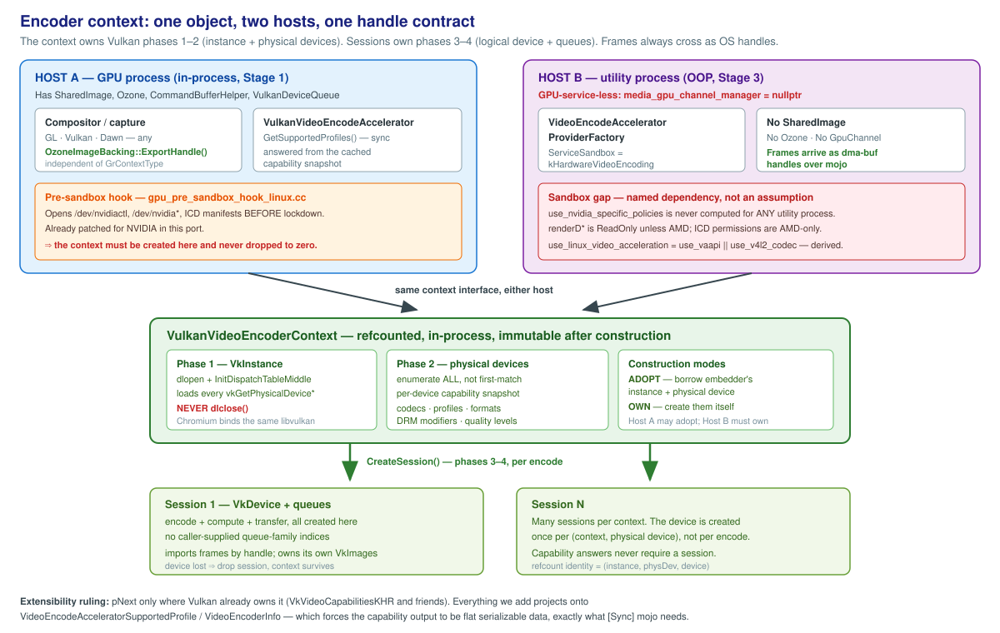

<!--
title: Vulkan Video Encoder — Context and Renderer-Agnostic Interface Design
status: design — implemented by RC-5
date: 2026-07-31
scope: vk_video_samples (library) + chrome/visgarg/src (browser integration)
-->

# Vulkan Video Encoder — Context and Renderer-Agnostic Interface Design

<!-- DOC-STATUS -->
> **Status: CURRENT.** Design of record for context/device ownership.
> Index: [`README.md`](README.md).


A refcounted encoder context that holds a live Vulkan instance and enumerated physical devices,
answers capability queries without creating or destroying devices, and hands frames across as OS
handles regardless of whether the browser renders with GL, D3D, Metal or Vulkan.

**Status:** design — **implemented by RC-5**. The device-model demotion, the adopt-by-context
interface, encode-site input adaptation and the glslang-enabled compute filter all landed; see
`VULKAN_VIDEO_ENCODER_RC5_REVIEW` for the conformance
table and the four open findings.
**Verified against:** upstream Chromium `main`, fork `visgarg/src` RC-2, `vk_video_samples` RC-2,
and `ThreadedRenderingVk_Standalone` (TRV) as the renderer-agnostic reference client.



---

## 1. Requirements and settled decisions

**R1 — Encoder context.** A refcounted object, creatable in the same or a different process,
holding a live Vulkan context so capabilities — supported codecs, profiles, formats, DRM
modifiers, quality and rate-control modes — can be queried **without repeatedly creating and
destroying devices**. It enumerates devices and is later used to create per-session device and
queue contexts. It lives in the NVPRO library.

**R2 — Renderer-agnostic.** No assumption that the renderer is GL, D3D, Metal or Vulkan.
Everything crosses as OS handles and/or IPC, as TRV already does.

Decisions taken before this design and **not** re-opened here:

| Decision | Consequence |
| --- | --- |
| Reuse Chromium's out-of-process `VideoEncodeAcceleratorProvider` | No new process model is invented |
| IPC/mojo marshalling stays in the browser | The library exports plain versioned data, never a transport |
| Capability queries stay cheap and synchronous | `GetVideoEncodeAcceleratorSupportedProfiles()` is `[Sync]` on the wire — a requirement, not a preference |
| Refcounting is in-process only | Cross-process lifetime belongs to the mojo connection |
| **No new `pNext` extension mechanism** | `pNext` only where Vulkan already owns it; everything we add projects onto `VideoEncodeAcceleratorSupportedProfile` / `VideoEncoderInfo` |
| In-process first; cross-process is a later, separable stage | Stage 1–2 deliver value with no Chromium core change |

The extensibility ruling has a useful side effect: it forces the library's capability output to
be **flat, serializable, versioned data** rather than a live object graph — which is exactly what
a `[Sync]` mojo call requires. The constraint and the transport agree, so it costs nothing.

---

## 2. Ground truth

### 2.1 The OOP encode mechanism already exists

Three mojo interfaces, one per hop:
`VideoEncodeAcceleratorProviderFactory` → `VideoEncodeAcceleratorProvider` →
`VideoEncodeAccelerator`, all in `media/mojo/mojom/video_encode_accelerator.mojom`. The factory
carries `[EnableIf=allow_linux_video_acceleration,
ServiceSandbox=sandbox.mojom.Sandbox.kHardwareVideoEncoding]` at `:102-104`. Capability query is
`[Sync] GetVideoEncodeAcceleratorSupportedProfiles()` at `:81`.

The browser-side launcher is seven lines —
`content/browser/media/video_encode_accelerator_provider_launcher.cc:13-15`,
`ServiceProcessHost::Launch(...).WithDisplayName("Video Encoder")` — driven lazily from the
renderer binder at `render_process_host_impl_receiver_bindings.cc:361-368` with
`reset_on_disconnect()`, so a crash respawns on next bind.

**Two gating facts that matter more than the interfaces:**

- `use_linux_video_acceleration = use_vaapi || use_v4l2_codec` (`media/gpu/args.gni:58`) is a
  **derived global, not a `declare_args` knob.** A Vulkan-only build has no OOP encode sandbox
  type and no mojom interface at all. Making OOP work for Vulkan requires changing that
  expression — a named upstream dependency.
- `kUseOutOfProcessVideoEncoding` is `FEATURE_DISABLED_BY_DEFAULT`
  (`media/base/media_switches.cc:1248`). The OOP path has effectively no field coverage on Linux.
  It is a foundation to build on, not a tested baseline.

### 2.2 The utility process is GPU-service-less, and that is good news

`mojo_video_encode_accelerator_provider_factory.cc:40-45` constructs the provider with default
`gpu::GpuPreferences()`, `gpu::GpuDriverBugWorkarounds()`, `gpu::GPUInfo::GPUDevice()` and
**`/*media_gpu_channel_manager=*/nullptr`**. That null short-circuits `GetCommandBufferHelper()`
at `mojo_video_encode_accelerator_provider.cc:47-49`. Consequence: **no `GpuChannel`, no
`CommandBufferStub`, no `SharedImageManager`, no `SharedContextState`, no
`gpu::VulkanDeviceQueue`, and no Ozone.**

It is not, however, GPU-*less*: `content/utility/utility_main.cc:151-165` runs
`gpu::CollectBasicGraphicsInfo`, and the pre-sandbox hook opens the DRM render node
(`media/gpu/sandbox/hardware_video_encoding_sandbox_hook_linux.cc:115`).

This is the strongest architectural argument in the whole design. In that host there is no
SharedImage to borrow a `VkImage` from, so **input must arrive as dma-buf handles over mojo** —
which is the renderer-agnostic model, arriving for free. The two hosts differ in how a frame is
*obtained*, not in what the library is *handed*. Design the handle contract first and treat
in-process as the special case where the handle happens to come from a SharedImage.

### 2.3 Sandbox: the syscall layer is fine, the file broker is the blocker

`kHardwareVideoEncoding` reuses the GPU policy outright —
`sandbox/policy/linux/sandbox_seccomp_bpf_linux.cc:223-227` calls
`GetGpuProcessSandbox(options, MremapPolicy::kBlock)`, and `bpf_gpu_policy_linux.cc:46-48,81-82`
allow `IsDlopen(sysno)` and unrestricted `ioctl`. So loading an ICD and talking to a driver is
permitted at the syscall level.

What the hook permits today (`hardware_video_encoding_sandbox_hook_linux.cc`): V4L2 encoder
nodes; `/dev/dri/renderD128..137` **`ReadOnly` unless AMD** (`:86-88`); AMD-only
`COMMAND_READLINK`, `/sys` access, `/usr/share/vulkan/icd.d` with a hardcoded
`radeon_icd.x86_64.json` (`:72-75`), and AMD-only `dlopen("libvulkan.so.1")` (`:131-132`).
**Zero occurrences of `nvidia` in the file.**

And a dead flag underneath it all: `content/utility/utility_main.cc:376` sets only
`sandbox_options.use_amd_specific_policies`. `use_nvidia_specific_policies` is **never computed
for any utility process**, unlike `content/gpu/gpu_main.cc:520`. So no NVIDIA branch is reachable
there today, in either the hook or the BPF variant selection.

The working port sidesteps all of this by staying in the GPU process and patching only
`content/common/gpu_pre_sandbox_hook_linux.cc` — `/dev/nvidiactl` RW at `:525/:541`,
`nvidia_icd.json` at `:511`, wired at `:782-783`. `hardware_video_encoding_sandbox_hook_linux.cc`
is byte-identical to upstream across the whole branch.

**Exact additive delta to host a Vulkan device in `kHardwareVideoEncoding`:**

1. Compute `use_nvidia_specific_policies` in `utility_main.cc` — prerequisite for everything else.
2. `COMMAND_READLINK` for non-AMD (sysfs symlinks).
3. `/dev/nvidiactl`, `/dev/nvidia0..9`, `/dev/nvidia-modeset` RW; `/proc/driver/nvidia/params` RO;
   upgrade `/dev/dri/renderD*` to **ReadWrite** for NVIDIA; `/dev/dri` directory RO.
4. ICD and layer manifests — `AddVulkanICDPermissions` currently lives only in `content/common`
   and is not linked from `media/gpu/sandbox`; move it to a shared target or duplicate it.
5. Validate `MremapPolicy::kBlock` against the NVIDIA driver's unified-memory paths.

`/dev/nvidia-uvm` is **not** required — it appears nowhere in `content/`, `sandbox/` or `media/`
in either tree, and the Vulkan path does not use it.

### 2.4 The library already has the phase split R1 needs

`common/libs/VkCodecUtils/VulkanDeviceContext.cpp`:

| Phase | Function | What it establishes |
| --- | --- | --- |
| 1 | `InitVulkanDevice` / `InitVkInstance` | `dlopen` (`:75`), `InitDispatchTableTop`, `vkCreateInstance`, `InitDispatchTableMiddle` (`:988-996`) |
| 2 | `InitPhysicalDevice` | enumerate + filter by `deviceID`/UUID (`:661-679`), queue-family probe, `PopulateDeviceExtensions()` (`:849`), `m_physDevice` (`:832`) |
| 3–4 | `CreateVulkanDevice` | `InitDispatchTableBottom` (`:1190`), `GetDeviceQueue` (`:1210-1220`) |

**Context = phases 1+2. Session = phases 3+4.** No state needs re-partitioning, only relocating.

Decisively: every `vkGetPhysicalDevice*` entry point the capability path needs is loaded at
**instance** level in `InitDispatchTableMiddle` — `HelpersDispatchTable.cpp:96,99,102` for
`VideoFormatPropertiesKHR`, `VideoCapabilitiesKHR`, `VideoEncodeQualityLevelPropertiesKHR`, and
`:33-34` for `FormatProperties2`/`ImageFormatProperties2`. **Capabilities need no `VkDevice`**,
which is exactly what R1 asserts.

The refcount idiom already exists — `VkVideoRefCountBase.h:22-28`, with
`template<class T> using VkSharedBaseObj = std::shared_ptr<T>;` and the factory shape
`VkResult Create…(…, VkSharedBaseObj<T>& out)`. R1 gets thread-safe refcounting for free; do not
invent one.

**What must break:** `VulkanVideoEncoderExtImpl` holds `VulkanDeviceContext m_vkDevCtx;` **by
value** (`vulkan_video_encoder_ext.cpp:233`). That becomes a
`VkSharedBaseObj<VulkanVideoEncoderContext>`.

**What must not happen:** do *not* make `VulkanDeviceContext` itself refcounted. Its destructor
unconditionally `dlclose()`s (`:1319`) and destroys non-imported instances (`:1271-1301`). Wrap
that ownership once, inside the context, and never let it run in a Chromium process — Chromium's
`gpu::VulkanFunctionPointers` are bound to the same library.

**Device enumeration does not exist.** `InitPhysicalDevice` is a first-match selector with
`deviceId`/UUID filters; nothing returns a device list or a per-device capability array. R1's
enumeration requirement is net-new API. Note `deviceId` matches
`VkPhysicalDeviceProperties::deviceID`, not an ordinal — it cannot disambiguate two identical
GPUs, so `gpuUUID` is the real selector.

### 2.5 What the capability path does today, and what a context fixes

`media/gpu/vulkan/vulkan_video_encode_capability_enumerator.cc` loops a five-entry candidate
table (`:82-98` — H.264 Baseline/Main/High, HEVC Main, AV1 Main) calling
`…ProfileCapabilitiesEphemeral(/*deviceId=*/-1, …)` at `:220-221`. Each call builds a fresh
`VulkanDeviceContext`: `dlopen` + layer/extension enumeration + `vkCreateInstance` +
`vkEnumeratePhysicalDevices` + per-device extension enumeration + the capability query, then
`vkDestroyInstance` + `dlclose`. **Five full loader and instance bring-ups per cache
computation.** No `VkDevice` is ever created.

| # | Defect | Fixed by a persistent context? |
| --- | --- | --- |
| D1 | Five loader/instance bring-ups per computation | **Yes** — becomes five `vkGetPhysicalDeviceVideoCapabilitiesKHR` calls |
| D2 | The cost is asserted, never measured — no `TRACE_EVENT`, timer or UMA on the path | **No.** Instrument before claiming the win |
| D3 | Unsynchronised lazy cache fill; the comment claims GPU-main-thread callers (`:336-338`) but production callers are per-provider ThreadPool sequences (`gpu_service_impl.cc:654`) | **No** — refcounting does not serialise. Publish an immutable snapshot built in the constructor |
| D4 | Hand-rolled cache invalidation via `IsProbeInfraFailure()` (`:150-167`) | **Yes, structurally** — cache lifetime becomes context generation |
| D5 | The probe uses "first capable device"; the encode uses Chromium's BYO device | **Yes** — same `VkPhysicalDevice` probed and used |
| D6 | `Initialize()` returns `kOk` with `initialized_=true` before it knows it has a device, so the factory selects Vulkan ahead of VA-API (`gpu_video_encode_accelerator_factory.cc:186` vs `:189`) and the refusal arrives later via `NotifyTerminalError`, bypassing fallback | **Yes, if the accessor is synchronous** — deletes `helper_fetch_pending_` / `async_init_pending_` / `pending_init_config_` |
| D7 | Field fidelity: only min/max resolution and `rate_control_modes` are probe data. `max_framerate` is hardcoded 60/1 (`:49,:184-185`), `scalability_modes` hardcoded `{kL1T1}` (`:267`) | **No** — policy work, see §3.3 |
| D8 | **The BYO capability entry point is broken.** It passes `requestQueueTypes = 0` (`vulkan_video_encoder_ext.cpp:4968-4972`), and `InitPhysicalDevice` `continue`s when `(queueFamilyFlags & requestQueueTypes) == 0` (`VulkanDeviceContext.cpp:726-728`), so `m_physDevice` stays null and it returns `VK_ERROR_FEATURE_NOT_PRESENT` | **Prerequisite, not a fix** — must be repaired first |

D8 is worth dwelling on: the entry point this design most wants to build on has never worked. The
only test (`vulkan_video_encode_accelerator_unittest.cc:4244-4267`) exercises the `sType`/`pNext`
gate and returns before any Vulkan work, and the samples repo has no caller at all. The honest
repair is an *adopt* entry point that skips queue selection entirely — when the caller supplies
the physical device there is nothing to select.

### 2.6 The handle vocabulary, and where it constrains R2

`vulkan_video_encoder_ext.h:261-272` defines `NONE`, `OPAQUE_FD`, `DMA_BUF`, `OPAQUE_WIN32`,
`D3D11_TEXTURE`, `VK_IMAGE`, with `TRANSFER`/`BORROW` ownership at `:258-259`.

Scoping is enforced at `vulkan_video_encoder_ext.cpp:3802-3841`: **`DMA_BUF` is the only
cross-driver-legal type**; the opaque types fail `DEVICE_MISMATCH` on `driverUUID`/`deviceLUID`
mismatch; `VK_IMAGE` is same-`VkDevice`-only.

The decisive asymmetry for R2 is **memory-type derivation**. `memoryTypeIndex == UINT32_MAX`
(exporter's Vulkan parameters unknown — which is *always* true for a GL or D3D exporter) is legal
for `DMA_BUF` via `vkGetMemoryFdPropertiesKHR` (`:3057-3069`) and for `D3D11_TEXTURE` via
`vkGetMemoryWin32HandlePropertiesKHR` (`:3105-3121`), but is a hard `MEMORY_TYPE_UNSUPPORTED` for
`OPAQUE_WIN32` (`:3091-3097`) and unusable for `OPAQUE_FD` (`:3081`).

> **Therefore R2 has exactly two renderer-agnostic transports: dma-buf on Linux and
> D3D11 shared NT handles on Windows.** The opaque types require a Vulkan exporter that ships its
> own `memoryTypeIndex`, and are therefore Vulkan-to-Vulkan optimisations, not general transports.

A second constraint: `imageUsage == 0` is rejected as `USAGE_INSUFFICIENT` (`:3632-3636`) for
every non-`VK_IMAGE` type, and the descriptor is documented as carrying "the exporter's ACTUAL
`VkImageCreateInfo`. Never guessed" (`vulkan_video_encoder_ext.h:327`) — which a GL or D3D
exporter cannot honour. §3.4 resolves this.

On the Chromium side, dma-buf export is genuinely orthogonal to the compositor API:
`OzoneImageBacking::GetGpuMemoryBufferHandle()` returns `pixmap_->ExportHandle()`
(`ozone_image_backing.cc:129-131`) regardless of `GrContextType`. Only NativePixmap-backed
SharedImages export — the base `SharedImageBacking::GetGpuMemoryBufferHandle` is `NOTREACHED()`.

---

## 3. Design

### 3.1 The context object

```c
// Opaque, refcounted, immutable after construction.
typedef struct VulkanVideoEncoderContext VulkanVideoEncoderContext;

typedef enum VkVideoEncoderContextMode {
    // Create and own VkInstance + enumerate physical devices.
    VK_VIDEO_ENCODER_CONTEXT_MODE_OWN    = 0,
    // Borrow an instance and physical device the embedder already has.
    // Nothing is created and nothing is destroyed on release.
    VK_VIDEO_ENCODER_CONTEXT_MODE_ADOPT  = 1,
} VkVideoEncoderContextMode;

typedef struct VkVideoEncoderContextCreateInfo {
    VkStructureType             sType;
    const void*                 pNext;
    VkVideoEncoderContextMode   mode;
    // ADOPT only. Both required together; either alone is an error.
    VkInstance                  adoptInstance;
    VkPhysicalDevice            adoptPhysicalDevice;
    // OWN only. All-zero UUID means "enumerate everything".
    uint8_t                     gpuUUID[VK_UUID_SIZE];
    VkBool32                    silenceStdio;
} VkVideoEncoderContextCreateInfo;

VkResult CreateVulkanVideoEncoderContext(
    const VkVideoEncoderContextCreateInfo*      pCreateInfo,
    VkSharedBaseObj<VulkanVideoEncoderContext>& outContext);
```

**Lifetime rules, each derived from a specific hazard:**

1. **Never `dlclose`.** Chromium's `gpu::VulkanFunctionPointers` bind the same `libvulkan.so.1`.
   The context owns the handle for the process lifetime.
2. **The refcount must not reach zero and re-create.** Dropping to zero and re-creating re-issues
   `vkCreateInstance` *after* sandbox lockdown — ICD manifest re-reads, `/dev/nvidiactl` re-open,
   `/sys` PCI reads — and any one broker denial is a device loss. Hold a **leaky floor
   reference** (`base::NoDestructor` on the browser side) with per-encoder references layered on
   top. Teardown releases sessions and images, never the instance.
3. **Immutable after construction.** The capability snapshot is built inside the constructor
   under the construction lock and is thereafter read-only, so several sequences can share it
   without synchronisation. This is what fixes D3; refcounting alone would not.
4. **ADOPT never destroys.** In ADOPT mode release is a no-op on the Vulkan objects.
5. **Refcount identity is the `(VkInstance, VkPhysicalDevice, VkDevice)` triple.** Stamp a context
   epoch into the high bits of the generation-counted `VkVideoEncoderResource` id, so a resource
   minted on context A is rejected on context B rather than silently matching a recycled slot.
6. **The VEA currently caches `gpu::VulkanDeviceQueue*` as a raw pointer** because the GPU-process
   root outlives it. Once ownership moves to the context, the context must be provably
   longer-lived than every VEA or that pointer becomes a use-after-free.

Host A may use either mode; Host B must use OWN.

### 3.2 Capability query and device enumeration

```c
uint32_t VkEncGetPhysicalDeviceCount(VulkanVideoEncoderContext* ctx);

// Stable identity across processes and runs. deviceID alone cannot
// disambiguate two identical GPUs; the UUID can.
VkResult VkEncGetPhysicalDeviceIdentity(
    VulkanVideoEncoderContext* ctx, uint32_t deviceIndex,
    VkVideoEncoderDeviceIdentity* pOut);   // deviceUUID, driverUUID, name, vendorID

VkResult VkEncGetEncodeCapabilities(
    VulkanVideoEncoderContext* ctx, uint32_t deviceIndex,
    VkVideoCodecOperationFlagBitsKHR codec, StdVideoProfile profile,
    VkVideoEncoderEncodeCapabilities* pOut);

// Answerable WITHOUT a session -- required, because the producer picks a
// modifier at allocation time, long before any encoder exists.
VkResult VkEncEnumerateDrmModifiers(
    VulkanVideoEncoderContext* ctx, uint32_t deviceIndex,
    VkFormat format, VkImageUsageFlags usage,
    uint32_t* pCount, uint64_t* pModifiers);
```

Two existing queries are gated on `m_initialized` today and must move onto the context, because
both need only a physical device: `EnumerateDrmModifiers`
(`vulkan_video_encoder_ext.cpp:3415-3439`) and the `filterCapable` half of
`FillImageSupportDetails` (`:3525-3568`). `ModifierWouldRegister` (`:3441`) is already
device-independent.

**Compatibility:** the four existing `Enumerate*` functions are `extern "C"` exports under
`VK_VIDEO_ENCODER_EXT_API_VERSION 5` (`vulkan_video_encoder_ext.h:64`), whose own rule at `:26`
says a compatibility break bumps the version. Keep them as thin wrappers that build a throwaway
context, so the vendored copy migrates without a flag day.

### 3.3 The capability projection — and the ruling the extensibility decision forces

The library queries the full Vulkan capability chain, then **projects it down** to the flat
properties Chromium understands. That projection is where honesty problems live: today some
`SupportedProfile` fields are real probe data and others are constants, with nothing marking
which is which.

`VideoEncodeAccelerator::SupportedProfile` has ten fields
(`media/video/video_encode_accelerator.h:218-226`), mirrored 1:1 in
`video_encode_accelerator.mojom:47-58` with traits at
`video_encode_accelerator_mojom_traits.h:33,101` and a typemap at
`media/mojo/mojom/BUILD.gn:967`. `VideoEncoderInfo` carries the post-init half.

**Neither surface can express a DRM-modifier list, per-physical-device identity,
`maxQualityLevels` or `maxBitrate`.** The port currently keeps the last two in private side-maps
inside the enumerator cache. Since we ruled out inventing a parallel extension mechanism, every
such property needs an explicit per-property ruling:

| Property | Ruling |
| --- | --- |
| `maxQualityLevels`, `maxBitrate` | **In-process only.** Negotiated in-band at `Initialize()`; never crosses the capability wire |
| Per-device identity (`deviceUUID`) | **In-process only** for now. If OOP needs device selection, it becomes an argument to the provider, not a property |
| **DRM modifier list** | **Does not cross the capability wire at all.** Resolved at the allocation site instead — see §3.3.1 |
| `max_framerate`, `scalability_modes` | Populate from real probes rather than the current constants (D7). No new surface needed — the fields already exist |

Note the adapter corrects `supports_gpu_shared_images` after the fact via
`NotifyEncoderInfoChange` (`video_encode_accelerator_adapter.cc:1043-1044`), so a wrong initial
value costs extra copies on early frames rather than being permanent — which sets the precedent
that *initially-conservative, corrected-later* is acceptable for this class of property.

### 3.3.1 What negotiation is for — and what it is not

**This interface does not expose a Vulkan device.** It exchanges frames and formats. Nothing in
it hands a `VkDevice`, `VkImage` or queue to the embedder, and nothing requires the embedder to
own one.

**Negotiation exists for exactly one purpose: to find out whether a zero-copy path between the
producer and the encoder is possible, and if so which format and modifier achieve it.** It is an
optimisation search, not a compatibility gate. When it fails, nothing breaks — the library adapts
(§3.4.1).

Measured on an RTX 5080, driver 620.05, via `vkGetPhysicalDeviceVideoFormatPropertiesKHR` with
`VIDEO_ENCODE_SRC` usage:

| Codec | Accepted encode-source formats |
| --- | --- |
| H.264 | **NV12 `OPTIMAL` — and nothing else** |
| H.265 | **NV12 `OPTIMAL` — and nothing else** |
| AV1 | **NV12 `OPTIMAL` — and nothing else** |

So on contemporary hardware **an RGB producer can never achieve zero-copy.** Not "usually not" —
there is no accepted RGB encode-source format at all, for any of the three codecs. Combined with
the modifier data below (LINEAR NV12 does not advertise `VIDEO_ENCODE_INPUT`; five block-linear
modifiers do), the zero-copy set on this device is exactly: *NV12, block-linear modifier,
`VIDEO_ENCODE_SRC` usage.* Everything else is adaptation.

That yields the negotiation outcome hierarchy, in order of preference:

1. **The producer's native format and modifier are already encodable** → true zero-copy. Reachable
   only when the producer is producing NV12 on a block-linear modifier.
2. **No zero-copy format exists** → choose a **direct render format**: the format the producer can
   render into *natively, with no producer-side conversion*, and let the library perform the
   single adaptation at the encode site. **The goal here is to avoid a copy on both sides**, not
   to force the producer toward the encoder's format.
3. Only if the producer cannot render the chosen format natively does a producer-side conversion
   become justified — and that should be treated as a negotiation failure worth logging.

**Why outcome 2 matters concretely in Chromium.** Today the RGBA path runs
`WebGraphicsContext3DVideoFramePool::CopyRGBATextureToVideoFrame` — a producer-side GPU blit into
a pooled NV12 shared image — and the encoder may then stage that image again. That is the
copy-on-both-sides case. The correct resolution under this design is the opposite: **let the
producer keep RGBA**, which is its native render target and therefore free, and let the library
do the one RGBA → NV12 conversion on the encode side. One pass instead of two, and one fewer
pooled allocation.

**If a future device does accept RGB encode input, the library uses it and the negotiation simply
succeeds at outcome 1.** Nothing in the design has to change — that is the point of making
negotiation a search over what the real device reports rather than a hardcoded format list.

### 3.3.2 DRM modifiers: do not negotiate them separately, filter at allocation

Having established what negotiation is *for*, the modifier half of it turns out to need no new
protocol at all. This looked like the forcing case for a new capability field. It is not, and the
reason is worth recording because two plausible designs are both wrong.

**What TRV does: it removes the negotiation rather than solving it.** Three decisions, none
involving the encoder. The consumer's requirement is declared out-of-band before allocation (a
CLI spec setting `encoderTarget`, `ThreadedRenderingVk.cpp:2076`). The *producer* then resolves
the modifier against the driver on its own physical device —
`selectBestDrmModifier()` (`ExternalMemory.h:398`) → `queryDrmModifiers()` (`:338`) →
`vkGetPhysicalDeviceFormatProperties2` with `VkDrmFormatModifierPropertiesListEXT` (`:352`),
called from `createOutputPool()` (`PostProcessFilter.cpp:467`). And the ordering makes the
question unaskable anyway: `initPostProcessFilter()` runs at `ThreadedRenderingVk.cpp:1644-1646`,
while `initMultiWindow()` — which forks the encoder process — runs at `:1706`. Allocation and
export are complete before the consumer exists. The modifier then rides the IPC `FrameData`
(`PresenterInstance.h:107-114`). On mismatch there is no renegotiation: `vkCreateImage` fails
(`EncoderInstance.cpp:2232`) and the frame is dropped (`:2422-2430`).

**Why "ask the encoder instead of advertising" does not work.** The library ships a renegotiation
surface — `MODIFIER_UNSUPPORTED` (`vulkan_video_encoder_ext.cpp:3853`) and a `directModifiers`
"modifiers that would work" list (`:3581`) — but `QueryImageSupport`, `RegisterImageResource` and
`SubmitRegisteredFrame` have **zero callers repo-wide**, and the physical-device half of
`ValidateImageDescriptor` is gated on `m_initialized` (`:3685`), which is set only after
`CreateVideoEncoder` (`:1461`). **The library cannot answer a modifier question before a session
exists.** So the predicate-shaped API that would have made this a mojo method rather than a
struct field is not usable today.

**The ruling — neither of those. Chromium already has the mechanism, in the right process, at
the right call site, with zero wire cost:**

- `ui::DrmModifiersFilter` (`ui/ozone/public/drm_modifiers_filter.h:30-37`) — the abstraction,
  whose header comment describes exactly this problem for a Vulkan consumer.
- `DrmModifiersFilterVulkan::Filter()`
  (`gpu/command_buffer/service/drm_modifiers_filter_vulkan.cc:74-96`) — queries
  `VkDrmFormatModifierPropertiesEXT` on the physical device and intersects. This *is*
  `selectBestDrmModifier` under a different name.
- Installed at `gpu/ipc/service/gpu_init.cc:940-953`, holding the same `VulkanImplementation` the
  encoder will use.
- Consumed **at allocation**: `ui/ozone/platform/wayland/gpu/gbm_pixmap_wayland.cc:60` →
  `CreateBufferWithModifiers` at `:77-78`.

The out-of-band consumer declaration TRV hand-rolled in `argv` also already exists end to end:
`NativePixmapUsage::kHWVideoEncoder` — *"Buffer will be read by a video encode accelerator"*
(`ui/ozone/public/native_pixmap_usage.h:31-32`) — reached from
`gfx::BufferUsage::VEA_READ_CAMERA_AND_CPU_READ_WRITE`, which WebRTC already passes
(`rtc_video_encoder.cc:677`), arriving at the allocation site as `NativePixmapUsageSet usage`
(`gbm_pixmap_wayland.cc:44`).

**So the gap is one plumbing edit, not a negotiation protocol.** Nothing crosses mojo, nothing is
added to `SupportedProfile`, and it works identically whether the encoder is in-process or out —
because the filtering happens in the GPU process where the allocator lives, in both cases.

> **Availability caveat, added after RC-5.** The mechanism exists but is not unconditionally
> available. `DrmModifiersFilterVulkan` is installed only when
> `gpu_feature_info_.status_values[GPU_FEATURE_TYPE_VULKAN] == kGpuFeatureStatusEnabled`
> (`gpu/ipc/service/gpu_init.cc:978-990`) — that is, **only when the compositor is Vulkan**. Under
> the default GL compositor, which is the configuration this whole design exists to serve, no filter
> is installed and nothing constrains the modifiers the producer allocates with. An earlier revision
> of this section said "one plumbing edit"; the edit is real but it has to make the constraint
> available on a non-Vulkan compositor, which is more than rewiring an existing call. See
> `VULKAN_VIDEO_ENCODER_RC5_REVIEW` §2 F2.

**Why a field on `SupportedProfile` is an adjunct at best.** It is cheaper than it sounds —
`gpu_supported_pixel_formats` and `supports_gpu_shared_images` are precisely this shape and were
added precisely this way, and `gpu::VideoEncodeAcceleratorSupportedProfile`
(`gpu/config/gpu_info.h:184-191`) is already a lossy subset that drops such fields silently, so it
does not metastasise into `about:gpu`. But `SupportedProfile` travels **renderer → GPU**, so it
reaches the allocator only where the *renderer* allocates. WebRTC does; the compositor, capture
and tab-share producers live in viz and never see one. It covers the case the question was not
about.

**Why a negotiation call on the provider is wrong outright.** It answers on the wrong side of the
process boundary — the entity that must consume a modifier list is the GBM/Ozone allocator in the
GPU process, and that interface's client is the renderer, so the answer ships away from the
consumer and must be shipped back. It also duplicates `GetVideoEncodeAcceleratorSupportedProfiles()`,
giving one question two sources of truth with different cache lifetimes.

**`ModifierWouldRegister` omits `VkVideoProfileListInfoKHR` from its
`vkGetPhysicalDeviceImageFormatProperties2` query, and that is fine.** It reads like a violation
of `VUID-VkPhysicalDeviceImageFormatInfo2-pNext-06813`, so it was tested rather than assumed —
probed on an RTX 5080 (driver 620.05) under validation layer 1.4.313, with a `usage = 0` control
proving the harness does catch VUIDs:

| Query form | Result | Validation |
| --- | --- | --- |
| No profile list, no `VIDEO_PROFILE_INDEPENDENT` — what the library does | `VK_SUCCESS`, importable | clean |
| No profile list, with `VIDEO_PROFILE_INDEPENDENT` | `VK_SUCCESS`, importable | clean |
| With profile list — by the book | `VK_SUCCESS`, importable | clean |
| **Control:** `usage = 0` | — | `VUID-…-usage-requiredbitmask` fires |

Validation does not flag the omission and the driver returns an identical verdict either way.
`VK_IMAGE_CREATE_VIDEO_PROFILE_INDEPENDENT_BIT_KHR` (from `VK_KHR_video_maintenance1`, which the
library already uses at `VulkanVideoImagePool.cpp:376`) exists precisely to lift that
requirement. The query shape is sound as written.

**What the probe did establish — measured NV12 modifier support on RTX 5080:**

```
0x0300000000606011 .. 0x0300000000606015   planes=2   VIDEO_ENCODE_INPUT: YES   (block-linear)
0x0000000000000000 (LINEAR)                planes=2   VIDEO_ENCODE_INPUT: no
```

**LINEAR is not an encode source on this driver.** A linear image can never be encoded directly,
whatever device it lives on. That is not a limitation of the separate-device design — it is the
normal case, and it is what §3.4.1 exists to handle.

### 3.4 The handle-exchange contract (R2)

**Transports.** dma-buf on Linux and D3D11 shared NT handles on Windows are the renderer-agnostic
pair (§2.6). `OPAQUE_FD`/`OPAQUE_WIN32` remain available as Vulkan-to-Vulkan optimisations and
must be documented as such rather than as general transports.

**The abstraction is not a common field set — it is a set of per-handle-type rules over one field
set.** That framing resolves both things a non-Vulkan producer supposedly cannot supply, and it
means no "derive mode" or other new descriptor surface is needed for them.

**`memoryTypeIndex`: a non-Vulkan producer satisfies it by not supplying it.**
The rule is per-arm (`vulkan_video_encoder_ext.cpp:3032-3128`):

| Arm | Authoritative source | Producer's `memoryTypeIndex` |
| --- | --- | --- |
| `DMA_BUF` | `vkGetMemoryFdPropertiesKHR` (`:3064-3070`), intersected with `memReqs.memoryTypeBits` | **Preference only.** `UINT32_MAX` legal; the heuristic fallback is logged, never silent (`:3072-3077`) |
| `D3D11_TEXTURE` | `vkGetMemoryWin32HandlePropertiesKHR` (`:3106-3110`) | Not needed; if the query fails the library refuses to guess on WDDM (`:3111-3120`) |
| `OPAQUE_FD` | forbidden to query by spec | `exporterIndexExact = TRUE` (`:3081`) |
| `OPAQUE_WIN32` | forbidden to query by spec | **Required**; `UINT32_MAX` → `MEMORY_TYPE_UNSUPPORTED` (`:3090-3098`) |

So the contract is *"a non-Vulkan producer may use only `DMA_BUF` or `D3D11_TEXTURE`; the opaque
arms are Vulkan-exporter-only."* The opaque arms exist precisely because there the exporter's
allocation parameters are the only legal ones — a statement only a Vulkan exporter can make.

Note **TRV is the counterexample here, not the model**: `EncoderInstance.cpp:1981` assigns
`allocInfo.memoryTypeIndex = frame.memoryTypeIndex` unconditionally, and
`ExternalMemory.h:526-544` picks the first `DEVICE_LOCAL` type without calling
`vkGetMemoryFdPropertiesKHR` at all. TRV's own audit flags this
(`docs/proj-status/RELEASE_AUDIT_2026-07-23.md:227`); it survives only because both TRV processes
sit on one physical GPU.

**`imageUsage`: it is the importer's declared minimal intent, not the exporter's usage.**
For a GBM/Ozone producer there is no `VkImageCreateInfo` to transport. The descriptor splits into
a transported half and a derived half:

- *Transported, API-neutral, and already exactly Chromium's wire:* `format`, extent,
  `tiling = DRM_FORMAT_MODIFIER`, `hasDrmFormatModifier` + `drmFormatModifier`
  (`vulkan_video_encoder_ext.h:347-348`), and explicit `planeLayouts[]` (`:357`). Every one is
  carried by `gfx::NativePixmapHandle` already (`ui/gfx/mojom/native_handle_types.mojom:12,23-27`).
  Field copy in both directions.
- *Not transportable:* `imageUsage` and `imageFlags`.

The header's *"the exporter's ACTUAL `VkImageCreateInfo`. Never guessed"* is written for a Vulkan
exporter. For a dma-buf import the correct rule is: **`VulkanVideoEncodeAccelerator` fills
`imageUsage` itself from a fixed minimal set** — `VIDEO_ENCODE_SRC_KHR`, plus `TRANSFER_SRC` only
where a copy path is enabled — **validated against the modifier** via
`vkGetPhysicalDeviceImageFormatProperties2` *with `VkVideoProfileListInfoKHR` chained* (§3.3.1),
and **never accepts a caller-supplied value**, because a caller-supplied one is by construction a
guess. This is the one place the library's rule cannot be applied verbatim to Chromium, and it
belongs as a comment in the vendored carried patch.

For contrast, TRV's non-Vulkan answer is *empirical verification, not contract*: the D3D probes
fabricate a create-info from a canonical recipe and byte-compare both directions
(`d3d11_vk_import_probe.cpp:293-296,330-335,480`). Chromium cannot run an NV12 round-trip probe
per format per driver at GPU-process startup, which is exactly why the validated-usage rule above
is not optional.

**Four further rules, each from a specific hazard:**

1. **Arm discipline as an invariant.** Ozone-sourced pixmaps ⇒ `DMA_BUF` only; make the opaque
   arms unreachable from `VulkanVideoEncodeAccelerator` by construction. The OOP path enforces
   this for free — `gfx::NativePixmapHandle` cannot express opaque-FD, having no `allocationSize`
   or `memoryTypeIndex`.
2. **Keep `hasDrmFormatModifier` explicit.** TRV infers the DRM path from `tiling == 2` and so
   cannot distinguish "no modifier" from `DRM_FORMAT_MOD_LINEAR` (0). Worse,
   `PresenterInstance.cpp:1550` remaps `handleType == 0` to DMA_BUF as a legacy default while
   `EncoderInstance.cpp:1804-1805` casts it raw — two consumers, two behaviours, from one
   zero-initialised field. `_NONE = 0` is the correct choice.
3. **Honour `residency` on the `VK_IMAGE` arm.** The in-process BYO path is
   `handleType = VK_IMAGE` + `existingImage`, the one arm where the library cannot derive
   residency and honours the caller (`vulkan_video_encoder_ext.cpp:3737-3747`). Declaring FOREIGN
   for a locally-created image is a queue-family acquire with no matching release — a wedged
   queue, not a slowdown. TRV has no `VK_IMAGE` arm and no residency concept, so there is **no
   prior art**; this is the highest-risk field in the descriptor.
4. **Replace the disjoint-plane heuristic with the real test.** The library infers disjointness
   from `planeLayouts[i].offset == 0` for `i > 0` (`:3660-3668`) because it receives one fd.
   `gfx::NativePixmapHandle` carries **one fd per plane**, so Chromium can compare fd identity
   directly. GBM does produce disjoint NV12 on some drivers; do not inherit the proxy.

### 3.4.1 The library owns adaptation — this is the core contract

This is the load-bearing idea behind R2 and it must be unambiguous: **the NVPRO library handles
every detail of adapting a frame when zero-copy is impossible.** The embedder is never asked to
convert, re-tile, or re-allocate to suit the encoder. It hands over what it has, and the library
makes it encodable.

**The producer does not adapt to the encoder. The encoder adapts to whatever arrives.** A frame
may arrive with the wrong tiling (linear, when only block-linear modifiers are encodable), the
wrong format (RGBA, when NV12 is the only accepted encode source — §3.3.1 measures both), or
both.

**And the library must adapt in the most efficient way the real device allows**, in this order:

| Mechanism | When | Cost |
| --- | --- | --- |
| **Hardware conversion in the encoder** — device accepts the producer's format as encode input directly | whenever `vkGetPhysicalDeviceVideoFormatPropertiesKHR` reports it. *Not available on RTX 5080 / 620.05: NV12 only* | free |
| **Compute shader** — `VulkanFilterYuvCompute`, e.g. `RGBA2YCBCR` | format conversion, subsampling, bit-depth | one compute pass on the encoder's compute queue |
| **Transfer copy** — `vkCmdCopyImage` | tiling-only mismatch; linear → block-linear | one blit on the transfer or encode queue |

The ordering is the design rule: **query the device first, use hardware if it exists, compute if
it does not, transfer only for pure tiling mismatches.** Falling straight to a copy when the
device could have converted, or to compute when the device could have taken the format directly,
is a defect — which is why the mechanism choice belongs inside the library, where the device
capabilities are known, rather than in the embedder.

Three consequences follow, and they tie the open threads in this project together:

1. **This is why the encoder must own its queues.** Preprocessing needs a transfer queue for the
   staging copy and a compute queue for the filter. Under the borrowed-device model those are
   queues the *embedder* had to create on the encoder's behalf — the coupling the
   device-independence plan removes. Self-sufficiency in queues is not tidiness; it is what makes
   the adaptation layer possible at all.
2. **This is why the compute filter is on the critical path, not a nice-to-have.** With it
   compiled out, the only adaptation available is a tiling copy — so RGBA input has no path
   through the encoder and must be converted upstream, on the CPU via `libyuv::ARGBToNV12` or
   with an extra GPU pass plus a pooled NV12 allocation. Enabling it is what lets the encoder
   accept what renderers actually produce. See
   [`VULKAN_VIDEO_GLSLANG_SHADER_COMPILER.md`](VULKAN_VIDEO_GLSLANG_SHADER_COMPILER.md).
3. **This is why zero-copy can be an optimisation rather than a requirement.** If adaptation
   always works, a wrong-tiling or wrong-format frame is a performance tier, not a failure. That
   is what allows §3.3.1 to resolve modifier selection by filtering at allocation (§3.3.2) and *not*
   negotiating: a filter miss costs a copy, not a dropped frame.

The one case the adaptation layer cannot rescue is a **different physical GPU**, where the import
itself is refused (`DEVICE_MISMATCH`) and there is nothing to preprocess. Physical-device pinning
via `gpuUUID` (§3.2) remains required for that reason alone.

**Token-keyed registration on Windows.** The NT handle is process-local, and Chromium dedupes by
`gfx::DXGIHandleToken` alone (`dxgi_shared_handle_manager.h:166-168`). Registration must take
`(opaque token, handle)` so a re-registration after an IPC hop maps to the same refcounted import
rather than creating a second `VkImage` over one texture.

**Also check `deviceUUID`/`driverUUID` at registration** (`vulkan_video_encoder_ext.h:385`).
TRV ships `FrameData::gpuUUID` and never reads it in any consumer. Chromium is genuinely
multi-GPU, and `DEVICE_MISMATCH` before the modifier verdict (`:3840`) is the right order.

**Cache and lifetime rules:**

- Key the import cache by `(exporter pool slot, descriptor equality)` — **never by frame id.** TRV
  produced duplicate-frame bitstreams from a frame-counter key (`EncoderInstance.cpp:1606-1610`,
  `:2117-2120`). Destroy slots only behind `vkDeviceWaitIdle` (`:1632`, `:2136`).
- Track **two independent lifetimes**: the OS handle (TRANSFER/BORROW) and the imported
  `VkImage`/`VkDeviceMemory` (refcounted). Collapsing them double-closes an fd on Linux and leaks
  NT handles on Windows. Record the handle as consumed the moment `vkAllocateMemory` succeeds.
- **Queue-family ownership transfer is performed by nobody** in either codebase today, although
  every import uses `VK_SHARING_MODE_EXCLUSIVE`. That is a latent bug whenever the producer and
  the encoder sit on different families of one device. The context must either perform the
  acquire or require the caller to.

**Cross-context rebinding:** permitted for `DMA_BUF` only; `DEVICE_MISMATCH` for the three opaque
types; refused for `VK_IMAGE`.

### 3.5 Synchronisation — the one genuine API gap

Chromium's cross-API sync currency is `gfx::GpuFenceHandle`, a **binary `sync_fd`** on Linux,
converted per device at `gpu/vulkan/semaphore_handle.cc:42-44` and imported at
`vulkan_ozone_image_representation.cc:49-53`. The foreign seam is
`BeginReadAccess/EndReadAccess(gfx::GpuFenceHandle&)`
(`shared_image_representation.h:1027`).

The library's `VkVideoEncoderSemaphoreDescriptor` is **timeline-only**
(`vulkan_video_encoder_ext.h:976-979`), and `RegisterSemaphoreResource` rejects binary semaphores
deliberately — a binary semaphore cannot express "wait for frame N" and cannot be registered once
and named repeatedly, which is the entire point of registration.

Both positions are correct, and they do not meet. **New API is required:** a per-frame
acquire/release fence entry point performing a `VK_SEMAPHORE_IMPORT_TEMPORARY_BIT` SYNC_FD import
and exporting a release `sync_fd` — exactly the shape of `EncoderInstance.cpp:1302-1304`. TRV
already demonstrates the three-handle-type, two-transference-semantics model: SYNC_FD is
copy-transference, hence `TEMPORARY`; `OPAQUE_FD`/`OPAQUE_WIN32` are reference-transference and
used for permanent cross-device timeline bridges (`:2539-2541`, `:2350`).

Without this, a GL or Vulkan Chromium compositor can only be synchronised against the encoder by
a CPU wait. This is a real gap, not a wiring detail, and it is on the critical path for zero-copy
in either host.

### 3.6 Where the code lives

| Component | Home | Rationale |
| --- | --- | --- |
| Context object, enumeration, capability structs | **NVPRO library** | Capability truth belongs with the implementation |
| Capability → `SupportedProfile` projection | **Browser** | It is a Chromium type; the library must not depend on media/ |
| Mojo marshalling, process launch | **Browser** | A transport inside a codec library is wrong for every non-Chromium embedder |
| Handle import/export | **NVPRO library** | Already there; TRV proves the seam |

TRV is the standing proof that this split works: it does all its own handle plumbing and the
library never learns what a renderer is.

**One correction about TRV's scope, since it is easy to over-claim.** TRV has exactly **one
producer API: Vulkan** — three Vulkan sites fill the frame descriptor
(`RenderFramePool.h:1575`, `PostProcessFilter.cpp:898`, `DecoderFrame.cpp:347`). CUDA is a
*consumer* (`NvcuvidEncoderInstance.cpp:602` deserialises `presenter::FrameData` and calls
`cuImportExternalMemory` at `:951-958`), and the D3D work is four standalone Windows probes plus
a design note — `RemotePresenterSpec.h:513-514` parses only `vulkan` and `nvcuvid`. In
`d3d11_vk_nvenc_probe.cpp` the direction is even reversed, with Vulkan as producer.

So the polymorphism TRV demonstrates is **consumer-side**, and the renderer-agnostic *producer*
contract lives in the library header rather than in TRV. TRV proves the process split, the handle
transport and the separate-device model; it does not prove multi-API production, and this design
should not cite it as if it did.

TRV's IPC is likewise not a precedent for capability exchange: there is **no capability
handshake**. `READY` carries only `{hasTimelineSemaphore, reserved}`
(`PresenterInstance.h:70-74`), and `ENCODER_CONFIG` has no sender anywhere in the tree — only
handlers. Everything the child needs arrives as `argv` at fork time. That is a reasonable choice
for a sample and an unusable one for a browser, which is another reason capability transport
stays on mojo (§1).

---

## 4. Prerequisites — defects to fix before building on any of this

1. **D8 — repair the BYO capability entry point.** It cannot work today. The repair is an *adopt*
   path that skips queue selection. Note `PopulateDeviceExtensions()` is called only inside the
   unreachable block, and the capability path currently works around that by re-querying
   (`:4716-4736`).
2. **`m_reqDeviceExtensions` accumulates duplicates** across candidate devices
   (`VulkanDeviceContext.cpp:310,328` inside `HasAllDeviceExtensions`), affecting every candidate
   examined before the selected one. Build the list per candidate and make phase-2 state
   const-after-construction before sharing the context across sequences.
3. **Instrument the capability path** (D2). No `TRACE_EVENT`, timer or UMA exists. The design is
   justified by a cost nobody has measured; measure it before the claim ships.
4. **Fix the fail-open selection** (D6) — independently valuable, and the synchronous context
   accessor makes it trivial.
5. **Enable the compute filter** — the second half of the adaptation layer (§3.4.1). Without it
   the encoder can correct tiling but not format, which leaves RGBA input with no path through
   the encoder at all. Requires the shaderc → glslang port.

---

## 5. Staging

**Stage 1 — context in-process, ADOPT mode.** Build the context, adopt Chromium's instance and
physical device, move the capability cache into it. Fixes D1, D4, D5. No Chromium core change, no
sandbox change, no behaviour change visible to the renderer.

**Stage 2 — context in OWN mode, in the GPU process.** The library creates its own instance,
device and every queue it needs. This is the device-independence plan's Stage 4 and this design's
R1 converging — they are the same work. Requires §3.5 sync work for zero-copy.

**Stage 3 — OOP.** Requires, in order: the `use_linux_video_acceleration` expression changed
upstream; `use_nvidia_specific_policies` plumbed to utility processes; the sandbox hook delta
(§2.3); the DRM-modifier ruling (§3.3); and G-NEW-12 dma-buf external input — which is a
**prerequisite for OOP, not an optimisation**, because there is no SharedImage in that host.

Stages 1 and 2 deliver the architecture. Stage 3 buys crash isolation.

---

## 6. Risks and unknowns

**Verified risks:** `dlclose` of a shared ICD (§3.1); refcount-to-zero re-creating an instance
post-sandbox; ABI break on the four `extern "C"` exports; mutable phase-2 state; the VEA's raw
`VulkanDeviceQueue*`; the binary/timeline semaphore mismatch; missing queue-family ownership
transfer; process-local Windows handles; the never-computed NVIDIA vendor flag;
`MremapPolicy::kBlock` unvalidated against the NVIDIA driver; the utility process having no Ozone
(the existing sandbox browsertest already skips this sandbox type on Linux for that reason).

**Not verified — do not treat as known:**

- **The cost of `VkDevice` creation with video extensions on this stack.** Nothing measures it.
  The requirement "we don't want to create and destroy a device" is well-motivated by the
  five-instance-bring-up capability path (D1, which *is* verified), but the per-session device
  cost is an assumption. Measure before it becomes a requirement.
- **Whether `kHardwareVideoEncoding`'s BPF policy actually admits the NVIDIA driver** once the
  file-broker paths are added. The syscall layer looks permissive, but `mremap` is blocked and
  nobody has run it.
- **Whether a second `VkDevice` on one physical GPU costs anything material** — still unmeasured,
  as recorded in the device-independence plan.

---

## 7. References

- [`VULKAN_VIDEO_GLSLANG_SHADER_COMPILER.md`](VULKAN_VIDEO_GLSLANG_SHADER_COMPILER.md) — the
  filter dependency that unblocks RGBA input
- TRV: `ThreadedRenderingVk_Standalone/src/encoder/EncoderInstance.cpp` — the reference client
