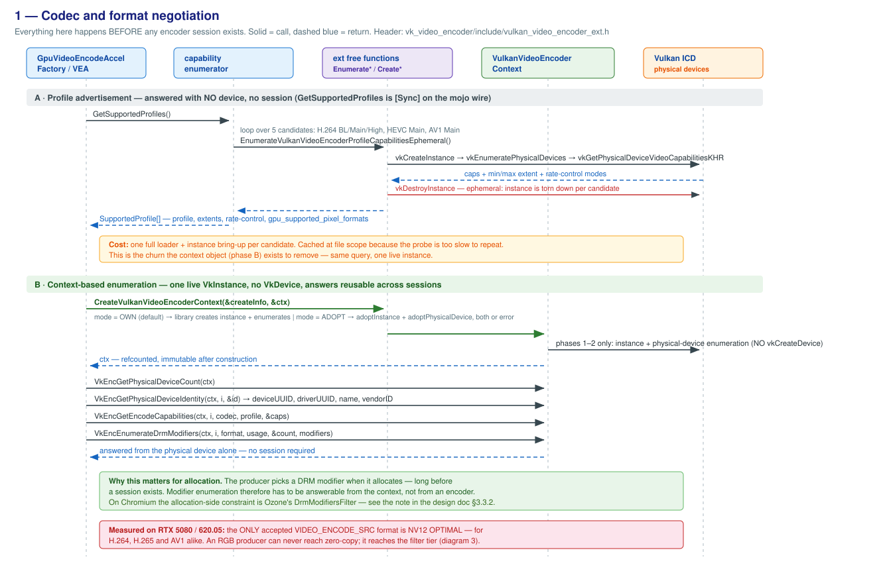
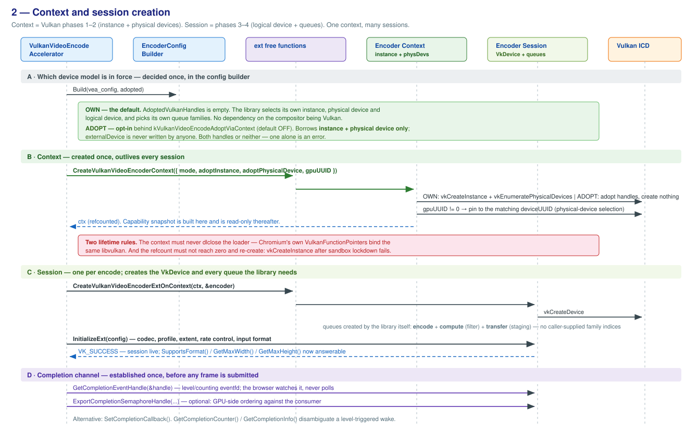
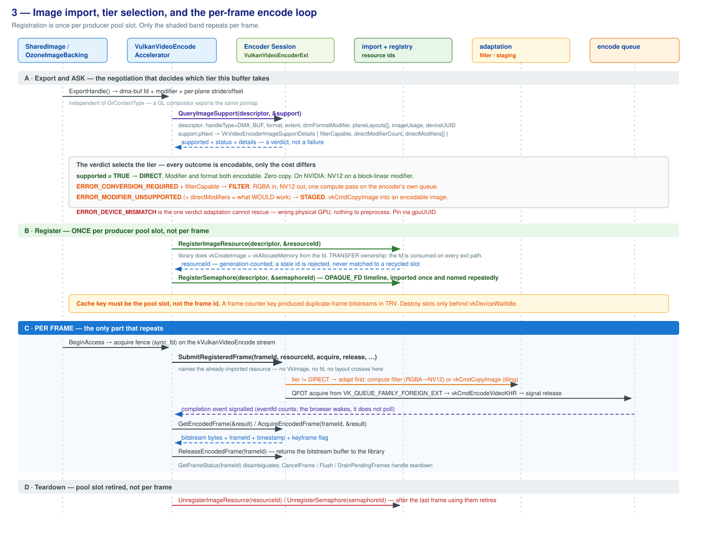

<!--
title: Vulkan Video Encoder — Ext API Call Sequences
status: reference
date: 2026-08-26
scope: vk_video_encoder/include/vulkan_video_encoder_ext.h (+ _internal.h)
-->

# Vulkan Video Encoder — Ext API Call Sequences

<!-- DOC-STATUS -->
> **Status: CURRENT.** Reference: call sequences for the descriptor API.
> Index: [`README.md`](README.md).


How Chromium drives the NVPRO sample library across the embeddable interface: what is negotiated,
when the Vulkan context is created, and what actually repeats per frame.

Read against `vk_video_encoder/include/vulkan_video_encoder_ext.h`. Every call named here is a real
entry point in that header, and every status code is one the library can actually return.

---

## The shape, in one paragraph

Three phases, and they run at very different rates. **Codec and format capabilities** are answered
with no device and no session — the browser needs them before it will even offer a profile.
**Context and session creation** happen once per encode: the context owns the instance and the
physical-device list, the session owns the `VkDevice` and every queue. **Import and encode** is the
only part in the frame loop, and even there registration is once per producer pool slot — the
per-frame call names an already-imported resource by id.

The interface never hands a `VkDevice`, `VkImage` or queue to the embedder. Frames cross as OS
handles; answers cross as plain data.

---

## 1. Codec and format negotiation



Two ways to ask, and the difference is cost. `EnumerateVulkanVideoEncoderProfileCapabilitiesEphemeral()`
stands an instance up and tears it down per candidate — correct, and too slow to repeat, which is why
the browser caches it at file scope. The context form answers the same questions against one live
instance: `VkEncGetPhysicalDeviceCount()`, `VkEncGetPhysicalDeviceIdentity()`,
`VkEncGetEncodeCapabilities()` and `VkEncEnumerateDrmModifiers()`.

**No `VkDevice` is involved in either.** Every `vkGetPhysicalDevice*` entry point the capability path
needs is loaded at instance level, which is what makes a device-free capability query possible at all.

Modifier enumeration has to live here rather than on the session, because the producer chooses a DRM
modifier when it **allocates** — long before an encoder exists.

> Measured on an RTX 5080, driver 620.05: the only accepted `VIDEO_ENCODE_SRC` format is **NV12
> `OPTIMAL`**, for H.264, H.265 and AV1 alike. There is no RGB encode-source format, so an RGB
> producer can never reach the zero-copy tier — it reaches the filter tier in §3.

---

## 2. Context and session creation



`CreateVulkanVideoEncoderContext()` takes a mode. **OWN is the default**: the library creates its own
instance, picks its own physical device, and later its own `VkDevice` and queues. **ADOPT** is opt-in
and borrows the embedder's **instance and physical device only** — `externalDevice` is never written
by anyone, so the two sides never share a logical device. Both adopt handles or neither; one alone is
an error.

`CreateVulkanVideoEncoderExtOnContext()` then creates the session, and `InitializeExt(config)` binds
codec, profile, extent, rate control and input format. The session creates **encode, compute and
transfer** queues itself — the compute queue for the preprocess filter, the transfer queue for staging
copies. No caller-supplied queue-family indices are involved.

The completion channel is established before any frame is submitted: `GetCompletionEventHandle()`
returns a level/counting eventfd the browser watches rather than polls, with
`GetCompletionCounter()` / `GetCompletionInfo()` to disambiguate a wake.
`ExportCompletionSemaphoreHandle()` is the GPU-ordering alternative.

Two lifetime rules the context must honour: never `dlclose` the loader — the embedder's own function
pointers bind the same `libvulkan` — and never let the refcount reach zero and re-create, because
`vkCreateInstance` after sandbox lockdown will not come back.

---

## 3. Image import, tier selection, and the encode loop



The producer exports a dma-buf and the browser **asks** before it registers:

```
QueryImageSupport(descriptor, &support)
    support.pNext -> VkVideoEncoderImageSupportDetails { filterCapable,
                                                         directModifierCount,
                                                         directModifiers[] }
```

The answer is a verdict, not a pass/fail, and every outcome is encodable — only the cost differs:

| Verdict | Tier | Cost |
| --- | --- | --- |
| `supported = TRUE` | **DIRECT** | zero copy |
| `ERROR_CONVERSION_REQUIRED` + `filterCapable` | **FILTER** | one compute pass on the encoder's own queue |
| `ERROR_MODIFIER_UNSUPPORTED` (+ `directModifiers` = what would work) | **STAGED** | one `vkCmdCopyImage` |
| `ERROR_DEVICE_MISMATCH` | *none* | wrong physical GPU — nothing to preprocess; pin with `gpuUUID` |

`RegisterImageResource()` then imports once per pool slot and returns a generation-counted
`resourceId`; the fd is consumed on every exit path under the default TRANSFER ownership.
`RegisterSemaphore()` imports an OPAQUE_FD timeline the same way.

**Per frame, only this repeats:** `SubmitRegisteredFrame(frameId, resourceId, acquire, release, …)`
— which names the already-imported resource, so no `VkImage`, fd or layout crosses the boundary —
then the completion event fires, `GetEncodedFrame()` or `AcquireEncodedFrame()` collects the
bitstream, and `ReleaseEncodedFrame()` returns the buffer.

> **Cache the registration by pool slot, never by frame id.** A frame-counter key produced
> duplicate-frame bitstreams in the TRV reference client. Destroy slots only behind
> `vkDeviceWaitIdle`.

---

## Related

- [`VULKAN_VIDEO_ENCODER_CONTEXT_DESIGN.md`](VULKAN_VIDEO_ENCODER_CONTEXT_DESIGN.md) — why the
  context/session split is drawn where it is
