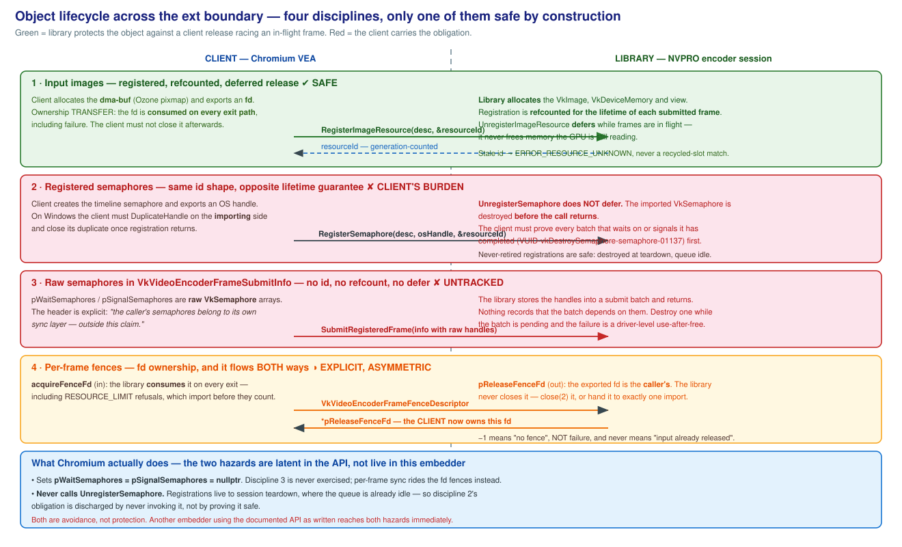

<!--
title: Vulkan Video Encoder — Ext API Object Lifecycle
status: review
date: 2026-08-26
scope: vk_video_encoder/include/vulkan_video_encoder_ext.h
-->

# Ext API Object Lifecycle — who allocates, who frees, and what survives a race

<!-- DOC-STATUS -->
> **Status: CURRENT.** Reference: object lifetimes in the descriptor API.
> Index: [`README.md`](README.md).

The library is internally built on refcounted shared objects (`VkSharedBaseObj`). This is a review
of how much of that safety actually crosses the embeddable boundary, and where it stops.

The rules this review measures against are stated separately in
[`VULKAN_VIDEO_ENCODER_OWNERSHIP_PRINCIPLES.md`](VULKAN_VIDEO_ENCODER_OWNERSHIP_PRINCIPLES.md).

**Short answer: it crosses for images and stops at semaphores.** One resource class is protected by
construction; two are not; a fourth uses a different discipline again. Chromium happens not to hit
the unprotected ones, but by avoidance rather than by the API making them safe.

---

## 1. Images — the model that works

`RegisterImageResource()` is the shape the rest of the interface should be measured against.

The client allocates the dma-buf and exports an fd. **Ownership transfers**: under the default
`VK_VIDEO_ENCODER_HANDLE_OWNERSHIP_TRANSFER` the fd is consumed on *every* exit path including
failure, so the client must not close it afterwards. The library then allocates everything Vulkan-
side — `VkImage`, `VkDeviceMemory`, the view, the pool wrapper — and returns an opaque
`VkVideoEncoderResource` id.

Three properties make this safe against a client release racing an in-flight frame:

1. **The registration is refcounted for the lifetime of each submitted frame.** The library's
   internal `VkSharedBaseObj` refcount is extended across the boundary by the registration, not
   exposed through it.
2. **`UnregisterImageResource` defers.** In the header's words, an *"Unregister racing an in-flight
   frame defers rather than freeing memory the GPU is still reading."*
3. **The id is generation-counted.** A stale id returns `ERROR_RESOURCE_UNKNOWN` rather than
   silently matching a recycled slot — so use-after-retire is a typed refusal, not corruption.

The client never holds a Vulkan handle, so it cannot destroy one out from under the encoder. That
is exactly the "refcounted reference passed back and forth" model, implemented with an id instead
of a smart pointer — which is the right choice for a C ABI that has to survive a process boundary.

---

## 2. Registered semaphores — same shape, opposite guarantee

`RegisterSemaphore()` looks identical: descriptor in, OS handle in, `VkVideoEncoderResource` id out.
The lifetime contract is the reverse:

> Unlike an image, this does **NOT** defer: the imported `VkSemaphore` is destroyed before the call
> returns. The caller must therefore ensure that every submitted batch which waits on or signals
> this registration has completed execution before unregistering.

So the id carries no protection. The client is handed the same token type and must apply a
completely different discipline to it — with the only signal being a paragraph of header comment.
Two resources, one id type, opposite rules, is the most likely thing on this interface for an
embedder to get wrong.

The safe sub-case is documented and real: registrations never retired are destroyed at session
teardown, after the encoder's threads are joined and its queue is idle.

---

## 3. Raw semaphores in the submit info — untracked entirely

`VkVideoEncoderFrameSubmitInfo` carries `pWaitSemaphores` / `pSignalSemaphores` as **raw
`VkSemaphore` arrays**, alongside a `resource` field that is a registered id. The header is candid
that these are outside the ownership model — *"the caller's semaphores belong to its own sync layer
— both outside this claim."*

The library records the handles into a submit batch and returns. Nothing tracks that the batch
depends on them. A client that destroys one while the batch is pending gets a driver-level
use-after-free, and there is no id, refcount, or deferral to catch it.

**This is the gap the proposal targets, and the diagnosis is right.** One struct mixes a protected
id-based resource with two unprotected raw-handle arrays.

---

## 4. Per-frame fences — explicit, and it flows both ways

`VkVideoEncoderFrameFenceDescriptor` is a third discipline, and unusually well specified:

- **`acquireFenceFd` (in)** — consumed on every exit, *including* a `RESOURCE_LIMIT` refusal, which
  imports before it counts. The ownership rule is not suspended by the refusal.
- **`pReleaseFenceFd` (out)** — the exported fd is the **caller's**; the library never closes it.
  This is the reverse of every other fd rule in the header, and it is called out as such.

Also correct and easy to miss: `-1` means "no fence", not failure, and must never be read as "the
input is already released". It is written before anything can refuse, so a caller may declare
`int fd;` and rely on it being defined on every return.

---

## 5. What Chromium actually does

Both hazards are latent in the API rather than live in this embedder — and the reason is avoidance:

- It sets `pWaitSemaphores = pSignalSemaphores = nullptr`. Discipline 3 is never exercised;
  per-frame synchronisation rides the fd fences instead.
- It **never calls `UnregisterSemaphore`**. Registrations live until session teardown, where the
  queue is already idle, so discipline 2's obligation is discharged by never invoking it.

That is a working embedder, not a safe interface. Any other consumer using the documented API as
written reaches both hazards on its first attempt.

---

## 6. Assessment of the proposal

**"All resources allocated by the library and passed as refcounted references."** For images this
is already true and is the reason that path is safe. Extending it to semaphores is the right
direction, with two qualifications worth stating before it is specified:

**Keep ids, not smart pointers, at the ABI.** A `VkSharedBaseObj` is a C++ `shared_ptr`; it cannot
cross a C ABI, cannot survive a process boundary, and would tie the embedder to the library's
allocator and destruction order. The image path already demonstrates the correct translation: an
opaque, generation-counted id whose *referent* is refcounted internally. The proposal's safety
property is what matters, not the pointer type.

**The library cannot allocate every semaphore.** A wait semaphore is signalled by the *producer*,
on the producer's device, before the encoder exists in that frame's story. What the library can own
is the **import** — which is what `RegisterSemaphore` already does. So the fix is not "the library
allocates it" but "the library's registration confers the same protection images get."

Three concrete changes follow:

1. **Make `UnregisterSemaphore` defer**, exactly as the image path does — refcount the registration
   for the lifetime of every submitted frame that names it, and retire it when the last one
   retires. This removes the client-side proof obligation entirely.
2. **Accept registered semaphore ids in `VkVideoEncoderFrameSubmitInfo`**, alongside or instead of
   the raw arrays, so a submitted batch holds references rather than bare handles. The raw arrays
   can remain for embedders that genuinely own their sync layer, but they should be the exception
   the header argues for, not the default shape of the struct.
3. **Make the two id disciplines indistinguishable, or make the types distinguishable.** Today both
   are `VkVideoEncoderResource`. If the lifetime rules stay different, the types should differ so
   the compiler catches the confusion; if they converge under (1), one type is correct.

None of this is a defect in the current Chromium integration. It is what the interface will need
before a second embedder — or the cross-process encoder — drives it.
