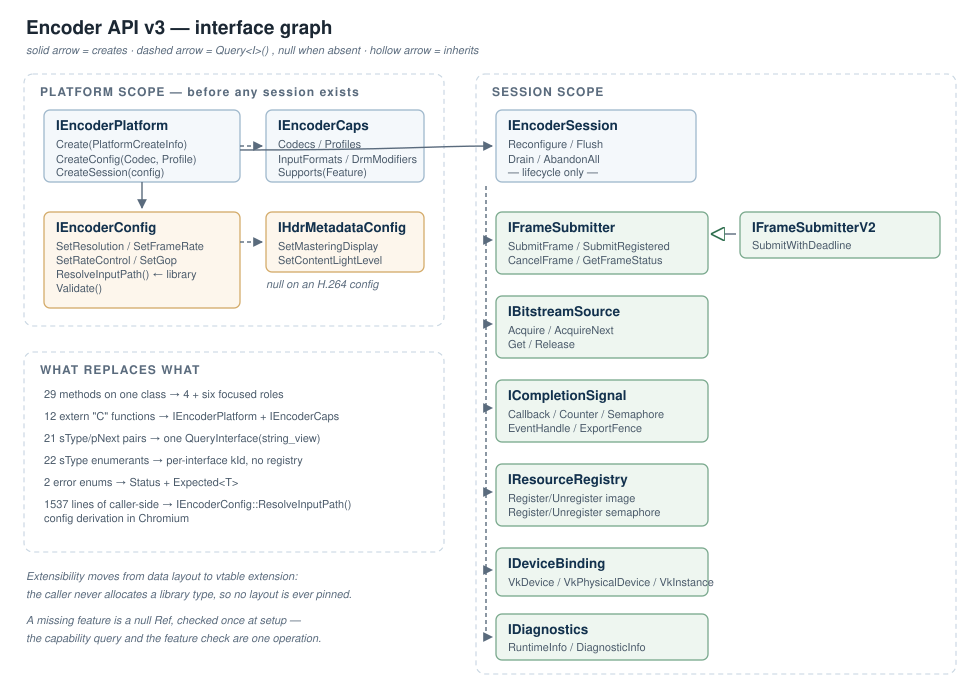

# Encoder API v3 — a modern C++ interface design

<!-- DOC-STATUS -->
> **Status: CURRENT.** Design of record for the public `vk::video::enc` interface.
> Index: [`README.md`](README.md).


**Status:** design proposal. Target: the branch after `RC-6-lib-v3+nvpro-rebase+split-02`.
**Companion:** `VULKAN_VIDEO_ENCODER_INTERFACE_STYLE.md` argues *whether* to change style and
measures the cost of the present one. This document is the *what*: the actual interface.

---

## 0. What we are designing against

Measured on the current branch:

| | |
|---|---|
| `vulkan_video_encoder_ext.h` | **3250** lines |
| `vulkan_video_encoder_ext_internal.h` | **1698** lines |
| `vulkan_video_encoder_ext.cpp` | **12611** lines |
| `VulkanVideoEncoderExt` virtual methods | **29** (+4 inherited) |
| free `extern "C"` entry points | **12** |
| structs carrying `sType` + `pNext` | **21** |
| `VkVideoEncoderStructureType` enumerants | **22** |
| error currencies | **2** (`VkResult` ×13, `VkVideoEncoderStatusCode` ×8) |
| Chromium code whose only job is to fill one config struct | **429** lines (1537 of file, 1033 of it comment) |

That last row is the finding that drives everything below, and it is worth stating at its true
size. `media/gpu/vulkan/vulkan_video_encoder_config_builder.{h,cc}` spans 1537 lines of file, but
1033 of those are comment: the code is **429 lines**, and the part that is *library policy* rather
than Chromium vocabulary is **113** of them -- `EncodesOnlyViaPreprocessFilter(VkFormat)`,
`EncodesViaFilterPlaneStorage`, `EncodesViaFilterStorageRead`, `DeclaredSessionInputFormat`,
`ClassifyFilterMatrix(int)`, `DeriveMatrixFromPrimaries(int)`, `ConvertsRgbToYcbcr(...)`,
`MapPixelFormat`.

113 lines is not, by itself, an argument for redesigning an interface, and this document should
not pretend otherwise. What those 113 lines demonstrate is a *kind* of cost rather than a
quantity of one: none of that reasoning is Chromium's business, all of it duplicates a decision
the library already makes internally, and it exists only because `VkVideoEncoderConfig` is an
inert record. A struct cannot decide anything, so every caller re-derives what the library knows
and every caller must get it right independently -- and the second caller pays the same 113 lines
again, with its own bugs. The case for the redesign rests on that, and on the defects in
section 4a that the descriptor shape made invisible, not on a line count.

An interface that can only be *filled in* pushes reasoning outward. An interface that can be
*asked* keeps it in.

---

## 1. Principles

### 1.1 Kept from VA-API

VA-API's durability comes from four rules, and they are the right four:

1. **The caller never lays out a library type.** `VAGenericID` is opaque; buffers are created by
   `vaCreateBuffer(..., size, ...)` with the size passed explicitly. The library owns layout, so
   layout can change.
2. **Version is negotiated, not assumed.** `vaInitialize(dpy, &major, &minor)` tells the caller
   what it actually got.
3. **Capability query precedes use.** `vaQueryConfigProfiles` → `vaQueryConfigEntrypoints` →
   `vaQueryConfigAttributes`, before any context exists.
4. **One vocabulary, uniformly prefixed.** Everything is `VA*`/`va*`. There is never a question
   of which namespace a symbol belongs to.

### 1.2 Rejected from VA-API

1. **`va_reserved[VA_PADDING_*]` on 43 structs.** Guessed-ahead, untyped space with a fixed
   budget. When it runs out the struct is frozen forever; until it runs out every field added
   is a `uint32_t` reinterpreted by hand. Vtable extension has no budget and no casts.
2. **48 `VABufferType` enumerants over `void*`.** A hand-rolled dynamic type system. C++ has one
   that the compiler checks.
3. **Implicit global state behind `VADisplay`.** Our device binding is explicit and always has
   been; keep it that way.
4. **Errors as a bare int with a stringify function.** No context, no propagation discipline.

### 1.3 The one structural move

**Extensibility moves from data layout to vtable extension.**

`pNext` extends a *struct*: the caller allocates it, so its layout is pinned the moment any
caller compiles. Inheritance extends an *interface*: the library allocates, the caller only
calls, so nothing about layout is observable and nothing needs pinning. That single move
deletes, at once: 22 `sType` enumerants, 21 `sType`/`pNext` member pairs, every "values are
permanent / never reuse" comment, every layout-pin test, and the class of bug where a struct is
chained onto an entry point that refuses `pNext`.



---

## 2. Foundations

### 2.1 Namespace and naming

```cpp
namespace vk::video::enc {}     // everything below lives here
```

Interfaces are `IName`. Value types are `Name`. No `Vk`/`VkVideoEncoder` prefix soup: the
namespace carries it. Vulkan handles keep their own spelling (`VkDevice`, `VkFormat`) because
they *are* Vulkan's.

### 2.2 One error currency

Today a caller must know which of two enums a given method speaks. Replace both:

```cpp
enum class ResultCode : int32_t {
    Ok = 0,
    // Caller error
    InvalidArgument, NotConfigured, AlreadyConfigured, UnsupportedFormat,
    UnsupportedProfile, UnsupportedFeature, OutOfRange,
    // Transient
    NotReady, Timeout, WouldBlock, OutOfResources,
    // Terminal
    DeviceLost, InternalError,
};

class Result {
public:
    Result() : code_(ResultCode::Ok), detail_("") {}
    Result(ResultCode c, const char* d = "") : code_(c), detail_(d ? d : "") {}
    bool ok() const { return code_ == ResultCode::Ok; }
    explicit operator bool() const { return ok(); }
    ResultCode  code()   const { return code_; }
    const char* detail() const { return detail_; }
private:
    ResultCode  code_;
    const char* detail_;
};
```

`Result` is **16 bytes and trivially copyable** — a code plus a pointer to a string literal the
library owns. That is deliberate on three counts: it puts no STL type in the ABI (§2.3), it
allocates nothing on a path that runs once per frame, and it is returnable in registers.

The constraint that buys this is that `detail()` is a literal, not a formatted message. Detail
needing runtime context — *which* frame id, *which* format — belongs on `IDiagnostics`, which
exists for exactly that and is queried when a caller wants it.

Value-returning calls need a carrier for "a T, or a Status":

```cpp
template <class T> class Expected;   // holds T or Result; value(), status(), operator bool
```

This is roughly 60 header-only lines and it is **permanent, not a stopgap**. `std::expected` is
C++23; this header targets C++11 (§2.6), so aliasing to the standard type is not on the table
and the call sites do not need it to be.

### 2.3 Object model

`VkSharedBaseObj<T>` is already `std::shared_ptr<T>` and `VkVideoRefCountBase` is already just a
virtual destructor. Keep both, spelled plainly:

```cpp
class IObject {
public:
    virtual ~IObject() = default;
protected:
    IObject() = default;
};
template <class T> using Ref = std::shared_ptr<T>;
```

No `AddRef`/`Release` to get wrong; no intrusive count to race.

> **ABI constraint, stated once.** `shared_ptr` is not ABI-portable across toolchains.
> It is the *only* standard-library type in this surface: `Result` is a code and a `const char*`,
> enumerations are values, and array returns are `ArrayView` (§3.1). `std::shared_ptr` itself is
> C++11. Chromium static-links (Model D) and is unaffected. Consumers that load
> `libvkvideo-encoder.so` must be built with the same compiler and standard library. VA-API
> avoids this with opaque integer handles; we are trading that portability for type safety
> knowingly. If a third consumer ever needs true cross-toolchain ABI, the answer is a thin C
> shim over these interfaces — not a redesign of them.

### 2.4 Feature discovery — the replacement for `pNext`

One virtual, on the base, that never grows:

```cpp
class IObject {
public:
    virtual ~IObject() = default;
    virtual void* QueryInterface(std::string_view id) = 0;
};

// Each interface names itself, version included:
class IFrameSubmitter : public IObject {
public:
    static constexpr std::string_view kId = "vk.video.enc.IFrameSubmitter/1";
    ...
};

template <class I>
Ref<I> Query(const Ref<IObject>& obj) {
    if (!obj) return Ref<I>();
    void* p = obj->QueryInterface(I::kId);
    return p ? Ref<I>(obj, static_cast<I*>(p)) : Ref<I>();   // aliasing ctor: shares obj's count
}
```

Three properties worth naming:

Three properties worth naming:

- **A missing feature is `nullptr`, checked once**, not `UnsupportedFeature` returned from a
  method the caller had no way to know was unavailable.
- **Identity is a string, so there is no central registry to keep in lockstep** — no
  `VkVideoEncoderStructureType` block with reservation comments, and a vendor can add
  `"com.nvidia.enc.IFoo/1"` without touching a shared enum.
- **The version is in the name.** `IFrameSubmitter/2` is a different interface, not a struct
  whose meaning depends on a size field.

### 2.5 How a version is added

```cpp
class IFrameSubmitterV2 : public IFrameSubmitter {
public:
    static constexpr std::string_view kId = "vk.video.enc.IFrameSubmitter/2";
    virtual Status SubmitWithDeadline(const FrameSubmit&, Deadline) = 0;
};
```

An old caller keeps calling `IFrameSubmitter` and does not recompile. A new caller does
`if (auto v2 = Query<IFrameSubmitterV2>(session))`. An old *implementation* (a test fake) simply
does not answer the v2 id. No struct grew, no size was compared, no `pNext` was walked.

---

### 2.6 The language floor is C++17

**The public header compiles at `-std=c++17`. The implementation stays C++20.** Those are two
different requirements and only the first one is a portability constraint: consumers include the
header, they do not compile the 12611-line implementation. `CMAKE_CXX_STANDARD 20` stays as it is.

C++17 is the floor because the library's own threading and synchronisation use C++17 facilities,
and because the current public header is portable today — it compiles clean at `-std=c++11`
through `-std=c++20`, and a redesign that quietly raised the bar to C++20 would be a regression
for consumers no one has surveyed.

Three C++20 conveniences are therefore out, and each has a cheap replacement:

| C++20 convenience | Replacement | Cost |
|---|---|---|
| `std::span<const T>` | `ArrayView<T>` — a borrowed `{const T*, size_t}` view | ~14 lines, header-only |
| `std::expected<T, E>` | `Expected<T>` (§2.2) | ~60 lines, and permanent — `std::expected` is C++**23**, not 20 |
| designated initialisers `{.device = d}` | plain member assignment on the aggregate | none |

```cpp
// The only container type that crosses the interface.
template <class T>
class ArrayView {
public:
    ArrayView() = default;
    ArrayView(const T* data, size_t size) : data_(data), size_(size) {}
    const T* data() const { return data_; }
    size_t   size() const { return size_; }
    const T* begin() const { return data_; }
    const T* end()   const { return data_ + size_; }
    const T& operator[](size_t i) const { return data_[i]; }
private:
    const T* data_ = nullptr;
    size_t   size_ = 0;
};
```

Everything else in the design is C++11 or C++14 and needs nothing. `std::shared_ptr` and its
aliasing constructor are C++11; `std::string_view` and nested `namespace a::b::c` are C++17.

> **One trap worth recording, because it decides a spelling.** `static constexpr std::string_view
> kId` is safe *at C++17 and above only*. Before C++17 a `constexpr` static data member that has a
> reference bound to it is an ODR-use requiring an out-of-line definition, and the link fails —
> verified: the same program produces an undefined reference at `-std=c++11` and links at
> `-std=c++17`, because C++17 made such members implicitly inline. Reading it by value is fine at
> every standard, so the bug only appears when some caller writes `const auto& id = I::kId;`.
> If the floor ever has to drop below C++17, the id becomes `static const char* Id()`, which has
> no such edge — but at a C++17 floor the data member is the better spelling and is used here.

## 3. The interface set

Today's 29 methods and 12 free functions form one god object plus a loose bag. Split by role —
each interface is what one collaborator needs, and nothing else.

### 3.1 Platform scope (before any session exists)

```cpp
class IEncoderPlatform : public IObject {
public:
    static constexpr std::string_view kId = "vk.video.enc.IEncoderPlatform/1";

    virtual Ref<IEncoderCaps>   Caps()   const = 0;
    virtual Ref<IDeviceBinding> Device() const = 0;

    virtual Expected<Ref<IEncoderConfig>>  CreateConfig(Codec, Profile) = 0;
    virtual Expected<Ref<IEncoderSession>> CreateSession(const Ref<IEncoderConfig>&) = 0;
};

// THE EXPORTED SURFACE IS TWO SYMBOLS, and only two. Everything else is reached
// through QueryInterface on an object one of these produced, which is what lets
// roles be added without changing the ABI.
//
// (1) Create a platform. Adopt the caller's Vulkan objects; a null instance
//     means the library creates its own (OWN mode -- see IPlatformLifetime).
extern "C" VK_ENC_EXPORT
VkResult VkEncCreatePlatform(const PlatformCreateInfo& info,
                             Ref<IEncoderPlatform>&   outPlatform);

// (2) Classify a VkFormat without standing anything up: answers what the
//     library would do with that format before a device exists. Free-standing
//     because a caller needs it to CHOOSE a format, i.e. before it has a
//     platform to ask.
extern "C" VK_ENC_EXPORT
VkResult VkEncClassifyFormat(VkFormat format, FormatRouting& outRouting);
```

`IEncoderCaps` absorbs the six enumeration free functions
(`VkEncGetEncodeCapabilities`, `VkEncEnumerateStdFlags`, `VkEncEnumerateInputFormats`,
`VkEncEnumerateDrmModifiers`, `VkEncQueryInputFormatSupport`,
`EnumerateVulkanVideoEncoderProfileCapabilities`) into one queryable object:

```cpp
class IEncoderCaps : public IObject {
public:
    static constexpr std::string_view kId = "vk.video.enc.IEncoderCaps/1";
    virtual ArrayView<Codec>       Codecs()   const = 0;
    virtual ArrayView<Profile>     Profiles(Codec) const = 0;
    virtual ArrayView<InputFormat> InputFormats(Profile) const = 0;   // carries optimality
    virtual ArrayView<uint64_t>    DrmModifiers(Profile, VkFormat) const = 0;
    virtual const RateControlCaps&  RateControl(Profile) const = 0;
    virtual const QpRange&          QpRange(Profile)     const = 0;
    virtual bool  Supports(Feature) const = 0;
};
```

Returning an `ArrayView` (§2.6) over library-owned storage removes the two-call
`(nullptr, &count)` → `(buffer, &count)` dance from every enumerator, and with it the class of
bug where the two calls disagree.

### 3.2 Configuration — a builder, not a struct

This is where the 113 lines of caller-side derivation go home (§0).

```cpp
class IEncoderConfig : public IObject {
public:
    static constexpr std::string_view kId = "vk.video.enc.IEncoderConfig/1";

    virtual IEncoderConfig& SetResolution(uint32_t width, uint32_t height) = 0;
    virtual IEncoderConfig& SetFrameRate(uint32_t num, uint32_t den) = 0;
    virtual IEncoderConfig& SetRateControl(const RateControl&) = 0;
    virtual IEncoderConfig& SetGop(const GopStructure&) = 0;
    virtual IEncoderConfig& SetInputFormat(VkFormat, ColorModel) = 0;
    virtual IEncoderConfig& SetInputColour(const ColourInfo&) = 0;

    // What the library knows and the caller should not have to re-derive:
    virtual InputPath  ResolveInputPath() const = 0;   // Direct | Copy | ComputeFilter
    virtual VkFormat   ResolveSessionFormat() const = 0;
    virtual Status     Validate() const = 0;           // one place, before a session exists
};
```

`ResolveInputPath()` is the whole point. Today the caller decides whether a compute filter is
needed, from a struct field it sets itself, using classification logic it reimplemented. Here it
asks. The rule the library actually wants to enforce — *use the copy engine unless the layout,
colour model, or format demands a filter* — becomes one method with one implementation, and the
caller can log the answer instead of guessing it.

Optional feature blocks stop being chained structs and become optional interfaces:

```cpp
if (auto hdr = Query<IHdrMetadataConfig>(config)) {
    hdr->SetMasteringDisplay(...);
    hdr->SetContentLightLevel(...);
}
```

`Query` returns null for an H.264 config, because H.264 has no mastering-display SEI. The rule
that today is a runtime rejection at `InitializeExt` — after the caller has built the struct,
chained it, and passed it — is expressed where the caller can act on it, at zero cost, in one
`if`.

### 3.3 Session scope

`IEncoderSession` is deliberately small: lifecycle only. Everything else is a queried role.

```cpp
class IEncoderSession : public IObject {
public:
    static constexpr std::string_view kId = "vk.video.enc.IEncoderSession/1";
    virtual Status Reconfigure(const Ref<IEncoderConfig>&) = 0;
    virtual Status Flush() = 0;
    virtual Status Drain() = 0;
    virtual Expected<uint32_t> AbandonAll() = 0;
};
```

| Role interface | Absorbs (today's methods) |
|---|---|
| `IFrameSubmitter` | `SubmitExternalFrame`, `SubmitRegisteredFrame`, `CancelFrame`, `GetFrameStatus` |
| `IBitstreamSource` | `AcquireNextEncodedFrame`, `AcquireEncodedFrame`, `GetEncodedFrame`, `ReleaseEncodedFrame` |
| `ICompletionSignal` | `SetCompletionCallback`, `GetCompletionCounter`, `GetCompletionInfo`, `GetCompletionEventHandle`, `GetCompletionSemaphore`, `ExportCompletionSemaphoreHandle` |
| `IResourceRegistry` | `RegisterImageResource`, `UnregisterImageResource`, `RegisterSemaphore`, `UnregisterSemaphore`, `QueryImageSupport` |
| `IDeviceBinding` | `GetVkDevice`, `GetVkPhysicalDevice`, `GetVkInstance`, `GetVkGetInstanceProcAddr` |
| `IDiagnostics` | `GetRuntimeInfo`, plus the diagnostic surface |
| `IPlatformLifetime` | `Retire` — releases the process-wide `VkInstance` (see below) |

29 methods on one class become 4 + six focused interfaces averaging five methods. A reader
asking "how do I get a bitstream out" reads one 4-method interface.

### 3.3b `IPlatformLifetime` — releasing the process-wide instance

An OWN-mode platform caches its `VkInstance` for the process lifetime, so that
repeated create/destroy cycles reuse one instance rather than issuing a second
`vkCreateInstance` — which a sandboxed process may no longer be permitted to do.
Dropping every `Ref` therefore does **not** destroy the instance, and a process
that exits without retiring leaves it standing. Under a driver that audits
allocations at exit this is reported, accurately, as a leak: 22 allocations,
all instance- and physical-device-scoped.

```cpp
if (auto life = Query<IPlatformLifetime>(platform)) {
    life->Retire();      // returns how many cached contexts were released
}
```

The rule the cache enforces is **"never re-created", not "never destroyed"**,
and those are separable. `Retire()` latches retirement and then releases the
cache: the instance is destroyed, and any later OWN-mode create is refused
rather than allowed to stand a second one up — a stronger guarantee than before,
where a post-teardown create was merely impossible because teardown never
happened.

It is a call and not a destructor deliberately. It runs `vkDestroyInstance`, so
it must happen while the process can still reach the driver — at a point the
caller picks, not at static destruction, where ordering against the loader is
undefined.

**It is pure reference release, not forced teardown.** Sessions and platforms
each hold their own reference to the context, so retiring while a session is
live does not disturb it; the instance is destroyed only when the last reference
goes. Verified: `Retire()` called with a live session leaves that session fully
usable, and the exit audit is clean once every reference drops.

A caller that simply runs to process exit need not call it at all — and
`media/gpu/vulkan` deliberately does not, because retirement is permanent and a
GPU process builds encoders repeatedly.

### 3.4 What this does to the test fake

`media/gpu/vulkan/fake_vulkan_video_encoder_ext.h` is 392 lines because a fake must implement
all 29 pure virtuals whether the test touches them or not. Under this design a fake implements
the roles the test exercises and answers `nullptr` for the rest — and the `nullptr` is
*meaningful*, because it is exactly how a real implementation reports an absent feature. The
fake stops being a wall of `NOTREACHED()`.

### 3.5 Value types

Types the caller constructs (`RateControl`, `GopStructure`, `ColourInfo`, `PlaneLayout`, `Rect`)
stay plain aggregates — no `sType`, no `pNext`, no reserved padding. The rule that keeps this
safe is one line:

> **A type the caller constructs may never be extended. A type the library owns may.**

Extension always happens on an interface. A value type that turns out to need a new field gets
a new setter taking a new value type on a `/2` interface; the old one keeps its meaning forever.

---

## 4. A caller, end to end

The Chromium `VulkanVideoEncodeAccelerator::Initialize` path, as it would read:

```cpp
PlatformCreateInfo pci;                 // plain aggregate the caller owns
pci.instance = vk_instance;
pci.device   = vk_device;
Ref<IEncoderPlatform> platform;
if (VkResult r = VkEncCreatePlatform(pci, platform); r != VK_SUCCESS) return Fail(r);

auto caps = platform->Caps();
if (!caps->Supports(Feature::kDmaBufImport)) return Fail("no dma-buf import");

auto config = platform->CreateConfig(Codec::kH265, Profile::kMain);
if (!config) return Fail(config.status());
RateControl rc;                         // aggregate; no designated initialisers (§2.6)
rc.mode    = RateControlMode::kCq;
rc.quality = 26;
(*config)->SetResolution(w, h)
          .SetFrameRate(num, den)
          .SetRateControl(rc)
          .SetInputFormat(vk_format, ColorModel::kBt709Limited);

if (auto hdr = Query<IHdrMetadataConfig>(*config)) hdr->SetContentLightLevel(max_cll, max_fall);

if (Status s = (*config)->Validate(); !s) return Fail(s);
input_path_ = (*config)->ResolveInputPath();          // logged, not re-derived

auto session = platform->CreateSession(*config);
if (!session) return Fail(session.status());

submitter_  = Query<IFrameSubmitter>(*session);
bitstream_  = Query<IBitstreamSource>(*session);
completion_ = Query<ICompletionSignal>(*session);     // may be null; poll instead
registry_   = Query<IResourceRegistry>(*session);     // may be null; submit unregistered
```

Everything the caller must know is a compile-checked type or a null check. Nothing is a
`sType` constant, a `pNext` cast, or a field the caller had to derive.

---

## 4a. What implementing it changed

The header and a translating implementation are on `vk_video_encoder/include/vulkan_video_encoder_v3.h`
and `.../src/vulkan_video_encoder_v3.cpp`, with `test/encoder-v3-interface` driving them. Three
constraints surfaced only from compiling against the real tree, and each changed the design.

### 4a.1 Xlib owns `Success`, `None` and `Status`

The library builds with `VK_USE_PLATFORM_XLIB_KHR`, as does every browser and compositor on
Linux, and Xlib defines `Success`, `None`, `Status`, `Bool`, `Always`, `Complex`, `Convex`,
`Above`, `Below`, `KeyPress` and `CursorShape` as **object-like macros**. A namespace is no
defence against the preprocessor, and `#undef`-ing them in a public header would silently break
the consumer's own use of Xlib.

So the status type is **`Result`** and its code type is **`ResultCode`**, and the "no handle"
enumerator is `NoHandle`. This is not a style preference: with the original spelling the header
does not parse in any translation unit that has seen Xlib, which is the entire target audience.

### 4a.2 The library builds `-fno-rtti`, so `dynamic_cast` is unavailable

A session has to verify that a configuration handed back to it is one this library made.
`dynamic_cast` is the reflex, and it does not compile here — nor would it in Chromium, which also
builds without RTTI.

`QueryInterface` already *is* a typed downcast that needs no RTTI, so it serves for this too,
through an `IConfigAccess` id kept out of the public header. The mechanism that replaces `pNext`
turns out to replace RTTI as well, and there is one mechanism to understand rather than two. This
is a point in the design's favour that was not visible from the design alone.

### 4a.3 `RegisterSemaphore` imports a handle; it does not adopt a `VkSemaphore`

The sketch had `RegisterSemaphore(VkSemaphore)`. The implementation imports an **OS handle** into
a new timeline semaphore — a binary semaphore cannot report a completion to a consumer that was
not already waiting. The interface takes an `ExternalSemaphore` accordingly. A design reviewed
only on paper would have shipped the wrong signature.

### 4a.4 `Flush()` is terminal, and the name hid it

The sketch had `Flush()` and `Drain()` as a checkpoint and a stronger checkpoint. They are not.
In the implementation, `Flush()` **releases the encoder**: it writes the trailing bitstream a
reordered GOP still owes, drops the encoder object, and every later submission is refused with
`ERROR_NOT_INITIALIZED`. `DrainPendingFrames()` is the non-terminal one — the session stays fully
usable and may be drained repeatedly.

This was found by running frames through, not by reading. The first working version of the test
encoded eight frames, called what it thought was a checkpoint, and then could not submit a ninth;
the failure surfaced as `encoder status 16` and nothing else, which is precisely why the
`IDiagnostics` channel exists.

The interface therefore names the two operations for what they do:

| v3 | Underlying | Meaning |
|---|---|---|
| `Drain()` | `DrainPendingFrames()` | Encode everything submitted and wait. The session stays usable. Callable repeatedly. |
| `Finish()` | `Flush()` | End the stream. Terminal; later submissions refused. Encoded frames stay acquirable. |

`Flush` is not carried forward as a name. It reads like a checkpoint in every other API a caller
has used, and here it ends the session — a caller who reaches for it by habit loses a stream and
gets one error code to explain it.

### 4a.5 `ExternalImage` needs the usage the image was created with

A `VkImage` handle does not carry its own `VkImageUsageFlags` or `VkImageCreateFlags`, and the
library needs both to decide whether the encoder can read the image directly or must stage it.
The first version of the value type omitted them, and registration then succeeded while
submission failed. `usage`, `createFlags` and `residency` are now fields, which is exactly the
kind of thing §3.5's rule is about: a caller-constructed type has to be right the first time,
because it can never grow one.

### 4a.6 Driving the completion roles found a deadlock

`ICompletionSignal` and `Reconfigure` were implemented and, for a while, only checked for being
*present* — `Query` returned non-null, so the role "worked". Driving them found two defects that
presence checks cannot reach, and both were in this design's own implementation rather than in
the layer below.

**`SetCallback` deadlocked against its own quiesce point.** Installing or clearing a completion
callback returns only once any in-flight invocation has returned. The implementation held its
callback mutex across that call — and the in-flight invocation was a trampoline waiting on the
same mutex. The fix is ordering, not locking: release before the library call, clear the cookie
only *after* the library has quiesced (which is what makes "you may now destroy what it pointed
at" true), and route a *replacement* through a detach, because the library sees the same
trampoline pointer either way and would not quiesce on its own.

**`Reconfigure` replaced rather than overlaid.** A caller wanting to change the bitrate had to
restate the resolution, format and frame rate it was not touching, or be refused for changing
them. The session now keeps the configuration it was created with and overlays only what the new
one states, with an unset field meaning "leave it alone". That is the same principle as
`ResolveInputPath`: the library holds the rule, and the caller is not made to know it.

One thing the tests deliberately do **not** assert: one callback per frame. Notifications
coalesce — the header says so — so the check is that the callback fires and never more often than
frames complete, and that retrieval reconciles against the counter the way consumers are told to.
A test asserting one-to-one would pass today and encode a promise the library does not make.

The timeline semaphore is checked for what it means (`lastFrameId + 1` once the encodes retire,
observed at 4006 for a last id of 4005) and for being withdrawn when the stream ends. Detachment
is shown to stop notifications by encoding *further* frames and requiring the count not to move;
an earlier version compared the counter with itself and would have passed on a detach that did
nothing.

### 4a.7 What porting a real host found that review could not

The design was reviewed, prototyped, compiled, and exercised by an 83-check suite on hardware
before Chromium's encode accelerator was moved onto it. That port then found **ten** things the
interface could not express or expressed wrongly. Every one is a place where the design modelled
what a caller receives when things work and lost what only matters when they do not.

| # | What was missing | What it would have cost |
|---|---|---|
| 1 | Acquire/release fences on `FrameSubmit` | zero-copy reads a half-rendered frame; caller never learns when it may write the buffer again |
| 2 | Per-frame outcome on `EncodedFrame` | a `VK_TIMEOUT` deadline drop emitted as an empty bitstream and called output |
| 3 | `RuntimeInfo::supportsNativeHandle` and three siblings | the host allocates the wrong kind of buffer |
| 4 | A release callback on `SetCallback` | a heap-allocated cookie with no correct owner |
| 5 | The ownership echo on registration | nothing for the host to assert against |
| 6 | An invented `int32` index instead of the library's handle | a second registry that existed only to translate |
| 7 | `IDeviceBinding` on a session, not only a platform | **the CPU dma-buf tier silently disabled; every frame demoted to staging** |
| 8 | Device provenance on `ExternalImage` | the library's cross-device check disabled, not merely weakened |
| 9 | The echo returned inside `Expected` | lost on exactly the refusal path where it is the only way to know |
| 10 | `QueryImageSupport` reading the status and not the reply | every refusal read as an acceptance |

Number 7 is the one to dwell on, because it is the failure mode this project exists to prevent:
nothing crashed, no test asserted anything false, and the encoder produced correct output — by the
slowest path available. It was caught only because a test counts which tier ran.

Number 8 is the one to be least comfortable about. An earlier pass of this document recorded that
`ExternalImage` covered every field the accelerator sets, having checked for assignments to each.
The provenance fields are filled by a span copy, so the check missed them and cleared a gap that
was real.

**Three further defects were in the porting, not the design**, and they share one shape: a rich
answer converted to a boolean. The stall watchdog asked for the completion counters and kept only
whether the call succeeded, so it could no longer name which side had stalled. Registration
refusals were flattened to a single failure code at eight sites, collapsing `NOT_READY` — park and
re-submit — into a fatal refusal that memoizes a descriptor as unusable. And the completion echo
was read into a variable the refusal path then discarded.

The lesson the whole exercise supports is narrow and worth stating without inflation: an interface
is not finished when it compiles, nor when its own tests pass. It is finished when something that
did not write it has to answer real questions through it.

### 4a.8 Two conveniences that survived contact

`ResolveInputPath()` is implemented against `VkEncClassifyInput`, which lives in the *internal*
header. Because the translation unit sits in `src/`, it can reach it — so the rule the caller
currently re-derives is answered by the library, with the real classifier, at no layering cost.

`Query<IHdrMetadataConfig>` returns null on an H.264 configuration and non-null on H.265, checked
on hardware. The refusal that today happens inside session creation is now a null check the
caller writes once.

---

## 4b. How this sits with the browser's own interfaces

Worth settling explicitly, because it decides whether v3 is an invention or a convergence.

### 4b.1 The config builder is ours, not Chromium's

`media/gpu/vulkan/vulkan_video_encoder_config_builder.{h,cc}` has exactly one commit in its
history — `61ebb410d232` *"media: the Vulkan Video encode accelerator"* — and upstream Chromium
has no `media/gpu/vulkan/` directory at all. It is not pre-existing browser code we must live
with: it is an adapter this integration had to grow, and it exists **because** the library speaks
in descriptor structs. The descriptor API did not merely fail to help; it created the adapter.

How much work that is, stated honestly: 429 lines of code, of which 113 are the library-policy
derivation of §0. Not 1537 — that is the file count and two thirds of it is comment.

### 4b.2 Chromium's own encoder interface already looks like v3

`media::VideoEncodeAccelerator` — the interface our accelerator implements — is built from
exactly the pieces proposed here:

| Chromium, today | v3 |
|---|---|
| Pure-virtual abstract class, library-allocated, caller never lays it out | `IEncoderSession` and the role interfaces |
| Nested pure-virtual `VideoEncodeAccelerator::Client` for completion | `ICompletionSignal` |
| `EncoderStatus = TypedStatus<EncoderStatusTraits>` — **one** error currency, code plus payload | `Status` (§2.2) |
| `Config`: a plain struct with real constructors | `PlatformCreateInfo` and the value types (§3.5) |
| **Zero** occurrences of `pNext` in the header | zero |

So v3 is not a new idiom; it is the idiom on the other side of the seam. Today the accelerator
is a translator between two philosophies, and the translation is where the config builder lives.

Two differences are real and worth naming rather than papering over:

- **Ref-counting spelling.** Chromium uses `scoped_refptr<T>` over `base::RefCountedThreadSafe`;
  we use `std::shared_ptr` (§2.3). Both are intrusive-vs-external variants of the same idea, and
  the accelerator holds both kinds already. This is a boundary, not a conflict.
- **Completion style.** Chromium wants one style — a `Client` callback. `ICompletionSignal`
  offers six entry points (callback, counter, semaphore, event handle, fence export) because TRV
  and the AQ library want the others. Making it a *role* is what keeps that generality out of
  the browser's way: the browser queries the interface, uses the callback, and never sees the
  rest.

### 4b.3 How the rest of the browser communicates

Two layers, and neither resembles a descriptor chain:

1. **In-process (within the GPU process, where we live):** pure-virtual C++ abstract classes,
   `scoped_refptr` for shared ownership, `base::OnceCallback`/`RepeatingCallback` for completion.
   `VideoEncodeAccelerator`, `VideoDecoder`, `ImageBacking` are all this shape.
2. **Cross-process:** Mojo. Interfaces are declared in IDL (`media/mojo/mojom/video_encode_accelerator.mojom`
   defines `VideoEncodeAcceleratorProvider`, `VideoEncodeAcceleratorConfig` and friends), the
   bindings are generated, and structs cross the boundary through typemap traits. Extension is
   the IDL's job — a new field is added to the `.mojom` and the generated code handles both ends.

The relevant conclusion for us: **Chromium never asks a caller to lay out a struct that crosses a
version boundary.** In-process it uses vtables; cross-process it uses generated serialisation.
The `sType`/`pNext` pattern has no analogue anywhere in the media stack, which is why the
adapter had to be written by hand.

We are static-linked (Model D), so layer 1 is the one we join. v3 joins it directly.

---

## 4c. The existing clients, and the process boundary

### 4c.1 Who actually consumes this

| Consumer | Linkage | Surface it uses |
|---|---|---|
| **Chromium** | static, vendored (Model D) | the ext API in full: config, submit, acquire, register, capabilities |
| **TRV** (`vk-encoder-instance`) | dynamic `libvkvideo-encoder.so.1`, **optional** — Windows `DELAYLOAD`, and a display-only mode when absent | **seven calls**: `CreateVulkanVideoEncoderExt`, `InitializeExt`, `SubmitExternalFrame`, `ReleaseEncodedFrame`, `Flush`, `GetVkDevice`, `GetVkPhysicalDevice` |
| **Samples demos** (`vk-video-enc-test`) | in-tree | the original four-method interface, driven by `CreateVulkanVideoEncoder(codec, argc, argv)` |
| **AQ** (`nvenc_aq_vulkan`) | **not a client** — `add_subdirectory`d *into* the library | none; it is a provider linked in below the interface |

Three things follow.

**TRV's real surface is seven calls, and it is fire-and-forget.** It submits frames and releases
them; it never retrieves a bitstream, because the library writes the output. Migrating it means
`VkEncCreatePlatform` + `CreateConfig`/`CreateSession`, then `Query<IFrameSubmitter>`,
`Query<IBitstreamSource>` for the release, and `Query<IDeviceBinding>` for the two getters.
That is a day, not a project — and it is worth knowing before anyone budgets the migration off
the 29-method count.

**The `shared_ptr` ABI constraint of §2.3 is real for TRV, not hypothetical.** TRV compiles with
`VK_VIDEO_ENCODER_SHAREDLIB=1` and resolves `libvkvideo-encoder.so.1` at load time. TRV and the
library must be built with the same toolchain and standard library. They already are; this is a
constraint to record, not a defect to fix.

**TRV treats the encoder as an optional, delay-loadable dependency, and that dictates the
factory.** A `DELAYLOAD`ed or `dlsym`'d entry point must have a stable, unmangled name, so
`IEncoderPlatform::Create` as a static member is the wrong shape — a mangled symbol is not
something a delay-load stub or a `dlsym` call can name portably. The design therefore keeps
**exactly one exported C symbol**, `VkEncCreatePlatform`, mirroring today's
`CreateVulkanVideoEncoderExt`; everything else is reached through virtuals on the object it
returns. One symbol to resolve, one symbol whose absence means "run without the encoder."

### 4c.2 Is the interface serialisable across processes?

**Not by itself — and no consumer needs it to be.**

Both consumers draw the process boundary *above* the library, not through it:

- **TRV** runs the encoder in a separate process, `vk-encoder-instance`, and talks to it over
  `AF_UNIX`/`SOCK_STREAM` with `sendmsg`/`recvmsg` and **`SCM_RIGHTS`** to pass dma-buf file
  descriptors. The protocol is TRV's own; the library sits entirely inside the encoder process.
- **Chromium** puts the boundary between the renderer and the GPU process, in Mojo. The library
  is inside the GPU process.
- The library itself contains no IPC. The only mention of `SCM_RIGHTS` in the public header is a
  comment describing how a *host* passes a handle in.

That is not a coincidence, and it is the answer to the question. The library's objects are a
`VkDevice`, a `VkImage`, a video session — things that have no meaning outside the process that
owns them. What crosses a boundary is never the object, it is the **OS handle** exported from it:
a dma-buf fd, an external semaphore handle, a shared-memory region. The API already treats those
as an explicit, separate concern (`VkVideoEncoderExternalHandleType`,
`ExportCompletionSemaphoreHandle`, the DRM modifier query), and v3 keeps that discipline
unchanged. So the encoder always runs where the device is, and the boundary goes above it.

**What the descriptor style would have given up.** One honest point in its favour: a tagged
struct chain is *self-describing*. A generic marshaller can walk a `pNext` chain reading `sType`
and copying payloads without knowing any of the types. A vtable offers nothing comparable — it is
a pointer to code in one address space. That is a real property being traded away.

It is a smaller loss than it appears, for two reasons. A `pNext` chain still contains pointers,
so a marshaller needs a per-type size and a per-type pointer walk anyway — the tag saves the
dispatch, not the work. And the payloads that matter are handles, which are never serialisable
by any style.

**If a proxy is ever wanted, the role split makes it easier, not harder.** Each role is a small,
single-purpose interface — `IFrameSubmitter` is four methods — which is exactly the shape of a
Mojo interface or a generated stub. Proxying six focused interfaces is mechanical; proxying one
29-method object with a `pNext`-extensible config is not. The discipline that keeps it mechanical
is already a rule of this design (§3.5): **every method parameter is either a plain serialisable
value type or an explicitly exportable OS handle.** Nothing in the design takes a pointer to a
caller-owned structure whose layout the wire would have to know.

**Decision: v3 is an in-process interface.** No Mojo, no proxy, no wire format, and no
serialisation requirement on any method signature. Both consumers already arrange the boundary
above the library and neither asks for anything else, so building a transport into the design
would be speculative work carried by every caller.

What keeps that decision cheap to revisit is the discipline in §3.5, which the design follows for
its own reasons: every method parameter is a plain value type or an explicitly exportable OS
handle, and no method takes a pointer to a caller-owned structure whose layout a wire would need
to know. If a third consumer ever needs a proxy, the role interfaces are already the right
granularity to generate one from. Nothing is being designed *for* that case; it is simply not
being designed *out*.

### 4c.3 Chromium's out-of-process encoding mode

Chromium is moving hardware encode out of the GPU process into a dedicated utility process. It
matters here because it decides **which process our library runs in**, and because one of its
gates excludes us.

The shape, as it stands upstream:

- **Feature:** `kUseOutOfProcessVideoEncoding`, Linux and ChromeOS only,
  `FEATURE_DISABLED_BY_DEFAULT`. Its comment: *"Spawn utility processes to perform hardware
  encode acceleration instead of using the GPU process."*
- **Launch:** the browser process calls `ServiceProcessHost::Launch(...)` with display name
  `"Video Encoder"` (`content/browser/media/video_encode_accelerator_provider_launcher.cc`).
- **Interface chain:** browser → `VideoEncodeAcceleratorProviderFactory` → (renderer)
  `VideoEncodeAcceleratorProvider` → `CreateVideoEncodeAccelerator(EncodeCommandBufferId?,
  pending_receiver<VideoEncodeAccelerator>)`. All Mojo, all generated.
- **Sandbox:** `ServiceSandbox=sandbox.mojom.Sandbox.kHardwareVideoEncoding`, which on Linux
  returns `GetGpuProcessSandbox(...)` under an explicit *"TODO(b/255554267): we're using the GPU
  process sandbox policy for now as a transition step… we should create a policy that's tighter
  just for hardware video encoding."* So today it is exactly as permissive as the GPU process,
  and that is stated to be temporary.

**What it does not change for this design.** The Mojo boundary sits above
`media::VideoEncodeAccelerator`, which sits above our library. The library still runs in whichever
process owns the `VkDevice`; out-of-process encoding only changes which process that is. v3 needs
nothing added for it — the same conclusion as §4c.2, reached from the browser's side.

**Position:** the integration targets the GPU process, where the feature is off by default and
where the zero-copy seam works. Out-of-process encoding is not in scope for v3. The two items
below are recorded so that enabling it later is a decision with known consequences rather than a
surprise; neither is work for this design.

**Two things it does change, and both are risks worth naming.**

*Zero-copy depends on SharedImage access that a utility process does not have by default.* Our
zero-copy tier is built on `OzoneImageBacking::ProduceVulkanVideo`. In the OOP model a caller may
only supply shared-image-backed frames when `EncodeCommandBufferId` carries a valid
`channel_token` and `route_id` **and** the profile advertises `supports_gpu_shared_images`;
otherwise the accelerator accepts CPU-memory or `GpuMemoryBuffer` frames only. The sibling
feature for decoding, `kUseSharedImageInOOPVDProcess`, is disabled with
*"TODO(crbug.com/457296322): Enable after fixing issue where SharedImages are missing from the
SharedImageManager."* Running our encoder out of process without setting
`supports_gpu_shared_images` would therefore demote it from `zero-copy` to `cpu-dmabuf` or
`staging` — silently, and functionally green. That is precisely the degradation the Tier-3
harness exists to catch, and it is the reason that harness reports a tier rather than a pass.

*The service is gated on a flag that Vulkan encode does not set.* Every piece above —
`RunVideoEncodeAcceleratorProviderFactory` in `content/utility/services.cc`, the
`kHardwareVideoEncoding` sandbox case — is behind `BUILDFLAG(USE_LINUX_VIDEO_ACCELERATION)`, and
`media/gpu/args.gni` defines:

```gn
use_linux_video_acceleration = use_vaapi || use_v4l2_codec
```

`enable_vulkan_video_encode` does not participate. A Vulkan-only build does not compile the
out-of-process encoding service at all. If that mode ever becomes the default, such a
configuration has no service to launch — the same gap that already keeps the in-tree VEA test
targets unreachable without VA-API or V4L2. Making `use_linux_video_acceleration` include
`enable_vulkan_video_encode` is a one-line change, and it should be made deliberately rather than
discovered.

---

## 5. Migration

Neither Chromium nor `ThreadedRenderingVk_Standalone` nor the AQ library can switch atomically,
so the two surfaces coexist for exactly one release.

| Step | Work |
|---|---|
| 1 | Land `vk_video_encoder/include/vulkan_video_encoder_v3.h` — interfaces only, no implementation. Compiles standalone; reviewable on its own. |
| 2 | Implement v3 as a **shim over the existing implementation**. No behaviour change, no risk to the RC-6 test results. |
| 3 | Port the C++ ctest suites to v3. They are the proof that the shim is faithful. |
| 4 | Port Chromium: `vulkan_video_encode_accelerator.cc` first, then delete the resolvable parts of `vulkan_video_encoder_config_builder.cc` as `IEncoderConfig` absorbs them. The absorbable derivation is 113 code lines (§0); the gain is that it stops being duplicated per caller, not the count. |
| 5 | Port TRV — seven call sites (§4c.1). The AQ library is not a client and needs no port. |
| 6 | Invert: v3 becomes the implementation, `VulkanVideoEncoderExt` becomes the shim. |
| 7 | Delete the shim, the 22 `sType` enumerants, the 21 `sType`/`pNext` pairs, the layout-pin tests, and the second error enum. |

Steps 1–3 are self-contained and testable without touching a caller. Step 4 is where the payoff
is measurable, and it is measurable in deleted lines.

---

## 6. Costs, honestly

- **One extra indirection per feature acquisition.** Paid once per session at `Query`, never per
  frame. The per-frame path (`SubmitFrame`, `AcquireEncodedFrame`) is one virtual call, exactly
  as it is today.
- **Virtual calls on config setters.** Configuration path, not hot; measured in nanoseconds
  against a session creation measured in milliseconds.
- **`shared_ptr`/`std::string` in the ABI** constrains shared-library consumers to a matching
  toolchain (§2.3). Static-linked Chromium is unaffected.
- **A shim release.** Two surfaces to keep working for one cycle, which is the price of not
  breaking three consumers at once.
- **String interface ids cost a comparison** at `Query`. Once per session. The alternative — a
  central enum — is the thing we are removing.
- **Self-describing marshalling is given up** (§4c.2): a `pNext` chain can be walked generically
  by tag, and a vtable cannot. No current consumer marshals the interface — both put the process
  boundary above the library — but it is a real property, traded knowingly.

## 7. What is explicitly *not* changing

- The library keeps `std::shared_ptr` semantics it already has; this is not a refcount rewrite.
- Vulkan handles stay Vulkan handles. No wrapping `VkDevice`.
- The encode pipeline, the DPB logic, the compute filter, the parameter caches: untouched. This
  is a surface redesign, and the 12611-line implementation is reached through a shim until every
  caller has moved.

---

## 8. The mechanism is compiled, not asserted

`vulkan_video_encoder_v3_prototype.cpp` in this directory is a self-contained, runnable
reduction of every mechanism above:

```sh
g++     -std=c++17 -Wall -Wextra -Werror -O2 vulkan_video_encoder_v3_prototype.cpp -o v3proto
clang++ -std=c++17 -Wall -Wextra -Werror -O2 vulkan_video_encoder_v3_prototype.cpp -o v3proto
```

Clean at `-Wall -Wextra -Werror` in all four combinations — GCC 14 and Chromium's bundled clang,
at `-std=c++17` and `-std=c++20`. It asserts seven properties:

| # | Property proven |
|---|---|
| 1 | `Query<IFrameSubmitter>` resolves a role off a session held as `Ref<IEncoderSession>`. |
| 2 | `IFrameSubmitterV2` is discovered on the **same object** by its own id — versioning by inheritance works without a size field or a `pNext` walk. |
| 3 | An unimplemented role (`ICompletionSignal`) yields `nullptr`, cleanly — the capability query and the feature check are the same operation. |
| 4 | The aliasing `shared_ptr` constructor keeps the owner alive: the session ref is `reset()` and the bitstream role still reads correctly. A caller cannot outlive-dangle a role. |
| 5 | The H.264-has-no-HDR rule holds in the type system: `Query<IHdrMetadataConfig>` is non-null on an H.265 config and null on an H.264 one, with no session created and no call refused. |
| 6 | Chained setters return `IEncoderConfig&`, `Validate()` reports `InvalidArgument` with detail, and `ResolveInputPath()` answers from the library. |
| 7 | `Status` is 16 bytes and `std::is_trivially_copyable` — no allocation and no STL type on the per-frame return path. |

Property 4 is what makes handing a caller six separate role pointers safe. Property 5 is the one
that pays: a runtime rejection deep in `InitializeExt` becomes a null check written once.

### 8.1 Keep the floor honest

The floor is a claim that decays silently the first time someone writes `std::span` in the
header. It is also trivially checkable — the probe is one translation unit:

```sh
echo '#include "vulkan_video_encoder_v3.h"
int main(){return 0;}' > /tmp/probe.cpp
g++ -std=c++17 -fsyntax-only -I vk_video_encoder/include /tmp/probe.cpp
```

Add it to the ctest suite alongside the existing header checks, so a C++20 construct in the
public header fails a build rather than a downstream consumer.
