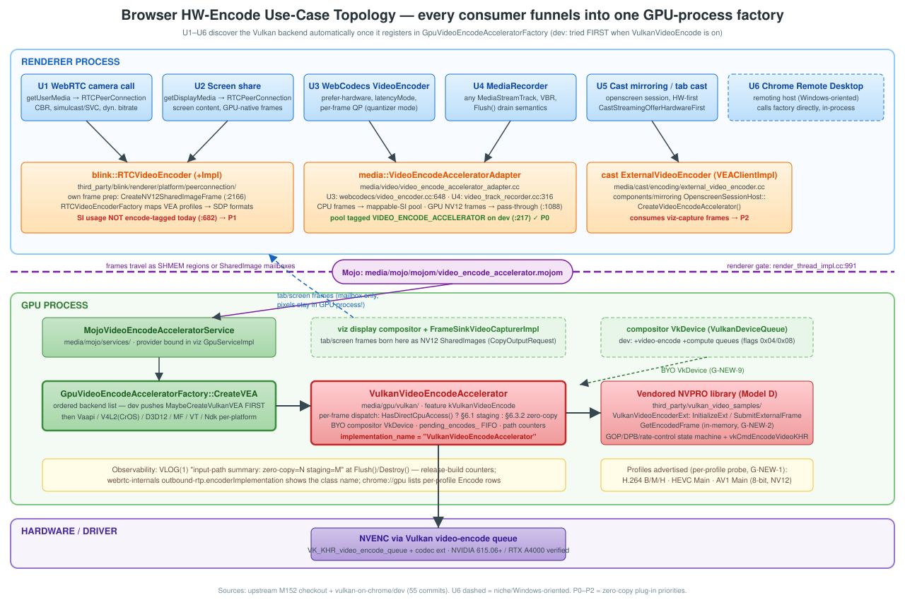
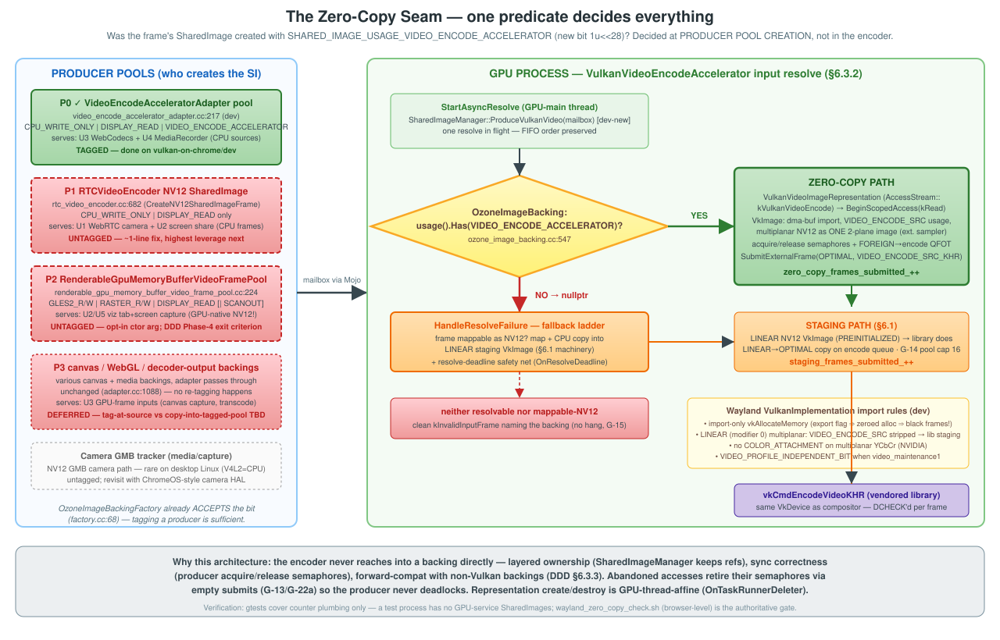
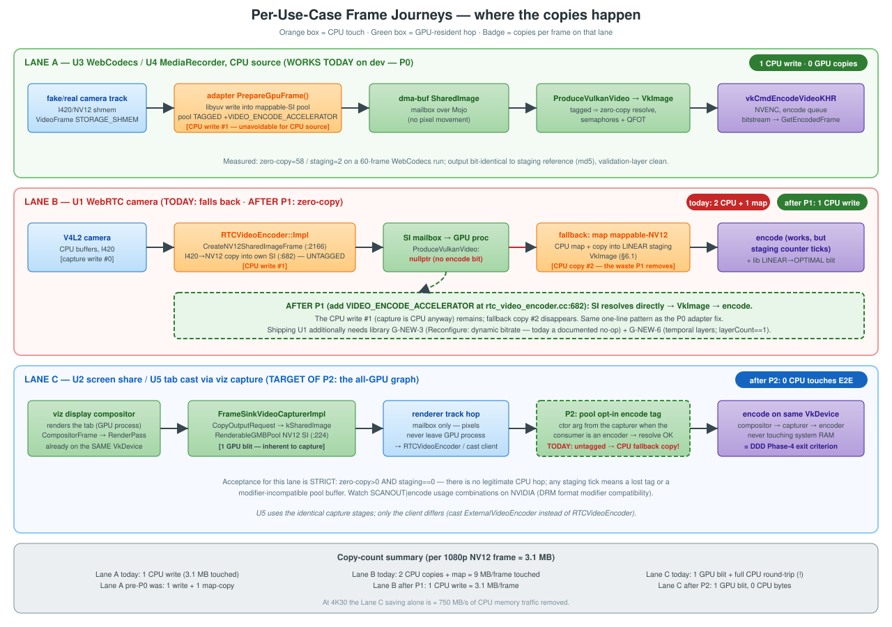
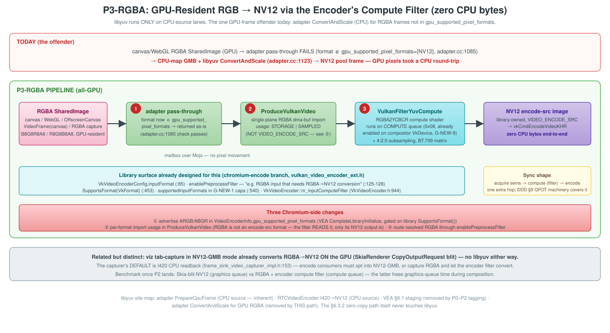
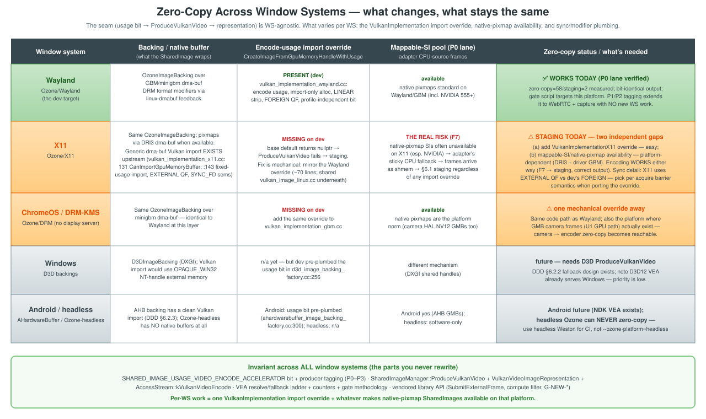
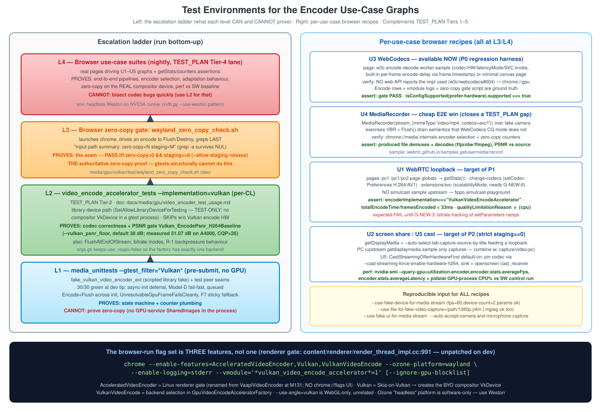

<!--
SPDX-FileCopyrightText: Copyright (c) 2026 NVIDIA CORPORATION & AFFILIATES. All rights reserved.
SPDX-FileCopyrightText: 2026 The Khronos Group, Inc.
SPDX-License-Identifier: Apache-2.0

Licensed under the Apache License, Version 2.0 (the "License");
you may not use this file except in compliance with the License.
You may obtain a copy of the License at

http://www.apache.org/licenses/LICENSE-2.0

Unless required by applicable law or agreed to in writing, software
distributed under the License is distributed on an "AS IS" BASIS,
WITHOUT WARRANTIES OR CONDITIONS OF ANY KIND, either express or implied.
See the License for the specific language governing permissions and
limitations under the License.
-->
# Browser HW Encoder: Use Cases, Processing Graphs, and Zero-Copy Plug-In Points

<!-- DOC-STATUS -->
> **Status: CURRENT.** Browser encode use cases U1-U6 and per-use-case frame flow.
> Index: [`README.md`](README.md).


**Status:** v1.1 — 2026-07-07 (v1.1 folds in web-verified flag names, getStats verification
fields, sample-page inventory, and CI environment caveats)
**HTML version:** [vulkan_video_encoder_use_cases.html](vulkan_video_encoder_use_cases.html)
(same content with SVG diagrams and expanded per-use-case detail/caveats)
**Scope:** Answers three architecture questions for the Vulkan Video encode integration:
(1) what are the browser use cases of the HW encoder, (1a) what is the component/processing
graph per use case, and (2a) how each graph can be prototyped and tested. The focus is the
**zero-copy input seam**: where GPU-resident frames can reach the encoder without a CPU copy,
what is already wired on `vulkan-on-chrome/dev`, and what must be tagged/patched next.

**Evidence base:**
- Upstream Chromium checkout at `chromium/src` (M152-era `main`); file:line references below.
- WIP branch `origin/vulkan-on-chrome/dev` in the `vulkan-on-chrome` fork (55 commits, Vishesh Garg).
- Companion docs: encode DDD (`VULKAN_VIDEO_ENCODE_INTEGRATION_DESIGN_DOCUMENT.md`, esp. §6.1/§6.3/§9),
  `VULKAN_VIDEO_TEST_PLAN.md` (five-tier model, §4.2 quality gates),
  `VULKAN_VIDEO_LIBRARY_INTEGRATION_ANALYSIS.md` (Model D vendoring).
  This document does not repeat their content; it adds the *per-use-case frame-flow graphs* and the
  producer-side zero-copy matrix that they do not cover.

---

## 1. Use cases of the HW encoder in the browser

Every use case funnels into **one** GPU-process entry point:
`media::GpuVideoEncodeAcceleratorFactory::CreateVEA()`
(`media/gpu/gpu_video_encode_accelerator_factory.cc`). The Vulkan backend registers there
(first in the factory list on `dev`, behind `--enable-features=VulkanVideoEncode` +
GN `enable_vulkan_video_encode=true`), so all consumers below discover it automatically via
`GpuVideoAcceleratorFactories::GetVideoEncodeAcceleratorSupportedProfiles()`.

| # | Use case | Renderer-side client | Frame source(s) | Notes for Vulkan backend |
|---|----------|---------------------|-----------------|--------------------------|
| U1 | **WebRTC camera call** (`getUserMedia` → `RTCPeerConnection`) | `RTCVideoEncoder` (`third_party/blink/renderer/platform/peerconnection/rtc_video_encoder.cc`) | Camera (V4L2 on Linux, usually CPU/shmem) | Most demanding: simulcast/SVC (`Config::SpatialLayer`), dynamic bitrate (`RequestEncodingParametersChange`), CBR. Blocked on G-NEW-3/G-NEW-6 today |
| U2 | **Screen share** (`getDisplayMedia` → WebRTC) | same `RTCVideoEncoder` | viz `FrameSinkVideoCapturerImpl` (tab/window/screen) | Frames can be GPU-native NV12 → prime zero-copy target |
| U3 | **WebCodecs `VideoEncoder`** | `blink::VideoEncoder` → `media::VideoEncodeAcceleratorAdapter` (`third_party/blink/renderer/modules/webcodecs/video_encoder.cc:648`) | Camera track, canvas/WebGL, `<video>` frames, generated `VideoFrame`s | `hardwareAcceleration:'prefer-hardware'`; per-frame QP (`kExternal` bitrate). **Works today on dev** |
| U4 | **MediaRecorder** | `VideoTrackRecorderImpl` → `media::VideoEncodeAcceleratorAdapter` (`third_party/blink/renderer/modules/mediarecorder/video_track_recorder.cc:316`) | Any `MediaStreamTrack` (camera, tab, canvas) | VBR; shares the adapter path with U3 → **works today on dev** |
| U5 | **Cast mirroring / tab cast** | `media/cast/encoding/external_video_encoder.cc` (`VEAClientImpl`) via `components/mirroring` | viz `FrameSinkVideoCapturerImpl` | Not covered by DDD/TEST_PLAN (known gap); uses `GpuVideoAcceleratorFactories` like the others |
| U6 | **Chrome Remote Desktop** | `remoting/codec/webrtc_video_encoder_gpu.cc` (calls factory directly, in-process) | Desktop capture | Niche; inherits backend for free |

Key upstream gating facts (Linux):
- `kAcceleratedVideoEncodeLinux` ("AcceleratedVideoEncoder") is **DISABLED by default**
  (`media/base/media_switches.cc:704`) — upstream Linux has no default HW encode.
- `kVaapiOnNvidiaGPUs` is **DISABLED by default** (`:716`) — on NVIDIA there is effectively *no*
  HW encode path in stock Chrome. The Vulkan backend is the first real one.

---

## 2. The processing graphs (1a)



### 2.0 Common trunk — everything below the Mojo boundary



All use cases share this trunk once a `media::VideoFrame` reaches the encoder:

```
RENDERER PROCESS                    ║ GPU PROCESS
                                    ║
 client (U1..U4)                    ║  MojoVideoEncodeAcceleratorService
   │ media::VideoFrame              ║    (media/mojo/services/)
   │  - STORAGE_SHMEM        ─────Mojo────►  GpuVideoEncodeAcceleratorFactory::CreateVEA
   │  - STORAGE_GPU_MEMORY_BUFFER   ║           │ (dev: Vulkan tried FIRST when feature on)
   │  - SharedImage mailbox         ║           ▼
   │    (media/mojo/mojom/          ║    VulkanVideoEncodeAccelerator (media/gpu/vulkan/)
   │     video_encode_accelerator   ║      │ per-frame: frame->HasDirectCpuAccess() ?
   │     .mojom)                    ║      │
   │                                ║      ├─ CPU frame ──► §6.1 staging: LINEAR NV12 VkImage,
   │                                ║      │               libyuv copy; library does
   │                                ║      │               LINEAR→OPTIMAL copy on encode queue
   │                                ║      │
   │                                ║      └─ SharedImage frame ──► §6.3.2 zero-copy:
   │                                ║           GPU-main thread: SharedImageManager::
   │                                ║           ProduceVulkanVideo(mailbox)           [dev-new]
   │                                ║             └► OzoneImageBacking checks
   │                                ║                SHARED_IMAGE_USAGE_VIDEO_ENCODE_ACCELERATOR
   │                                ║                (ozone_image_backing.cc:547)
   │                                ║             ├─ tagged: VkImage (dma-buf import,
   │                                ║             │   VIDEO_ENCODE_SRC usage, FOREIGN QF)
   │                                ║             │   + acquire/release semaphores
   │                                ║             │   ──► vendored library SubmitExternalFrame
   │                                ║             │       (vkCmdEncodeVideoKHR, encode queue)
   │                                ║             └─ untagged: nullptr → fallback:
   │                                ║                 map as mappable-NV12 → §6.1 staging,
   │                                ║                 else clean kInvalidInputFrame
   │  ◄──── BitstreamBufferReady ───║────── GetEncodedFrame (in-memory, G-NEW-2)
```

The compositor `VkDevice` (viz `VulkanInProcessContextProvider`) now also creates the
video-encode and compute queues (`gpu/vulkan/vulkan_device_queue.h`, flags 0x04/0x08) — one
device, three queues, timeline-semaphore/QFOT handoff per DDD §9.

**The zero-copy seam is therefore a single predicate:** *was the frame's SharedImage created
with `SHARED_IMAGE_USAGE_VIDEO_ENCODE_ACCELERATOR` (new bit `1u<<28`, dev branch)?*
Everything upstream of Mojo decides this at **producer pool creation time**. That is where
architecture decisions must land.

### 2.1 U3/U4 — WebCodecs & MediaRecorder (the adapter path) — WORKS TODAY

```
 camera/canvas/track frame
   │
   ▼
 VideoEncodeAcceleratorAdapter (media/video/video_encode_accelerator_adapter.cc)
   │
   ├─ CPU frame (I420/NV12 shmem) ──► PrepareGpuFrame(): copy into the adapter's
   │      mappable-SI pool. dev TAGS this pool with VIDEO_ENCODE_ACCELERATOR
   │      (adapter.cc:217-219: CPU_WRITE_ONLY | DISPLAY_READ | VIDEO_ENCODE_ACCELERATOR)
   │      = ONE CPU write, then zero GPU-side copies. This is the path that passes
   │      wayland_zero_copy_check.sh today (zero-copy=58/staging=2 on a 60-frame run).
   │      F7 fallback: if the mappable-SI pool is unavailable (X11), sticky-fallback
   │      to shmem delivery → §6.1 staging in the GPU process.
   │
   └─ GPU frame (NV12 SharedImage from canvas/<video>/capture) ──► PASS-THROUGH
          (adapter.cc:1088-1093: returned unchanged, no re-tagging)
          → backing was created by canvas/raster/capture pools WITHOUT the encode bit
          → ProduceVulkanVideo returns nullptr → staging fallback (CPU map + copy!)
```

**Implication:** WebCodecs "zero-copy" today is *CPU-write-once* zero-copy. True GPU→GPU
zero-copy (canvas/WebGL/decoder output → encoder with no CPU touch) requires tagging the
*producer* SharedImages (§3, P2/P3).

### 2.2 U1 — WebRTC camera call

```
 V4L2 camera (media/capture/video/linux/v4l2_capture_delegate.cc)
   │  Linux desktop default: CPU buffers → I420 shmem VideoFrame
   ▼
 renderer: WebRTC pipeline → RTCVideoEncoder::Impl (NOT the adapter — its own frame prep)
   │
   ├─ Config negotiated: "NV12 + kGpuMemoryBuffer" or "I420 + kShmem"
   │    (rtc_video_encoder.cc:1112-1118)
   ├─ CPU frame → CreateNV12SharedImageFrame (rtc_video_encoder.cc:2166):
   │    copies into its OWN SharedImage with usage CPU_WRITE_ONLY | DISPLAY_READ
   │    (rtc_video_encoder.cc:682-683) — NO encode tag → staging fallback in GPU process
   └─ GPU frame (NV12 GMB camera, rare on desktop Linux) → pass-through, also untagged
```

**Implication:** WebRTC never zero-copies into the Vulkan VEA today, even for the CPU-staged
SharedImage it creates itself. The one-line-class fix is adding
`SHARED_IMAGE_USAGE_VIDEO_ENCODE_ACCELERATOR` at `rtc_video_encoder.cc:682` (P1 in §3).
Functionally U1 still *encodes* fine via fallback — but with an extra CPU map+copy per frame.
Full U1 support additionally needs `RequestEncodingParametersChange` (library G-NEW-3) and
temporal layers (G-NEW-6); today's no-op means WebRTC's congestion controller cannot steer
the bitrate — acceptable for a demo, not for shipping.

### 2.3 U2/U5 — Tab/screen capture → WebRTC or Cast (the marquee zero-copy graph)

```
 viz display compositor (GPU process) renders the tab
   │  CompositorFrame → RenderPass
   ▼
 FrameSinkVideoCapturerImpl (components/viz/service/frame_sinks/video_capture/)
   │  CopyOutputRequest, ResultDestination::kSharedImage
   ▼
 GpuMemoryBufferVideoFramePool (same dir, :82)
   └► media::RenderableGpuMemoryBufferVideoFramePool
        (media/video/renderable_gpu_memory_buffer_video_frame_pool.cc:224-227)
        creates NV12 SharedImages with usage GLES2_READ/WRITE | RASTER_READ/WRITE |
        DISPLAY_READ [| SCANOUT]  — NO encode tag
   │
   │   *** frame is ALREADY GPU-resident NV12 in the GPU process's SharedImage
   │       manager; it crosses to the renderer only as a mailbox ***
   ▼
 mojo → renderer track → U1 RTCVideoEncoder (screen share) or U5 cast ExternalVideoEncoder
   ▼
 mojo → GPU process VEA … ProduceVulkanVideo → untagged → staging fallback (CPU copy of a
 frame that never needed to leave the GPU!)
```

**Implication:** this graph is the strongest architectural argument for the Vulkan backend —
compositor output is born as a Vulkan-compatible dma-buf SharedImage *in the same process
and (on dev) the same `VkDevice`* as the encoder. Tagging the renderable pool (P2 in §3)
closes the loop: tab → compositor → encoder with zero CPU touches end-to-end. This is also
DDD Phase-4's exit criterion ("tab-capture→WebRTC encode loop with no CPU readback").



### 2.4 Producer→seam matrix (what determines zero-copy per use case)

| Producer pool / frame prep | File:line (usage set) | Tagged on `dev`? | Result at `ProduceVulkanVideo` |
|---|---|---|---|
| `VideoEncodeAcceleratorAdapter` mappable-SI pool (U3, U4) | `media/video/video_encode_accelerator_adapter.cc:217` (dev) | **YES** | zero-copy ✅ |
| `RTCVideoEncoder` NV12 SI frame (U1, U2 CPU path) | `third_party/blink/renderer/platform/peerconnection/rtc_video_encoder.cc:682` | no | staging fallback |
| `RenderableGpuMemoryBufferVideoFramePool` (U2/U5 capture) | `media/video/renderable_gpu_memory_buffer_video_frame_pool.cc:224` | no | staging fallback |
| Canvas / WebGL / raster SharedImages passed through adapter (U3 GPU path) | various canvas backings | no | staging fallback |
| Camera GMB tracker (ChromeOS-style NV12 camera) | `media/capture/` GMB tracker | no | staging fallback |

`OzoneImageBackingFactory` already accepts the new usage bit on dev
(`ozone_image_backing_factory.cc:68`), and D3D/AHardwareBuffer factories were pre-plumbed —
so tagging a producer is *sufficient* on Wayland/Ozone; no further backing work is needed.

---

## 3. Recommended zero-copy plug-in order

Ranked by (leverage ÷ risk). Each step is independently testable with the recipes in §4.

**P0 — done on `dev`:** adapter pool tagging → WebCodecs + MediaRecorder CPU-source
zero-copy; browser gate script passes.

**P1 — `RTCVideoEncoder` SI tagging (~1-line + review).** Add
`SHARED_IMAGE_USAGE_VIDEO_ENCODE_ACCELERATOR` to `si_usage` at `rtc_video_encoder.cc:682`.
Unlocks U1/U2 WebRTC zero-copy for every CPU-source frame. Risk: none on non-Ozone paths
(bit is ignored by backings that don't check it); needs the same F7-style fallback thinking
if SI creation fails.

**P2 — `RenderableGpuMemoryBufferVideoFramePool` tagging (small, high leverage).** Add the
bit (plumbed via a pool-creation parameter so only *capture-for-encode* pools opt in, since
this pool is shared with other consumers). Unlocks the U2/U5 compositor→encoder full-GPU
graph — the DDD Phase-4 exit criterion. Watch: SCANOUT|encode combinations on NVIDIA
(format-modifier compatibility), and the LINEAR-modifier restriction already handled in
`vulkan_implementation_wayland.cc` (VIDEO_ENCODE_SRC stripped for modifier-0 imports →
library staging copy still zero-CPU).

**P3 — canvas/decoder-output backings (larger, later).** Tag or re-produce canvas and
video-decoder-output SharedImages for encode. Needs a policy decision (tag broadly vs.
copy-on-first-encode into a tagged pool). Defer until P1/P2 data shows demand.

**P4 — library-side unblockers for U1 to *ship* (not just demo):** G-NEW-3 `Reconfigure()`
(dynamic bitrate/framerate — today `RequestEncodingParametersChange` is a no-op) and
G-NEW-6 temporal layers. These are library workstream items, not seam items, but U1
acceptance tests (§4.2) will fail their bitrate-tracking assertions until they land.

### 3.1 The GPU-RGB input path (P3-RGBA) — where libyuv actually sits, and how to avoid it



libyuv (CPU) appears **only on CPU-source lanes** — it is *not* part of the §6.3.2 zero-copy
path. Exact sites:

| libyuv / CPU-conversion site | When it runs | Avoidable? |
|---|---|---|
| adapter `PrepareCpuFrame` / pool write | frame born on CPU (camera shmem) | No — one CPU write is inherent to a CPU source |
| `RTCVideoEncoder::CreateNV12SharedImageFrame` (I420→NV12) | U1/U2 CPU frames | No (CPU source), but P1 removes the *second* copy |
| VEA §6.1 staging upload (I420→NV12 into LINEAR `VkImage`) | fallback for untagged/mappable frames | Yes — that's what P0–P2 tagging eliminates |
| **adapter `PrepareGpuFrame` non-passthrough branch → `ConvertAndScale`** (`video_encode_accelerator_adapter.cc:1123`) | **GPU RGBA frame** (canvas/WebGL/`VideoFrame`) whose format is not in `gpu_supported_pixel_formats` | **Yes — this is the offender.** A frame already resident on the GPU gets CPU-mapped and converted by libyuv because pass-through (`:1085`) requires NV12 or an advertised GPU format, and dev advertises `{NV12}` only |

**The GPU-resident RGB path.** The vendored library already contains the GPU converter:
`VulkanFilterYuvCompute` (`common/libs/VkCodecUtils/VulkanFilterYuvCompute.{h,cpp}`) with an
explicit **`RGBA2YCBCR` compute-shader operation** (plus `YCBCRCOPY`, `YCBCR2RGBA`,
subsampling and MSB-shift flags). `VkVideoEncoder` owns it as `m_inputComputeFilter`
(`VkVideoEncoder.h:944`, created at `VkVideoEncoder.cpp:2118`), and the `chromium-encode`
ext API was designed for exactly this: `VkVideoEncoderConfig.inputFormat` +
`enablePreprocessFilter` ("e.g. RGBA input that needs RGBA→NV12 conversion",
`vulkan_video_encoder_ext.h:125-128`), `SupportsFormat(VkFormat)` (`:453`), and
`supportedInputFormats` in the G-NEW-1 capability struct (`:540`). The compute queue the
filter needs is already enabled on the compositor `VkDevice`
(`COMPUTE_QUEUE_FLAG = 0x08`, dev) and its family index is plumbed through the BYO config
(G-NEW-9).

End-to-end, all-GPU:

```
canvas/WebGL/capture RGBA SharedImage (GPU)
  → adapter pass-through            [advertise ARGB/ABGR in VideoEncoderInfo.
                                     gpu_supported_pixel_formats — adapter.cc:939/:1085]
  → mailbox over Mojo (no pixels)
  → ProduceVulkanVideo: single-plane RGBA import                     [change needed:
      import usage STORAGE|SAMPLED for non-YCbCr formats — today it hardcodes
      VIDEO_ENCODE_SRC (ozone_image_backing.cc), which RGBA is not; the filter
      READS the RGBA image, only the filter's NV12 output is an encode source]
  → library SubmitExternalFrame(inputFormat=B8G8R8A8/R8G8B8A8,
      enablePreprocessFilter=TRUE)
  → VulkanFilterYuvCompute::RGBA2YCBCR on the compute queue
      → library-owned NV12 VIDEO_ENCODE_SRC image
  → vkCmdEncodeVideoKHR              — zero CPU bytes end-to-end
```

Chromium-side changes: (1) advertise RGBA formats in `VideoEncoderInfo.gpu_supported_pixel_formats`
(VEA `CompleteLibraryInitialize`), gated on the library's `SupportsFormat()`; (2) per-format
import usage in `ProduceVulkanVideo`; (3) route resolved RGBA images through the
`enablePreprocessFilter` config. Sync shape: acquire semaphores → compute (filter) → encode,
i.e. one extra queue hop that the existing timeline-semaphore/QFOT machinery (DDD §9)
already models. Note the DDD deliberately kept CPU-side RGBA readback conversion off-plan —
the compute filter *is* the planned mechanism.

Related but distinct: viz tab-capture in NV12-GMB mode already converts RGBA→NV12 **on the
GPU** (the `CopyOutputRequest` blit in SkiaRenderer) before the frame ever reaches the
encoder, so Lane C involves no libyuv either way — the P3-RGBA choice there is Skia-blit-NV12
(existing) vs. handing RGBA to the encoder filter. The capturer's *default* format is I420
CPU readback (`frame_sink_video_capturer_impl.h:153`) — WebRTC screen-share opts into
NV12-GMB; keep it in NV12-GMB mode for encode consumers.

### 3.2 Zero-copy across window systems — Wayland vs X11 vs the rest



The seam itself (usage bit → `ProduceVulkanVideo` → `VulkanVideoImageRepresentation` →
resolve/fallback ladder → counters) is **window-system-agnostic**. What varies per WS is one
hook — `VulkanImplementation::CreateImageFromGpuMemoryHandleWithUsage()` — plus whether
native-pixmap SharedImages exist on that platform at all. Verified state on `dev`:

| WS | Import override | Native-pixmap SIs | Zero-copy status |
|---|---|---|---|
| **Wayland** (Ozone) | **present** (`vulkan_implementation_wayland.cc`: encode usage, import-only alloc, LINEAR strip, FOREIGN QF) | standard (GBM/minigbm; NVIDIA 555+) | ✅ works today; P1/P2 need **no** new WS work |
| **X11** (Ozone) | **missing** — base default returns `nullptr` (`vulkan_implementation.cc:86-88`) → staging | **the real risk**: often unavailable (esp. NVIDIA) → adapter F7 sticky CPU fallback → shmem → §6.1 staging *regardless* of any override | ⚠ encodes correctly via staging; two independent gaps |
| **ChromeOS / DRM-KMS** (Ozone) | missing — add same override to `vulkan_implementation_gbm.cc` | platform norm (incl. NV12 camera GMBs) | one mechanical override away; unlocks camera→encoder zero-copy |
| **Windows / Android** | n/a yet, but dev pre-plumbed the usage bit in `d3d_image_backing_factory.cc:256` / `ahardwarebuffer_image_backing_factory.cc:300` | different mechanisms (DXGI NT handles / AHB) | future; D3D12/NDK VEAs already serve those platforms |
| **Ozone headless** | n/a | none (software-only) | never — use headless Weston for CI |

Two X11 specifics worth noting when porting the override: upstream X11 already has generic
dma-buf Vulkan import (`vulkan_implementation_x11.cc:131/:143` — dma-buf + DRM-modifier
extensions, DRI3 pixmaps), so the override is ~70 mechanical lines over the shared
`vulkan_image_linux.cc` machinery (including the import-only-`vkAllocateMemory` fix, which is
shared and stays fixed). And X11's import stamps `VK_QUEUE_FAMILY_EXTERNAL` where the dev
Wayland path uses `VK_QUEUE_FAMILY_FOREIGN_EXT` — the library's FOREIGN→staging-family
acquire barrier keys off this, so pick the queue family consistently with the acquire
semantics when porting. The practical consequence: **X11 users still get working HW encode**
(the F7 + §6.1 ladders guarantee correctness), just with one CPU copy per frame — which is
exactly what the `staging` counter and the gate script's `--allow-staging` mode exist to
distinguish.

---

## 4. Prototyping & test environments per graph (2a)

Complements TEST_PLAN Tiers 1–5; these are the *browser-graph* environments the TEST_PLAN
lists as gaps (MediaRecorder E2E, Cast) plus concrete recipes for what exists on `dev`.



### 4.0 Common harness facts

- Build: `enable_vulkan_video_encode=true` GN arg; run with
  **`--enable-features=AcceleratedVideoEncoder,Vulkan,VulkanVideoEncode --ozone-platform=wayland`**.
  All three features are required for browser-level runs:
  - `AcceleratedVideoEncoder` (= `kAcceleratedVideoEncodeLinux`): the **renderer** refuses to
    expose any HW encoder on Linux without it (`content/renderer/render_thread_impl.cc:991`,
    verified unpatched on `dev`) — the GPU-process factory never even gets asked. Note the
    feature was renamed from `VaapiVideoEncoder` at M131 and has **no chrome://flags entry on
    Linux**; command line is the only way.
  - `Vulkan` (Skia-on-Vulkan compositing): creates the viz `VulkanInProcessContextProvider`
    whose `VulkanDeviceQueue` is the BYO device the VEA requires (production fail-fasts
    without it). `--use-angle=vulkan` is unrelated (WebGL only) — don't confuse the two.
  - `VulkanVideoEncode`: selects the backend in `GpuVideoEncodeAcceleratorFactory`.
  - The renderer additionally requires `GPU_FEATURE_TYPE_ACCELERATED_VIDEO_ENCODE` to be
    enabled in `GpuFeatureInfo`; if the GPU blocklist disables it on Linux/NVIDIA, add
    `--ignore-gpu-blocklist`. Verify in `chrome://gpu` → "Video Acceleration Information":
    the per-profile **Encode rows** come straight from the VEA profile enumeration (trust the
    table, not the summary line).
- Zero-copy observability: the VEA logs `input-path summary: zero-copy=N staging=M` at
  `Flush()`/`Destroy()` under `--enable-logging=stderr --vmodule='*vulkan_video_encode_accelerator*=1'`.
  Counters are release-build. The authoritative gate is
  `media/gpu/vulkan/test/wayland_zero_copy_check.sh` (PASS iff zero-copy>0 && staging==0;
  `--allow-staging` to relax). gtests can only cover counter plumbing — a unit-test process
  has no GPU-service SharedImages, so browser-level checks are *required* for zero-copy.
- Reproducible input, no real camera:
  `--use-fake-device-for-media-stream --use-file-for-fake-video-capture=/path/clip.y4m`
  (+ `--use-fake-ui-for-media-stream` to auto-grant). For `getDisplayMedia` automation:
  `--auto-select-desktop-capture-source=...` / `--auto-select-tab-capture-source-by-title=...`.
- Encoder-selection proof (WebRTC): `chrome://webrtc-internals` → `outbound-rtp` →
  `encoderImplementation` reports the **concrete VEA class name** (VA-API shows
  `"VaapiVideoEncodeAccelerator"`) via `VideoEncoderInfo::implementation_name` — set ours to
  `"VulkanVideoEncodeAccelerator"` deliberately; it becomes the user-visible proof string.
  Also check `powerEfficientEncoder === true`. Per webrtc-stats both fields only exist when
  the page's *capturing state* is true (a successful getUserMedia/getDisplayMedia) —
  receive-only pages won't show them. Historical fallback value before encoder info arrives
  is `"ExternalEncoder"`.
- Encoder-selection proof (WebCodecs): **there is no web API reporting which implementation
  was actually used** (w3c/webcodecs#604); `isConfigSupported({hardwareAcceleration:
  'prefer-hardware'})` is only a pre-check (`supported:false` on stock Linux since the
  renderer gate is off). Ground truth: `chrome://gpu` Encode rows, `chrome://media-internals`,
  or `--vmodule=*/media/gpu/*=2` stderr logs.

### 4.1 U3 WebCodecs (available now — P0 regression harness)

1. Page: canvas or fake-camera track → `VideoEncoder` (`avc1.42E01E`, NV12,
   `hardwareAcceleration:'prefer-hardware'`), encode N frames, `flush()`, `close()`.
   Best ready-made page: the W3C **encode-decode-worker** sample
   (w3c.github.io/webcodecs/samples/encode-decode-worker/) — knobs for codec, HW preference,
   `latencyMode`, bitrate mode, scalabilityMode L1T1–L1T3, and it already measures per-frame
   encode delay by correlating `frame.timestamp` submit→output (pin `latencyMode` when
   benchmarking; realtime mode may drop frames).
2. Run under the flags above; assert via `wayland_zero_copy_check.sh`.
3. Functional/quality tier below the browser: Tier-2
   `video_encode_accelerator_tests --implementation=vulkan` incl. the
   `Vulkan_EncodePsnr_H264Baseline` gate (≥38 dB floor; 51 dB measured on A4000).

### 4.2 U1 WebRTC loopback (target of P1)

1. Single-page `RTCPeerConnection` loopback with fake camera file input. Ready-made pages
   (webrtc.github.io/samples): `peerconnection/pc1` (minimal loopback; `pc1`/`pc2` are page
   globals, so automation can call `pc1.getStats()` directly), `peerconnection/change-codecs`
   (H.264/VP9/AV1 via `setCodecPreferences`), `extensions/svc` (scalabilityMode dropdown for
   L1T1–L1T3 once G-NEW-6 lands). Note: webrtc/samples has **no simulcast sample** — use
   fippo's simulcast-playground for that.
2. Assert per `getStats()`: `encoderImplementation === "VulkanVideoEncodeAccelerator"`;
   `framesEncoded` advances; avg encode ms = `totalEncodeTime/framesEncoded` under ~33 ms
   at 30 fps; `qualityLimitationReason` stays `none`/`bandwidth`, never `cpu` (the top-line
   "HW encoder is really carrying the load" signal); bitrate (Δ`bytesSent`×8/Δt) tracks
   `setParameters` ramps — this last one will FAIL until library G-NEW-3, encode it as an
   expected-fail. QP from `qpSum/framesEncoded` is codec-scale-specific (H.264 0–51 vs VP8
   0–127) — never compare across codecs. Zero-copy counters after P1 tagging.
3. Pre-existing story sets: `tools/perf/page_sets/webrtc_cases/` (`codec_constraints`,
   `multiple-peerconnections`, `pause-play`, `canvas-capture`) as TEST_PLAN §6.2 variants;
   ChromeOS tast (`video.EncodeAccel.*`, `webrtc/rtc_peer_connection_perf.go`) is the model
   for real-hardware CI jobs.

### 4.3 U2 screen-share / U5 tab-capture (target of P2)

1. `getDisplayMedia({video:true})` with `--auto-select-tab-capture-source-by-title` feeding
   a loopback `RTCPeerConnection`. Note the upstream `getusermedia/getdisplaymedia` sample
   only *captures* — it never encodes; combine with `capture/video-pc/` or hand-roll the PC.
   For U5, Cast is HW-first by default (`CastStreamingOfferHardwareFirst` enabled), with
   per-codec overrides `--cast-streaming-force-{enable,disable}-hardware-h264` — useful to
   pin the codec under test (full Cast graph needs a receiver; openscreen's `cast_receiver`
   demo or a second Chrome works as a sink).
2. Success = zero-copy counters with **staging==0 strictly** — this graph has no legitimate
   CPU hop; any staging indicates a lost tag or a modifier-incompatible pool buffer.
3. Perf probe at 1080p30/4K30, SW vs Vulkan runs (`--disable-features=VulkanVideoEncode` as
   control): GPU-process CPU% (`pidstat`), and NVIDIA encoder engine stats via
   `nvidia-smi --query-gpu=utilization.encoder,encoder.stats.sessionCount,encoder.stats.averageFps,encoder.stats.averageLatency`
   or `nvidia-smi encodersessions` (`utilization.encoder` is busy-time %, not throughput).

### 4.4 U4 MediaRecorder (cheap E2E win, closes a TEST_PLAN gap)

`MediaRecorder(stream, {mimeType:'video/mp4; codecs=avc1'})` over a fake-camera stream;
assert HW selection (chrome://media-internals), zero-copy counters, and that the produced
file demuxes/decodes (ffprobe) — this exercises VBR + `Flush()` drain semantics that
WebCodecs CQ mode does not.

### 4.5 CI shape

Wrap 4.1–4.4 as headless-Wayland jobs on the NVIDIA runner: each job = launch script + page
+ stderr grep + getStats JSON dump; promote to the TEST_PLAN's Tier-4 lane. Keep Tier-2
gtests as the per-CL gate; browser jobs nightly. Environment caveats (all verified against
upstream docs):
- The Ozone `headless` platform is **software-only** — it cannot host these jobs. Chromium's
  own Wayland bots run `testing/xvfb.py --use-weston` with `--ozone-platform=wayland`; a
  headless Weston (or cage) session on the GPU runner is the equivalent.
- Headless-mode Chrome with `--enable-gpu` needs a real display server for HW GL; the
  `--use-angle=vulkan` workaround covers WebGL only, not our path — prefer a real
  Weston/X session.
- Ubuntu 24.04 AppArmor user-namespace restrictions break unpackaged Chromium builds;
  apply the documented AppArmor profile fix rather than `--no-sandbox` (sandbox-off runs
  don't exercise the production GPU-process brokering).
- Reference docs: `docs/media/gpu/video_encoder_test_usage.md` (Tier-2 binaries — note the
  commonly cited `video_encode_accelerator_tests.md` path does not exist),
  `docs/gpu/vaapi.md` (Linux HW-video flag conventions we mirror).

---

## 5. Caveats index (C1–C14)

Full text with context in the [HTML version](vulkan_video_encoder_use_cases.html) §7; one-liners here for grep-ability:

- **C1** — browser runs need THREE features: `AcceleratedVideoEncoder` (renderer gate, `render_thread_impl.cc:991`) + `Vulkan` (BYO compositor VkDevice) + `VulkanVideoEncode` (backend selection).
- **C2** — feature renamed `VaapiVideoEncoder`→`AcceleratedVideoEncoder` at M131; no chrome://flags UI on Linux.
- **C3** — `--enable-features=Vulkan` (Skia compositing, what we need) ≠ `--use-angle=vulkan` (WebGL only).
- **C4** — gtests structurally cannot prove zero-copy (no GPU-service SharedImages in a test process); only browser-level gates can.
- **C5** — WebCodecs has no implementation-report API (w3c/webcodecs#604); ground truth = chrome://gpu / media-internals / vmodule logs.
- **C6** — webrtc-internals `encoderImplementation`/`powerEfficientEncoder` require active capture; pre-info fallback value is `"ExternalEncoder"`.
- **C7** — dma-buf imports must use import-only `vkAllocateMemory`; an export flag on NVIDIA yields a zeroed allocation → black frames, no validation error.
- **C8** — LINEAR-modifier (modifier-0) multiplanar imports can't be encode sources on A4000/615.06; usage is stripped → library staging copy (still zero CPU).
- **C9** — Ozone `headless` is software-only; use headless Weston for CI; prefer the AppArmor profile fix over `--no-sandbox`.
- **C10** — metric semantics: `qpSum` scales are codec-specific; `utilization.encoder` is busy-time %, not throughput; healthy HW = `qualityLimitationReason ∈ {none, bandwidth}`.
- **C11** — `RequestEncodingParametersChange` is a no-op pending library G-NEW-3/G-NEW-6; U1 bitrate assertions are expected-fail.
- **C12** — `kVaapiOnNvidiaGPUs` is default-off; the meaningful control run is software, not VA-API.
- **C13** — GPU RGBA frames silently drop to CPU libyuv `ConvertAndScale` in the adapter until P3-RGBA (§3.1) advertises RGBA formats.
- **C14** — **CORRECTED, measured on bare metal.** Wayland reaches `zero-copy` (480/480 frames, NVENC 35%); X11 reaches `cpu-dmabuf` (398–475/480), not staging. A host reaches staging when its X SERVER runs on a GPU whose GBM cannot allocate NV12 `SCANOUT_CPU_READ_WRITE` — a property of the host, not of X11. On a hybrid host the compositor and the encoder can land on different GPUs, which fails before the tier is reached at all. See `VULKAN_VIDEO_ENCODE_SURFACES_AND_GPU_TOPOLOGY.md`.

## 6. Open architecture questions

1. **Tag-at-source vs copy-into-tagged-pool** for P3 canvas/decoder frames — tagging is
   free but spreads encode usage across backings created for display; a copy-on-demand pool
   keeps usage isolated at one extra GPU blit. Decide with P2 perf data.
2. **Pool parameterization for P2** — `RenderableGpuMemoryBufferVideoFramePool` serves
   non-encode consumers; the encode bit should be an opt-in constructor arg wired only from
   `FrameSinkVideoCapturerImpl` when the capture consumer is an encoder.
3. **U5 Cast** remains undocumented in DDD/TEST_PLAN; once P2 lands, add a Cast section to
   the TEST_PLAN (it shares the U2 graph up to the encoder client).
4. **`RequestEncodingParametersChange` no-op** is the biggest functional (not seam) gap for
   U1/U2; track as library G-NEW-3/G-NEW-6.
