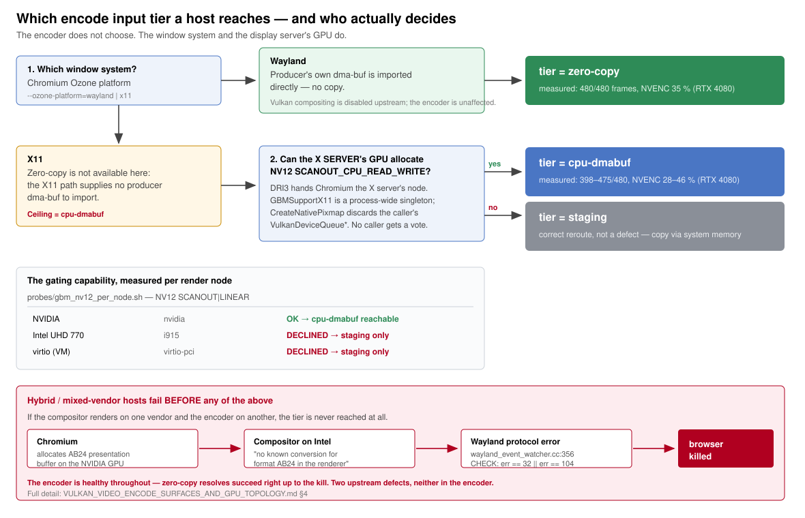

# Surfaces and GPU topology: what the encode tier actually depends on

<!-- DOC-STATUS -->
> **Status: CURRENT.** What the input tier depends on: X11, Wayland, hybrid GPUs.
> Index: [`README.md`](README.md).


Which input tier a browser reaches is **not** a property of the encoder. It is
decided by the window system and by which GPU the display server runs on, and on
Linux the browser does not get a vote. This document records what was measured,
on what, and what follows for anyone reading a tier result.

Supersedes the window-system claims in
`VULKAN_VIDEO_ENCODER_PROCESSING_GRAPHS.md` (C14) and
`VULKAN_VIDEO_BROWSER_TIER_BLOCKERS.md` (B-1), both of which predate
bare-metal measurement and are wrong in the direction of pessimism.



---

## 1. The measured matrix

| Host | Display server on | Platform | Tier reached | Witness |
|---|---|---|---|---|
| RTX 4080, bare metal | NVIDIA | **Wayland** (weston 13) | **`zero-copy`**, 480/480 | NVENC 35 % |
| RTX 4080, bare metal | NVIDIA | **X11** | **`cpu-dmabuf`**, 398–475/480 | NVENC 28–46 % |
| VM, virtio display adapter | virtio | X11 | `staging` only | — |
| RTX 4080 + Intel iGPU | Intel (compositor) | Wayland | **browser killed** | §4 |

Two corrections to earlier documents follow directly from row 1 and row 2.

**Zero-copy is reachable.** `VULKAN_VIDEO_BROWSER_TIER_BLOCKERS.md` B-1 states
that with Wayland Vulkan unimplemented upstream the zero-copy tier "cannot be
measured through this path at all -- on any machine, with any compositor... not
a weston artifact and not a provisioning gap." That is disproven: 480 zero-copy
frames on an RTX 4080 under headless weston. The upstream
`VulkanImplementationWayland::CreateViewSurface` gap is real and still logs
`'--ozone-platform=wayland' is not compatible with Vulkan`, but it does not
prevent the encoder reaching zero-copy.

**X11 does not degrade to staging.** C14 states X11 "silently degrades to
staging". On a host whose X server runs on a capable GPU, X11 reaches
`cpu-dmabuf`. Staging is what a host reaches when the X server is on a GPU that
cannot allocate the buffer — which is a property of the host, not of X11.

---

## 2. Why the display server decides, and not Chromium

Three independent mechanisms, all converging on the same fact.

**The GBM device comes from DRI3.** `GBMSupportX11` takes whatever DRI3 returns
for the X root window (`ui/gfx/linux/gbm_support_x11.cc:53`). It is a
process-wide singleton and no caller selects it.

**The caller's device handle is discarded.** `X11SurfaceFactory::CreateNativePixmap`
takes a `gpu::VulkanDeviceQueue*` and **ignores it**
(`ui/ozone/platform/x11/x11_surface_factory.cc:213`). Passing the encoder's own
device would change nothing.

**Chromium has no device-selection lever on Linux.** `GetDefaultGPU()` and the
`FORCE_LOW_POWER_GPU` / `FORCE_HIGH_PERFORMANCE_GPU` workarounds set a
`system_device_id` that reaches ANGLE as `EGL_PLATFORM_ANGLE_DEVICE_ID_*`
(`gpu/ipc/service/gpu_init.cc:310-345`, `ui/gl/gl_display.cc:158-167`). That id
is assigned only in `gpu_info_collector_win.cc:319` (the LUID) and from ANGLE's
`SystemInfo`; `gl_display.cc` skips the attribute entirely when it is `0`.

Verified empirically: with every GL/EGL environment override we could apply,
Chromium's GPU process opened the **same** render node (`renderD129`, NVIDIA) in
all configurations. Environment variables steer Mesa clients; they do not steer
Chromium.

> **Do not try to steer Chromium's GPU with `DRI_PRIME`,
> `__GLX_VENDOR_LIBRARY_NAME` or `__EGL_VENDOR_LIBRARY_FILENAMES`.** Measured:
> they either do nothing to Chromium or break EGL initialisation entirely and
> drop it to llvmpipe, which then looks like a hardware result and is not.
> `__GLX_VENDOR_LIBRARY_NAME` is GLX-only and Chromium uses EGL.

---

## 3. The capability that actually gates `cpu-dmabuf`

The tier needs exactly one thing from the platform: an **NV12
`SCANOUT_CPU_READ_WRITE`** buffer. Measured per render node with
`chrome-test-harness/probes/gbm_nv12_per_node.sh`:

| node | driver | NV12 `SCANOUT\|LINEAR` |
|---|---|---|
| NVIDIA | `nvidia` | **OK** |
| Intel UHD 770 | `i915` | DECLINED |
| virtio | `virtio-pci` (generic `drm`) | DECLINED |

A `RENDERING|LINEAR` decline on NVIDIA is **expected and not a fault**: NV12 is
not renderable there and the tier never asks for it. Only the
`SCANOUT|LINEAR` row decides.

**Read this before blaming the encoder for a staging result.** If the node DRI3
hands back prints DECLINED, `cpu-dmabuf` is unreachable on that host no matter
what the encoder does, and the code is behaving correctly by rerouting to
staging rather than shearing frames.

---

## 4. Hybrid / mixed-vendor systems

A machine with two GPUs from different vendors is not merely a slower case. It
is the case where buffers are allocated against one device and consumed by code
running on another, and it fails in more than one place.

### 4.1 Compositor on one vendor, encoder on another: the browser dies

Measured on an Intel iGPU + RTX 4080 host, same binary and row, varying only the
compositor's render device:

| compositor renders on | result |
|---|---|
| NVIDIA | PASS, `zero-copy`, 480 frames |
| Intel | **browser process killed** |

```
weston:   Error during import, and no known conversion for format AB24 in the renderer
weston:   libwayland: error in client communication
chromium: FATAL wayland_event_watcher.cc:356
          Check failed: err == 32 || err == 104. Wayland protocol error.
```

Chromium allocates its **presentation** buffer — `AB24`
(`DRM_FORMAT_ABGR8888`), the composited page output — on the NVIDIA GPU and
submits it to a compositor whose renderer is Intel, which cannot import it.
Weston raises a Wayland protocol error; Chromium tolerates only errno 32/104 and
`CHECK`s on anything else, turning a negotiation failure into a browser kill.

**This is not the encoder.** The log shows the Vulkan encoder working normally
right up to the kill — `[R10ZCDF] device-free zero-copy resolve OK` repeatedly,
release fences returned, encoding on the NVIDIA GPU as intended. Two separable
defects, neither ours:

1. Chromium selects a presentation buffer unsuited to the compositor's render
   device on mixed-vendor systems.
2. A Wayland protocol error is a `CHECK` rather than a degrade.

A lead, not a finding: `WaylandZwpLinuxDmabuf::OnTrancheFlags` is
`NOTIMPLEMENTED`, and tranche flags are how a compositor tells a client which
device and modifiers a buffer must suit. It is **not** the discriminator — it
prints in passing runs too — and the link is unproven.

### 4.2 The same shape on X11

`chrome-test-harness/probes/gbm_device_node.sh` documents the X11 form on a
different host: a buffer described by one device imported through a GBM device
opened on another, with the modifier's vendor byte naming the wrong GPU. One
root cause, two surfaces.

### 4.3 What a hybrid host means for a tier result

- The encoder selects its own device correctly — it picked the RTX 4080 in every
  hybrid configuration measured, including ones where everything else failed.
- The **allocation** and the **encode** can land on different GPUs, and nothing
  in the current code prevents it.
- A tier lower than expected on a hybrid host is the host's topology, not a
  regression, until the probe in §3 says otherwise.

---

## 5. Per-surface notes

### X11

- Tier ceiling is `cpu-dmabuf`. Zero-copy is not available: the zero-copy arm
  imports the producer's own dma-buf, which the X11 path does not supply.
- The tier depends entirely on which GPU the X server runs on (§2, §3).
- `X11SurfaceFactory::CanCreateNativePixmapForFormat` answers the capability
  question truthfully from GBM, but
  `OzonePlatformX11::IsNativePixmapConfigSupported` is a **hardcoded
  `return false`** (`ui/ozone/platform/x11/ozone_platform_x11.cc:236-238`) that
  ignores both arguments, while `supports_native_pixmaps` two lines above is set
  true whenever GBM holds a device. X11 contradicts itself.
  **Do not "fix" this in isolation** — it was tried: making the predicate
  truthful moves the allocation to the native branch, which then refuses for
  other reasons and has *no fallback to shared memory*, turning a recoverable
  failure into an unrecoverable one. See `E3_X11_ENCODE_PATH_RESPONSE.md` §2.

### Wayland

- Reaches `zero-copy`. Measured 480/480 frames, NVENC 35 %.
- Chromium still logs `'--ozone-platform=wayland' is not compatible with
  Vulkan` and disables Vulkan *compositing*
  (`VulkanImplementationWayland::CreateViewSurface` is `NOTIMPLEMENTED`). This
  does not stop the encoder.
- A headless compositor is fine for CI. Weston 13 accepts
  `--backend=headless --renderer=gl`; **Weston 10 requires
  `--backend=headless-backend.so` and has no `--renderer` at all** (it uses
  `--use-gl` / `--use-pixman`). A recipe written for one fails on the other.

### Virtualised hosts

- A VM whose X server is on a virtio adapter cannot reach `cpu-dmabuf` at all —
  virtio's GBM declines NV12 in every usage combination tested.
- Such a host measures `staging` and will do so forever. It is a valid host for
  correctness testing and an invalid one for tier assertions.

---

## 6. Reading a tier result responsibly

Before treating a tier below expectation as an encoder defect:

1. Run `probes/gbm_nv12_per_node.sh`. If the X server's node declines NV12, stop
   — the tier is unreachable on that host.
2. Run `probes/gbm_device_node.sh` to confirm which node the GPU process opens.
3. Check whether the host is hybrid. If the compositor and the encoder are on
   different vendors, §4 applies before anything else does.
4. Only then look at the encoder.

The harness's three-verdict model exists for exactly this: **HARNESS means
nothing was measured.** A host limit wearing a FAIL badge is the failure mode
this document is meant to prevent. `preflight.sh` does not yet probe the §3
capability; until it does, the check is manual.
