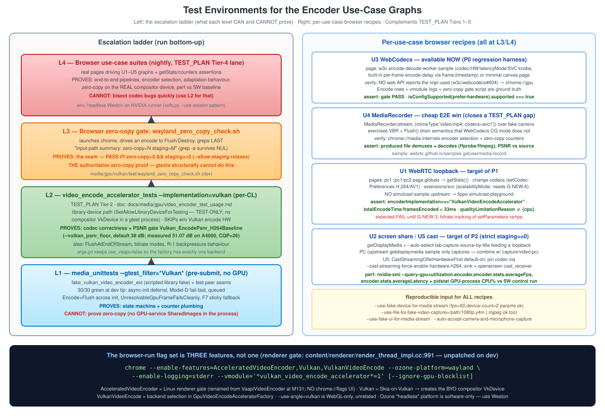

<!--
SPDX-FileCopyrightText: Copyright (c) 2026 NVIDIA CORPORATION & AFFILIATES. All rights reserved.
SPDX-FileCopyrightText: Copyright (c) 2026 The Khronos Group, Inc.
SPDX-License-Identifier: Apache-2.0

Licensed under the Apache License, Version 2.0 (the "License");
you may not use this file except in compliance with the License.
You may obtain a copy of the License at

http://www.apache.org/licenses/LICENSE-2.0

Unless required by applicable law or agreed to in writing, software
distributed under the License is distributed on an "AS IS" BASIS,
WITHOUT WARRANTIES OR CONDITIONS OF ANY KIND, either express or implied.
See the License for the specific language governing permissions and
limitations under the License.
-->
# Vulkan Video Encode + Decode — Elaborate Test Plan

**Version**: 1.0
**Date**: May 19, 2026
**Status**: Draft (proposal)
**Scope**: Verification strategy for the proposed `VulkanVideoEncodeAccelerator` and `VulkanVideoDecodeAccelerator` (companion to `VULKAN_VIDEO_ENCODE_INTEGRATION_DESIGN_DOCUMENT.md` and `VULKAN_VIDEO_INTEGRATION_DESIGN_DOCUMENT.md`).
**Audience**: media/gpu engineers, test infra owners, release CQ.

---

## Table of Contents

1.  [Executive Summary](#1-executive-summary)
2.  [Testing Philosophy: Five-Tier Onion](#2-philosophy)
3.  [Tier 1 — In-Process Unit Tests](#3-tier1-unit)
4.  [Tier 2 — `media/gpu` VEA / VDA Integration Tests (gtest binaries)](#4-tier2-gtest)
5.  [Tier 3 — WebCodecs Web Platform Tests](#5-tier3-wpt)
6.  [Tier 4 — Browser-Level / WebRTC / Tast Tests](#6-tier4-browser)
7.  [Tier 5 — External Conformance Suites](#7-tier5-external)
8.  [Vulkan-Video-Samples & Khronos VK-GL-CTS Cross-Validation](#8-vvs-cts)
9.  [Gap Analysis — What Does **Not** Yet Exist](#9-gaps)
10. [New Tests We Must Create](#10-new-tests)
11. [Test Matrix (codec × resolution × bit-depth × RC × SVC × driver)](#11-matrix)
12. [Test Data Sources & Provisioning](#12-data)
13. [CI/CQ Integration](#13-ci)
14. [Performance KPIs and Pass/Fail Thresholds](#14-kpis)
15. [Bug Reproduction and Triage Workflow](#15-triage)
16. [Execution Plan (5-phase, parallel with implementation)](#16-execution)
17. [Risks and Open Questions](#17-risks)
18. [References](#18-refs)

---

## 1. Executive Summary <a name="1-executive-summary"></a>

### 1.1 What we are verifying

The hardware path: `Blink VideoEncoder / VideoDecoder` → Mojo → `Vulkan{Encode|Decode}Accelerator` → `vkCmdEncodeVideoKHR` / `vkCmdDecodeVideoKHR` → bitstream / decoded `VkImage`.

We must prove, for every supported codec × profile × resolution × rate-control combination, that:

| Property | Verification method |
|---|---|
| **Bitstream conformance** — output decodes on any standards-compliant decoder | Re-decode with FFmpeg/JM/HM/aom + JVT/HM/Argon conformance checks |
| **Visual quality** — encode → decode → original ≥ quality floor | PSNR / SSIM / log-likelihood vs source YUV |
| **Decoded-frame correctness** — bit-exactness vs reference | MD5 of `VideoFrame` planes vs golden checksum (when codec/profile/rounding is deterministic) |
| **API conformance** — every `VideoEncodeAccelerator` / `VideoDecoder` method honours its contract | gtest VEA/VDA harness + WebCodecs WPT |
| **Stability** — no hang, leak, validation error, OOM under sustained / chaotic load | ASan/TSan/MSan, validation layers, 24-h soak, fault-injection |
| **Performance** — fps, latency, power within the budget table | `*_perf_tests` + Tast perf wrappers |
| **Interop** — Chrome→Firefox/Safari, Vulkan-encoded→VA-API-decoded | WebRTC loopback, cross-decoder roundtrip |
| **Fallback** — Vulkan failure → VA-API/V4L2/D3D12 → software | Synthetic fault injection in the factory |

### 1.2 What we *reuse* vs what we *build*

| Existing infra (REUSE) | New work (BUILD) |
|---|---|
| `media/gpu/test/video_encode_accelerator_tests.cc` (~17 gtest cases) | **NEW** `--implementation=vulkan` selector switch + Vulkan-only test cases |
| `media/gpu/test/video_decode_accelerator_tests.cc` (~19 gtest cases) | Vulkan-specific layout transition / sync2 tests |
| `media/gpu/test/video_encoder/bitstream_validator.{h,cc}` (decode-and-verify wrapper) | New `VulkanLoopbackValidator` — encode with Vulkan, decode with Vulkan, compare YUV |
| `media/gpu/test/image_quality_metrics.{h,cc}` (PSNR / SSIM / log-likelihood, libyuv) | Reuse as-is |
| WebCodecs WPT: `video-encoder*.https.any.js`, `videoDecoder-*.https.any.js`, etc. (~40 files in tree) | New WPT additions for `VK_KHR_video_encode_quantization_map`, intra-refresh, manual-ref-buffer mode |
| Tast: `video.EncodeAccel.*`, `video.ChromeStackDecoder.*`, `video.WebRTC*`, `video.Play.*` | New tast wrappers `video.VulkanEncodeAccel.*`, `video.VulkanChromeStackDecoder.*` |
| `media/gpu/vaapi/h264_vaapi_video_encoder_delegate_unittest.cc` (~7 TEST_F) | Mirror as `h264_vulkan_video_encoder_delegate_unittest.cc` |
| External: JVT H.264, JCT-VC HEVC, Argon AV1 conformance | Wrap behind a new `tools/scripts/run_conformance.py` runner |
| `fluster` (Python conformance harness) | Register Vulkan-Video as a new fluster decoder plugin |
| Khronos VK-GL-CTS `dEQP-VK.video.*` | Run nightly against Chromium's Vulkan loader build flags |
| Vulkan-Video-Samples `vvs_test_runner.py` + `encode_samples.json` | Pull our test artifacts into VVS's sample format → cross-vendor check |

### 1.3 Coverage targets (P0 ship gate)

| Tier | Target |
|---|---|
| Unit (delegate) | 90% line coverage of `media/gpu/vulkan/*delegate*` |
| Integration (VEA/VDA gtest) | All ~36 existing test cases green for h264/hevc/av1 |
| WebCodecs WPT | 100% of `webcodecs/video-encoder*` and `videoDecoder-*` green (Linux NVIDIA, Linux ANV, ChromeOS) |
| Conformance | JVT H.264 ≥ 95% bitstreams pass, JCT-VC HEVC ≥ 90%, Argon AV1 ≥ 90% |
| WebRTC loopback | Chrome→Chrome, Chrome→Firefox interop @ 1080p30 in CI |
| Perf (vs VA-API baseline) | ≥ 95% throughput, ≤ 110% latency, ≤ 150% memory residency |
| Stress | 24-hour CQ soak job, zero validation errors |

---

## 2. Testing Philosophy — Five-Tier Onion <a name="2-philosophy"></a>

We adopt a layered ("onion") test strategy. Each tier is independently runnable, increasingly slower, and increasingly closer to user-observable behavior.

```
                                       slower / closer to user
                                                  ▲
   ┌────────────────────────────────────────────────────────────┐
   │ Tier 5 — External conformance (JVT, JCT-VC, Argon, fluster) │   nightly
   ├────────────────────────────────────────────────────────────┤
   │ Tier 4 — Browser-level: Tast video.*, WebRTC, JS perf       │   pre-release
   ├────────────────────────────────────────────────────────────┤
   │ Tier 3 — WebCodecs WPT (web platform tests)                 │   CQ + per-roll
   ├────────────────────────────────────────────────────────────┤
   │ Tier 2 — media/gpu VEA/VDA gtest binaries                   │   CQ on every CL
   ├────────────────────────────────────────────────────────────┤
   │ Tier 1 — In-process unit tests (delegate + wrapper)         │   pre-submit
   └────────────────────────────────────────────────────────────┘
                                                  ▼
                                       faster / closer to source
```

A regression must reproduce at the lowest possible tier — that is the layer where a CL author can iterate fast. Every external (Tier 4–5) failure should be eventually mirrored by a Tier 1–2 case.

---

## 3. Tier 1 — In-Process Unit Tests <a name="3-tier1-unit"></a>

**Granularity**: a single C++ class, mocked Vulkan dispatch table.
**Runtime**: < 50 ms per test, < 30 s total per binary.
**Where**: `media/gpu/vulkan/*_unittest.cc`, in `media_unittests` target.

### 3.1 Existing analogues we mirror

Verified file map (`media/gpu/vaapi/`):

| Existing | Mirror as |
|---|---|
| `h264_vaapi_video_encoder_delegate_unittest.cc` (7 TEST_F) | `media/gpu/vulkan/h264_vulkan_video_encoder_delegate_unittest.cc` |
| `vp9_vaapi_video_encoder_delegate_unittest.cc` | n/a (no Vulkan VP9 encode) |
| `vaapi_video_decoder_unittest.cc` | `vulkan_video_decoder_unittest.cc` |
| `vaapi_wrapper_unittest.cc` | `vulkan_video_encoder_wrapper_unittest.cc` |

### 3.2 New unit-test files we MUST create

```
media/gpu/vulkan/
├── vulkan_video_encoder_wrapper_unittest.cc       (~12 cases)
├── vulkan_video_encode_accelerator_unittest.cc    (~15 cases)
├── vulkan_video_encoder_delegate_unittest.cc      (~ 8 cases — base class)
├── vulkan_video_encoder_dpb_unittest.cc           (~10 cases)
├── h264_vulkan_video_encoder_delegate_unittest.cc (~14 cases)
├── h265_vulkan_video_encoder_delegate_unittest.cc (~14 cases)
├── av1_vulkan_video_encoder_delegate_unittest.cc  (~12 cases)
├── h264_vulkan_video_decoder_delegate_unittest.cc (~14 cases)
├── h265_vulkan_video_decoder_delegate_unittest.cc (~14 cases)
├── av1_vulkan_video_decoder_delegate_unittest.cc  (~12 cases)
├── vp9_vulkan_video_decoder_delegate_unittest.cc  (~10 cases — decode only)
└── vulkan_video_image_pool_unittest.cc            (~ 6 cases)
```

### 3.3 Mock layer

We mock Vulkan via the existing `gpu::VulkanDeviceQueue` test-double pattern (see `gpu/vulkan/tests/`). Specifically:

```cpp
// media/gpu/vulkan/test/mock_vulkan_function_pointers.h  (NEW)
class MockVulkanFunctionPointers {
 public:
  MOCK_METHOD(VkResult, vkCreateVideoSessionKHR,
              (VkDevice, const VkVideoSessionCreateInfoKHR*,
               const VkAllocationCallbacks*, VkVideoSessionKHR*));
  MOCK_METHOD(VkResult, vkCreateVideoSessionParametersKHR,
              (VkDevice, const VkVideoSessionParametersCreateInfoKHR*,
               const VkAllocationCallbacks*, VkVideoSessionParametersKHR*));
  MOCK_METHOD(void,   vkCmdBeginVideoCodingKHR,
              (VkCommandBuffer, const VkVideoBeginCodingInfoKHR*));
  MOCK_METHOD(void,   vkCmdEncodeVideoKHR,
              (VkCommandBuffer, const VkVideoEncodeInfoKHR*));
  // ... full surface of VK_KHR_video_{queue,encode_queue,encode_h264,h265,av1}
};
```

This is **mandatory** for fast pre-submit testing — no GPU on the bot, no DRM access, no slow startup.

### 3.4 Concrete unit-test list for `h264_vulkan_video_encoder_delegate_unittest.cc`

(Mirrors existing `H264VaapiVideoEncoderDelegateTest` + Vulkan-specific cases.)

```cpp
// Sanity
TEST_F(H264VulkanEncoderDelegateTest, Initialize_BaselineProfile);
TEST_F(H264VulkanEncoderDelegateTest, Initialize_MainProfile);
TEST_F(H264VulkanEncoderDelegateTest, Initialize_HighProfile);
TEST_F(H264VulkanEncoderDelegateTest, Initialize_RejectsInvalidProfile);
TEST_F(H264VulkanEncoderDelegateTest, ChangeBitrateModeFails);
TEST_F(H264VulkanEncoderDelegateTest, VariableBitrate_Initialize);

// SPS / PPS / SliceHeader conversion
TEST_F(H264VulkanEncoderDelegateTest, H264SPS_To_StdVideoH264SPS_RoundTrip);
TEST_F(H264VulkanEncoderDelegateTest, H264PPS_To_StdVideoH264PPS_RoundTrip);
TEST_F(H264VulkanEncoderDelegateTest, H264SliceHeader_To_StdVideoEncodeH264SliceHeader_RoundTrip);

// Frame submission
TEST_P(H264VulkanEncoderDelegateTest, PrepareEncodeJob_IDR_FillsAllFields);
TEST_P(H264VulkanEncoderDelegateTest, PrepareEncodeJob_PFrame_RefListPopulated);
TEST_P(H264VulkanEncoderDelegateTest, EncodeWithSWBitrateController);
TEST_P(H264VulkanEncoderDelegateTest, UpdateRatesWithSWBitrateController);
TEST_P(H264VulkanEncoderDelegateTest, EncodeTemporalLayerRequest);

// Vulkan-specific
TEST_F(H264VulkanEncoderDelegateTest, SessionParameters_RecreateOnSPSChange);
TEST_F(H264VulkanEncoderDelegateTest, FeedbackQuery_StatusComplete_Path);
TEST_F(H264VulkanEncoderDelegateTest, FeedbackQuery_InsufficientBuffer_GrowsAndRetries);
TEST_F(H264VulkanEncoderDelegateTest, FeedbackQuery_Error_PropagatesToClient);
TEST_F(H264VulkanEncoderDelegateTest, ImageLayout_Transitions_AreOrdered);
TEST_F(H264VulkanEncoderDelegateTest, DPBSlot_Acquire_Release_Lifecycle);
TEST_F(H264VulkanEncoderDelegateTest, DriverEmittedSPSPPS_PrependedToBitstream);
TEST_F(H264VulkanEncoderDelegateTest, ProtectedSession_FlagPropagates);
```

### 3.5 Coverage policy

- Every public method of `VulkanVideoEncoderDelegate` has at least 1 test.
- Every state-transition edge in the encoder state machine has at least 1 test.
- Every error-return path has 1 negative test.
- Branches measured by `llvm-cov` against `media_unittests --gtest_filter=*Vulkan*`.

Target: **≥ 90 % line, ≥ 80 % branch** coverage at P0 ship.

---

## 4. Tier 2 — `media/gpu` VEA / VDA Integration Tests <a name="4-tier2-gtest"></a>

These are gtest binaries that exercise the real backend against real video data, **without** the Chrome browser stack. They are run by Tast in CQ.

### 4.1 The encoder gtest binary — verified contents

Source: `media/gpu/test/video_encode_accelerator_tests.cc` (~1000 lines, 17 `TEST_F`). Already covers:

| Test name | What it verifies |
|---|---|
| `Initialize` | VEA accepts a config and signals `RequireBitstreamBuffers` |
| `DestroyBeforeInitialize` | Clean teardown on aborted init |
| `FlushAtEndOfStream` | All frames drained, `Flush` callback fires |
| `ForceKeyFrame` | `force_keyframe=true` produces an IDR |
| `KeyFrameOnFirstFrameOfGOP` | Periodic IDR at gop boundary |
| `ForceTheFirstAndSecondKeyFrames` | Back-to-back forced IDRs |
| `FlushIntheMiddle` | Mid-stream flush flushes and resumes |
| `FlushAtEndOfStream_MultipleOutstandingEncodes` | Multiple in-flight encodes drained |
| `FlushAtEndOfStream_MultipleConcurrentEncodes` | High concurrency |
| `BitrateCheck` | Steady-state bitrate within ±10 % of target |
| `FlushAtEndOfStream_NV12Dmabuf` | DMA-BUF zero-copy input path |
| `FlushAtEndOfStream_NV12DmabufScaling` | Scale-down at encode time |
| `FlushAtEndOfStream_NV12DmabufCroppingTopAndBottom` | Vertical crop |
| `FlushAtEndOfStream_NV12DmabufCroppingRightAndLeft` | Horizontal crop |
| `DeactivateAndActivateSpatialLayers` | SVC layer toggle mid-stream |
| `FlushAtEndOfStream_NV12Dmabuf_EnableDropFrame` | Drop-frame threshold |

**Plan**: add `--implementation=(vulkan|vaapi|v4l2|d3d12|mf|ndk|vt)` switch to the binary (parses `Config::required_encoder_type` and the new feature flag). Every test above must pass **unchanged** against Vulkan for h264/hevc/av1.

### 4.2 New encoder gtest cases we add

```cpp
// media/gpu/test/video_encode_accelerator_tests.cc additions

TEST_F(VideoEncoderTest, Vulkan_BitExactWithSelf_H264Baseline) {
  // encode_with_vulkan() then decode_with_vulkan() then compare YUV to source
  // against a PSNR floor (40 dB for CQP=26, 1080p30)
}

TEST_F(VideoEncoderTest, Vulkan_CrossCompare_VAAPIDecodes_VulkanOutput) {
  // encode_with_vulkan() then decode_with_vaapi() — verifies our bitstream
  // is consumable by another (legacy) decoder
}

TEST_F(VideoEncoderTest, Vulkan_BitstreamConforms_H264_JVT_Decoder) {
  // encode with Vulkan, save Annex-B, run the JM reference decoder on the
  // output, expect zero spec violations in stderr
}

TEST_F(VideoEncoderTest, Vulkan_QP_Map_ChangesQualityRegions) {
  // VK_KHR_video_encode_quantization_map: low QP on a rect, high QP elsewhere
  // assert PSNR(low-QP region) > PSNR(high-QP region) by ≥ 5 dB
}

TEST_F(VideoEncoderTest, Vulkan_IntraRefresh_RecoversFromLoss) {
  // VK_KHR_video_encode_intra_refresh: drop first GOP slices, verify
  // subsequent frame is still decodable
}

TEST_F(VideoEncoderTest, Vulkan_ProtectedSession_KeepsContentOnDevice) {
  // PROTECTED_CONTENT_BIT — runtime asserts no host-mapped readback works
}

TEST_F(VideoEncoderTest, Vulkan_TimelineSemaphore_CrossQueueSync) {
  // input from compositor's graphics queue + signal/wait on a shared timeline
  // semaphore — verifies no race
}

TEST_F(VideoEncoderTest, Vulkan_SharedImage_ZeroCopy_NoStagingCopy) {
  // GMB-backed VideoFrame mailbox-resolved to VkImage from SharedImageBackingVulkan
  // assert that VulkanWrapper::ImportSharedImage took the fast path
  // (verified via a counter exposed under DCHECK_IS_ON)
}

TEST_F(VideoEncoderTest, Vulkan_InsufficientBitstreamBuffer_GrowsAndRetries) {
  // force a tiny coded buffer; expect feedback query to report INSUFFICIENT
  // and the encoder to re-encode after growing the VkBuffer
}

TEST_F(VideoEncoderTest, Vulkan_Fallback_VAAPIWhenSessionCreateFails) {
  // inject a failure into vkCreateVideoSessionKHR via mock; assert that the
  // factory returns a VaapiVideoEncodeAccelerator instead
}
```

### 4.3 The decoder gtest binary — verified contents

Source: `media/gpu/test/video_decode_accelerator_tests.cc` (~700 lines, 19 `TEST_F`). Same idea: 19 cases must pass against Vulkan decode for h264/hevc/av1/vp9. Plus new Vulkan-only cases:

```cpp
TEST_F(VideoDecoderTest, Vulkan_DPB_Reorder_AfterReset);
TEST_F(VideoDecoderTest, Vulkan_SessionParameters_ReusedAcrossFrames);
TEST_F(VideoDecoderTest, Vulkan_ImageLayout_DPB_To_SRC_Transition);
TEST_F(VideoDecoderTest, Vulkan_DmaBufExport_RoundTrip);   // export to DMA-BUF and re-import
TEST_F(VideoDecoderTest, Vulkan_FallbackToVAAPI_OnDecodeError);
```

### 4.4 Perf binaries

`video_encode_accelerator_perf_tests` and `video_decode_accelerator_perf_tests` already emit fps, latency, BD-rate, CPU & GPU usage to a JSON file picked up by ChromePerf. We add `--implementation=vulkan` and run the **same** perf tests as VA-API for a head-to-head dashboard.

### 4.5 BitstreamValidator (REUSE)

Critical: `media/gpu/test/video_encoder/bitstream_validator.{h,cc}` already does the **encode→decode-with-SW→compare** flow. We extend it with:

```cpp
// NEW: media/gpu/test/video_encoder/vulkan_loopback_validator.{h,cc}
class VulkanLoopbackValidator : public BitstreamProcessor {
 public:
  // Encode with Vulkan, decode with Vulkan, compare to source — pure HW loop.
  // Faster than going via the software decoder; catches sym/asym driver bugs.
};

// NEW: media/gpu/test/video_encoder/cross_backend_validator.{h,cc}
class CrossBackendValidator : public BitstreamProcessor {
 public:
  // Encode with Vulkan, decode with VA-API (or vice versa) — interop check.
};
```

---

## 5. Tier 3 — WebCodecs Web Platform Tests <a name="5-tier3-wpt"></a>

### 5.1 Existing WPT we already pass with VA-API

Verified path: `third_party/blink/web_tests/external/wpt/webcodecs/`. The relevant video files (matches `video-encoder*` and `videoDecoder-*`):

| File | What it tests |
|---|---|
| `video-encoder.https.any.js` | Basic VideoEncoder lifecycle |
| `video-encoder-config.https.any.js` | Config negotiation |
| `video-encoder-flush.https.any.js` | `flush()` semantics |
| `video-encoder-rescaling.https.any.js` | Display-size vs coded-size |
| `video-encoder-content-hint.https.any.js` | `ContentType` propagation |
| `video-encoder-h264.https.any.js` | H.264 profile constraints |
| `video-encoder-h26x-annexb.https.any.js` | Annex-B vs AVCC framing (both H.264 & H.265) |
| `video-encoder-orientation.https.any.js` | Rotation metadata |
| `video-encoder-canvasImageSource.https.html` | Canvas → encoder |
| `video-decoder.https.any.js` | Basic VideoDecoder lifecycle |
| `videoDecoder-codec-specific.https.any.js` | Per-codec config |
| `videoDecoder-codec-specific-orientation.https.any.js` | Rotation through decode |
| `videoDecoder-h264-sei.https.any.js` | SEI passthrough |
| `videoDecoder-interlaced-h264.https.any.js` | Interlaced — must be rejected on encode side |
| `video-decoder-no-size-in-configure.https.any.js` | Size inference from bitstream |
| `encoded-video-chunk.any.js` | EncodedVideoChunk container semantics |
| `videoFrame-*` | VideoFrame around the encoder/decoder boundary |

**Plan**: enable the existing set with `--enable-features=VulkanVideoEncode,VulkanVideoDecode` and ensure 100% pass on the Linux/NVIDIA, Linux/ANV (Intel Vulkan via Mesa), Linux/RADV, ChromeOS/x86, ChromeOS/ARM, Android/Adreno bots.

### 5.2 New WPT we MUST write

The current WPT suite does **not** cover several features we depend on. Proposed additions, contributed back to web-platform-tests upstream:

```
third_party/blink/web_tests/external/wpt/webcodecs/  (NEW files)
├── video-encoder-quantization-map.https.any.js
│      // Tests EncodeOptions.quantizer + delta-QP map
├── video-encoder-intra-refresh.https.any.js
│      // Tests intra-refresh period via EncodeOptions extension
├── video-encoder-manual-references.https.any.js
│      // Tests Config.manual_reference_buffer_control = true
├── video-encoder-spatial-svc.https.any.js
│      // S=2, S=3 scalability for AV1/VP9 (parity with existing temporal SVC)
├── video-encoder-zero-copy-from-canvas.https.any.js
│      // Canvas → VideoFrame(MAILBOX) → encoder, verify no CPU readback
├── video-decoder-multi-instance.https.any.js
│      // 8 simultaneous VideoDecoder instances — checks queue/session pool
└── video-encoder-protected-content.https.any.js (deferred / P3)
```

### 5.3 WPT expectations files

Each new test gets a `*-expected.txt` baseline (zero failures). Per-platform expectation files (`-NEW-expected.txt`) document features that legitimately differ across Vulkan ICDs (e.g. some drivers don't support 10-bit AV1 yet — handled the same way as the current `*-expected.txt` machinery for VA-API).

### 5.4 Running

```bash
# Locally:
testing/xvfb.py third_party/blink/tools/run_web_tests.py \
    --target=Release --no-show-results \
    --additional-driver-flag=--enable-features=VulkanVideoEncode \
    external/wpt/webcodecs/video-encoder-*.https.any.js

# In CQ, the same target is invoked via wpt_internal infrastructure.
```

---

## 6. Tier 4 — Browser-Level / WebRTC / Tast Tests <a name="6-tier4-browser"></a>

These tests boot the full Chrome stack and exercise user-visible scenarios.



*The escalation ladder feeding this tier — including the exact three-feature flag set
(`AcceleratedVideoEncoder,Vulkan,VulkanVideoEncode`; the renderer gate at
`content/renderer/render_thread_impl.cc:991` makes `VulkanVideoEncode` alone insufficient)
and the authoritative zero-copy gate script. Full per-use-case recipes and caveats:
[Encoder Use Cases & Processing Graphs](VULKAN_VIDEO_ENCODER_PROCESSING_GRAPHS.md) §4/§7.*

### 6.1 Existing Tast tests (ChromeOS, verified)

| Tast test | What it covers |
|---|---|
| `video.EncodeAccel.*` | Wraps `video_encode_accelerator_tests` |
| `video.EncodeAccelPerf.*` | Wraps `video_encode_accelerator_perf_tests` |
| `video.ChromeStackDecoder.*` | Wraps `video_decode_accelerator_tests` (direct VideoDecoder) |
| `video.ChromeStackDecoderLegacy.*` | Legacy VDA |
| `video.ChromeStackDecoderPerf.*` | Perf wrapper |
| `video.Play.*` | Full <video>-tag playback, frame-checksums |
| `video.WebRTC*` | Loopback RTC scenarios |
| `video.Capability` | Capabilities exposure |

**Plan**: add **new** Tast variants that flip the Vulkan feature flag and re-use the **same** underlying gtest binaries. No new Go code needed beyond a thin parameterisation:

```
src/go.chromium.org/tast-tests/cros/local/bundles/cros/video/
├── vulkan_encode_accel.go              (NEW — wraps tests with --implementation=vulkan)
├── vulkan_encode_accel_perf.go         (NEW)
├── vulkan_chrome_stack_decoder.go      (NEW)
├── vulkan_chrome_stack_decoder_perf.go (NEW)
├── vulkan_play.go                      (NEW — overrides browser launch flags)
└── vulkan_webrtc.go                    (NEW — Chrome→Chrome with both ends Vulkan)
```

We add **new tast capabilities**:

```yaml
# overlays/chipset-<x>/.../<NN>-chipset-<x>-capabilities.yaml
hw_enc_h264_vulkan
hw_enc_hevc_vulkan
hw_enc_av1_vulkan
hw_dec_h264_vulkan
hw_dec_hevc_vulkan
hw_dec_av1_vulkan
hw_dec_vp9_vulkan
```

Each new tast variant lists the matching capability in `SoftwareDeps`, so the test only runs on devices known to support Vulkan video for that codec.

### 6.2 WebRTC loopback (Tast + perf)

We extend `video.WebRTC` with three Vulkan variants:

```
video.WebRTC.vulkan_chrome_to_chrome_h264_1080p30
video.WebRTC.vulkan_chrome_to_chrome_av1_1080p30
video.WebRTC.vulkan_chrome_to_firefox_h264_720p30   (interop — Firefox uses its own SW/HW path)
```

Each captures: average fps, p50/p95/p99 encode-side latency, p50/p95/p99 receive-side latency, freezes, glitches, bitrate stability, packet-loss recovery latency.

### 6.3 Telemetry / ChromePerf benchmarks

```bash
# Existing harness in tools/perf/
./tools/perf/run_benchmark webrtc \
    --browser=release \
    --extra-browser-args="--enable-features=VulkanVideoEncode"
```

Stories: `codec_constraints`, `multiple-peerconnections`, `resolution`, `pause-play`, `canvas-capture` — already exist in `tools/perf/page_sets/webrtc_cases/`. We only add `vulkan_*` variants.

### 6.4 Browser-level Chrome `--blink-features` smoke

```bash
# Manual smoke for human testers (mirrors what the Tast bots do)
chrome \
  --enable-features=VulkanVideoEncode,VulkanVideoDecode \
  --enable-blink-features=WebCodecs \
  --use-vulkan=swiftshader  # or =native
  /tmp/encode_demo.html
```

The HTML demo (`tools/media/vulkan_video_demo.html`, NEW) is a tiny page that:
- Captures `getUserMedia` (or a Canvas2D pattern)
- Encodes via `VideoEncoder` → displays bitrate, fps in a `<canvas>`
- Decodes the same stream via `VideoDecoder` → renders into a second `<video>`
- Reports SSIM vs source in real time

Useful for engineers triaging visual artefacts in person, not in CI.

---

## 7. Tier 5 — External Conformance Suites <a name="7-tier5-external"></a>

These are the *gold standard* for "did we produce a real-world-compliant bitstream?". They run nightly, not on every CL.

### 7.1 JVT H.264 conformance

| Source | Detail |
|---|---|
| Bitstreams | http://www.itu.int/wftp3/av-arch/jvt-site/draft_conformance/AVCv1/ |
| Reference decoder | JM (Joint Test Model) — https://vcgit.hhi.fraunhofer.de/jct-vc/JM |
| Coverage | ~100+ bitstreams covering CABAC, CAVLC, FMO, ASO, RS, MBAFF, PAFF, FRExt, SVC |
| Required pass rate | ≥ 95 % of streams must decode bit-exact on Vulkan |

**Test driver** (NEW): `tools/scripts/run_jvt_conformance.py`

```python
# Pseudo-code; full impl in repo
for bitstream in glob('jvt-conformance/*.264'):
    expected_md5 = read_golden_md5(bitstream)
    yuv_out = decode_with_vulkan(bitstream)
    assert md5(yuv_out) == expected_md5, f"FAIL {bitstream}"
```

For encode: encode a YUV → bitstream, then run JM `ldecod` on it; JM must exit 0 with zero NAL parsing errors and the decoded YUV must match the Vulkan recon to PSNR ≥ 45 dB.

### 7.2 JCT-VC HEVC conformance

| Source | Detail |
|---|---|
| Bitstreams | http://wftp3.itu.int/av-arch/jctvc-site/bitstream_exchange/draft_conformance/ |
| Reference decoder | HM (HEVC Test Model) — https://vcgit.hhi.fraunhofer.de/jvet/HM |
| Coverage | ~400+ bitstreams, including Main, Main10, MainStillPicture |
| Required pass rate | ≥ 90 % at P0 |

Driver: `tools/scripts/run_hevc_conformance.py` (same pattern).

### 7.3 AV1 conformance — Argon Streams

| Source | Detail |
|---|---|
| Bitstreams | https://aomedia.org/av1-video-decoder-verification-tool (Argon Streams, ~7 GB) |
| Reference decoder | `aom` (`av1d`) — https://aomedia.googlesource.com/aom |
| Coverage | Formally verified, exhaustive over the AV1 spec, MD5 digests included |
| Required pass rate | ≥ 90 % at P0 |

Driver: `tools/scripts/run_av1_conformance.py`.

### 7.4 Fluster — cross-codec conformance framework

`fluster` (https://github.com/fluendo/fluster) is a Python harness that already wraps JVT, JCT-VC, AOM-test-vectors, VP8/VP9-WebM, etc. It supports a pluggable `Decoder` class. We **add Vulkan as a fluster decoder**:

```
fluster-plugins/
└── vulkan_video_decoder.py
    class VulkanVideoDecoder(Decoder):
        codec_strings = ['h264', 'h265', 'av1', 'vp9']
        def decode(self, input_path, output_path, output_format, timeout):
            subprocess.run(['./vulkan-video-dec', '-i', input_path,
                            '-o', output_path, '--md5'], timeout=timeout, check=True)
```

That single ~30-line plugin gives us free access to ~2000 conformance streams across 4 codecs.

### 7.5 Argon Streams — separate AV1 encoder verification

`argon-streams-av1` (Graphcore/Broadcom) also has an encoder verification flow: it can take the Vulkan-encoded bitstream, run a structural check (every OBU parses), and report which spec coverage entries our encoder exercises. We schedule this nightly.

---

## 8. Vulkan-Video-Samples and Khronos VK-GL-CTS Cross-Validation <a name="8-vvs-cts"></a>

### 8.1 Vulkan-Video-Samples (this workspace at `/data/nvidia/android-extra/video-apps/vulkan-video-samples`)

Already has a mature test runner: `tests/vvs_test_runner.py`.

- `encode_samples.json` — encoder tests with YUV input, per-codec/profile/RC settings
- `decode_samples.json` — decoder tests with MD5-verified outputs
- `skipped_samples.json` — driver/platform-conditional skips
- MD5 verification end-to-end

**Plan**: we run the **identical** sample list against Chromium's Vulkan backend by exposing a tiny CLI that mimics the VVS encoder/decoder:

```
out/chromium/Release/
└── chromium_vulkan_video_cli   (NEW — same signature as vulkan-video-enc / -dec)
```

so `vvs_test_runner.py` can drive Chromium's implementation against the **same** samples as the reference implementation. This gives us a direct comparator: "does Chromium's Vulkan backend produce the same MD5 as nvpro-samples on the same input and the same driver?"

### 8.2 Khronos VK-GL-CTS — `dEQP-VK.video.*`

Mainline CTS already has video encode/decode coverage:

```
dEQP-VK.video.decode.h264.*
dEQP-VK.video.decode.h265.*
dEQP-VK.video.decode.av1.*
dEQP-VK.video.encode.h264.*
dEQP-VK.video.encode.h265.*
dEQP-VK.video.encode.av1.*
```

These tests:
- Use the exact same Vulkan API our backend uses
- Verify driver conformance (not application conformance), but a failure here means our backend will also be broken on that driver
- Required to be green before we enable a driver in the Chromium feature flag's allowlist

**Plan**: nightly CTS run on every supported (driver × OS × GPU) tuple — log to ChromePerf. If CTS regresses, gate the feature flag accordingly.

---

## 9. Gap Analysis — What Does NOT Yet Exist <a name="9-gaps"></a>

A concrete enumeration of things we have to **invent** because nothing in tree or upstream covers them today:

| # | Gap | Why nothing covers it | New artifact |
|---|---|---|---|
| G1 | Mocked Vulkan loader for `media_unittests` | gpu/vulkan tests are GPU-bound | `media/gpu/vulkan/test/mock_vulkan_function_pointers.{h,cc}` |
| G2 | Loopback validator (HW encode → HW decode) | `BitstreamValidator` decodes with **SW** only | `media/gpu/test/video_encoder/vulkan_loopback_validator.{h,cc}` |
| G3 | Cross-backend validator (Vulkan ↔ VA-API) | Existing tests don't cross backends | `media/gpu/test/video_encoder/cross_backend_validator.{h,cc}` |
| G4 | Mock VK feedback-query driver | Need to inject `INSUFFICIENT_BITSTREAM_BUFFER_RANGE` etc. | `media/gpu/vulkan/test/fake_vk_video_session.{h,cc}` |
| G5 | Tast capabilities for HW Vulkan video | Capabilities yaml lists VA-API only | new entries `hw_enc_h264_vulkan` etc. |
| G6 | WPT for QP map, intra-refresh, manual refs | WebCodecs spec recently added these | new WPT files in §5.2 |
| G7 | JVT/JCT-VC/Argon test-driver scripts | `media/test/data` only has hand-picked samples | new `tools/scripts/run_*_conformance.py` |
| G8 | Fluster Vulkan-decoder plugin | Fluster ships with GStreamer/FFmpeg/aom plugins | new `fluster_plugin_vulkan_video.py` |
| G9 | `chromium_vulkan_video_cli` (VVS-compatible CLI) | Chromium has no standalone binary | new `media/gpu/vulkan/tools/cli/` |
| G10 | DRM/protected encode test harness | No CDM-side encryption-key API yet | future P3 (track Khronos) |
| G11 | Long soak (24h) job for memory leaks | Existing TSan/ASan are unit-level | new chromium.gpu.fyi `Vulkan Video Soak` bot config |
| G12 | Driver allowlist regression test | Nothing watches CTS pass-rate per driver | new `gpu/config/software_rendering_list.json` + script `tools/scripts/update_vulkan_video_allowlist.py` |
| G13 | Vendor-specific shader-level QP map validation | Mesa RADV / NVK / proprietary differ | new diagnostic test `qp_map_visualizer_test` |
| G14 | Validation-layer enforcement in CI | gpu/vulkan tests run with VL but media doesn't | new bot recipe step `vk_validation_check.py` |
| G15 | Frame-loss recovery measurement (intra-refresh) | Tested manually only | new `wpt_internal/video-encoder-loss-recovery.html` |
| G16 | Bitstream fuzzing for our encoder output | Existing fuzz targets are parser-side only | new `media/gpu/vulkan/fuzzers/{h264,h265,av1}_bitstream_fuzzer.cc` |
| G17 | Cross-vendor reproducibility check | Vendor diffs slip through today | new `tools/scripts/cross_vendor_diff.py` comparing PSNR distributions |

---

## 10. New Tests We MUST Create <a name="10-new-tests"></a>

A single concrete checklist of every new test file with target codec, target location, estimated LOC, and the gap it closes.

### 10.1 Unit tests (Tier 1)

| File | LOC | Closes gap |
|---|---|---|
| `media/gpu/vulkan/test/mock_vulkan_function_pointers.{h,cc}` | ~600 | G1 |
| `media/gpu/vulkan/test/fake_vk_video_session.{h,cc}` | ~400 | G4 |
| `media/gpu/vulkan/vulkan_video_encoder_wrapper_unittest.cc` | ~400 | G1 |
| `media/gpu/vulkan/vulkan_video_encode_accelerator_unittest.cc` | ~600 | G1 |
| `media/gpu/vulkan/vulkan_video_encoder_delegate_unittest.cc` | ~250 | G1 |
| `media/gpu/vulkan/vulkan_video_encoder_dpb_unittest.cc` | ~300 | G1 |
| `media/gpu/vulkan/h264_vulkan_video_encoder_delegate_unittest.cc` | ~700 | G1 |
| `media/gpu/vulkan/h265_vulkan_video_encoder_delegate_unittest.cc` | ~750 | G1 |
| `media/gpu/vulkan/av1_vulkan_video_encoder_delegate_unittest.cc` | ~650 | G1 |
| `media/gpu/vulkan/h264_vulkan_video_decoder_delegate_unittest.cc` | ~700 | G1 |
| `media/gpu/vulkan/h265_vulkan_video_decoder_delegate_unittest.cc` | ~750 | G1 |
| `media/gpu/vulkan/av1_vulkan_video_decoder_delegate_unittest.cc` | ~650 | G1 |
| `media/gpu/vulkan/vp9_vulkan_video_decoder_delegate_unittest.cc` | ~550 | G1 |
| `media/gpu/vulkan/vulkan_video_image_pool_unittest.cc` | ~250 | G1 |
| **Subtotal** | **~6 550** | |

### 10.2 Integration tests (Tier 2)

| File | LOC | Closes gap |
|---|---|---|
| `media/gpu/test/video_encoder/vulkan_loopback_validator.{h,cc}` | ~500 | G2 |
| `media/gpu/test/video_encoder/cross_backend_validator.{h,cc}` | ~400 | G3 |
| New `TEST_F` cases inside `video_encode_accelerator_tests.cc` (see §4.2) | ~300 | G2 G3 G4 |
| New `TEST_F` cases inside `video_decode_accelerator_tests.cc` (see §4.3) | ~250 | G2 G3 |
| **Subtotal** | **~1 450** | |

### 10.3 WPT tests (Tier 3)

| File | LOC | Closes gap |
|---|---|---|
| `wpt/webcodecs/video-encoder-quantization-map.https.any.js` | ~150 | G6 |
| `wpt/webcodecs/video-encoder-intra-refresh.https.any.js` | ~120 | G6 |
| `wpt/webcodecs/video-encoder-manual-references.https.any.js` | ~140 | G6 |
| `wpt/webcodecs/video-encoder-spatial-svc.https.any.js` | ~160 | G6 |
| `wpt/webcodecs/video-encoder-zero-copy-from-canvas.https.any.js` | ~100 | G6 |
| `wpt/webcodecs/video-decoder-multi-instance.https.any.js` | ~100 | G6 |
| `wpt_internal/video-encoder-loss-recovery.html` | ~200 | G15 |
| Per-platform `*-expected.txt` baselines | ~50 | n/a |
| **Subtotal** | **~1 020** | |

### 10.4 Tast wrappers (Tier 4)

| File | LOC | Closes gap |
|---|---|---|
| `tast-tests/.../video/vulkan_encode_accel.go` | ~150 | G5 |
| `tast-tests/.../video/vulkan_encode_accel_perf.go` | ~120 | G5 |
| `tast-tests/.../video/vulkan_chrome_stack_decoder.go` | ~150 | G5 |
| `tast-tests/.../video/vulkan_chrome_stack_decoder_perf.go` | ~120 | G5 |
| `tast-tests/.../video/vulkan_play.go` | ~80 | G5 |
| `tast-tests/.../video/vulkan_webrtc.go` | ~120 | G5 |
| YAML capability additions (~6 boards) | ~40 | G5 |
| **Subtotal** | **~780** | |

### 10.5 Conformance drivers (Tier 5)

| File | LOC | Closes gap |
|---|---|---|
| `tools/scripts/run_jvt_conformance.py` | ~250 | G7 |
| `tools/scripts/run_hevc_conformance.py` | ~250 | G7 |
| `tools/scripts/run_av1_conformance.py` | ~250 | G7 |
| `tools/scripts/cross_vendor_diff.py` | ~200 | G17 |
| `tools/scripts/update_vulkan_video_allowlist.py` | ~150 | G12 |
| `fluster-plugins/vulkan_video_decoder.py` | ~80 | G8 |
| **Subtotal** | **~1 180** | |

### 10.6 Tooling

| File | LOC | Closes gap |
|---|---|---|
| `media/gpu/vulkan/tools/cli/chromium_vulkan_video_cli.cc` | ~400 | G9 |
| `media/gpu/vulkan/fuzzers/h264_bitstream_fuzzer.cc` | ~150 | G16 |
| `media/gpu/vulkan/fuzzers/h265_bitstream_fuzzer.cc` | ~150 | G16 |
| `media/gpu/vulkan/fuzzers/av1_bitstream_fuzzer.cc` | ~150 | G16 |
| `tools/media/vulkan_video_demo.html` | ~200 | n/a |
| CI: `infra/config/subprojects/chromium/gpu_fyi.star` updates (~3 new bots) | ~100 | G11 G14 |
| **Subtotal** | **~1 150** | |

### 10.7 Grand totals

| Category | LOC |
|---|---|
| Unit | ~6 550 |
| Integration | ~1 450 |
| WPT | ~1 020 |
| Tast | ~780 |
| Conformance | ~1 180 |
| Tooling | ~1 150 |
| **Total NEW test/tooling code** | **~12 130** |

> Plus we contribute net-new WPT upstream (~600 lines of those 1 020) and a `fluster` plugin (~80 lines) back to their respective communities.

---

## 11. Test Matrix <a name="11-matrix"></a>

### 11.1 Codec × Profile × Resolution × Bit-Depth

| Codec | Profile | Resolutions | Bit depth | Notes |
|---|---|---|---|---|
| H.264 | Constrained Baseline | 320×240 .. 720p | 8 | minimum profile for legacy WebRTC interop |
| H.264 | Main | 720p, 1080p, 4K | 8 | most common WebRTC profile |
| H.264 | High | 720p, 1080p, 4K | 8 | tab-share / MediaRecorder |
| H.264 | High10 | 1080p, 4K | 10 | (encode optional — depends on driver) |
| H.265 | Main | 720p, 1080p, 4K | 8 | MediaRecorder, HDR=no |
| H.265 | Main10 | 1080p, 4K | 10 | HDR pipeline |
| H.265 | MainStillPicture | n/a | — | decode only |
| AV1 | Main | 720p, 1080p, 4K | 8, 10 | future-default codec |
| AV1 | High / Pro | up to 8K | 10, 12 | decode-only on most HW |
| VP9 | Profile 0 / Profile 2 | up to 4K | 8 / 10 | **decode only** (no Vulkan VP9 encode) |

### 11.2 Rate-control × SVC × QP map × Intra-refresh

| Axis | Values | Tier |
|---|---|---|
| Rate control | CBR, VBR, CQP, External (DEFAULT) | T2, T4 |
| Temporal SVC | T=1, T=2, T=3 | T2, T3, T4 |
| Spatial SVC | S=1, S=2, S=3 (AV1/VP9 only) | T2, T3 |
| QP map | off / on (random map, uniform, region) | T2 |
| Intra-refresh | off / period=N | T2 |
| Force keyframe | off / every-frame / every-30 | T1, T2 |
| Drop frame | threshold=0,25,50,75 | T2 |
| Reference buffer control | automatic / manual | T1, T3 |

### 11.3 Storage type × Sync

| `Config::storage_type` | Sync | Tier |
|---|---|---|
| Shmem (CPU NV12) | implicit | T1, T2 |
| GpuMemoryBuffer (DMA-BUF) | sync FD (`VK_KHR_external_semaphore_fd`) | T2 |
| SharedImage (compositor) | timeline semaphore + queue family xfer | T2 |

### 11.4 Driver × OS × GPU matrix (CI/CQ)

| OS | GPU | Driver | Lane |
|---|---|---|---|
| Linux | NVIDIA RTX 3060 | nvidia 560 | CQ |
| Linux | Intel ARC A380 | ANV (Mesa 24+) | CQ |
| Linux | AMD RX 7600 | RADV (Mesa 24+) | nightly |
| Linux | NVIDIA RTX 4090 | NVK (Mesa 24+) | nightly |
| ChromeOS | Intel UHD | iHD/ANV | CQ |
| Android | Qualcomm Adreno 750 | Adreno Vk 1.3.273+ | nightly |
| Windows | NVIDIA RTX 3060 | nvidia 560 | nightly |
| Windows | AMD RX 7600 | AMD Vulkan | nightly |
| Linux | swiftshader (CPU) | swiftshader | smoke (validates host code only) |

Every cell in the matrix runs Tier 1 + Tier 2 minimum; CQ lanes also run a Tier-3 subset, nightly lanes also run Tiers 4 and 5.

### 11.5 Special-case combinations forced by spec

- **MaxLevelIdc**: encode at the maximum level supported by each driver, verify SPS `level_idc` matches.
- **MaxDpbSlots / MaxActiveReferencePictures**: encode with maximum allowed reference frames.
- **Edge resolutions**: 16×16 (smallest mb-aligned), 33×33 (deliberately not aligned, triggers cropping), 8K (where driver allows).
- **Frame rate**: 1 fps, 24 fps, 30 fps, 60 fps, 120 fps.
- **Aspect ratios**: square (1080×1080), portrait (vertical phone), 21:9.

---

## 12. Test Data Sources & Provisioning <a name="12-data"></a>

### 12.1 Where input YUVs come from

| Source | Storage | Used by |
|---|---|---|
| `media/test/data/bear_*` (~30 files) | Chromium repo (LFS) | Tier 1, 2, 3 |
| WPT vectors (in `external/wpt/webcodecs/data/`) | Chromium repo | Tier 3 |
| Derf clips (foreman, akiyo, news, container, mobile) | `gs://chromium-test-data/raw-yuv/` | Tier 2 |
| 4K HDR sequences (ColourBars, ParkRunning) | `gs://chromium-test-data/4k-hdr/` | Tier 2 perf |
| Vulkan-Video-Samples YUVs (~10 sequences) | `gs://vulkan-video-samples/yuv/` | Tier 5 cross-vendor |
| User-generated synthetic patterns (test/utils) | generated at runtime | Tier 1 |

### 12.2 Where bitstream test vectors come from

| Source | Mirror | Tier |
|---|---|---|
| JVT H.264 conformance | `gs://chromium-test-data/conformance/h264/jvt/` (~1 GB) | T5 |
| JCT-VC HEVC conformance | `gs://chromium-test-data/conformance/h265/jctvc/` (~4 GB) | T5 |
| Argon Streams AV1 | `gs://chromium-test-data/conformance/av1/argon/` (~7 GB) | T5 |
| AOM AV1 test_vectors | `gs://chromium-test-data/conformance/av1/aom/` (~500 MB) | T5 |
| WebM VP9 conformance | `gs://chromium-test-data/conformance/vp9/webm/` (~1 GB) | T5 |

**Provisioning**: `tools/scripts/fetch_conformance.py --codec=all` (NEW) downloads on first run, caches in `~/.chromium-vulkan-test-cache/`, validated against SHA256 + size.

### 12.3 Metadata sidecars

Every input file has a `*.json` sidecar (matching the existing `media/test/data/*.yuv.webm.json` format):

```json
{
  "pixel_format": "NV12",
  "width": 1920,
  "height": 1080,
  "num_frames": 60,
  "frame_rate": 30,
  "color_space": "BT.709",
  "checksum_sha256": "..."
}
```

For conformance streams there is an additional `golden.json`:

```json
{
  "expected_decoded_md5": "9a629a99a9870197022265fcb1fc4bb2",
  "expected_decoder_status": "OK",
  "spec_features": ["CABAC", "FMO", "8x8_transform"]
}
```

### 12.4 Update policy

- Conformance suites refreshed when ITU / ISO / AOM publishes new vectors (~quarterly).
- Test vector additions reviewed by media/gpu OWNERS.
- Storage cost monitored; total budget ≤ 25 GB across all Vulkan-related test data.

---

## 13. CI/CQ Integration <a name="13-ci"></a>

### 13.1 Per-CL CQ (every commit)

```yaml
# infra/config/subprojects/chromium/gpu_try.star  (additions, NEW)
builder(
    name = "linux-vulkan-video-rel",
    parent_builders = ["linux-rel"],
    extra_flags = ["--enable-features=VulkanVideoEncode,VulkanVideoDecode"],
    test_targets = [
        "media_unittests",                       # Tier 1
        "video_encode_accelerator_tests",        # Tier 2
        "video_decode_accelerator_tests",        # Tier 2
        "blink_wpt_tests/webcodecs/video-*",     # Tier 3
    ],
    deps = ["nvidia_rtx_3060", "intel_arc_a380"],
)
```

Runtime budget per CL: **≤ 12 min** wall-clock (parallelism on bots).

### 13.2 Per-roll FYI bot (each milestone roll)

Adds Tier 4 (Tast) and reduced Tier 5 (10% sample of conformance):
- `chromium.gpu.fyi/linux-vulkan-video-fyi-rel` — full Tast on Intel + NVIDIA + AMD
- `chromium.gpu.fyi/chromeos-vulkan-video-fyi-rel` — Tast on ChromeOS strongbad / brya / volteer

Runtime budget: **≤ 45 min**.

### 13.3 Nightly

Full Tier 5 conformance + 24-h soak:
- `chromium.gpu.fyi/nightly-vulkan-video-conformance` — JVT 100 % + JCT-VC 100 % + Argon 100 % + fluster
- `chromium.gpu.fyi/nightly-vulkan-video-soak` — 24-h `video.WebRTC.vulkan_*` loop, dumps `chrome://gpu`, `vk_validation`, `chrome://media-internals`, heap profile
- `chromium.gpu.fyi/nightly-vk-gl-cts-video` — full `dEQP-VK.video.*` against every supported driver

Runtime: **≤ 26 h** (yes — the soak is 24 h + setup).

### 13.4 Pre-submit (developer machine, before sending CL)

```bash
# tools/mb/mb.py gen out/Release && autoninja -C out/Release media_unittests
out/Release/media_unittests --gtest_filter="*Vulkan*"

# Optional: WPT sanity
testing/xvfb.py third_party/blink/tools/run_web_tests.py \
   --target=Release external/wpt/webcodecs/video-encoder.https.any.js
```

### 13.5 Failure routing

| Tier failure | Routed to | Cycle time |
|---|---|---|
| Unit (T1) | CL author (gerrit comment block) | minutes |
| VEA/VDA gtest (T2) | CL author + sheriff | ~30 min |
| WPT (T3) | sheriff + web-platform-tests-bot | ~1 h |
| Tast (T4) | sheriff + ChromeOS sheriff | ~3 h |
| Conformance (T5) | media/gpu OWNERS — opens crbug, not blocking unless ≥ 5 % regression | next-day |

### 13.6 Flake budget

- Tier 1–3: zero-tolerance for flakes; quarantine if flake rate > 0.1 %.
- Tier 4: ≤ 1 % flake.
- Tier 5: ≤ 5 % flake (some conformance streams have known driver-specific issues).

---

## 14. Performance KPIs and Pass/Fail Thresholds <a name="14-kpis"></a>

### 14.1 Encode KPIs (1080p30 H.264, CBR 4 Mbps)

| Metric | Floor (P0 gate) | Target | Stretch |
|---|---|---|---|
| Throughput (fps, encode-only) | ≥ 90 fps | ≥ 150 fps | ≥ 200 fps |
| End-to-end latency p50 (frame in → bitstream out) | ≤ 16 ms | ≤ 10 ms | ≤ 6 ms |
| p99 latency | ≤ 40 ms | ≤ 22 ms | ≤ 12 ms |
| GPU encode-queue utilization | ≤ 80 % | ≤ 40 % | ≤ 25 % |
| Memory residency vs VA-API | ≤ 200 % | ≤ 150 % | ≤ 110 % |
| BD-rate vs VA-API (Vulkan worse by) | ≤ +10 % | ≤ +3 % | ≤ 0 % |
| Validation-layer errors per minute | 0 | 0 | 0 |

### 14.2 Decode KPIs (1080p30 H.264)

| Metric | Floor | Target |
|---|---|---|
| Throughput (fps, decode-only) | ≥ 120 fps | ≥ 240 fps |
| End-to-end latency p50 | ≤ 12 ms | ≤ 6 ms |
| Memory residency vs VA-API | ≤ 200 % | ≤ 130 % |

### 14.3 4K / SVC / 10-bit

- 4K H.264 encode: ≥ 30 fps floor; 4K HEVC ≥ 30 fps; 4K AV1 ≥ 24 fps.
- T=3 SVC: encode wall-time ≤ 1.4 × single-layer cost.
- 10-bit: wall-time within 1.5 × 8-bit; bitstream MD5 deterministic across runs on the same driver.

### 14.4 BD-rate methodology

Compute Bjøntegaard-delta rate between Vulkan and VA-API outputs of the **same** input at QP ∈ {22, 27, 32, 37}. Use `tools/scripts/bd_rate.py` (already exists in some perf paths; we add a Vulkan-aware wrapper).

### 14.5 Frame-loss recovery

For intra-refresh tests: drop the first 50 ms of bitstream, measure the time until the receiver renders a "clean" frame (defined as PSNR ≥ 30 dB vs source). Floor: ≤ refresh-period + 50 ms.

---

## 15. Bug Reproduction and Triage Workflow <a name="15-triage"></a>

Every failure must produce enough artefacts to reproduce locally.

### 15.1 Per-failure artefacts

```
out/Release/test_results/vulkan_video/<run-id>/
├── repro.sh                # exact command to reproduce
├── chrome_trace.json.gz    # tracing of the failing run
├── chrome_gpu.html         # snapshot of chrome://gpu
├── chrome_media_internals.json
├── vk_validation.log       # validation layer dump
├── encoder_config.json     # full Config (codec, RC mode, layers)
├── input.yuv               # truncated / hashed if large
├── bitstream_output.h264   # always saved on fail
├── decoded_recon.yuv       # both Vulkan and SW-decoded recon
├── psnr.csv                # per-frame PSNR
├── ssim.csv
└── env.txt                 # driver version, gpu model, kernel
```

### 15.2 Auto-bisect

Tier 1–3 failures trigger Chromium's existing `git-bisect`-style flake/regression auto-bisector. Tier 4–5 failures open a `crbug` and ping `media/gpu/OWNERS`.

### 15.3 First-line triage commands

```bash
# Reproduce a Tier 2 failure locally
./repro.sh   # always present per artefact dir

# Enable maximum tracing.
# NOTE: --implementation=vulkan is a NEW test-harness flag proposed by this plan;
# it is not present in ToT yet.
out/Release/video_encode_accelerator_tests \
    --gtest_filter=*BitrateCheck* \
    --implementation=vulkan \
    --vmodule="*vulkan*=2,*video*=2" \
    --enable-tracing \
    --trace-output=/tmp/trace.pftrace \
    --output_bitstream

# Validation layers always on for repro
VK_LOADER_LAYERS_ENABLE=*validation \
VK_VALIDATION_VALIDATE_SYNC=true \
VK_VALIDATION_THREAD_SAFETY=true \
  out/Release/video_encode_accelerator_tests --gtest_filter=...
```

### 15.4 Triage rotation

- Media/gpu sheriffs rotate weekly (existing rotation).
- Vulkan-specific failures default-routed to a small `vulkan-video-sheriff` rotation we propose.
- Driver-specific failures open per-vendor crbugs labeled `Hotlist-NVIDIA`, `Hotlist-Mesa-ANV`, etc.

---

## 16. Execution Plan (5-phase, parallel with implementation) <a name="16-execution"></a>

Test infrastructure work runs **in parallel** with the encoder implementation phases (see `VULKAN_VIDEO_ENCODE_INTEGRATION_DESIGN_DOCUMENT.md` §11). Total test-only effort: **~8 engineer-weeks**.

```
Implementation  Phase 1  Phase 2          Phase 3                  Phase 4         Phase 5
                Foundation H.264          HEVC + AV1               SVC, QP, IR     Integration
Week            1  2  3   4  5  6  7      8  9 10 11 12            13 14 15        16 17 18
                ███████   ████████████    ████████████████████     ████████████    ████████████

Test infra
TI Phase A  ████████        (mocks + harness scaffolding, in parallel with impl Phase 1)
TI Phase B          ████████   (H.264 unit + integration, parallel with impl Phase 2)
TI Phase C                  ████████████   (HEVC + AV1 mirrors, parallel with Phase 3)
TI Phase D                              ████████   (Tier 3 WPT + Tier 4 Tast, parallel with Phase 4)
TI Phase E                                      ████████   (Conformance + CI bots, parallel with Phase 5)
```

### 16.1 TI-Phase A — Harness scaffolding (2 weeks)

- `MockVulkanFunctionPointers` (G1)
- `FakeVkVideoSession` (G4)
- `VulkanLoopbackValidator` skeleton (G2)
- New CQ bot config landed but only running smoke tests

### 16.2 TI-Phase B — H.264 test wave (2 weeks)

- All H.264 unit tests (Tier 1)
- New gtest cases in `video_encode_accelerator_tests.cc` for Vulkan H.264 (Tier 2)
- Vulkan-specific WPT skips removed (Tier 3)

### 16.3 TI-Phase C — HEVC + AV1 test wave (3 weeks)

- HEVC + AV1 unit tests (Tier 1)
- HEVC + AV1 integration in gtest binaries (Tier 2)
- New conformance fetcher script (Tier 5)
- New gaps: G6 (QP map / IR / manual refs) WPT first drafts

### 16.4 TI-Phase D — Browser + WPT depth (2 weeks)

- All new WPT files (Tier 3)
- All new Tast wrappers (Tier 4)
- Tast capabilities yaml updates (G5)
- `chromium_vulkan_video_cli` for cross-comparison with VVS (G9)

### 16.5 TI-Phase E — Conformance, CI, soak (3 weeks)

- JVT / JCT-VC / Argon drivers (G7)
- Fluster plugin (G8)
- Nightly bot configs (G11, G14)
- Driver allowlist regression test (G12)
- Bitstream fuzzers (G16)
- Cross-vendor diff (G17)

### 16.6 Pre-launch quality gate

Before flipping `kVulkanVideoEncode` to enabled-by-default:

- 7 consecutive days of green Tier 1–3 across all CQ lanes.
- ≥ 95 % JVT, ≥ 90 % JCT-VC, ≥ 90 % Argon pass rates on at least 2 vendors.
- Perf regressions ≤ 5 % vs VA-API baseline on Chrome perf dashboard.
- Zero new validation-layer regressions.
- One full 24-h soak passing.

---

## 17. Risks and Open Questions <a name="17-risks"></a>

| # | Item | Risk | Mitigation |
|---|---|---|---|
| R1 | Validation layers themselves have bugs (especially around `VK_KHR_video_encode_*`) | Med | Pin known-good Vulkan SDK version per Chromium roll, file upstream issues quickly |
| R2 | Tast capabilities for Vulkan video need ChromeOS-side approval | Low | Send early CL to platform/overlays repos, kick the dependency early in Phase 1 |
| R3 | Conformance suite licenses (JVT, HEVC) vary | Low | All mirrored sets are royalty-free for testing; check legal on first import only |
| R4 | Argon Streams AV1 is 7 GB — bandwidth on bots | Med | Lazy-fetch, cache, prune to a 1-GB "fast" subset for CQ; full set nightly only |
| R5 | Multi-vendor reproducibility — driver QP rounding diffs | High | Define per-driver expected MD5 ranges; PSNR ≥ floor instead of MD5 where rounding diverges |
| R6 | Chrome WebRTC interop breakage (other browsers haven't shipped Vulkan video) | Low | Output should be bit-equivalent regardless of producer; treat as wire-format test |
| R7 | Long-soak job (24 h) regressions hard to bisect | Med | Use chrome's `--trace-startup --trace-startup-duration=86400` + per-hour micro-checkpoints |
| R8 | New CTS tests we don't yet know about | Low | Subscribe to Khronos GitLab issues; CTS owner is dedicated rotation member |
| R9 | Some drivers don't support `VK_KHR_video_maintenance1` → inline-query path can't be tested in CQ on those bots | Med | CQ matrix flips to fallback path on those lanes; both code paths must remain in tree |
| R10 | Speculative: hardware encode quality may regress with driver updates without our knowing | Med | Driver-version-aware PSNR floors; warn (not fail) on > 0.5 dB drop; auto-file crbug |
| R11 | DRM/protected encode has no upstream test infra to lean on | Low (P3) | Defer to post-launch; design VEA-side mock CDM provider when API exists |

---

## 18. References <a name="18-refs"></a>

### 18.1 In-tree paths verified at HEAD (May 2026)

| Path | Purpose |
|---|---|
| `media/gpu/test/video_encode_accelerator_tests.cc` | Existing VEA gtest, 17 TEST_F |
| `media/gpu/test/video_encode_accelerator_perf_tests.cc` | Encode perf gtest |
| `media/gpu/test/video_decode_accelerator_tests.cc` | Existing VDA gtest, 19 TEST_F |
| `media/gpu/test/video_decode_accelerator_perf_tests.cc` | Decode perf gtest |
| `media/gpu/test/video_encoder/bitstream_validator.{h,cc}` | Encoded→SW-decoded→PSNR validator |
| `media/gpu/test/image_quality_metrics.{h,cc}` | PSNR/SSIM/log-likelihood (libyuv) |
| `media/gpu/test/video_frame_validator.{h,cc}` | Frame checksum validator |
| `media/gpu/vaapi/h264_vaapi_video_encoder_delegate_unittest.cc` | Existing unit test, model for ours |
| `media/test/data/bear_320x192_40frames.yuv.webm` | Default test video |
| `third_party/blink/web_tests/external/wpt/webcodecs/` | WebCodecs WPT (~40 video files) |
| `docs/media/gpu/video_encoder_test_usage.md` | Encoder test usage docs |
| `docs/media/gpu/video_decoder_test_usage.md` | Decoder test usage docs |
| `docs/media/gpu/video_decoder_perf_test_usage.md` | Decoder perf test usage docs |
| `tools/perf/page_sets/webrtc_cases/` | WebRTC perf scenarios |
| `tools/perf/benchmarks/webrtc.py` | WebRTC telemetry benchmark |
| `gpu/vulkan/tests/` | Mock loader patterns we copy |

### 18.2 External references

- Tast quickstart: https://chromium.googlesource.com/chromiumos/platform/tast/+/HEAD/docs/quickstart.md
- Tast video bundle: https://chromium.googlesource.com/chromiumos/platform/tast-tests/+/refs/heads/main/src/go.chromium.org/tast-tests/cros/local/bundles/cros/video/
- JVT H.264 conformance: http://www.itu.int/wftp3/av-arch/jvt-site/draft_conformance/AVCv1/
- JM reference decoder: https://vcgit.hhi.fraunhofer.de/jct-vc/JM
- JCT-VC HEVC conformance: http://wftp3.itu.int/av-arch/jctvc-site/bitstream_exchange/draft_conformance/
- HM reference: https://vcgit.hhi.fraunhofer.de/jvet/HM
- Argon Streams AV1: https://aomedia.org/av1-video-decoder-verification-tool
- AOM AV1 test vectors: https://aomedia.googlesource.com/aom/+/master/test/test_vectors.cc
- Fluster: https://github.com/fluendo/fluster
- VK-GL-CTS: https://github.com/KhronosGroup/VK-GL-CTS
- Vulkan-Video-Samples: https://github.com/KhronosGroup/Vulkan-Video-Samples
- Argon Streams blog (Khronos): https://www.khronos.org/blog/khronos-finalizes-vulkan-video-extensions-for-accelerated-h.264-and-h.265-encode

### 18.3 Companion docs in this repo

- `docs/VULKAN_VIDEO_INTEGRATION_DESIGN_DOCUMENT.md` — decode design
- `docs/VULKAN_VIDEO_ENCODE_INTEGRATION_DESIGN_DOCUMENT.md` — encode design
- `docs/VULKAN_VIDEO_ENCODE_DESIGN_REPORT.md` — encode status report
- `docs/VULKAN_VIDEO_DEVELOPMENT_PLAN.md` — decode dev plan

---

## Appendix A — SVG Diagrams

| Diagram | File |
|---|---|
| Five-tier test onion | [`diagrams/test_five_tier_onion.svg`](diagrams/test_five_tier_onion.svg) |
| Bitstream validator pipeline | [`diagrams/test_bitstream_validator_pipeline.svg`](diagrams/test_bitstream_validator_pipeline.svg) |
| Cross-backend / cross-vendor validation flow | [`diagrams/test_cross_backend_validation.svg`](diagrams/test_cross_backend_validation.svg) |
| CI/CQ lane topology | [`diagrams/test_ci_lanes.svg`](diagrams/test_ci_lanes.svg) |
| Conformance suite plumbing | [`diagrams/test_conformance_suites.svg`](diagrams/test_conformance_suites.svg) |
| Gap analysis vs existing infra | [`diagrams/test_gap_analysis.svg`](diagrams/test_gap_analysis.svg) |
| Test execution Gantt | [`diagrams/test_execution_timeline.svg`](diagrams/test_execution_timeline.svg) |
| Browser test-environment ladder + use-case recipes | [`diagrams/encode_test_environments.svg`](diagrams/encode_test_environments.svg) |
| Per-use-case frame journeys / copy counts | [`diagrams/encode_use_case_lanes.svg`](diagrams/encode_use_case_lanes.svg) |

---

*Document generated from Chromium source analysis at `/data/LinuxExtra/browsers/chrome/chromium/src/` and the Vulkan Video Samples reference implementation at `/data/nvidia/android-extra/video-apps/vulkan-video-samples/`.*
*Chromium HEAD as of May 2026 — Vulkan headers 1.3.296.*
