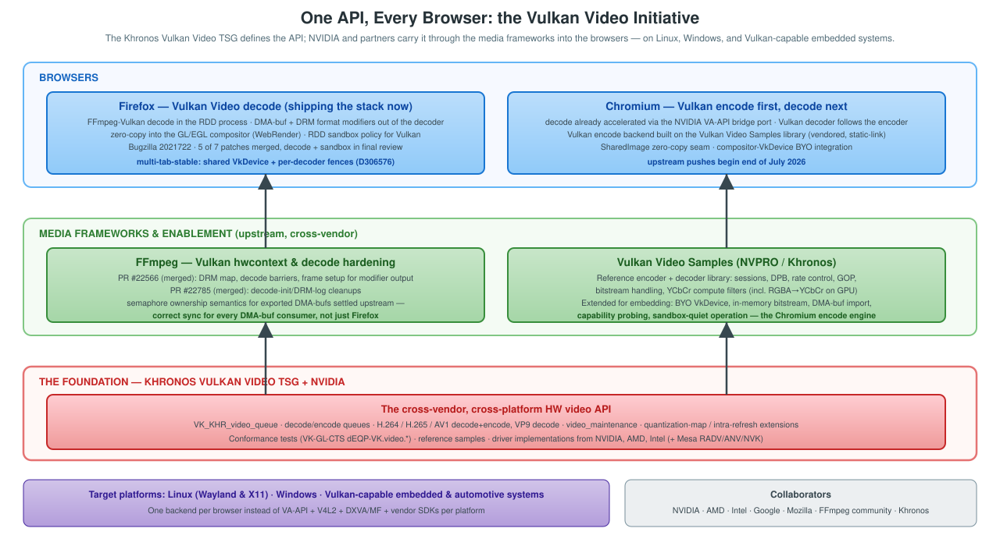
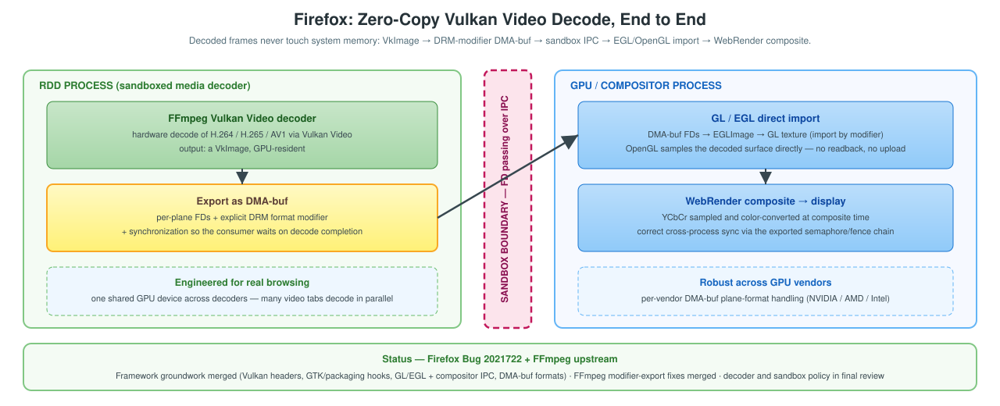
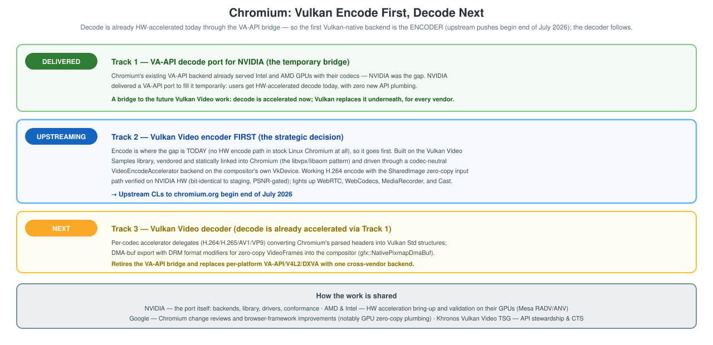

<!--
SPDX-FileCopyrightText: Copyright (c) 2026 NVIDIA CORPORATION & AFFILIATES. All rights reserved.
SPDX-FileCopyrightText: 2026 The Khronos Group, Inc.
SPDX-License-Identifier: Apache-2.0

Licensed under the Apache License, Version 2.0 (the "License");
you may not use this file except in compliance with the License.
You may obtain a copy of the License at

http://www.apache.org/licenses/LICENSE-2.0

Unless required by applicable law or agreed to in writing, software
distributed under the License is distributed on an "AS IS" BASIS,
WITHOUT WARRANTIES OR CONDITIONS OF ANY KIND, either express or implied.
See the License for the specific language governing permissions and
limitations under the License.

This Markdown file is the SOURCE for the blog. Regenerate the styled HTML with:
    python3 build_blog.py blog_vulkan_video_browsers.md blog_vulkan_video_browsers.html
-->
<!--meta
badges: Vulkan Video TSG:vulkan, NVIDIA:nvidia, Firefox:ff, Chromium:chrome
byline: NVIDIA Multimedia · Khronos Vulkan Video TSG · July 2026
footer: Khronos Vulkan Video TSG & NVIDIA · Browser Hardware Video Acceleration Initiative · July 2026
-->

# Bringing Vulkan Video to the Browser

_How the Khronos Vulkan Video TSG and NVIDIA are rebuilding browser hardware video acceleration around one cross-vendor API — with zero-copy pipelines shipping in Firefox and a Vulkan-native encoder headed for Chromium._

Hardware video acceleration in browsers has always been a patchwork. On Linux it means VA-API on some stacks and V4L2 on others; Windows brings DXVA and Media Foundation; embedded platforms add their own vendor SDKs. Every browser carries a backend per API per platform, every vendor maintains a different integration, and entire classes of hardware — NVIDIA GPUs on Linux desktops most visibly — end up with *no* accelerated path at all, burning CPU on software codecs during every video call.

**Vulkan Video** changes that equation: one explicit, cross-vendor, cross-platform API for hardware decode *and* encode, defined by the Khronos Vulkan Video Technical Sub-Group and implemented by NVIDIA, AMD, and Intel drivers (with Mesa's RADV, ANV, and NVK following). The TSG and NVIDIA are not just behind the API — we are carrying it through the media frameworks and into the browsers ourselves, and this post is a tour of that work: what has already merged, what it took, and what lands next.

## The foundation: an API built for exactly this <!--accent:vk-->

Vulkan Video extends the same explicit-GPU philosophy of Vulkan to codec hardware: `VK_KHR_video_queue` plus decode and encode queue extensions, codec operation extensions for H.264, H.265, and AV1 (decode and encode, with VP9 decode alongside), maintenance extensions, and a growing set of encode-quality features — quantization maps, intra-refresh, tuning profiles. It comes with Khronos conformance tests (`dEQP-VK.video.*`) and a reference implementation: the **Vulkan Video Samples** library, which implements the hard parts — session management, DPB tracking, rate control, GOP structure, bitstream assembly, and GPU compute filters for YCbCr conversion.

For applications, the payoff is that video decode, encode, graphics, and compute all live in one API with shared images, shared synchronization primitives, and interop with every window system Vulkan reaches. For browsers specifically, that means a decoded frame can be exported as a DMA-buf with an explicit DRM format modifier, imported by the compositor, and displayed — **without ever touching system memory**. That zero-copy, correctly-synchronized path is the heart of everything below.

## Firefox: shipping the zero-copy decode stack <!--accent:ff-->

Firefox decodes media in a dedicated sandboxed process using FFmpeg. To make Vulkan Video work there, we advanced *both* layers of the stack: FFmpeg's Vulkan decoder now exports its output as a DMA-buf with an explicit DRM format modifier and correct cross-process synchronization, and the Firefox graphics framework imports those buffers directly into its GL/EGL compositor. A decoded frame is produced on the GPU, handed across the sandbox as a file descriptor, and sampled straight into the compositor — **the pixels never touch system memory**.

Getting there took real work in both projects. On the FFmpeg side, modifier-aware DMA-buf export and decode-barrier fixes merged upstream ([#22566](https://code.ffmpeg.org/FFmpeg/FFmpeg/pulls/22566) and [#22785](https://code.ffmpeg.org/FFmpeg/FFmpeg/pulls/22785)). On the Firefox side, a train of patches under [Bug 2021722](https://bugzilla.mozilla.org/show_bug.cgi?id=2021722) brought in the vendored Vulkan headers, the GTK and packaging hooks, the GL/EGL and compositor IPC path so OpenGL can import the decoded surfaces directly, and per-vendor DMA-buf plane-format handling that keeps the import robust across NVIDIA, AMD, and Intel. We also hardened it for real browsing — a single shared GPU device across decoders so many video tabs play in parallel. The framework groundwork is merged; the decoder itself and its sandbox-access policy are in final review.

## Chromium: Vulkan encode first, decode next <!--accent:cr-->

For Chromium we deliberately sequenced the work so users get value at every stage. The project began with detailed planning — integration design documents, a gap analysis of the Vulkan Video Samples library against Chromium's encoder interface, and a five-tier test plan. On the decode side, Chromium's existing VA-API backend already served Intel and AMD GPUs — **NVIDIA GPUs were the gap**. So NVIDIA delivered a **VA-API port as a temporary bridge**: it fills that gap and gives Chromium users on NVIDIA hardware accelerated decode today, through the browser's existing backend.

With decode covered by the bridge, the ordering of the Vulkan-native work follows directly: **encode goes first, decode next**. Encode is where the real gap is — stock Linux Chromium has *no* hardware encode path at all today — while decode already works. So the first Vulkan-native backend to head upstream is the encoder; the Vulkan decoder follows it and, when it lands, retires the VA-API bridge and unifies decode across vendors. The encoder is built directly on the **Vulkan API and the Vulkan Video Samples library** — vendored and statically linked into Chromium the same way libvpx and libaom are, and driven by a codec-neutral `VideoEncodeAccelerator` backend that runs on the compositor's own Vulkan device. A SharedImage-based zero-copy input seam lets frames from the capture and rendering pipelines reach the encoder without CPU copies, and one backend registration lights up every browser encode consumer: WebRTC calls, screen sharing, WebCodecs, MediaRecorder, and Cast.

> **The Chromium timeline and the division of labor.** *Now:* NVIDIA is completing the port — the vendored library, the encode backend, the zero-copy plumbing, and the test tiers. *End of July 2026:* we begin pushing the changes upstream to the Chromium project. *Alongside:* AMD and Intel join on the hardware-acceleration bring-up for their GPUs, and Google supports the effort with change reviews and browser-framework improvements — most importantly the GPU zero-copy infrastructure the encoder plugs into.

## Beyond the browser: one API across the ecosystem <!--accent:vk-->

The browser is the most visible target, but it is one front in a broader effort. The same Vulkan Video API, drivers, conformance tests, and reference library that power these browser integrations are the foundation for hardware video across the entire Vulkan ecosystem — from desktops out to embedded and automotive systems, the way Vulkan graphics already spans that whole range. One conformance-tested API and one set of drivers, reused from an in-vehicle display or a set-top box to a desktop browser, instead of a different codec stack for every platform. The browser work is the leading edge of expanding Vulkan Video the way Vulkan graphics was expanded before it.

## Why this matters

Because video is not a feature of the browser — by traffic volume it **is** most of what a browser does. Video makes up well over half of all internet traffic by most measurements, and nearly every way people produce or consume it runs through a browser engine. Every one of these everyday activities crosses the hardware codec path this initiative accelerates:

- **Playback & streaming** — YouTube, Netflix, Twitch, embedded video everywhere *(decode)*
- **Video conferencing** — Meet, Teams, Zoom, Discord, camera calls all day *(decode + encode)*
- **Screen sharing & collaboration** — presenting a tab, window, or desktop into a call *(encode)*
- **In-browser recording** — Loom-style capture, voice/video notes, interviews *(encode)*
- **Tab & screen casting** — mirroring the browser to TVs and conference rooms *(encode)*
- **Remote desktop & cloud workstations** — Chrome Remote Desktop and friends *(decode + host encode)*
- **Cloud gaming** — GeForce NOW and other browser-delivered game streams *(low-latency decode)*
- **Creator tools & live broadcast** — WebCodecs editors, transcoders, WebRTC/WHIP ingest *(decode + encode)*

Moving encode off the CPU and onto dedicated silicon should show up on every axis that matters to a laptop or a fanless device — processor load, power draw, latency, and the memory traffic of shuttling frames around. We are measuring exactly those KPIs, for an everyday 1080p video call and for the all-GPU tab-recording lane where capture, color conversion, and encode never leave the GPU. Rather than quote numbers before they are measured, here is the scorecard we will fill in — with reproducible figures published alongside the upstream Chromium change lists:

When this work completes, a browser needs *one* video acceleration backend that runs on every GPU vendor and every Vulkan-capable platform — Linux under Wayland and X11, Windows, and the embedded and automotive systems where Vulkan is already the standard graphics API. Video calls stop pegging CPU cores on machines that have dedicated silicon for exactly this job. And because the path from decoder to screen (and from capture to encoder) is zero-copy with explicit synchronization, it is not just accelerated — it is efficient in the way battery-powered and thermally-constrained devices need.

The Khronos Vulkan Video TSG and NVIDIA are committed to this across the stack: the API and conformance tests, the drivers, FFmpeg, the Vulkan Video Samples library, and the browser integrations themselves — with AMD, Intel, Google, Mozilla, and the FFmpeg community as partners in review and bring-up. Watch for the Chromium encoder CLs starting to land upstream at the end of this month.

### References

- Firefox integration: [Bugzilla 2021722](https://bugzilla.mozilla.org/show_bug.cgi?id=2021722)
- FFmpeg: [#22566](https://code.ffmpeg.org/FFmpeg/FFmpeg/pulls/22566) (DRM map / decode barriers / modifier output), [#22785](https://code.ffmpeg.org/FFmpeg/FFmpeg/pulls/22785) (cleanups)
- Chromium design & analysis: [decode design](vulkan_video_integration.html), [encode design](vulkan_video_encode_integration.html), [encoder use cases & zero-copy processing graphs](vulkan_video_encoder_use_cases.html), [test plan](vulkan_video_test_plan.html)
- Khronos Vulkan Video: [khronos.org/vulkan](https://www.khronos.org/vulkan/) · Vulkan Video Samples: [github.com/KhronosGroup/Vulkan-Video-Samples](https://github.com/KhronosGroup/Vulkan-Video-Samples)
